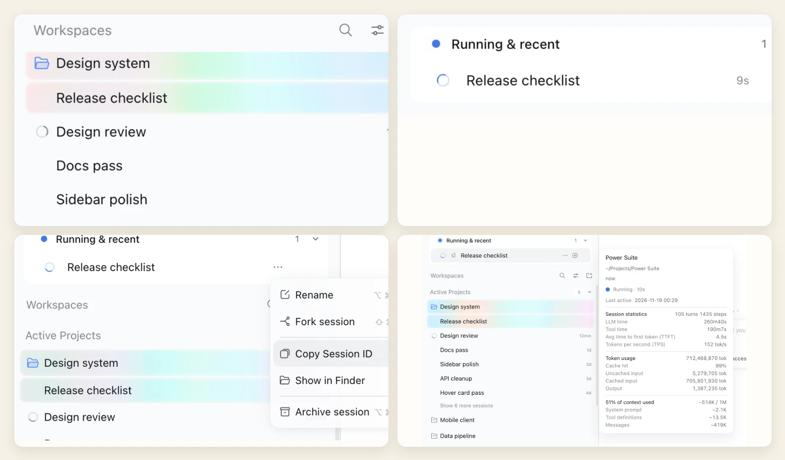

# DSH Power Suite

[](https://www.npmjs.com/package/@zephinel/dsh-power-suite)
[](LICENSE)
[](https://www.npmjs.com/package/@deepseek-ai/dsh)
[](https://github.com/Zephinel/dsh-power-suite/actions/workflows/ci.yml)

**One plugin that makes DSH show the working session, not only the answer.** It adds a Running & recent panel and activity buckets to the sidebar, a Session artifacts browser, prompt recall, draft memory and a multi-image composer gallery, interrupted-session recovery, and point-and-click UI annotation — all as one `power-suite` plugin row.

Install it from npm and start DSH:

```bash
dsh plugin --profile web add @zephinel/dsh-power-suite@0.1.0
dsh web
```

> **Status: `0.1.0` is published on npm.** Install the released bundle with
> `dsh plugin --profile web add @zephinel/dsh-power-suite@0.1.0` (see
> [Install](#install)); the in-app update notice stays silent until a newer
> stable version is published.

[Overview](#overview) · [Session artifacts](#session-artifacts) · [Composer](#composer-prompt-recall-drafts-recovery) · [UI annotation](#ui-element-annotation) · [Features](#features-at-a-glance) · [Install](#install) · [Quick start](#quick-start) · [Get the code](#get-the-code) · [Prerequisites](#prerequisites) · [Build, test and deploy](#build-test-and-deploy) · [Documentation](#documentation) · [Contributing](#contributing)

## Overview

The suite works inside the native shell instead of beside it: it augments the sidebar, the Files pane and the composer with Host-backed state, and adds one annotation surface that never covers the page. Unloading the plugin restores the native surface.



*All screenshots come from a temporary, isolated DSH instance with demo Sessions and demo artifacts; no personal content is involved.*

- **Running & recent, at the top of the sidebar.** The card lists running and recently finished Sessions, nests delegated subagent rows, shows an amber `flag-fill` before the title of a Session waiting on a question, plan review or approval, and paints the current row with its rainbow glow. Hover a row for the native **Session statistics**, **Token usage** and **Context usage** figures.
- **Native row menus.** A top-level row's "…" menu opens the shell's own shared context-menu popup with the native Session actions (Pin is left out): native material, icons, shortcut hints and footer.
- **A width that stays put.** The dragged left sidebar width is a Host-owned preference: it survives reloads and new tabs, matches across every browser paired with the same Host (last write wins), reopens at the stored width after a collapse, and no longer blinks the rainbow atmosphere while the handle is dragged.
- **Read state shared by the Host.** Read marks, card pins and event-sourced last-activity times live on the Host, so they persist across reloads and are shared by every browser on the same Host instead of belonging to one browser's storage.

Read more: [Dynamic Workspaces](https://github.com/Zephinel/dsh-power-suite/blob/main/docs/dynamic-workspaces.md) · [Sidebar width](https://github.com/Zephinel/dsh-power-suite/blob/main/docs/sidebar-width.md) · [Interrupted sessions](https://github.com/Zephinel/dsh-power-suite/blob/main/docs/interrupted-sessions.md).

## Session artifacts

The right Sidebar's **Files** pane header carries an **Artifacts** button. It opens the current Session's list in place: every file the Session created or delivered, plus the images and files you attached to your own prompts.


- **One list, two sources.** Generated files and provided attachments share one list; the header filter switches **All / Generated / Provided** with live counts.
- **Look before you open.** Hover a row for the shared Quick Look: Markdown, highlighted code, images, audio/video, PDF and HTML for generated files, and images, media and text-like files for provided attachments — all in a resizable card.
- **The actions you need on a file.** Open, download, copy content (text verbatim; images as a real clipboard picture in a secure context), and copy the authenticated LAN link.
- **The same preview in the Workspace tree.** The native Workspace files list gets the same Quick Look row, so files preview the same way in both places.

Read more: [Session artifacts](https://github.com/Zephinel/dsh-power-suite/blob/main/docs/session-artifacts.md).

## Composer: prompt recall, drafts, recovery

The composer keeps the work around the prompt: what you asked before, what you attached, and what happened when a turn did not finish.


- **Prompt history.** The configured modifier + ↑/↓ recalls prompts already sent in this Session; plain arrows keep their native behavior. A rail at the conversation's right edge lists the same prompts as ticks, oldest first, with timestamps, a full-text hover preview, an inline search and click-to-copy.
- **Draft attachments survive Session switches.** Pasted, dropped or picked files stay with the draft when you open another Session and come back, for the page lifetime — the shell itself persists only the draft text.
- **A viewer for pasted screenshots.** When the composer holds two or more pasted images, clicking one opens a continuous `N / M` viewer instead of the native single-image lightbox: previous/next buttons and ←/→ keys, one-step mouse-wheel navigation, Esc/backdrop/close returning focus to the thumbnail, and clamping when an image is removed while it is open (removing all closes it). A single image keeps the native lightbox.


- **Interrupted Sessions are marked and recoverable.** A Session whose last turn did not finish gets an amber title mark, a hover-revealed inline **Continue** triangle and a play-shaped composer submit control. Continuing is implicit and Host-owned, and an SSE stream keeps open pages in sync across devices.
- **Settings in one place.** The bundle's Plugins page holds the prompt-history modifier and the two retention windows for the Active/recent surfaces.

Read more: [Prompt history](https://github.com/Zephinel/dsh-power-suite/blob/main/docs/prompt-history.md), [draft attachments](https://github.com/Zephinel/dsh-power-suite/blob/main/docs/draft-attachments.md), [composer image gallery](https://github.com/Zephinel/dsh-power-suite/blob/main/docs/usage.md#composer-image-gallery), [interrupted sessions](https://github.com/Zephinel/dsh-power-suite/blob/main/docs/interrupted-sessions.md).

## UI element annotation

A round launcher at the bottom-right of the page toggles a point-and-click annotation mode. The page makes room for a narrow right rail instead of being covered.


- **Point at the element.** Hovering outlines the element a click would select, including floating surfaces such as native hover preview cards, which can be drilled into. The popover carries the locator summary, live status, parent/child adjustment and the requested change.
- **The note stays with the page.** Each annotation becomes a persisted record with a page marker, a numbered requirement badge and a hover detail card; edit the requirement, relocate the target, copy the locator, or delete with a 5 s undo.
- **Send it as a reference, not prose.** References are inserted as native composer inline reference chips — one chip or one grouped batch — without sending. The rail's collection view edits, previews, reorders and batch-inserts annotations, with multi-select, marquee, ancestor adjustment and a pass-through modifier.

Read more: [UI element annotation](https://github.com/Zephinel/dsh-power-suite/blob/main/docs/ui-annotation.md).

## Features at a glance

| Feature | What it adds |
|---|---|
| [Dynamic Workspaces](https://github.com/Zephinel/dsh-power-suite/blob/main/docs/dynamic-workspaces.md) | Active/Inactive activity buckets, the Running & recent card with Host-shared pinning and subagent rows, the native row menu, pending-interaction flags and the rainbow current row. |
| [Session artifacts](https://github.com/Zephinel/dsh-power-suite/blob/main/docs/session-artifacts.md) | The Files-pane Artifacts list for generated files and provided attachments, with Quick Look, open/download/copy actions and the All/Generated/Provided filter. |
| [UI element annotation](https://github.com/Zephinel/dsh-power-suite/blob/main/docs/ui-annotation.md) | Point-and-click annotation with a right rail, persisted page markers, a collection view and native composer reference chips. |
| [Prompt history](https://github.com/Zephinel/dsh-power-suite/blob/main/docs/prompt-history.md) | Modifier + ↑/↓ recall plus a right-edge history rail with preview, search and click-to-copy. |
| [Draft attachments](https://github.com/Zephinel/dsh-power-suite/blob/main/docs/draft-attachments.md) | Browser-owned attachment memory across Session switches for the page lifetime. |
| [Composer image gallery](https://github.com/Zephinel/dsh-power-suite/blob/main/docs/usage.md#composer-image-gallery) | A continuous N/M viewer for two or more pasted composer images, with keys/wheel navigation, focus return, removal clamping and native behavior for a single image. |
| [Interrupted sessions](https://github.com/Zephinel/dsh-power-suite/blob/main/docs/interrupted-sessions.md) | An amber mark, inline Continue and a play-shaped submit control for turns that did not finish, with Host-owned cross-device state. |
| [Sidebar width](https://github.com/Zephinel/dsh-power-suite/blob/main/docs/sidebar-width.md) | A Host-owned, durable left-sidebar width shared across browsers, restored after a collapse, with a flicker-free rainbow repaint. |
| [Workspace presets](https://github.com/Zephinel/dsh-power-suite/blob/main/docs/workspace-default-presets.md) | A Workspace context-menu submenu that sets the default agent preset for new Sessions in that Workspace. |
| [Settings](https://github.com/Zephinel/dsh-power-suite/blob/main/docs/settings.md) | The bundle's Plugins-page section: the prompt-history modifier and the two retention windows. |
| [Update notice](https://github.com/Zephinel/dsh-power-suite/blob/main/docs/update-check.md) | A bottom-right Host-checked notice for a newer published version, with the version change and release highlights; silent until a newer version is published. |

The features ship in the single bundle `@zephinel/dsh-power-suite` (Loader row `power-suite`), so they install, enable and uninstall together. The browser half attaches to the Web platform only.

## Install

The bundle is `@zephinel/dsh-power-suite` (Loader row `power-suite`). Install it into a DSH profile, then reload the plugin or restart the Web process so the Host half loads — a page refresh is not enough for Host code.

**From npm:**

```bash
dsh plugin --profile web add @zephinel/dsh-power-suite@0.1.0
```

Or use the in-app route: **Plugins** in the Web sidebar → **Add plugin** → enter `@zephinel/dsh-power-suite@0.1.0` → **Install** → **Enable now**.

**From this checkout (development):** in the **Plugins** page choose **Add plugin** → **Install a third-party plugin** and enter the checkout's absolute path. From an agent session the same install is:

```text
plugin_manager action=install_bundle target=/absolute/path/to/dsh-power-suite
```

The profile keeps a local checkout as a `link:` dependency, so the checkout is the code the Host runs after `npm run build` and a reload; removing the bundle removes the plugin.

Installation needs `pnpm` on `PATH`: `dsh plugin add` forwards to pnpm in the profile, and the Plugins page runs pnpm behind its install dialog.

## Quick start

Start (or restart) DSH and open the URL it prints:

```bash
dsh web
```

1. Expand the left sidebar: **Running & recent** sits above the native Workspaces header, and the Workspace list is split into **Active Projects** and **Inactive Projects**.
2. Open a Session with at least two turns that has sent prompts: the prompt-history rail appears below the native turn rail, and the modifier + ↑/↓ recalls earlier prompts in the composer (one-turn Sessions keep the keyboard recall but have no native rail column to host the ticks).
3. Open **Files** in the right sidebar and click **Artifacts** to list what the Session produced and what you attached.
4. Click the round launcher at the bottom-right: the page narrows, and hovering outlines the element a click would annotate.
5. Open the bundle's page under **Plugins** for its settings: the prompt-history modifier and the two retention windows.

The address and port come from the DSH profile. After a browser-code change, refresh the page; after a Host-code change, reload the plugin or restart the Web process.

## Get the code

The publishing target is GitHub:

```bash
git clone https://github.com/Zephinel/dsh-power-suite.git
cd dsh-power-suite
```

There is no runtime dependency. Run `npm ci` once to install the esbuild/TypeScript dev dependencies, then `npm run build` to produce the gitignored `lib/` entries (`npm run check` builds for you); `npm test` runs without the build.

## Prerequisites

- **DSH 0.2.2 plugin interface** — the Host and browser halves target DSH 0.2.2. The Web Host used for this repository's browser checks runs **0.2.2-rc.1**; later DSH versions are unverified. Install the CLI with `npm install -g @deepseek-ai/dsh`.
- **Node.js 22.18 or newer** — `package.json` declares `engines.node >= 22.18` (the test suite imports the TypeScript sources through Node's native type stripping); the CI gate runs on Node 22 and 24. Run `npm ci` once for esbuild and the typecheck tooling.
- **pnpm** — needed to install profile bundles: `dsh plugin add` forwards to it, and the in-app Plugins page runs it behind its dialog.
- **Git** — needed only to get the code; the repository sets no minimum version.
- **Google Chrome** (optional) — only for the local browser suites; they use the standard macOS Chrome path and accept `CHROME_BIN` elsewhere.

Confirm the tools are present:

```bash
node --version   # v22 or newer
dsh --version    # verified: 0.2.2-rc.1
pnpm --version
git --version
```

Verified platform: macOS with DSH Web 0.2.2-rc.1. The plugin itself is a Web-platform bundle; other platforms are unverified.

## Build, test and deploy

The build bundles `src/index.ts` and `src/client.js` into the gitignored `lib/` entries with esbuild; there are no runtime dependencies. Run the commands below from the checkout root.

| Command | Purpose |
|---|---|
| `npm run build` | `node scripts/build.mjs` — esbuild bundles `src/` into the gitignored `lib/index.js` (Host ESM) and `lib/client.js` (browser entry: ESM source plus `src/browser/` modules, bundled to a classic script); `prepare` runs it before `npm pack`/`npm publish`. |
| `npm test` | `node --test test/*.test.js` — pure-logic tests importing the TypeScript Host sources through Node's native type stripping (Node 22.18+; no build needed). |
| `npm run typecheck` | `tsc --noEmit` — no-emit **strict** TypeScript check over the Host and browser sources; the browser DOM profile is a second zero-diagnostic gate. |
| `npm run check` | The full gate: builds the entries, then runs syntax, typecheck, package manifest, docs links, Node tests and the release-notes check, then `pack:check`. |
| `npm run pack:check` | `npm pack --dry-run --json` — inspect the published file list. |
| `npm run check:release-notes` | Validate the tag-pinned release highlights for the package version. |
| `npm run check:docs-links` | Verify that local Markdown links and images resolve. |
| `npm run build:readme-bento` | Compose the README Bento images from local captures (needs Chrome). |

The browser acceptance suites drive the real running DSH UI in a throwaway headless Chrome profile:

```bash
node test/browser/sidebar.e2e.mjs --smoke      # sidebar surfaces
node test/browser/annotation.e2e.mjs --smoke   # UI element annotation
node test/browser/update-prompt.e2e.mjs        # update notice
```

They need a running DSH Web and Chrome, and run one at a time; environment variables, per-mode checks and the full option list are in the [browser harness guide](https://github.com/Zephinel/dsh-power-suite/blob/main/test/browser/README.md). CI has no browser job — these are local pre-release checks.

**Deploy** means installing the bundle into the target DSH profile; there is no separate server or watch mode. The local install/reload loop and the tag-publish procedure (Trusted Publishing on a `v*` tag) are in [docs/development.md](https://github.com/Zephinel/dsh-power-suite/blob/main/docs/development.md).

## Documentation

Detailed docs live in `docs/` and ship with the package; the links below use
absolute GitHub URLs so they stay clickable from the npm README as well. Start
with the [full documentation index](https://github.com/Zephinel/dsh-power-suite/blob/main/docs/README.md).

**Concepts**

- [Architecture](https://github.com/Zephinel/dsh-power-suite/blob/main/docs/architecture.md) — Host and browser halves, routes, slots, services and settings documents.
- [Usage](https://github.com/Zephinel/dsh-power-suite/blob/main/docs/usage.md) — what each feature does in the UI, step by step.
- [Feature inventory](https://github.com/Zephinel/dsh-power-suite/blob/main/docs/overview.md) — the full inventory plus the recipe for adding a feature.

**Feature reference**

- [Dynamic Workspaces](https://github.com/Zephinel/dsh-power-suite/blob/main/docs/dynamic-workspaces.md) · [Sidebar width](https://github.com/Zephinel/dsh-power-suite/blob/main/docs/sidebar-width.md) · [Session artifacts](https://github.com/Zephinel/dsh-power-suite/blob/main/docs/session-artifacts.md) · [Prompt history](https://github.com/Zephinel/dsh-power-suite/blob/main/docs/prompt-history.md) · [Draft attachments](https://github.com/Zephinel/dsh-power-suite/blob/main/docs/draft-attachments.md) · [Interrupted sessions](https://github.com/Zephinel/dsh-power-suite/blob/main/docs/interrupted-sessions.md) · [UI element annotation](https://github.com/Zephinel/dsh-power-suite/blob/main/docs/ui-annotation.md) · [Workspace presets](https://github.com/Zephinel/dsh-power-suite/blob/main/docs/workspace-default-presets.md) · [Settings](https://github.com/Zephinel/dsh-power-suite/blob/main/docs/settings.md) · [Update notice](https://github.com/Zephinel/dsh-power-suite/blob/main/docs/update-check.md)

**Development and verification**

- [Development](https://github.com/Zephinel/dsh-power-suite/blob/main/docs/development.md) — local install/reload loop, checks, the README capture and Bento pipeline, release flow.
- [Verification](https://github.com/Zephinel/dsh-power-suite/blob/main/docs/verification.md) — the checks and evidence for this checkout.
- [Limitations](https://github.com/Zephinel/dsh-power-suite/blob/main/docs/limitations.md) — known bounds and unverified areas.
- [Browser harness](https://github.com/Zephinel/dsh-power-suite/blob/main/test/browser/README.md) — the live-GUI acceptance suites, their modes and evidence.
- [Changelog](https://github.com/Zephinel/dsh-power-suite/blob/main/CHANGELOG.md) — release entries; the current published release is 0.1.0.
- [Release notes](https://github.com/Zephinel/dsh-power-suite/blob/main/release-notes/README.md) — the tag-pinned Highlights format read by the update notice.

## Contributing

- Bugs and feature requests go to [GitHub Issues](https://github.com/Zephinel/dsh-power-suite/issues).
- Run `npm run check` before proposing a change. Host logic lives in `src/features/<name>/` behind tests under `test/`, and each feature has a page under `docs/`; [docs/development.md](https://github.com/Zephinel/dsh-power-suite/blob/main/docs/development.md) documents the feature recipe, the commit conventions and the release flow.
- Behavior, copy or gate changes need the matching docs updated too: the feature reference, `CHANGELOG.md` and `docs/verification.md`; the docs-sync procedure is `.agents/skills/sync-power-suite-docs/SKILL.md`.
- Releases are cut from a tag by the publish workflow. Never run `npm publish` locally; the maintainer procedure is `.agents/skills/release-power-suite/SKILL.md`.
- Maintainer: [@Zephinel](https://github.com/Zephinel).

## License

[MIT](LICENSE). Third-party notices are in [NOTICE](NOTICE): Remix Icon SVG path data inlined in the browser entry (Apache-2.0), and the DeepSeek Harness platform disclaimer.
