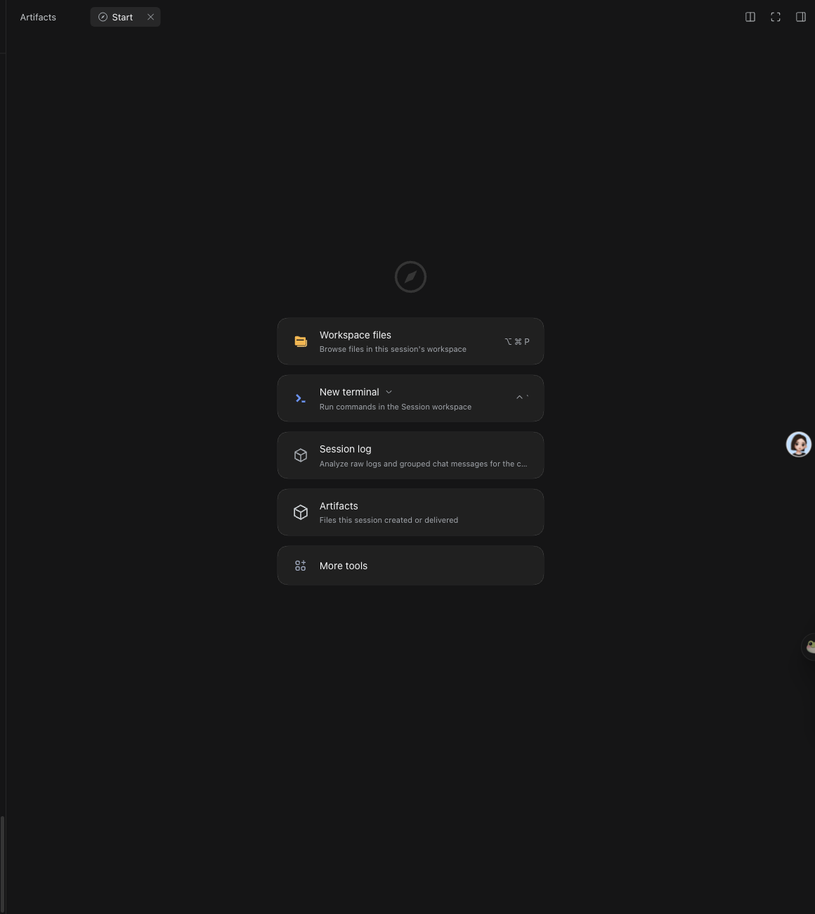

# DSH Power Suite

One installable plugin for the DeepSeek Harness Web GUI that adds a small suite
of workday improvements around the conversation.

The installable unit is a single bundle, `@zephinel/dsh-power-suite` (Loader row
`power-suite`). Its features are modules inside the package, so the Plugin list
shows one plugin whose inventory grows with the suite.

| Feature | What it adds |
|---|---|
| [Session artifacts](docs/session-artifacts.md) | An **Artifacts** card in the right Sidebar's Start page listing the current Session's created and delivered files **and the images/files the user attached to their prompts**, with 40 px image thumbnails, an All/Generated/Provided dropdown filter in the panel header, native open, download, copy content (text verbatim; images as a real clipboard picture in a secure context, with an HTML-image fallback on plain HTTP), and LAN link copy. |
| [Workspace presets](docs/workspace-default-presets.md) | A Workspace context-menu submenu that sets the default agent preset for new Sessions created in that Workspace. |
| [Dynamic Workspaces](docs/dynamic-workspaces.md) | The native Workspaces browser gains **Active Projects** and **Inactive Projects** buckets that follow running and recently active Sessions, plus a **Running & recent** card above the native header with a fixed trailing grid (time → New session action → disclosure; subagent rows have no New session), a card-owned **Host-shared pin** (title-left pin button with two-phase hover reveal; pinned rows lead newest-activity-first and never retire, with a subtle violet single-layer tint), a **"…" row menu** on top-level rows that renders the shell's native Session actions without the Pin/Unpin entry (native labels plus local action glyphs, no native shortcut hints; every top-level row swaps its time for the trigger on hover/focus and restores it on leave; the trigger keeps the ordinary hover paint and only the rainbow row suppresses it), a preview-only **pending-interaction notice stack** beside the card for Sessions waiting on a question, plan review, or approval (clicking opens the Session; answering stays in the native composer card), Host-shared read marks, event-sourced Host last-activity times, a breathing rainbow glow on the current row's bottom edge and its owning Workspace row, a native-style row hover card carrying status plus the native **Session statistics / Token usage / Context usage** figures, nested subagent Sessions, and configurable retention windows. |
| [Prompt history](docs/prompt-history.md) | The configured modifier + ↑/↓ recalls prompts already sent in this Session; a right-edge rail lists them newest first with a hover full-text preview, an inline search, and click-to-copy. Plain arrows keep their original behavior. |
| [Draft attachments](docs/draft-attachments.md) | Attachments in a draft (pasted images, dropped or picked files) survive switching Sessions and coming back, for the page lifetime; the shell only persists the draft text. |
| [Interrupted sessions](docs/interrupted-sessions.md) | Sessions that did not finish — restart/crash, any provider/model/network error (quota, timeout, rate limit), an output limit, or an imported unknown cancellation — carry an amber mark left of the title, a hover-revealed inline Continue triangle in the status cell (title shifts right, no hover mask), and a play-shaped composer submit control; deliberate cancellations and completed turns stay unmarked. State is Host-owned and cross-device: a Host SSE stream invalidates open pages immediately on turn boundaries, with polling as fallback. |
| [Update notice](docs/update-check.md) | Once per page load the bundle asks its Host route whether npm has a newer stable release; when one exists, a fixed bottom-right card (`shell.overlay`, no sidebar DOM) shows the version change and up to six release highlights, with **更新** (opens the bundle's Plugin page so DSH performs the update), **下次再说** (counted per version; after three, **不再提醒** silences that version), and expand/collapse. No auto-update, no cross-device state, and it stays silent until the package is published. |
| [UI element annotation](docs/ui-annotation.md) | A floating launcher toggles a point-and-click annotation mode in which the page makes room for a narrow right rail instead of being covered. Hovering outlines the element a click would select — including floating surfaces such as native hover preview cards, which can also be drilled into — and each annotation becomes a persisted v2 record (verified unique selector, Session/Workspace identity, position) shown as a page marker with a requirement badge and a hover detail card. References are inserted as **native composer inline reference chips** (single or one grouped batch) without sending, and the right rail's collection view edits, previews, reorders, and batch-inserts annotations — with multi-select, marquee, ancestor adjustment, and a hold-to-pass-through modifier. |
| [Settings](docs/settings.md) | The bundle's Plugins page carries its own configuration section: the prompt-history modifier plus the two Dynamic Workspaces retention windows (finished Sessions and Active projects). |

First public release: 0.1.0 (planned). The package has never been published
before: the `0.1.0` (2026-11-09), `0.1.1` (2026-11-11), and undated `0.2.0`
development snapshots were internal only — never tagged, never released — and
their history is consolidated into this first release (see
[CHANGELOG.md](CHANGELOG.md)). The release is cut by pushing the `v0.1.0` tag
once the bilingual [release notes](release-notes/README.md) are approved; until
then npm has no `latest` version for the package and the in-app update notice
stays silent.

Highlights of the first release:

- **Dynamic Workspaces** — the shipped Workspaces browser is augmented, never
  replaced: Active/Inactive buckets follow the running and recent Sessions live,
  fold independently with persisted state, and hide in rail mode, while a
  **Running & recent** card above the native header lists running and recently
  finished Sessions as single-line rows, nests delegated subagent Sessions under
  their parent, marks unread completions green until opened, and shows status
  plus the native Session statistics / token / context figures on hover. A
  title-left pin button (Host-shared, with a two-phase reveal) keeps main
  Sessions pinned first and past the retention window, while a "…" row menu offers the shell's
  Rename/Fork/Copy Session ID/Show in Finder/Archive actions without Pin. Every
  top-level row (the current rainbow row included) keeps its time at rest and
  swaps it for the "…" trigger on hover/focus; the trigger keeps the ordinary
  hover paint (only the rainbow row suppresses it), and leaving restores the time. Sessions waiting on a question, plan review, or approval raise a
  preview-only notice beside the card. Read marks and last-activity times are
  Host-shared, the current row carries a rainbow atmosphere, and both retention
  windows are settings on the bundle's Plugins page.
- **Prompt history** — the configured modifier + ↑/↓ recalls prompts already sent
  in this Session; a right-edge rail lists them oldest first with a full-text
  hover preview, an inline search, per-prompt timestamps, and click-to-copy.
  Draft attachment memory keeps pasted/dropped files across Session switches for
  the page lifetime.
- **Session artifacts** — the right Sidebar's Start page carries an **Artifacts**
  card listing the current Session's created and delivered files **and the
  images/files you attached to your prompts**, de-duplicated by attachment id
  with 40 px lazy thumbnails, an All/Generated/Provided dropdown filter, open,
  download, copy content (text verbatim; images as a real clipboard picture in a
  secure context), LAN-link copy, and a hover Quick Look.
- **Interrupted sessions** — Sessions whose last turn did not finish (restart/
  crash, any provider/model/network error, an output limit, or an imported
  unknown cancellation) carry an amber title mark, a hover-revealed inline
  Continue triangle, and a play-shaped composer submit control; Continue is
  implicit and Host-owned, and an SSE stream keeps every tab in sync.
- **UI element annotation** — a round launcher toggles a point-and-click
  annotation mode in which the page makes room for a responsive right rail
  instead of being covered: hovering outlines the element a click would select
  (including floating surfaces such as native hover preview cards, which can be
  drilled into), and a compact popover records the requested change. Each
  annotation becomes a persisted record with a page marker, a numbered
  requirement badge, and a hover detail card; references are inserted as native
  composer inline reference chips — one per reference or one grouped batch —
  without sending, and multi-select, marquee, and a pass-through modifier are
  included.
- **Update notice (new)** — the Host reads the npm `latest` dist-tag and the
  tag-pinned release notes; every page load checks at most once and shows a
  bottom-right card when a newer stable version exists, with the version change,
  up to six Highlights, **更新** (opens the Plugin page; DSH performs the
  update), **下次再说** (counted per version; after three, **不再提醒** silences
  that version), and Escape/outside-click as "later". State is per browser; the
  card inserts no sidebar DOM and stays silent while 0.1.0 is the latest
  version.
- **Workspace presets and settings** — a Workspace context-menu submenu sets the
  default agent preset for new Sessions in that Workspace, and the bundle's
  Plugins page carries the prompt-history modifier plus the two Dynamic
  Workspaces retention windows.

The same plugin adds a shared **hover preview** to Artifacts rows (generated
files plus provided images and text-like attachments) and the native Workspace
files tree: Markdown, highlighted code, images, audio/video, PDF, and HTML, with
drag-to-resize and animated switching. The card opens at a 570 x 360 default so
its content is visible on the first hover.





## Install

The bundle is `@zephinel/dsh-power-suite` (Loader row `power-suite`). Install a
published release from npm:

```text
plugin_manager action=install_bundle target=@zephinel/dsh-power-suite
```

For development, install the checkout as a local `link:` bundle instead:

```text
plugin_manager action=install_bundle target=/Users/rexxin/Development/dsh-power-suite
```

The profile keeps a local checkout as a `link:` dependency, so an edited
checkout is the code the Host runs after a reload. Removing the bundle removes
the plugin.

Changes are profile-wide and survive restarts. After changing Host code, reload
the plugin (or restart the Host process); after changing browser code, reload
the Web page.

## Repository layout

```text
.
├── package.json             # bundle manifest, exports, checks
├── cordis.patch.yml         # inserts the single `power-suite` row
├── src/
│   ├── index.js             # Host entry: installs each feature
│   ├── client.js            # browser entry: one `#region feature: <name>` per feature
│   └── features/<name>/     # Host-side feature modules
├── locale/                  # plugin display metadata (en, zh)
├── docs/                    # architecture, guides, per-feature reference
├── release-notes/           # tag-pinned Highlights read by the update notice
├── scripts/check.mjs        # syntax + package-manifest + release-notes checks
├── test/                    # node:test pure-logic tests
└── .github/workflows/       # CI (verify + tag-triggered publish)
```

## Development

No build step is required: the package exports its ES modules directly.

```bash
npm test               # node --test test/*.test.js
npm run check          # syntax + manifest + release-notes gate + tests + pack:check
npm run pack:check     # inspect the published file list
npm run check:release-notes  # validate the release-notes Highlights for the package version
```

See [docs/development.md](docs/development.md) for the local install/reload loop
and the release flow, and [docs/architecture.md](docs/architecture.md) for the
Host/Client contracts.

## Documentation

- [Architecture](docs/architecture.md) — Host and browser halves, routes, slots, settings.
- [Usage](docs/usage.md) — what each feature does in the UI.
- [Update notice](docs/update-check.md) — behavior, route contract, cache rules, prompt state, release-notes source.
- [Development](docs/development.md) — install, reload, tests, release flow, adding a feature.
- [Verification](docs/verification.md) — the checks and evidence for this checkout.
- [Limitations](docs/limitations.md) — known bounds and unsupported cases.
- [Feature reference](docs/overview.md) — the feature inventory and addition recipe.
- [Release notes](release-notes/README.md) — the tag-pinned Highlights format used by the update notice.

## License

[MIT](LICENSE). Third-party notices are in [NOTICE](NOTICE).
