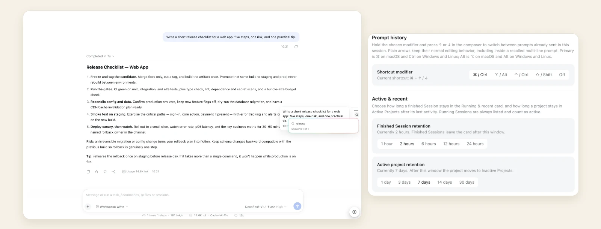
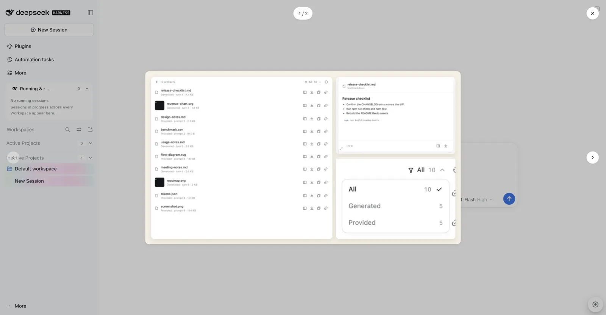

# DSH Power Suite

English | [中文](README.zh.md)

[](https://www.npmjs.com/package/@zephinel/dsh-power-suite)
[](LICENSE)
[](https://www.npmjs.com/package/@deepseek-ai/dsh)
[](https://github.com/Zephinel/dsh-power-suite/actions/workflows/ci.yml)

**One plugin that makes DeepSeek Harness (DSH) show the working session, not only the answer.** It augments the native Web shell with a Running & recent panel and activity buckets, a Session artifacts browser, prompt history, draft attachment memory, a multi-image composer gallery, interrupted-session recovery, and point-and-click UI annotation — all as one `power-suite` plugin row.


*All screenshots come from a temporary, isolated DSH instance with demo Sessions and demo artifacts; no personal content is involved.*

> **Current status**: `@zephinel/dsh-power-suite@0.2.1` is published on npm (Web platform only); recent visual refinements shown above — including the colored smoke atmosphere and title-colour highlighted icons — are on `main` for the next release. See [CHANGELOG](https://github.com/Zephinel/dsh-power-suite/blob/main/CHANGELOG.md).

[Install](#install) · [Overview](#overview) · [Features](#features-at-a-glance) · [Quick start](#quick-start) · [Documentation](#documentation) · [Local development](#get-the-code-and-local-development)

## Install

Install from npm (requires `pnpm` on `PATH`), then reload the plugin or restart DSH Web so the Host half loads:

```bash
dsh plugin --profile web add @zephinel/dsh-power-suite@0.2.1
dsh web
```

Or install in the Web UI via **Plugins → Add plugin → `@zephinel/dsh-power-suite@0.2.1` → Install → Enable now**. Local checkout installation (`link:` dependency) and release steps live in [docs/development.md](https://github.com/Zephinel/dsh-power-suite/blob/main/docs/development.md).

## Overview

The suite works inside the native shell instead of beside it; unloading the plugin restores the native surface.

- **Running & recent, at the top of the sidebar.** Lists running and recently finished Sessions, nests delegated subagent rows, marks Sessions waiting on a question, plan review or approval with an amber `flag-fill`, and highlights the active row with its colored smoke glow. Hover a row for native **Session statistics**, **Token usage** and **Context usage**.
- **Native row menus.** A top-level card row's "…" menu opens the shell's shared context-menu popup with the native Session actions (Pin is left out): native material, icons and shortcut hints.
- **Host-shared state and sidebar width.** Read marks, card pins, last-activity times and the dragged left sidebar width are owned by the Host, surviving reloads and syncing across browsers on the same Host.

Read more: [Dynamic Workspaces](https://github.com/Zephinel/dsh-power-suite/blob/main/docs/dynamic-workspaces.md) · [Sidebar width](https://github.com/Zephinel/dsh-power-suite/blob/main/docs/sidebar-width.md) · [Interrupted sessions](https://github.com/Zephinel/dsh-power-suite/blob/main/docs/interrupted-sessions.md).

## Session artifacts

The right Sidebar's **Files** pane header carries an **Artifacts** button opening the current Session's generated files and provided attachments in one list.


- **One list, two sources.** Filter **All / Generated / Provided** with live counts.
- **Shared Quick Look.** Hover a row (in Artifacts or the native Workspace tree) for a resizable preview of Markdown, highlighted code, images, audio/video, PDF and HTML.
- **File actions.** Open, download, copy verbatim text or clipboard images (in a secure context), and copy the authenticated LAN link.

Read more: [Session artifacts](https://github.com/Zephinel/dsh-power-suite/blob/main/docs/session-artifacts.md).

## Composer: prompt recall, drafts, recovery

The composer keeps the work around the prompt: what you asked before, what you attached, and turns that did not finish.



- **Prompt history.** Modifier + ↑/↓ recalls earlier prompts in this Session while plain arrows stay native. A right-edge rail lists sent prompts oldest-first with timestamps, hover preview, inline search and click-to-copy.
- **Draft attachments & multi-image gallery.** Pasted, dropped or picked files survive Session switches for the page lifetime; clicking any thumbnail when two or more images are attached opens a continuous `N / M` viewer with arrow/wheel navigation and focus return (single images keep the native lightbox).



- **Interrupted-session recovery & settings.** Unfinished turns get an amber title mark, hover **Continue** triangle and play-shaped submit button backed by Host SSE sync. Prompt-history modifier and retention windows live on the bundle's **Plugins** page.

Read more: [Prompt history](https://github.com/Zephinel/dsh-power-suite/blob/main/docs/prompt-history.md) · [Draft attachments](https://github.com/Zephinel/dsh-power-suite/blob/main/docs/draft-attachments.md) · [Composer image gallery](https://github.com/Zephinel/dsh-power-suite/blob/main/docs/usage.md#composer-image-gallery) · [Interrupted sessions](https://github.com/Zephinel/dsh-power-suite/blob/main/docs/interrupted-sessions.md).

## UI element annotation

A round launcher at the bottom-right toggles point-and-click annotation; the page narrows for a right rail instead of being covered.


- **Point & drill into surfaces.** Hover outlines elements including floating hover cards; the popover offers locator summary, parent/child stepping and requirement editing.
- **Persisted markers & native chips.** Annotations persist as numbered page markers (with edit, go to element, copy locator and 5 s undo) and insert into the composer as native inline reference chips — single or batched — without sending.

Read more: [UI element annotation](https://github.com/Zephinel/dsh-power-suite/blob/main/docs/ui-annotation.md).

## Features at a glance

| Feature | Reference |
| --- | --- |
| Dynamic Workspaces (Active/Inactive buckets, Running & recent, flags, pins, native menu) | [docs/dynamic-workspaces.md](https://github.com/Zephinel/dsh-power-suite/blob/main/docs/dynamic-workspaces.md) |
| Session artifacts & shared Quick Look | [docs/session-artifacts.md](https://github.com/Zephinel/dsh-power-suite/blob/main/docs/session-artifacts.md) |
| UI element annotation & native composer reference chips | [docs/ui-annotation.md](https://github.com/Zephinel/dsh-power-suite/blob/main/docs/ui-annotation.md) |
| Prompt history, draft attachments & composer image gallery | [docs/prompt-history.md](https://github.com/Zephinel/dsh-power-suite/blob/main/docs/prompt-history.md) · [docs/draft-attachments.md](https://github.com/Zephinel/dsh-power-suite/blob/main/docs/draft-attachments.md) · [docs/usage.md](https://github.com/Zephinel/dsh-power-suite/blob/main/docs/usage.md#composer-image-gallery) |
| Interrupted-session recovery (Host-owned SSE sync) | [docs/interrupted-sessions.md](https://github.com/Zephinel/dsh-power-suite/blob/main/docs/interrupted-sessions.md) |
| Host-synced sidebar width, workspace default presets, settings & update notice | [docs/sidebar-width.md](https://github.com/Zephinel/dsh-power-suite/blob/main/docs/sidebar-width.md) · [docs/workspace-default-presets.md](https://github.com/Zephinel/dsh-power-suite/blob/main/docs/workspace-default-presets.md) · [docs/settings.md](https://github.com/Zephinel/dsh-power-suite/blob/main/docs/settings.md) · [docs/update-check.md](https://github.com/Zephinel/dsh-power-suite/blob/main/docs/update-check.md) |

All features ship together in `@zephinel/dsh-power-suite` (Loader row `power-suite`, Web platform only).

## Quick start

1. Expand the left sidebar: **Running & recent** sits above **Workspaces**, split into **Active Projects** and **Inactive Projects**.
2. Open a Session with at least two sent prompts: the prompt-history rail appears on the right edge, and modifier + ↑/↓ recalls earlier prompts.
3. Open **Files → Artifacts** in the right sidebar to browse and Quick Look generated files and provided attachments.
4. Click the round bottom-right launcher to annotate elements and insert native reference chips.
5. Configure the prompt-history modifier and retention windows under **Plugins → DSH Power Suite**.

## Documentation

All detailed docs ship in `docs/` (links use absolute GitHub URLs so they stay clickable on npm):

| Document | What it covers |
| --- | --- |
| [Full documentation index](https://github.com/Zephinel/dsh-power-suite/blob/main/docs/README.md) · [Usage](https://github.com/Zephinel/dsh-power-suite/blob/main/docs/usage.md) | Step-by-step UI guide and complete feature-doc directory |
| [Architecture](https://github.com/Zephinel/dsh-power-suite/blob/main/docs/architecture.md) · [Feature inventory](https://github.com/Zephinel/dsh-power-suite/blob/main/docs/overview.md) | Host/browser halves, routes, slots, services and feature recipe |
| [Development](https://github.com/Zephinel/dsh-power-suite/blob/main/docs/development.md) · [Browser harness](https://github.com/Zephinel/dsh-power-suite/blob/main/test/browser/README.md) | Local install/reload loop, full command reference, live-GUI browser suites and release flow |
| [Limitations](https://github.com/Zephinel/dsh-power-suite/blob/main/docs/limitations.md) | Known bounds and unverified areas |
| [Verification](https://github.com/Zephinel/dsh-power-suite/blob/main/docs/verification.md) · [CHANGELOG](https://github.com/Zephinel/dsh-power-suite/blob/main/CHANGELOG.md) · [Release notes](https://github.com/Zephinel/dsh-power-suite/blob/main/release-notes/README.md) | Automated gates, live evidence, release history and update-notice format |

## Get the code and local development

```bash
git clone https://github.com/Zephinel/dsh-power-suite.git
cd dsh-power-suite
npm ci
npm run check
```

**Prerequisites**: DSH 0.2.2 plugin interface (full browser suites verified on `0.2.2-rc.1`; 0.2.2 scroll/hover adaptations verified on **DSH 0.2.2** on macOS; later DSH versions unverified), Node.js `>= 22.18` (native TypeScript type stripping for `npm test`; CI runs Node 22 and 24), `pnpm` (used by `dsh plugin add`), Git, and optional Google Chrome for the local browser suites (`node test/browser/sidebar.e2e.mjs --smoke`, `annotation.e2e.mjs --smoke`, `update-prompt.e2e.mjs`).

No runtime dependencies and no watch server: rebuild with `npm run build` (refresh the browser after client changes; reload the plugin or restart `dsh web` after Host changes). Full command table and deployment/release steps: [docs/development.md](https://github.com/Zephinel/dsh-power-suite/blob/main/docs/development.md).

## Contributing

- Issues and feature requests: [GitHub Issues](https://github.com/Zephinel/dsh-power-suite/issues).
- Run `npm run check` before proposing a change; sync feature docs, `CHANGELOG.md` and `docs/verification.md` per [sync-power-suite-docs](https://github.com/Zephinel/dsh-power-suite/blob/main/.agents/skills/sync-power-suite-docs/SKILL.md).
- Releases are published from `v*` tags via Trusted Publishing (never run `npm publish` locally; see [release-power-suite](https://github.com/Zephinel/dsh-power-suite/blob/main/.agents/skills/release-power-suite/SKILL.md)). Maintainer: [@Zephinel](https://github.com/Zephinel).

## License

[MIT](LICENSE). Third-party notices are in [NOTICE](NOTICE): Remix Icon SVG path data inlined in the browser entry (Apache-2.0), and the DeepSeek Harness platform disclaimer.
