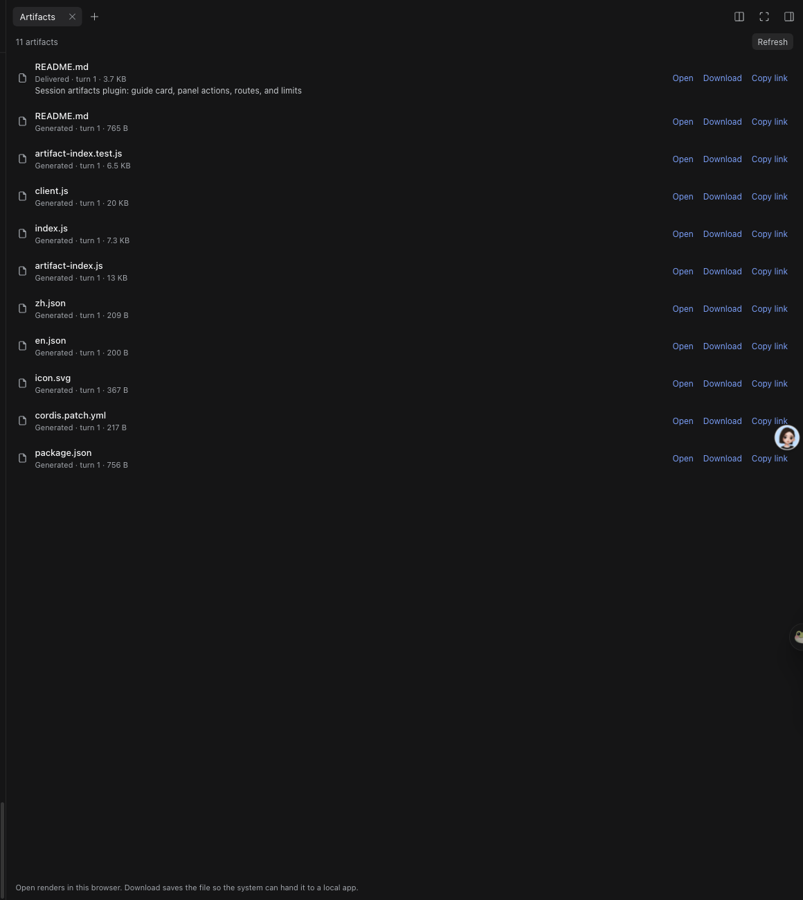

# dsh-power-suite

A growing suite of small enhancements for the DeepSeek Harness Web GUI.

The installable unit is **one plugin**: `@rexxin/dsh-power-suite` (Loader row
`power-suite`). Its features are modules inside the package, so the Plugin list
shows one plugin and its inventory grows with the suite.

| Feature | What it adds |
|---|---|
| Session artifacts | An **Artifacts** card in the right Sidebar's Start page that lists the current Session's created and delivered files, with in-browser open, download, and LAN link copy. See [docs/session-artifacts.md](packages/power-suite/docs/session-artifacts.md). |
| Workspace presets | A Workspace context-menu submenu that sets the default agent preset for new Sessions created in that Workspace. See [docs/workspace-default-presets.md](packages/power-suite/docs/workspace-default-presets.md). |
| Prompt history | The configured modifier + ↑/↓ recalls prompts already sent in this Session; plain arrows keep their original behavior. See [docs/prompt-history.md](packages/power-suite/docs/prompt-history.md). |
| Interrupted sessions | Sessions cut off by a restart carry an amber mark left of the title, a hover-only Continue action with a row mask, and a play-shaped composer submit control. See [docs/interrupted-sessions.md](packages/power-suite/docs/interrupted-sessions.md). |
| Settings | The bundle's Plugins page carries its own configuration section; the prompt-history modifier is the first setting. See [docs/settings.md](packages/power-suite/docs/settings.md). |

## Structure

```
packages/power-suite/
  package.json              # bundle patch + browser entry
  cordis.patch.yml          # inserts the single `power-suite` row
  index.js                  # Host entry: calls each feature's installer
  lib/features/<name>/      # Host-side feature modules
  client.js                 # browser entry: one `#region feature: <name>` per feature
  locale/                   # plugin display metadata (en, zh)
  docs/                     # suite overview, per-feature reference, settings
  test/                     # pure-logic tests
```

See the [suite overview](packages/power-suite/docs/overview.md) for the feature-addition
recipe.




## Install

Install (or reinstall) the suite into the active profile:

```text
plugin_manager action=install_bundle target=/Users/rexxin/Development/dsh-power-suite/packages/power-suite
```

Changes are profile-wide and survive restarts. After upgrading the package's
JavaScript, restart the Host process and reload the Web page.
