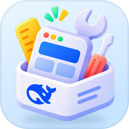
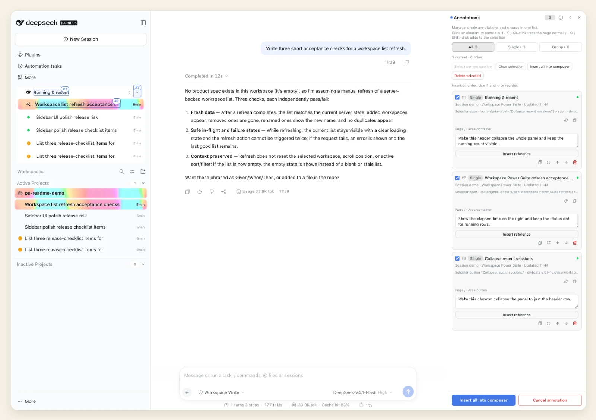

# DSH Power Suite

[](https://www.npmjs.com/package/@zephinel/dsh-power-suite)
[](LICENSE)
[](https://www.npmjs.com/package/@deepseek-ai/dsh)

**One plugin that makes the DSH Web GUI show the working session, not only the answer.** It adds a Running & recent panel and activity buckets to the sidebar, a Session artifacts browser, prompt recall and draft memory in the composer, interrupted-session recovery, and point-and-click UI annotation — all as one `power-suite` plugin row, with no build step.

Install it from npm (after the 0.1.0 release) and start the Web UI:

```bash
dsh plugin --profile web add @zephinel/dsh-power-suite@0.1.0
dsh web
```

> [!NOTE]
> **Status: release prepared, not published.** `@zephinel/dsh-power-suite@0.1.0`
> is prepared on the `release-0.1.0-prep` branch — package metadata, the bilingual
> release notes and the CHANGELOG entries are in place — but the package is
> **not on npm yet**, and this repository has **no git remote**, so nothing has
> been pushed and no CI run exists. Until the first tag is published, install the
> local checkout instead (see [Install](#install)); the in-app update notice stays
> silent while no published version exists.

[Overview](#overview) · [Session artifacts](#session-artifacts) · [Composer](#composer-prompt-recall-drafts-recovery) · [UI annotation](#ui-element-annotation) · [Features](#features-at-a-glance) · [Install](#install) · [Quick start](#quick-start) · [Get the code](#get-the-code) · [Prerequisites](#prerequisites) · [Build, test and deploy](#build-test-and-deploy) · [Documentation](#documentation) · [Contributing](#contributing)

## Overview

The suite works inside the native shell instead of beside it: it augments the sidebar, the Files pane and the composer with Host-backed state, and adds one annotation surface that never covers the page. Unloading the plugin restores the native surface.


*All screenshots come from a temporary, isolated DSH instance with demo Sessions and demo artifacts; no personal content is involved.*

- **Running & recent, at the top of the sidebar.** The card lists running and recently finished Sessions, nests delegated subagent rows, raises a preview-only notice when a Session waits on a question, plan review or approval, and paints the current row with its rainbow glow. Hover a row for the native **Session statistics**, **Token usage** and **Context usage** figures.
- **Native row menus.** A top-level row's "…" menu opens the shell's own shared context-menu popup with the native Session actions (Pin is left out): native material, icons, shortcut hints and footer.
- **A width that stays put.** The dragged left sidebar width is a Host-owned preference: it survives reloads and new tabs, matches across every browser paired with the same Host (last write wins), reopens at the stored width after a collapse, and no longer blinks the rainbow atmosphere while the handle is dragged.
- **Read state shared by the Host.** Read marks, card pins and event-sourced last-activity times live on the Host, so they persist across reloads and are shared by every browser on the same Host instead of belonging to one browser's storage.

Read more: [Dynamic Workspaces](docs/dynamic-workspaces.md) · [Sidebar width](docs/sidebar-width.md) · [Interrupted sessions](docs/interrupted-sessions.md).

## Session artifacts

The right Sidebar's **Files** pane header carries an **Artifacts** button. It opens the current Session's list in place: every file the Session created or delivered, plus the images and files you attached to your own prompts.


- **One list, two sources.** Generated files and provided attachments share one list; the header filter switches **All / Generated / Provided** with live counts.
- **Look before you open.** Hover a row for the shared Quick Look: Markdown, highlighted code, images, audio/video, PDF and HTML for generated files, and images, media and text-like files for provided attachments — all in a resizable card.
- **The actions you need on a file.** Open, download, copy content (text verbatim; images as a real clipboard picture in a secure context), and copy the authenticated LAN link.
- **The same preview in the Workspace tree.** The native Workspace files list gets the same Quick Look row, so files preview the same way in both places.

Read more: [Session artifacts](docs/session-artifacts.md).

## Composer: prompt recall, drafts, recovery

The composer keeps the work around the prompt: what you asked before, what you attached, and what happened when a turn did not finish.


- **Prompt history.** The configured modifier + ↑/↓ recalls prompts already sent in this Session; plain arrows keep their native behavior. A rail at the conversation's right edge lists the same prompts as ticks, oldest first, with timestamps, a full-text hover preview, an inline search and click-to-copy.
- **Draft attachments survive Session switches.** Pasted, dropped or picked files stay with the draft when you open another Session and come back, for the page lifetime — the shell itself persists only the draft text.
- **Interrupted Sessions are marked and recoverable.** A Session whose last turn did not finish gets an amber title mark, a hover-revealed inline **Continue** triangle and a play-shaped composer submit control. Continuing is implicit and Host-owned, and an SSE stream keeps open pages in sync across devices.
- **Settings in one place.** The bundle's Plugins page holds the prompt-history modifier and the two retention windows for the Active/recent surfaces.

Read more: [Prompt history](docs/prompt-history.md), [draft attachments](docs/draft-attachments.md), [interrupted sessions](docs/interrupted-sessions.md).

## UI element annotation

A round launcher at the bottom-right of the page toggles a point-and-click annotation mode. The page makes room for a narrow right rail instead of being covered.



- **Point at the element.** Hovering outlines the element a click would select, including floating surfaces such as native hover preview cards, which can be drilled into. The popover carries the locator summary, live status, parent/child adjustment and the requested change.
- **The note stays with the page.** Each annotation becomes a persisted record with a page marker, a numbered requirement badge and a hover detail card; edit the requirement, relocate the target, copy the locator, or delete with a 5 s undo.
- **Send it as a reference, not prose.** References are inserted as native composer inline reference chips — one chip or one grouped batch — without sending. The rail's collection view edits, previews, reorders and batch-inserts annotations, with multi-select, marquee, ancestor adjustment and a pass-through modifier.

Read more: [UI element annotation](docs/ui-annotation.md).

## Features at a glance

| Feature | What it adds |
|---|---|
| [Dynamic Workspaces](docs/dynamic-workspaces.md) | Active/Inactive activity buckets, the Running & recent card with Host-shared pinning and subagent rows, the native row menu, pending-interaction notices and the rainbow current row. |
| [Session artifacts](docs/session-artifacts.md) | The Files-pane Artifacts list for generated files and provided attachments, with Quick Look, open/download/copy actions and the All/Generated/Provided filter. |
| [UI element annotation](docs/ui-annotation.md) | Point-and-click annotation with a right rail, persisted page markers, a collection view and native composer reference chips. |
| [Prompt history](docs/prompt-history.md) | Modifier + ↑/↓ recall plus a right-edge history rail with preview, search and click-to-copy. |
| [Draft attachments](docs/draft-attachments.md) | Browser-owned attachment memory across Session switches for the page lifetime. |
| [Interrupted sessions](docs/interrupted-sessions.md) | An amber mark, inline Continue and a play-shaped submit control for turns that did not finish, with Host-owned cross-device state. |
| [Sidebar width](docs/sidebar-width.md) | A Host-owned, durable left-sidebar width shared across browsers, restored after a collapse, with a flicker-free rainbow repaint. |
| [Workspace presets](docs/workspace-default-presets.md) | A Workspace context-menu submenu that sets the default agent preset for new Sessions in that Workspace. |
| [Settings](docs/settings.md) | The bundle's Plugins-page section: the prompt-history modifier and the two retention windows. |
| [Update notice](docs/update-check.md) | A bottom-right Host-checked notice for a newer published version, with the version change and release highlights; silent until the package is published. |

The features ship in the single bundle `@zephinel/dsh-power-suite` (Loader row `power-suite`), so they install, enable and uninstall together. The browser half attaches to the Web platform only.

## Install

The bundle is `@zephinel/dsh-power-suite` (Loader row `power-suite`). Install it into a DSH profile, then reload the plugin or restart the Web process so the Host half loads — a page refresh is not enough for Host code.

**From npm, after the 0.1.0 release:**

```bash
dsh plugin --profile web add @zephinel/dsh-power-suite@0.1.0
```

Or use the in-app route: **Plugins** in the Web sidebar → **Add plugin** → enter `@zephinel/dsh-power-suite@0.1.0` → **Install** → **Enable now**.

**From this checkout, available today:** in the **Plugins** page choose **Add plugin** → **Install a third-party plugin** and enter the checkout's absolute path. From an agent session the same install is:

```text
plugin_manager action=install_bundle target=/absolute/path/to/dsh-power-suite
```

The profile keeps a local checkout as a `link:` dependency, so an edited checkout is the code the Host runs after a reload. There is no build step; removing the bundle removes the plugin.

Installation needs `pnpm` on `PATH`: `dsh plugin add` forwards to pnpm in the profile, and the Plugins page runs pnpm behind its install dialog.

## Quick start

Start (or restart) the Web UI and open the URL it prints:

```bash
dsh web
```

1. Expand the left sidebar: **Running & recent** sits above the native Workspaces header, and the Workspace list is split into **Active Projects** and **Inactive Projects**.
2. Open a Session that has sent prompts: the prompt-history rail appears at the conversation's right edge, and the modifier + ↑/↓ recalls earlier prompts in the composer.
3. Open **Files** in the right sidebar and click **Artifacts** to list what the Session produced and what you attached.
4. Click the round launcher at the bottom-right: the page narrows, and hovering outlines the element a click would annotate.
5. Open the bundle's page under **Plugins** for its settings: the prompt-history modifier and the two retention windows.

The address and port come from the DSH profile. After a browser-code change, refresh the page; after a Host-code change, reload the plugin or restart the Web process.

## Get the code

The publishing target is GitHub:

```bash
git clone https://github.com/Zephinel/dsh-power-suite.git
cd dsh-power-suite
```

> [!IMPORTANT]
> The repository has no remote configured yet, so this clone does not work until the first push lands. Until then, work in the existing local checkout this README ships in and install it as a local `link:` bundle (see [Install](#install)).

The checkout needs no `npm install` to run the checks: the package has no runtime dependencies and no build step.

## Prerequisites

- **DSH 0.2.2 plugin interface** — the Host and browser halves target DSH 0.2.2. The Web Host used for this repository's browser checks runs **0.2.2-rc.1**; later DSH versions are unverified. Install the CLI with `npm install -g @deepseek-ai/dsh`.
- **Node.js 22 or newer** — `package.json` declares `engines.node >= 22`; the CI gate runs on Node 22 and 24.
- **pnpm** — needed to install profile bundles: `dsh plugin add` forwards to it, and the in-app Plugins page runs it behind its dialog.
- **Git** — needed only to get the code; the repository sets no minimum version.
- **Google Chrome** (optional) — only for the local browser suites; they use the standard macOS Chrome path and accept `CHROME_BIN` elsewhere.

Confirm the tools are present:

```bash
node --version   # v22 or newer
dsh --version    # verified: 0.2.2-rc.1
pnpm --version
git --version
```

Verified platform: macOS with DSH Web 0.2.2-rc.1. The plugin itself is a Web-platform bundle; other platforms are unverified.

## Build, test and deploy

There is no build step: the Host and browser entries are the checked-in ES modules under `src/`, with no runtime dependencies. Run the commands below from the checkout root.

| Command | Purpose |
|---|---|
| `npm test` | `node --test test/*.test.js` — pure-logic tests for the Host stores/routes and the browser-side derivations. |
| `npm run check` | The full gate: syntax, package manifest, docs links, Node tests and the release-notes check, then `pack:check`. |
| `npm run pack:check` | `npm pack --dry-run --json` — inspect the published file list. |
| `npm run check:release-notes` | Validate the tag-pinned release highlights for the package version. |
| `npm run check:docs-links` | Verify that local Markdown links and images resolve. |
| `npm run build:readme-bento` | Compose the README Bento images from local captures (needs Chrome). |

The browser acceptance suites drive the real running Web GUI in a throwaway headless Chrome profile:

```bash
node test/browser/sidebar.e2e.mjs --smoke      # sidebar surfaces
node test/browser/annotation.e2e.mjs --smoke   # UI element annotation
node test/browser/update-prompt.e2e.mjs        # update notice
```

They need a running DSH Web and Chrome, and run one at a time; environment variables, per-mode checks and the full option list are in the [browser harness guide](test/browser/README.md). CI has no browser job — these are local pre-release checks.

**Deploy** means installing the bundle into the target DSH profile; there is no separate server or watch mode. The local install/reload loop and the tag-publish procedure (Trusted Publishing on a `v*` tag) are in [docs/development.md](docs/development.md).

## Documentation

- [Architecture](docs/architecture.md) — Host and browser halves, routes, slots, services and settings documents.
- [Usage](docs/usage.md) — what each feature does in the UI, step by step.
- [Feature inventory](docs/overview.md) — the full inventory plus the recipe for adding a feature.
- [Development](docs/development.md) — local install/reload loop, checks, the README capture and Bento pipeline, release flow.
- [Verification](docs/verification.md) — the checks and evidence for this checkout.
- [Limitations](docs/limitations.md) — known bounds and unverified areas.
- [Browser harness](test/browser/README.md) — the live-GUI acceptance suites, their modes and evidence.
- [Changelog](CHANGELOG.md) — release entries; the first release is 0.1.0, not yet cut.
- [Release notes](release-notes/README.md) — the tag-pinned Highlights format read by the update notice.

## Contributing

- Bugs and feature requests go to GitHub Issues once the repository is pushed; today there is no remote, so work from the local checkout and report to the maintainer directly.
- Run `npm run check` before proposing a change. Host logic lives in `src/features/<name>/` behind tests under `test/`, and each feature has a page under `docs/`; [docs/development.md](docs/development.md) documents the feature recipe, the commit conventions and the release flow.
- Behavior, copy or gate changes need the matching docs updated too: the feature reference, `CHANGELOG.md` and `docs/verification.md`.
- Releases are cut from a tag by the publish workflow. Never run `npm publish` locally; the maintainer procedure is `.agents/skills/release-power-suite/SKILL.md`.
- Maintainer: [@Zephinel](https://github.com/Zephinel).

## License

[MIT](LICENSE). Third-party notices are in [NOTICE](NOTICE): Remix Icon SVG path data inlined in the browser entry (Apache-2.0), and the DeepSeek Harness platform disclaimer.
