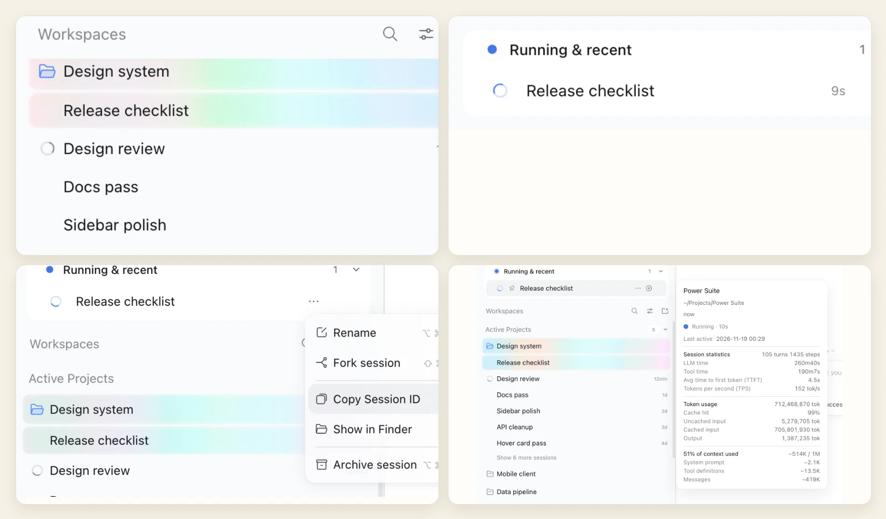
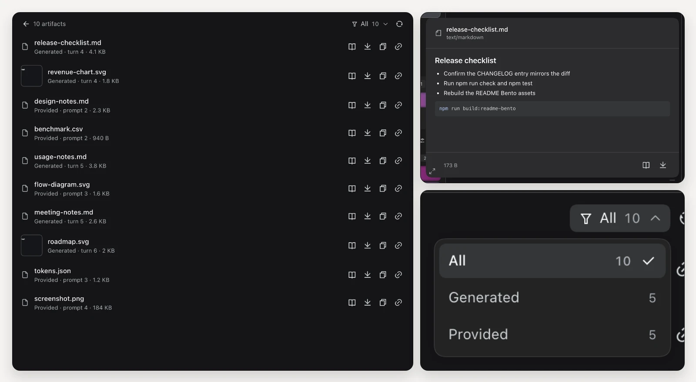
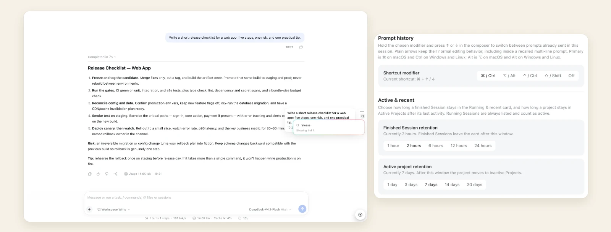
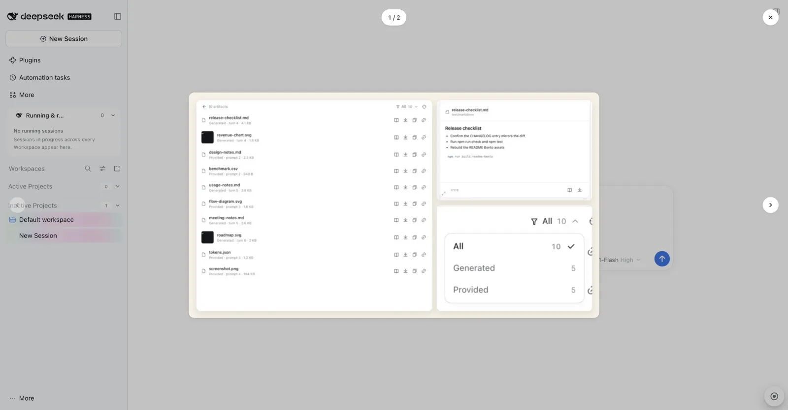
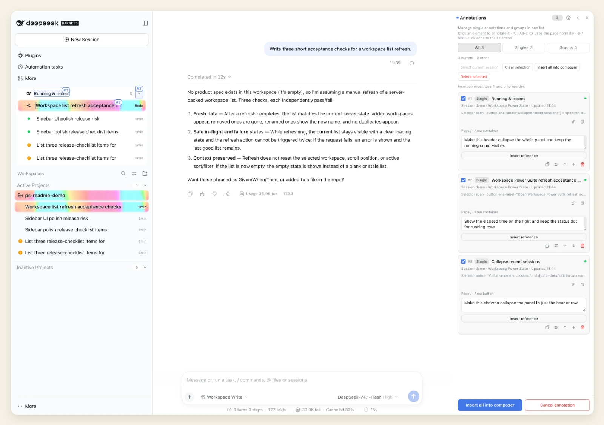

# DSH Power Suite

[English](README.md) | 中文

[](https://www.npmjs.com/package/@zephinel/dsh-power-suite)
[](LICENSE)
[](https://www.npmjs.com/package/@deepseek-ai/dsh)
[](https://github.com/Zephinel/dsh-power-suite/actions/workflows/ci.yml)

**一个插件，让 DeepSeek Harness（DSH）不只展示回答，更把整个工作会话摊开在眼前。** 它直接融入原生 Web 界面，提供「运行中与最近」卡片与活跃/非活跃分组、会话产物（Artifacts）浏览、提示历史与草稿附件记忆、多图预览画廊、中断会话恢复以及点选式 UI 元素标注——全部打包为单个 `power-suite` 插件。



*全部截图均来自临时隔离的 DSH 演示实例与演示产物，不含任何个人数据。*

> **当前状态**：`@zephinel/dsh-power-suite@0.2.2` 已发布到 npm（仅 Web 平台）；本版包含上方截图中的彩色烟雾流光、原生行几何与更新后的中英界面文案。版本变更见 [CHANGELOG](https://github.com/Zephinel/dsh-power-suite/blob/main/CHANGELOG.md)。

[安装](#安装) · [总览](#总览) · [功能一览](#功能一览) · [快速上手](#快速上手) · [文档索引](#文档索引) · [本地开发](#获取代码与本地开发)

## 安装

从 npm 安装（需 `PATH` 中有 `pnpm`），安装后重载插件或重启 DSH Web 使 Host 端生效：

```bash
dsh plugin --profile web add @zephinel/dsh-power-suite@0.2.2
dsh web
```

也可在 Web 界面内安装：**插件 → 添加插件 → 输入 `@zephinel/dsh-power-suite@0.2.2` → 安装 → 立即启用**。本地源码安装（`link:` 依赖）与发版流程见 [docs/development.md](https://github.com/Zephinel/dsh-power-suite/blob/main/docs/development.md)。

## 总览

插件直接增强原生外壳而非另起炉灶；卸载插件即恢复原生界面。

- **侧栏顶部「运行中与最近」卡片。** 集中列出运行中与近期结束的会话，折叠展示嵌套子代理行；等待回答、计划审查或审批的会话标题前显示琥珀色小旗（`flag-fill`），当前会话带彩色烟雾高亮。悬停任意行即可查看原生**会话统计、Token 用量与上下文占比**。
- **原生行菜单。** 点击顶层卡片行的 `…` 打开外壳共享上下文菜单，提供原生会话操作（不含置顶），保持原生材质、图标与快捷键提示。
- **Host 端共享状态与侧栏宽度。** 已读标记、卡片置顶、最近活动时间及拖拽后的左侧栏宽度全部由 Host 持久化，刷新不丢失并在同一 Host 的多个浏览器间同步。

延伸阅读：[动态工作区](https://github.com/Zephinel/dsh-power-suite/blob/main/docs/dynamic-workspaces.md) · [侧栏宽度](https://github.com/Zephinel/dsh-power-suite/blob/main/docs/sidebar-width.md) · [中断会话](https://github.com/Zephinel/dsh-power-suite/blob/main/docs/interrupted-sessions.md)。

## 会话产物（Session artifacts）

右侧边栏 **文件（Files）** 面板顶部新增 **产物（Artifacts）** 按钮，在同一列表里查看当前会话生成的所有文件以及你附带发送的图片与附件。



- **统一列表、两种来源。** 顶部支持按 **全部 / 生成 / 用户提供** 实时计数筛选。
- **共享 Quick Look 预览。** 悬停产物行（或原生工作区文件树中的文件）即可在可调大小的预览卡中查看 Markdown、代码高亮、图片、音视频、PDF 与 HTML。
- **常用文件操作。** 一键打开、下载、复制原文或剪贴板图片（安全上下文下），以及复制带鉴权的局域网链接。

延伸阅读：[会话产物](https://github.com/Zephinel/dsh-power-suite/blob/main/docs/session-artifacts.md)。

## 输入区：提示历史、草稿附件与中断恢复

围绕提问前后保留上下文：问过什么、附过什么、以及没跑完的轮次。



- **提示历史。** 按设定的修饰键 + ↑/↓ 回溯当前会话已发送提示（普通方向键保持原生行为）；对话右边缘轨道按从旧到新排列历史刻度，支持时间戳、全文悬停预览、行内搜索与点击复制。
- **草稿附件与多图预览画廊。** 粘贴、拖入或选取的附件在页面生命周期内切换会话不丢失；输入框附带 2 张及以上图片时，点击缩略图打开连续的 `N / M` 预览器，支持方向键/滚轮切换与关闭后焦点归还（单图保持原生灯箱）。



- **中断会话恢复与统一设置。** 未正常结束的轮次会显示琥珀色标记、悬停出现的内联 **继续** 三角以及播放形态提交按钮，由 Host 通过 SSE 跨端同步。提示历史修饰键与保留窗口统一位于插件详情页设置区。

延伸阅读：[提示历史](https://github.com/Zephinel/dsh-power-suite/blob/main/docs/prompt-history.md) · [草稿附件](https://github.com/Zephinel/dsh-power-suite/blob/main/docs/draft-attachments.md) · [多图画廊](https://github.com/Zephinel/dsh-power-suite/blob/main/docs/usage.md#composer-image-gallery) · [中断会话](https://github.com/Zephinel/dsh-power-suite/blob/main/docs/interrupted-sessions.md)。

## UI 元素标注

页面右下角的圆形入口可一键开启点选标注模式；页面会自动让出右侧栏空间，不遮挡内容。



- **所指即所选。** 悬停高亮目标元素（支持钻入原生悬停浮卡等浮层），浮窗内可直接查看定位摘要、调整父/子级元素并填写修改说明。
- **持久标记与原生引用标签。** 每条标注都会以编号标记留在页面上（支持编辑、定位到元素、复制定位器与 5 秒撤销），并以原生内联引用标签（单条或批量分组）插入输入框，不会自动发送。

延伸阅读：[UI 元素标注](https://github.com/Zephinel/dsh-power-suite/blob/main/docs/ui-annotation.md)。

## 功能一览

| 功能 | 详细文档 |
| --- | --- |
| 动态工作区（活跃/非活跃分组、运行中与最近卡片、待交互旗标、置顶、原生行菜单） | [docs/dynamic-workspaces.md](https://github.com/Zephinel/dsh-power-suite/blob/main/docs/dynamic-workspaces.md) |
| 会话产物与共享 Quick Look 预览 | [docs/session-artifacts.md](https://github.com/Zephinel/dsh-power-suite/blob/main/docs/session-artifacts.md) |
| UI 元素标注与原生输入框引用标签 | [docs/ui-annotation.md](https://github.com/Zephinel/dsh-power-suite/blob/main/docs/ui-annotation.md) |
| 提示历史、草稿附件记忆与多图预览画廊 | [docs/prompt-history.md](https://github.com/Zephinel/dsh-power-suite/blob/main/docs/prompt-history.md) · [docs/draft-attachments.md](https://github.com/Zephinel/dsh-power-suite/blob/main/docs/draft-attachments.md) · [docs/usage.md](https://github.com/Zephinel/dsh-power-suite/blob/main/docs/usage.md#composer-image-gallery) |
| 中断会话恢复（Host 端 SSE 跨端同步） | [docs/interrupted-sessions.md](https://github.com/Zephinel/dsh-power-suite/blob/main/docs/interrupted-sessions.md) |
| 侧栏宽度持久化、工作区默认预设、设置页与更新提示 | [docs/sidebar-width.md](https://github.com/Zephinel/dsh-power-suite/blob/main/docs/sidebar-width.md) · [docs/workspace-default-presets.md](https://github.com/Zephinel/dsh-power-suite/blob/main/docs/workspace-default-presets.md) · [docs/settings.md](https://github.com/Zephinel/dsh-power-suite/blob/main/docs/settings.md) · [docs/update-check.md](https://github.com/Zephinel/dsh-power-suite/blob/main/docs/update-check.md) |

全部功能随单个包 `@zephinel/dsh-power-suite`（加载行 `power-suite`，仅 Web 平台）统一安装、启停与卸载。

## 快速上手

1. 展开左侧栏：**运行中与最近**位于**工作区**上方，工作区按活跃度分为**活跃项目**与**非活跃项目**。
2. 打开一个至少有两轮提示的会话：右边缘出现提示历史轨道，使用修饰键 + ↑/↓ 可在输入框回溯历史提示。
3. 在右侧栏点击 **文件 → 产物**，浏览并悬停预览会话生成的文件与你附带的附件。
4. 点击右下角圆形入口开启元素标注，点选界面区域并把引用标签插入输入框。
5. 打开 **插件 → DSH 增强套件**（DSH Power Suite）调整提示历史修饰键与两个保留时间窗口。

## 文档索引

详细文档随 npm 包发布在 `docs/`（下方使用 GitHub 绝对链接，确保在 npm 页面也可直接跳转；文档正文为英文）：

| 文档 | 内容范围 |
| --- | --- |
| [完整文档目录](https://github.com/Zephinel/dsh-power-suite/blob/main/docs/README.md) · [使用指南](https://github.com/Zephinel/dsh-power-suite/blob/main/docs/usage.md) | 逐项 UI 使用说明与全部特性文档入口 |
| [架构文档](https://github.com/Zephinel/dsh-power-suite/blob/main/docs/architecture.md) · [功能清单](https://github.com/Zephinel/dsh-power-suite/blob/main/docs/overview.md) | Host/浏览器双端结构、路由、插槽、服务与新特性接入模式 |
| [开发与发布](https://github.com/Zephinel/dsh-power-suite/blob/main/docs/development.md) · [浏览器测试指南](https://github.com/Zephinel/dsh-power-suite/blob/main/test/browser/README.md) | 本地安装重载循环、完整命令表、真实 GUI 浏览器套件与发版流程 |
| [已知限制](https://github.com/Zephinel/dsh-power-suite/blob/main/docs/limitations.md) | 当前边界与未验证范围 |
| [验证记录](https://github.com/Zephinel/dsh-power-suite/blob/main/docs/verification.md) · [CHANGELOG](https://github.com/Zephinel/dsh-power-suite/blob/main/CHANGELOG.md) · [更新说明规范](https://github.com/Zephinel/dsh-power-suite/blob/main/release-notes/README.md) | 自动化门禁、真机验证记录、版本历史与更新提示高亮格式 |

## 获取代码与本地开发

```bash
git clone https://github.com/Zephinel/dsh-power-suite.git
cd dsh-power-suite
npm ci
npm run check
```

**前置环境**：DSH 0.2.2 插件接口，当前在 **DSH 0.2.2-rc.5** 宿主上验证（smoke 与 update-prompt 套件通过；完整套件的记录来自更早的 `0.2.2-rc.1`；更高版本未验证）、Node.js `>= 22.18`（原生 TypeScript 类型剥离运行 `npm test`，CI 覆盖 Node 22 与 24）、`pnpm`（供 `dsh plugin add` 调用）、Git，以及可选的 Google Chrome（用于运行本地浏览器套件：`node test/browser/sidebar.e2e.mjs --smoke`、`annotation.e2e.mjs --smoke`、`update-prompt.e2e.mjs`）。

无运行时依赖，无独立 watch 服务：修改代码后运行 `npm run build`（浏览器改动刷新页面即可，Host 改动需重载插件或重启 `dsh web`）。完整命令与部署流程见 [docs/development.md](https://github.com/Zephinel/dsh-power-suite/blob/main/docs/development.md)。

## 贡献

- 问题反馈与功能建议请提至 [GitHub Issues](https://github.com/Zephinel/dsh-power-suite/issues)。
- 提交改动前运行 `npm run check`；涉及行为、文案或门禁变化时，按 [sync-power-suite-docs](https://github.com/Zephinel/dsh-power-suite/blob/main/.agents/skills/sync-power-suite-docs/SKILL.md) 同步对应文档、`CHANGELOG.md` 与 `docs/verification.md`。
- 发版由 `v*` tag 触发 Trusted Publishing 自动完成（请勿在本地运行 `npm publish`，流程见 [release-power-suite](https://github.com/Zephinel/dsh-power-suite/blob/main/.agents/skills/release-power-suite/SKILL.md)）。维护者：[@Zephinel](https://github.com/Zephinel)。

## 许可证

[MIT](LICENSE)。第三方声明见 [NOTICE](NOTICE)：浏览器端内联的 Remix Icon SVG 路径数据（Apache-2.0）与 DeepSeek Harness 平台免责声明。
