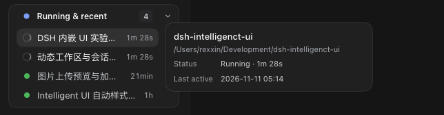
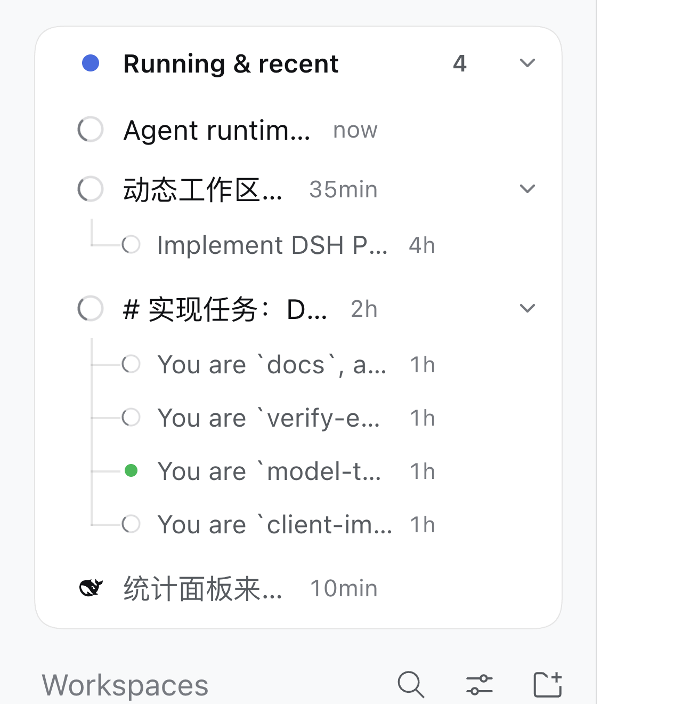
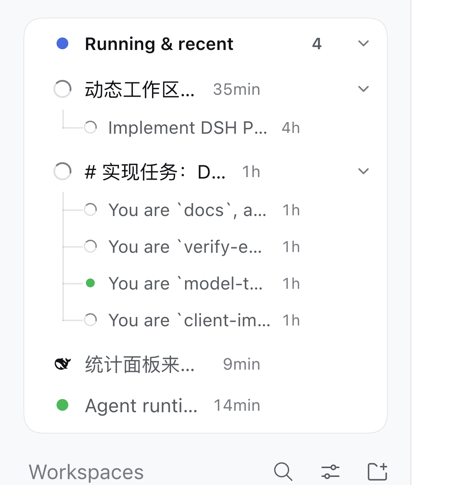
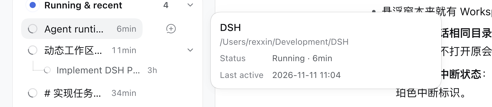
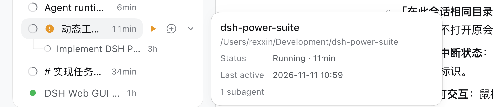
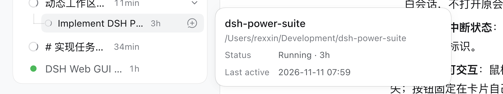

# Dynamic Workspaces

A DSH Power Suite feature: the native sidebar Workspaces browser gains two
activity buckets and a running & recent Sessions summary card, without replacing
the shipped browser. Native search, context menus, add-workspace flow, drag
reordering, and dialogs keep working because their nodes are never touched.


The row hover detail (Workspace, Status, Last active, subagent count):



## What it adds

- **Active Projects / Inactive Projects buckets** — the native Workspace
  sections are split into two labelled groups. Each bucket has one header with
  its Workspace count and a fold control; the Active group is ordered by most
  recent activity, the Inactive group keeps the native order.
- **Running & recent card** — a collapsible card above the native
  Workspaces section header lists the Sessions that are running now and the
  Sessions that finished recently, newest first, and opens any row's Session.
- Both surfaces update live in both directions: a Workspace moves to Active when
  one of its Sessions starts, drops back to Inactive once nothing it accounts
  for is running or inside the retention window, and a finished Session lingers
  in the card instead of vanishing on the stop.
- **Configurable windows** — the two retention windows are Host settings on the
  suite's Plugins page ([Settings](settings.md)): finished-Session retention
  (1/2/6/12/24 hours, default **2 hours**) and active-project retention
  (1/3/7/14/30 days, default **7 days**). Running Sessions ignore both. Changes
  apply to the card, its nested subagent rows, and the buckets without a reload.

## Active and Inactive Projects

A Workspace is **Active** while at least one of its accounted Sessions is:

- **running now** — the live Session-status snapshot is authoritative; the
  Session list summary's running bit is the fallback while that snapshot is
  still loading; or
- **last active within the retention window**.

The retention window is the Host-backed **Active project retention** setting
([Settings](settings.md)): 1/3/7/14/30 days, default **7 days** (field
`activeProjectDays`). It keeps a project in Active after its last turn ends, so
the "I left it here" affordance survives a break. Inactive means no accounted
Session is running and none was active inside the window.

- A parent Session whose own turn has closed still counts while a delegated
  **direct subagent** runs; the hover card names the running subagent count. A
  finished subagent alone does not end the parent's task.
- Sessions that no Workspace accounts for form the native ungrouped section; it
  follows the same rule and its card rows read `Ungrouped`.
- Blank and archived Sessions are ignored when accounting activity: an archived
  row stays available under the native archived filter, but it neither keeps its
  Workspace Active nor appears in the card.
- A 30-second clock tick re-evaluates expiry, so a Workspace drops to Inactive
  when its window ends even with no new Session event. A settings change to the
  window re-derives the buckets immediately. Every other change follows the
  stores — no page reload and no Host restart.
- The bucket counts are **Workspace** counts, not Session counts.
- The section order follows the native grouping: Active sections
  `order: 100 + index` (most recent activity first), the Active header
  `order: 0`, the Inactive header `order: 5000`, and Inactive sections
  `order: 5001 + index`.

## The Running & recent card

The card sits directly above the native **Workspaces** section header, below the
sidebar's panel tabs. It starts expanded.

- **Header**: the leading indicator has two states. While at least one listed
  Session is running it is a **blue pulsing dot** — a business-primary 8 px dot
  with an expanding ring on a 2 s loop (static under reduced motion); when every
  task is complete it is the white 14 px RemixIcon **sparkling-line** glyph.
  Both states are horizontally centred on the same **leading-glyph column** as
  the top-level rows (the pulse/sparkle, the green unread-completion dots, and
  the white session-type icons share one centre; header sparkle/pulse centre
  x = 43 and row glyph centre x = 43), and the header title starts on the same
  column as the row titles (x = 58). Then come the **Running & recent** title
  and a count badge with the number of listed rows. The toggle
  block, the **View all** link, and the header chevron are all 30 px tall with
  the same corner radius (12 px in the shell), so their hover highlights line
  up; the chevron is the rightmost control and folds the body.
- **Rows**: a Session row is **one line**: leading glyph, title, and time, with
  a disclosure chevron at the far right when the Session has subagent children.
  Running Sessions are always listed, then recently finished Sessions inside
  the finished-Session **retention window** (default 2 hours, configurable in
  [Settings](settings.md)), each group newest activity first. A running row uses the
  shell's own `StateDot` with `state: "ongoing"` as its loading indicator — no
  bespoke spinner — and its right side shows the **observed run duration** once
  the run started while this page has been open; for a run that was already
  going when the page loaded it falls back to the relative last-activity time.
  The glyph then tells the read state: a **finished but unread** row shows the
  shell's green `StateDot state: "done"` (the green marker means *only* this
  unread completion), while a **finished and acknowledged** row swaps the green
  dot for the white session-type icon — the RemixIcon `deepseek-fill` glyph on
  main rows and `robot-2-line` on subagent rows, drawn at 14 px / 12 px in the
  primary label colour. Opening a Session from this card or anywhere else
  acknowledges it; the acknowledgement is **persisted per browser** and keeps
  the green dot away until genuine new activity arrives (see *Read
  acknowledgements* below). The Workspace is not printed under the row any more;
  it lives in the hover card below.
- **Read acknowledgements**: read marks persist in
  `localStorage['dsh-power-suite.acked-sessions']` as
  `{ "version": 1, "acked": { "<sessionId>": <acknowledged updatedAt> } }`
  (guarded read/write: missing, corrupt, or storage-denied → empty, then rewritten
  as valid versioned JSON). Opening a finished Session (it is open in the main
  view) raises its baseline to the newer `updatedAt`. A Session that is merely
  *running* but **not open** clears its acknowledgement only when its
  `updatedAt` advanced by more than **1000 ms** past the baseline — a transient
  running flag with unchanged activity no longer resurrects the green dot, while
  a genuine new turn does. Entries are pruned only against a non-empty Session
  catalog; rows and nested subagent children share the same map. Acks survive
  seat remounts, client HMR, and a full page reload, and the green-dot *unread*
  direction still works when an acknowledgement is intentionally removed.
  Completed rows still leave the card once the configurable finished-Session
  retention window expires, so they never linger forever.





- **Row actions**: every row (main and nested subagent) carries a fixed trailing
  cluster immediately before the disclosure chevron:
  `[Continue (interrupted only)] [New session] [chevron]`. The two action slots
  are 22 px wide and stay reserved, hidden with opacity/`pointer-events` until the
  row is hovered or on keyboard `focus-within`, so revealing them never shifts
  the title or time. Both buttons stop the row's open handler; clicking the row
  body still opens the Session.
- **Interrupted rows**: a row whose Session is interrupted (main or child) shows
  an amber warning badge before the title, taken from the suite's shared
  interrupted-Session records; its **Continue** action reuses the interrupted
  feature's continuation request (it does not open the row first).
- **New session**: the native shell's "new chat" sprite icon (with an inlined
  Remix fallback) creates a blank Session in **the row's own directory** using
  the Session service, then opens it — without opening the source Session. When
  the directory or creation is unavailable it falls back to the Workspace's
  **New Session** flow, and an in-flight guard stops double clicks from creating
  two Sessions.
- **Hover detail**: the row carries no native `title` tooltip; the hover card is
  the only detail surface. Resting on a row for about a quarter second opens a
  native-style card whose **title is the Workspace name** (not the Session name,
  which is already on the row), followed by the **full workspace path** (wrapped,
  not truncated) and then **Status** (`Running`/`Finished` plus the observed or
  relative time), **Last active** (absolute `YYYY-MM-DD HH:MM`), and the running
  subagent count when there is one. The card is anchored to the **activity
  panel's right edge + 10 px** (clamped to the viewport), so it sits outside the
  sidebar and never covers the row or its action buttons; it does not capture the
  pointer (same show/hide delays as before, dismissed by Escape, scroll, or
  resize), and clicking the row still opens the Session.
- **Disclosure column**: the header chevron and every row's disclosure arrow
  are horizontally centred on one right-edge column (not merely right-aligned),
  and rows without children reserve the same column with a spacer, so their
  times stay aligned with rows that have children.
- **Split row highlight**: hovering the row body highlights only the main part
  of the row; hovering the disclosure arrow highlights only the arrow — the two
  are independent and never compose into a nested two-layer highlight. The row
  body's highlight carries 8 px horizontal inner padding, so the leading glyph
  and title do not sit flush against the highlight edge.
- **No body scrollbar**: the card body scrolls with the wheel or trackpad but
  hides its scrollbar (native `scrollbar-width` / WebKit rules), matching the
  native sidebar surfaces.




- **Nested subagents**: a parent row with running or recently active direct
  subagent Sessions gets a per-parent disclosure chevron at its far right.
  Expanding it shows the children indented deeper beneath the parent, connected
  by a thin vertical trunk that is centered under the parent's status indicator
  (the dot column) with one short horizontal branch to each child's indicator;
  the trunk is masked below the last child's tick, so no dangling line hangs
  under the group. Each child row has its own leading glyph (the same running /
  unread / acknowledged states, using the white `robot-2-line` icon when
  acknowledged), title, relative time, and the same trailing action cluster
  (Continue when interrupted, New session).
  
  Each parent folds independently; the card header still folds the whole list.
- **Click**: clicking a parent row opens that Session; clicking a child row
  opens the child Session. The disclosure chevron is a separate control.
- **Five-row default**: with more than five top-level rows the header also shows
  **View all {count}**; **Show less** returns to the first five (children stay
  inside their parent row and do not count against the limit). The body scrolls,
  and a very long title truncates.
- **Empty state**: **No running sessions** with the sentence that Sessions in
  progress across every Workspace appear there. Blank, archived, and Sessions
  with `origin: "subagent"` never appear as top-level rows; subagent Sessions
  are reachable through their parent's nested row.

Finished rows deliberately linger: a stop moves the Session below the running
rows, it stays for the retention window, and then it leaves the card. This is the
"find it again" behavior the card exists for.

## Collapsing the buckets

Each bucket header is a button with the uppercase label, the Workspace count,
and a chevron at the far right. Folding a bucket hides that bucket's native
sections with an inline `display: none`; the native nodes stay alive, so their
menus, hover states, and drag state survive. The chevron flips and the header
keeps its `aria-expanded` state.

The two fold states persist in `localStorage` under
`power-suite.dynamic-workspaces.folds`:

```json
{ "active": false, "inactive": true }
```

`true` means folded; a missing key, a malformed value, or denied storage degrades
to expanded and the in-memory state. The preference is per browser and per
profile: it does not sync across devices. The card's own expanded/collapsed state
is per page visit and is not persisted.

## How it fits the native browser

The native Workspaces browser keeps ownership of the surface. The feature only
adds sibling nodes and inline layout:

- **Anchors**: `[data-slot="sidebar.workspaces"]` (the slot wrapper the DSH
  renderer emits for the single `sidebar.workspaces` slot), its first element
  child (the browser root), `[role="tree"]` (the Session list), and the
  `data-row-key="workspace:<id>"` row inside each native group section (which
  tells the feature which Workspace a section renders).
- **Inserted nodes**: the summary-card slot is inserted as the first child of the
  browser root (above the native header); the two bucket headers are inserted as
  children of the native tree. No native node is wrapped, moved, or re-rendered.
- **Ordering**: the tree becomes `display: flex; flex-direction: column`, and the
  feature writes only `order` (and `display` for folding) on the native group
  sections. It matches no hashed native class name.
- **Reconciliation**: a `MutationObserver` on `[data-slot="sidebar"]` plus a
  500 ms retry keeps the foreign nodes present across native re-renders and
  sidebar folds. Unloading the plugin removes every inserted node and clears
  every inline `order`/`display` it wrote.
- **Styling**: theme tokens only; the animated flow bar on running rows is
  stopped under reduced motion, and the disclosure chevrons keep their short
  transform transition.

## Rail behavior

The collapsed (rail) sidebar has no `[role="tree"]`. The feature keeps the card
node mounted but hides it with `display: none` and leaves the rail untouched;
widening the sidebar restores the card, and the bucket headers are created again
on the new tree. The card therefore never competes with the rail's icon column.

## Grouping modes

The native **View options** menu picks how Sessions are grouped:

| Native mode | What the feature does |
|---|---|
| **WorkSpace** | Native Workspace group sections exist: both buckets and the summary card apply. |
| **Workspace Tree** | Same: the nested Workspace groups are banded into the two buckets. |
| **In one list** (flat) | There are no Workspace group sections to band, so no bucket headers appear; only the summary card applies. |

## Limits

- **Expanded sidebar only.** Rail mode hides the card and offers no tree to
  bucket.
- **Flat list mode has no buckets.** Only the summary card applies.
- **DSH DOM dependency.** The anchors are internal to the shipped sidebar, not a
  public contract. If a future DSH changes the slot attribute, the `tree` role, or
  the row-key scheme, this feature degrades to doing nothing while the native
  browser keeps working.
- **Retention windows are shared settings.** Finished-Session retention
  (1/2/6/12/24 hours, default 2 hours) and Active-project retention
  (1/3/7/14/30 days, default 7 days) are Host-wide preferences edited on the
  suite's Plugins page; every browser shares them, and a change applies to this
  page's card and buckets immediately while other open browsers pick it up on
  their next page load. Running Sessions are always listed and always keep their
  project Active regardless of either window.
- **Durations are observation-only.** A run's duration is exact only when this
  page was open when the run started; otherwise the row shows the Session's
  last-activity distance. A background tab throttles the once-per-second
  duration refresh until it is visible again.
- **Subagents nest one level deep.** Running or recently active direct subagent
  children are listed under their parent Session, and a running child keeps the
  parent counted as running. Subagent Sessions never appear as top-level rows —
  the native sidebar hides them outright, and the card is the only place they
  surface. When a parent row itself is outside the card (no running child and its
  own last activity aged out) its children are not exposed either, and
  delegations below the direct child are not walked. A finished subagent does
  not by itself finish the parent's task.
- **Read marks are per browser.** Acks are stored in this browser/profile's
  `localStorage`; another device or profile has its own read marks. With storage
  denied, the map lives in memory only for the page lifetime. The 1000 ms
  tolerance deliberately favors keeping an ack: a real new turn that moves
  `updatedAt` by more than one second clears it, while metadata-only bumps do
  not.
- **Row actions are hover/focus-revealed.** The Continue and New session slots
  are reserved but hidden until the row is hovered or keyboard-focused; a
  touch-only device has no hover, so those row actions are not reachable there
  (the Workspace's own New Session still is). The buttons never change the row
  layout.
- **Continue sends a real continuation.** The row's Continue action reuses the
  interrupted-session continuation flow, so pressing it actually asks the Host to
  resume that Session (it does not open the row first). The badge and action were
  verified against a controlled interrupt state because the live GUI had no
  genuinely interrupted Session; no live child-interrupted case was exercised.
- **New session directory fallback.** The row's New session action creates a
  blank Session in the row's own `cwd`; when that directory or creation is
  unavailable it falls back to the Workspace's New Session flow, so the new
  Session can land in the Workspace default directory instead.
- **Parent disclosure state is per page.** Each parent's expanded/collapsed
  nested list is not persisted; only the two bucket folds are.
- **Client-side derivation, no Host route.** The card and buckets read the
  browser's Session, Session-status, and Workspace stores. There is no new
  `/api/` route for this feature, so a change made from another device can lag by
  one snapshot.
- **Per-browser state.** Bucket folds live in `localStorage` for one browser and
  profile; the card's open state is not persisted.
- **Blank and archived Sessions are skipped.** Rows come from the Session list,
  so a Session with no recorded content never appears, and an archived Session
  does not keep its Workspace Active.

## Verification

Manual checks on the running DSH Web GUI:

1. On a grouped view (**WorkSpace** or **Workspace Tree**), confirm the card sits
   above the native Workspaces header and both bucket headers render with their
   Workspace counts.
2. Start a turn in a Workspace: within one snapshot the Workspace moves into
   Active (top of that bucket) and its Session appears in the card with the
   shell loading indicator and, after a second, a running duration.
3. Stop the turn: the Session stays in the card, moves below the still-running
   rows, and shows `done` with a relative time. Start another turn in the same
   Workspace: it stays in Active and its row returns to the running group. A
   Workspace becomes Inactive only after the configured active-project window,
   re-evaluated on the 30-second tick; no page reload is needed at any step.
4. Open **Plugins → DSH Power Suite → Active & recent** and change the windows:
   setting Finished Session retention to 1 hour should drop a finished row older
   than one hour from the card (rows 4 → 3), and reverting to 2 hours should
   restore it (3 → 4); setting Active project retention to 1 day should move
   projects whose last activity is older than a day into Inactive (e.g. Active
   8 → 5, Inactive 6 → 9), and reverting to 7 days restores 8/6. The hints show
   the current values (`Currently 2 hours…`, `Currently 7 days…`).
5. Fold **Active Projects**: its sections disappear, the chevron flips, and the
   state survives a page reload; unfold it again.
6. Rest a pointer on a card row: the hover card's title is the Workspace name,
   with the full wrapped workspace path, Status with its time, Last active
   absolute time, and the running subagent count when present; the card does not
   take the pointer, and the row has no native tooltip.
7. If a listed Session delegated to subagents, its row shows a disclosure
   chevron at the far right: expanding reveals the child rows indented under the
   parent with the branch lines (the trunk is centered under the parent's dot
   and stops at the last child's tick), each opens its own Session, and
   collapsing hides the child rows again.
8. Check the alignment: the header pulse (while running) or sparkle (when idle),
   the green unread dot, and the white session-type icon of a top-level row are
   centred on one glyph column, the header title starts on the row-title column,
   and the header chevron centre lines up with every row arrow centre (rows
   without children reserve the same column).
9. Check the glyph states: a running row shows the shell loading indicator; a
   finished, unopened row shows the green done dot; after opening that Session
   (from here or elsewhere) the row shows the white `deepseek-fill` icon and a
   subagent row shows the white `robot-2-line` icon, until a new run and
   completion restore the green dot. Check that hovering the row body and the
   arrow highlights only the hovered part, and that the card body scrolls with a
   hidden scrollbar.
10. Check the card header geometry: the toggle block, **View all**, and the
    header chevron share one 30 px height and corner radius.
11. Collapse the sidebar: the card is hidden and no custom node shows in the rail;
    widen it: the card and buckets return.
12. Use the native Workspaces search, a Workspace context menu, the add-workspace
    flow, and drag reordering while the feature is mounted: none of them target
    the card or the bucket headers, and no row is lost.
13. Run `npm run check`; it stays green (syntax, package manifest, Markdown
    links, and the node tests).

See [verification.md](verification.md) for the recorded evidence.
