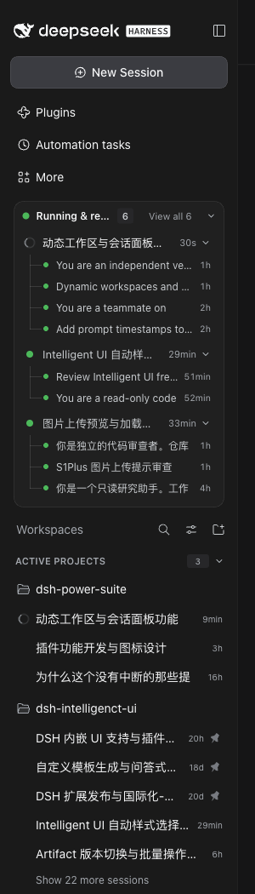

# Dynamic Workspaces

A DSH Power Suite feature: the native sidebar Workspaces browser gains two
activity buckets and a running & recent Sessions summary card, without replacing
the shipped browser. Native search, context menus, add-workspace flow, drag
reordering, and dialogs keep working because their nodes are never touched.



The row hover detail (Workspace, Status, Last active, subagent count):


## What it adds

- **Active Projects / Inactive Projects buckets** — the native Workspace
  sections are split into two labelled groups. Each bucket has one header with
  its Workspace count and a fold control; the Active group is ordered by most
  recent activity, the Inactive group keeps the native order.
- **Running & recent card** — a collapsible card above the native
  Workspaces section header lists the Sessions that are running now and the
  Sessions that finished recently, newest first, and opens any row's Session.
- Both surfaces update live in both directions: a Workspace moves to Active when
  one of its Sessions starts, drops back to Inactive once nothing it accounts
  for is running or inside the retention window, and a finished Session lingers
  in the card instead of vanishing on the stop.

## Active and Inactive Projects

A Workspace is **Active** while at least one of its accounted Sessions is:

- **running now** — the live Session-status snapshot is authoritative; the
  Session list summary's running bit is the fallback while that snapshot is
  still loading; or
- **last active within the retention window**.

The retention window is the `DW_ACTIVE_WINDOW_MS` constant in the
`//#region feature: dynamic workspaces` section of
[`src/client.js`](../src/client.js): **12 hours** today. It keeps a project in
Active after its last turn ends, so the "I left it here" affordance survives a
break; it is a code constant and has no settings UI. Inactive means no accounted
Session is running and none was active inside the window.

- A parent Session whose own turn has closed still counts while a delegated
  **direct subagent** runs; the hover card names the running subagent count. A
  finished subagent alone does not end the parent's task.
- Sessions that no Workspace accounts for form the native ungrouped section; it
  follows the same rule and its card rows read `Ungrouped`.
- Blank and archived Sessions are ignored when accounting activity: an archived
  row stays available under the native archived filter, but it neither keeps its
  Workspace Active nor appears in the card.
- A 30-second clock tick re-evaluates expiry, so a Workspace drops to Inactive
  when its window ends even with no new Session event. Every other change
  follows the stores immediately — no page reload and no Host restart.
- The bucket counts are **Workspace** counts, not Session counts.
- The section order follows the native grouping: Active sections
  `order: 100 + index` (most recent activity first), the Active header
  `order: 0`, the Inactive header `order: 5000`, and Inactive sections
  `order: 5001 + index`.

## The Running & recent card

The card sits directly above the native **Workspaces** section header, below the
sidebar's panel tabs. It starts expanded.

- **Header**: a green pulsing dot, the title **Running & recent**, a count badge
  with the number of listed rows, and the disclosure controls. The pulse uses
  `corner-shape: round` so it stays a true circle under the shell's
  superellipse corner shape, and reduced-motion preferences stop its animation.
  The toggle block, the **View all** link, and the header chevron are all 30 px
  tall with the same corner radius (12 px in the shell), so their hover
  highlights line up; the chevron is the rightmost control and folds the body.
- **Rows**: a Session row is **one line**: status dot, title, and time, with a
  disclosure chevron at the far right when the Session has subagent children.
  Running Sessions come first, then recently finished Sessions inside the same
  12-hour window, each group newest activity first. A running row uses the
  shell's own `StateDot` with `state: "ongoing"` as its loading glyph — no
  bespoke spinner — and its right side shows the **observed run duration** once
  the run started while this page has been open; for a run that was already
  going when the page loaded it falls back to the relative last-activity time. A
  finished row uses the shell's green `StateDot state: "done"` and a relative
  time. The Workspace is not printed under the row any more; it lives in the
  hover card below.
- **Hover detail**: resting on a row for about a quarter second opens a
  native-style card beside it with the Session title, **Workspace** (the
  durable title and its path), **Status** (`Running`/`Finished` plus the observed
  or relative time), **Last active** (absolute `YYYY-MM-DD HH:MM`), and the
  subagent count when it has one. The card does not capture the pointer and
  hides shortly after the pointer leaves; clicking still opens the Session.
- **Nested subagents**: a parent row with running or recently active direct
  subagent Sessions gets a per-parent disclosure chevron at its far right.
  Expanding it shows the children indented deeper beneath the parent, connected
  by a thin vertical trunk that is centered under the parent's status indicator
  (the dot column) with one short horizontal branch to each child's indicator;
  the trunk is masked below the last child's tick, so no dangling line hangs
  under the group. Each child has its own status dot, title, and relative time.
  Each parent folds independently; the card header still folds the whole list.
- **Click**: clicking a parent row opens that Session; clicking a child row
  opens the child Session. The disclosure chevron is a separate control.
- **Five-row default**: with more than five top-level rows the header also shows
  **View all {count}**; **Show less** returns to the first five (children stay
  inside their parent row and do not count against the limit). The body scrolls,
  and a very long title truncates.
- **Empty state**: **No running sessions** with the sentence that Sessions in
  progress across every Workspace appear there. Blank, archived, and Sessions
  with `origin: "subagent"` never appear as top-level rows; subagent Sessions
  are reachable through their parent's nested row.

Finished rows deliberately linger: a stop moves the Session below the running
rows, it stays for the retention window, and then it leaves the card. This is the
"find it again" behavior the card exists for.

## Collapsing the buckets

Each bucket header is a button with the uppercase label, the Workspace count,
and a chevron at the far right. Folding a bucket hides that bucket's native
sections with an inline `display: none`; the native nodes stay alive, so their
menus, hover states, and drag state survive. The chevron flips and the header
keeps its `aria-expanded` state.

The two fold states persist in `localStorage` under
`power-suite.dynamic-workspaces.folds`:

```json
{ "active": false, "inactive": true }
```

`true` means folded; a missing key, a malformed value, or denied storage degrades
to expanded and the in-memory state. The preference is per browser and per
profile: it does not sync across devices. The card's own expanded/collapsed state
is per page visit and is not persisted.

## How it fits the native browser

The native Workspaces browser keeps ownership of the surface. The feature only
adds sibling nodes and inline layout:

- **Anchors**: `[data-slot="sidebar.workspaces"]` (the slot wrapper the DSH
  renderer emits for the single `sidebar.workspaces` slot), its first element
  child (the browser root), `[role="tree"]` (the Session list), and the
  `data-row-key="workspace:<id>"` row inside each native group section (which
  tells the feature which Workspace a section renders).
- **Inserted nodes**: the summary-card slot is inserted as the first child of the
  browser root (above the native header); the two bucket headers are inserted as
  children of the native tree. No native node is wrapped, moved, or re-rendered.
- **Ordering**: the tree becomes `display: flex; flex-direction: column`, and the
  feature writes only `order` (and `display` for folding) on the native group
  sections. It matches no hashed native class name.
- **Reconciliation**: a `MutationObserver` on `[data-slot="sidebar"]` plus a
  500 ms retry keeps the foreign nodes present across native re-renders and
  sidebar folds. Unloading the plugin removes every inserted node and clears
  every inline `order`/`display` it wrote.
- **Styling**: theme tokens only; the pulse and the animated flow bar are
  stopped under reduced motion, and the disclosure chevrons keep their short
  transform transition.

## Rail behavior

The collapsed (rail) sidebar has no `[role="tree"]`. The feature keeps the card
node mounted but hides it with `display: none` and leaves the rail untouched;
widening the sidebar restores the card, and the bucket headers are created again
on the new tree. The card therefore never competes with the rail's icon column.

## Grouping modes

The native **View options** menu picks how Sessions are grouped:

| Native mode | What the feature does |
|---|---|
| **WorkSpace** | Native Workspace group sections exist: both buckets and the summary card apply. |
| **Workspace Tree** | Same: the nested Workspace groups are banded into the two buckets. |
| **In one list** (flat) | There are no Workspace group sections to band, so no bucket headers appear; only the summary card applies. |

## Limits

- **Expanded sidebar only.** Rail mode hides the card and offers no tree to
  bucket.
- **Flat list mode has no buckets.** Only the summary card applies.
- **DSH DOM dependency.** The anchors are internal to the shipped sidebar, not a
  public contract. If a future DSH changes the slot attribute, the `tree` role, or
  the row-key scheme, this feature degrades to doing nothing while the native
  browser keeps working.
- **Fixed retention window.** Active and "recent" use the 12-hour
  `DW_ACTIVE_WINDOW_MS` constant; there is no setting UI for it.
- **Durations are observation-only.** A run's duration is exact only when this
  page was open when the run started; otherwise the row shows the Session's
  last-activity distance. A background tab throttles the once-per-second
  duration refresh until it is visible again.
- **Subagents nest one level deep.** Running or recently active direct subagent
  children are listed under their parent Session, and a running child keeps the
  parent counted as running. Subagent Sessions never appear as top-level rows —
  the native sidebar hides them outright, and the card is the only place they
  surface. When a parent row itself is outside the card (no running child and its
  own last activity aged out) its children are not exposed either, and
  delegations below the direct child are not walked. A finished subagent does
  not by itself finish the parent's task.
- **Parent disclosure state is per page.** Each parent's expanded/collapsed
  nested list is not persisted; only the two bucket folds are.
- **Client-side derivation, no Host route.** The card and buckets read the
  browser's Session, Session-status, and Workspace stores. There is no new
  `/api/` route for this feature, so a change made from another device can lag by
  one snapshot.
- **Per-browser state.** Bucket folds live in `localStorage` for one browser and
  profile; the card's open state is not persisted.
- **Blank and archived Sessions are skipped.** Rows come from the Session list,
  so a Session with no recorded content never appears, and an archived Session
  does not keep its Workspace Active.

## Verification

Manual checks on the running DSH Web GUI:

1. On a grouped view (**WorkSpace** or **Workspace Tree**), confirm the card sits
   above the native Workspaces header and both bucket headers render with their
   Workspace counts.
2. Start a turn in a Workspace: within one snapshot the Workspace moves into
   Active (top of that bucket) and its Session appears in the card with the
   ongoing dot and, after a second, a running duration.
3. Stop the turn: the Session stays in the card, moves below the still-running
   rows, and shows `done` with a relative time. Start another turn in the same
   Workspace: it stays in Active and its row returns to the running group. A
   Workspace becomes Inactive only after the 12-hour window, re-evaluated on the
   30-second tick; no page reload is needed at any step.
4. Fold **Active Projects**: its sections disappear, the chevron flips, and the
   state survives a page reload; unfold it again.
5. Rest a pointer on a card row: the hover card shows Workspace (title and
   path), Status with its time, Last active absolute time, and the subagent
   count when present; the card does not take the pointer.
6. If a listed Session delegated to subagents, its row shows a disclosure
   chevron at the far right: expanding reveals the child rows indented under the
   parent with the branch lines (the trunk is centered under the parent's dot
   and stops at the last child's tick), each opens its own Session, and
   collapsing hides the child rows again.
7. Check the card header geometry: the toggle block, **View all**, and the
   header chevron share one 30 px height and corner radius.
8. Collapse the sidebar: the card is hidden and no custom node shows in the rail;
   widen it: the card and buckets return.
9. Use the native Workspaces search, a Workspace context menu, the add-workspace
   flow, and drag reordering while the feature is mounted: none of them target
   the card or the bucket headers, and no row is lost.
10. Run `npm run check`; it stays green (syntax, package manifest, Markdown
    links, and the node tests).

See [verification.md](verification.md) for the recorded evidence.
