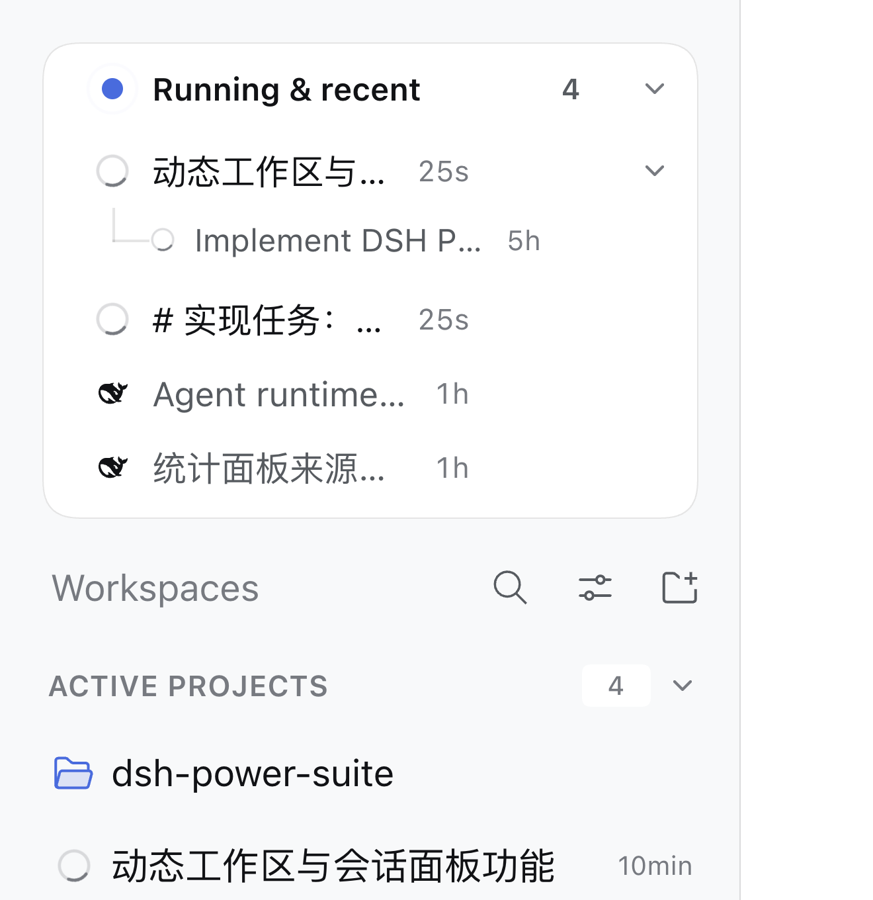

# Dynamic Workspaces

A DSH Power Suite feature: the native sidebar Workspaces browser gains two
activity buckets and a running & recent Sessions summary card, without replacing
the shipped browser. Native search, context menus, add-workspace flow, drag
reordering, and dialogs keep working because their nodes are never touched.

## What it adds

- **Active Projects / Inactive Projects buckets** — the native Workspace
  sections are split into two labelled groups. Each bucket has one header with
  its Workspace count and a fold control; the Active group is ordered by most
  recent activity, the Inactive group keeps the native order.
- **Running & recent card** — a collapsible card above the native
  Workspaces section header lists the Sessions that are running now and the
  Sessions that finished recently, newest first, and opens any row's Session.
- Both surfaces update live in both directions: a Workspace moves to Active when
  one of its Sessions starts, drops back to Inactive once nothing it accounts
  for is running or inside the retention window, and a finished Session lingers
  in the card instead of vanishing on the stop.
- The card and the buckets are aligned to the native sidebar's own geometry: the
  same right-anchored control columns in every row and the header, the native
  14 px/20 px row type, title-case bucket labels, borderless native-style
  floating cards, a native-aligned row hover card, and plugin input focus
  highlighted with the rainbow track (see *Plugin chrome*). Opening a Session
  paints a soft rainbow smoke glow on the bottom face of its row and of its
  Project's row.
- **Configurable windows** — the two retention windows are Host settings on the
  suite's Plugins page ([Settings](settings.md)): finished-Session retention
  (1/2/6/12/24 hours, default **2 hours**) and active-project retention
  (1/3/7/14/30 days, default **7 days**). Running Sessions ignore both. Changes
  apply to the card, its nested subagent rows, and the buckets without a reload.

## Active and Inactive Projects

A Workspace is **Active** while at least one of its accounted Sessions is:

- **running now** — the live Session-status snapshot is authoritative; the
  Session list summary's running bit is the fallback while that snapshot is
  still loading; or
- **last active within the retention window**.

The retention window is the Host-backed **Active project retention** setting
([Settings](settings.md)): 1/3/7/14/30 days, default **7 days** (field
`activeProjectDays`). It keeps a project in Active after its last turn ends, so
the "I left it here" affordance survives a break. Inactive means no accounted
Session is running and none was active inside the window.

- A parent Session whose own turn has closed still counts while a delegated
  **direct subagent** runs; the hover card names the running subagent count. A
  finished subagent alone does not end the parent's task.
- Sessions that no Workspace accounts for form the native ungrouped section; it
  follows the same rule and its card rows read `Ungrouped`.
- Blank and archived Sessions are ignored when accounting activity: an archived
  row stays available under the native archived filter, but it neither keeps its
  Workspace Active nor appears in the card.
- A 30-second clock tick re-evaluates expiry, so a Workspace drops to Inactive
  when its window ends even with no new Session event. A settings change to the
  window re-derives the buckets immediately. Every other change follows the
  stores — no page reload and no Host restart.
- The bucket counts are **Workspace** counts, not Session counts.
- The section order follows the native grouping: Active sections
  `order: 100 + index` (most recent activity first), the Active header
  `order: 0`, the Inactive header `order: 5000`, and Inactive sections
  `order: 5001 + index`.

## The Running & recent card

The card sits directly above the native **Workspaces** section header, below the
sidebar's panel tabs. It starts expanded.

- **Header**: the leading indicator has two states. While at least one listed
  Session is running it is a **blue pulsing dot** — a business-primary 8 px dot
  with an expanding ring on a 2 s loop (static under reduced motion); when every
  task is complete it is the white 14 px RemixIcon **deepseek-fill** brand glyph.
  Both states are horizontally centred on the same **leading-glyph column** as
  the top-level rows (the pulse/brand glyph, the green unread-completion dots,
  and the white read-row identity icons share one centre; header pulse/brand
  centre x = 43 and row glyph centre x = 43), and the header title starts on the
  same column as the row titles (x = 58), followed by the **Running & recent**
  title. The text block (indicator, title) is content-sized, so its hover
  highlight hugs the label instead of stretching across the header; a flexible
  spacer then pushes the trailing controls to the right. Those controls share
  the row grid: the **View all** link keeps its 30 px hover block, an empty
  **time column** (48 px) follows, then the **count badge** with the number of
  listed rows is right-anchored on the fixed **action column** (its natural
  width spills left into the empty time column), and the **header chevron**
  closes the same 24 px **disclosure column** every row uses.
  The toggle block, the link, and the chevron are all 30 px tall with the same
  corner radius (12 px in the shell), so header and row controls line up
  vertically. The chevron folds the body; clicking anywhere in the header that
  is not a control folds it too.
- **Rows**: a Session row is **one line**. Four columns are anchored from the
  right edge, left to right: the title/content column, a 48 px right-aligned
  **time column** (11 px tabular numerals), a fixed 22 px **New session action
  column**, and a 24 px **disclosure column**. Every parent and child row
  reserves all of them — child rows keep the action and disclosure columns as
  empty fixed spacers — so a subagent row's time ends on exactly the same x as
  its parent row's time. A flexible **spacer** (`flex: 1 1 auto; min-width: 0`)
  between the title control and the trailing grid absorbs every spare pixel, so
  the trailing grid is **right-anchored at any card width**: the disclosure
  column's right edge always equals the row's right edge and every row's time
  right edge equals `row right − 50 px` (22 action + 24 disclosure + the two
  2 px gaps), no matter whether a title is short or clipped. The title control
  keeps its content-paced width (so the hover pill still hugs the label) and its
  `max-width: calc(100% − 100 px)` cap, and the right-edge gradient mask fades a
  clipped title inside the pill's right padding (parent rows end 10 px before
  the content-column boundary, child rows 8 px), never under the trailing
  columns. The 14 px/20 px title size matches the native sidebar rows, and the
  time is drawn at 11 px in the tabular-numeric tertiary label colour. Running Sessions are always listed,
  then recently finished Sessions inside
  the finished-Session **retention window** (default 2 hours, configurable in
  [Settings](settings.md)), each group newest activity first. A running row uses the
  shell's own `StateDot` with `state: "ongoing"` as its loading indicator — no
  bespoke spinner — and its right side shows the **observed run duration** once
  the run started while this page has been open; for a run that was already
  going when the page loaded it falls back to the relative last-activity time.
  The glyph then tells the read state: a **finished but unread** row shows the
  shell's green `StateDot state: "done"` (the green marker means *only* this
  unread completion), while a **finished and acknowledged** row swaps the green
  dot for the white identity icon — the RemixIcon `sparkling-line` glyph on main
  rows and `robot-2-line` on subagent rows, drawn at 14 px / 12 px in the primary
  label colour. The panel header's all-complete glyph is the DeepSeek brand mark
  (`deepseek-fill`) in the same 14 px indicator slot; the swap changes only which
  static glyph each slot paints, never the pulse dot, the green dot, the glyph
  column, or any state branch. Opening a Session from this card or anywhere else
  acknowledges it; the acknowledgement is **persisted per browser** and keeps
  the green dot away until genuine new activity arrives (see *Read
  acknowledgements* below). The Workspace is not printed under the row any more;
  it lives in the hover card below.
- **Read acknowledgements**: read marks are **shared through the Host** and
  cached per browser (see *Shared read acknowledgements* below). Opening a
  finished Session raises its baseline; a row is read while
  `baseline >= updatedAt - 1000 ms`, with no running-status input, so a transient
  running flag can no longer resurrect the green dot. Rows and nested subagent
  children share the same baselines, and completed rows still leave the card
  once the finished-Session retention window expires.



- **Row actions**: **main (parent) rows** carry the **New session** button on
  the fixed 22 px action column between the time column and the disclosure
  column. **Nested subagent rows carry no New session button at all** (user
  decision: creating a Session belongs to the main row; the column stays
  reserved as an empty spacer so the child time keeps the parent time x). The
  button is hidden with opacity/`pointer-events` until the row is hovered or on
  keyboard `focus-within`, so revealing it never shifts the title, time, action
  or disclosure columns. The button stops the row's open handler; clicking the
  row body (including the title's faded tail) still opens the Session.
- **Interrupted rows**: a row whose Session is interrupted (main or child) shows
  an amber warning badge before the title, taken from the suite's shared
  interrupted-Session records; its **Continue** action reuses the interrupted
  feature's continuation request: it opens that Session and then sends the
  continuation once the conversation is open and idle. On a **subagent row**
  Continue sits in that row's fixed action slot (children have no New session
  button, so the slot is free). On a **main row** the slot is reserved for New
  session, so Continue is a hover/focus-revealed overlay immediately left of
  the time column, over the title's faded tail — the old cluster position — and
  no fixed column moves. Interrupted children therefore show only Continue in
  the action column; New session is never reintroduced for child rows.
- **New session**: the native shell's "new chat" sprite icon (with an inlined
  Remix fallback) creates a blank Session in **the row's own directory** using
  the Session service, then opens it — without opening the source Session. When
  the directory or creation is unavailable it falls back to the Workspace's
  **New Session** flow, and an in-flight guard stops double clicks from creating
  two Sessions.
- **Hover detail**: the row carries no native `title` tooltip; the hover card is
  the only detail surface. Resting on a row for about a quarter second opens a
  native-style card whose **title is the Workspace name** (not the Session name,
  which is already on the row), followed by the **full workspace path** (wrapped,
  not truncated) and then **Status** (`Running`/`Finished` plus the observed or
  relative time), **Last active** (absolute `YYYY-MM-DD HH:MM`), and the running
  subagent count when there is one. A nested subagent row adds one compact line
  under the Workspace title with that subagent Session's own title, so the
  figures below are attributed to the right Session; child rows and parent rows
  use the same card otherwise. The card reproduces the **native sidebar session
  tooltip** recipe measured live: its left edge is **flush with the sidebar
  column's right edge** (same offset 0 as the native tooltip, no longer
  intruding into the sidebar), its top aligns with the hovered row's top (then
  clamped to the viewport), and its chrome is the native borderless session
  hover card — 16 px radius, the shell's `--dsw-hovercard-bg` surface
  (`#2C2C2E`) with its static title/secondary/tertiary text colours,
  `--dsw-shadow-lv3` elevation, 12 x 16 px padding, 14/20 px title, 12/16 px
  path/time, and a 12/20 px status line with a 10 px dot — all inherited from
  the shell font. That surface is deliberately **theme-invariant**, exactly like
  the native session hover card: the shell pins its own hover-card background to
  #2C2C2E in both light and dark (the theme-dependent
  `--dsw-alias-tooltip-bg` token is *not* used for this card). The card is 320 px
  wide (the native tooltip is 244 px; the card grows so each native figure row
  fits its label and right-aligned value on one line) with `max-height:
  min(560px, calc(100vh - 16px))` and internal scroll. It does not capture the
  pointer in normal mode (same show/hide delays as before, dismissed by Escape,
  scroll, or resize), and clicking the row still opens the Session. Below the
  plain detail rows it appends the three **native session figures** (see
  *Session figures in the hover card* below). While the UI annotation mode is
  active the same card becomes **pinned/annotatable** (see *Plugin chrome and
  annotation mode* below).
- **Disclosure column**: the header chevron and every row's disclosure arrow
  share one 24 px right-edge column (not merely right-aligned), and rows without
  children — including every nested subagent row — reserve the same column with a
  spacer. Parent rows, child rows, and the header therefore share the same
  time, action, and disclosure columns: the header's empty time column and its
  count badge (right-anchored on the action column) complete the same grid.
- **Hover highlights**: the row-body highlight is a rounded pill paced by its
  **content** — the leading glyph plus the (possibly faded) title — with roomy
  horizontal insets so the text never touches the pill edge: parent rows use
  `padding: 4px 10px 4px 14px` (left 14 px, right 10 px) and child rows
  `padding: 3px 8px 3px 10px` (left 10 px, right 8 px), so the title's right
  edge always sits at least 8 px inside the pill's right edge (measured by the
  sidebar E2E alongside the unchanged right-anchored grid). The pill still
  never stretches across empty space. Non-text
  controls keep fixed highlight blocks that line up across all rows: 22 x 22 px
  for each action button and 24 x 26 px for the disclosure arrow. Hovering the
  disclosure arrow highlights only the arrow (the body pill is suppressed), so
  the two highlights stay independent and never compose into a nested two-layer
  highlight.
- **Row spacing**: rows are separated so the internal rainbow-atmosphere fills
  never touch — the card body uses a 5 px column gap between top-level items,
  a 4 px gap between a parent row and its child list, and a 5 px gap between
  child rows. The tree connector geometry stays coherent: the 1 px vertical
  trunk starts at the child list, still meets each child's tick, and the
  last-child mask ends the trunk cleanly below the last row. Hovering across the
  gaps still works (row hover intents are unaffected; the gap is only spacing,
  never a click target), and the gaps cause no horizontal layout change.
- **No body scrollbar**: the card body scrolls with the wheel or trackpad but
  hides its scrollbar (native `scrollbar-width` / WebKit rules), matching the
  native sidebar surfaces.
- **Nested subagents**: a parent row with running or recently active direct
  subagent Sessions gets a per-parent disclosure chevron at its far right.
  Expanding it shows the children indented deeper beneath the parent, connected
  by a thin vertical trunk that is centered under the parent's status indicator
  (the dot column) with one short horizontal branch to each child's indicator;
  the trunk is masked below the last child's tick, so no dangling line hangs
  under the group. Each child row has its own leading glyph (the same running /
  unread / acknowledged states, using the white `robot-2-line` icon when
  acknowledged), title, relative time, and the same reserved trailing columns
  (time, the empty 22 px action slot — Continue only while interrupted — and the
  disclosure spacer), so child and parent times and disclosure arrows sit on the
  same vertical lines. Child rows render no New session control.
  Each parent folds independently; the card header still folds the whole list.
- **Click**: clicking a parent row opens that Session; clicking a child row
  opens the child Session. The whole row body is clickable (the action buttons
  and the disclosure chevron are the separate controls).
- **Five-row default**: with more than five top-level rows the header also shows
  **View all {count}**; **Show less** returns to the first five (children stay
  inside their parent row and do not count against the limit). The body scrolls,
  and a long title fades out under the right-edge mask instead of colliding with
  the fixed trailing columns.
- **Empty state**: **No running sessions** with the sentence that Sessions in
  progress across every Workspace appear there. Blank, archived, and Sessions
  with `origin: "subagent"` never appear as top-level rows; subagent Sessions
  are reachable through their parent's nested row.

Finished rows deliberately linger: a stop moves the Session below the running
rows, it stays for the retention window, and then it leaves the card. This is the
"find it again" behavior the card exists for.

## Session figures in the hover card

The hover card appends the three native Session figures the shell shows in its
own stats dialogs and composer context meter, for the hovered Session — parent
or nested subagent row alike:

- **Session statistics** — header value `{turns} turns {steps} steps` (the native
  `stats.counts` line), then `LLM time`, `Tool time`, `Avg time to first token
  (TTFT)` (= `ttftMs / ttftSteps`), and `Tokens per second (TPS)` (=
  `decodeTokens / (decodeMs / 1000)`) in the native `formatDuration` /
  `formatTokensPerSecond` recipes (`45.2s` / `2m42s`; whole tokens from ten up,
  one decimal below). Timing rows appear only when their input is non-zero; the
  whole section is hidden while `steps === 0`, exactly like the native activity
  pill.
- **Token usage** — header value is the exact grouped total
  (`billed input + output`, e.g. `5,498,331 tok`), then `Cache hit {pct}%`,
  `Uncached input`, `Cached input`, `Cache write` (only when ≠ 0, native
  parity), and `Output`, each an exact grouped count (`formatExactTokens`, comma
  groups). The whole section is hidden when nothing was billed and no output was
  produced.
- **Context usage** — header line `{percent} of context used` plus
  `~{used} / {window}` in compact K/M (`517 / 12.2K / 517K / 1.2M`); then the
  heuristic composition `System prompt`, `Tool definitions`, `Messages`, each
  compact and prefixed `~`. The section is hidden unless the provider reported
  both a used count and a context-window size.

Data seam: these are **Host projections**, not a re-fold of the event log. The
plugin already receives the Session list store through its existing `sessions`
inject, and every live Host Session is push-seeded there — its
`projectionsBySession[id].values` carries `sessionStats`, `tokenUsage`,
`contextPressure`, and `contextBreakdown`, updated with each committed event, so
a live row needs **no request at all**. While the card stays open this is also
**not frozen at hover start**: the card re-renders on the panel's once-per-second
clock (and on every Session-store update) and re-reads the live
`projectionsBySession` snapshot each render, so `turns`/`steps`, token totals,
context percent and the observed run duration tick in place as frames arrive —
no extra polling, no extra network. Measured live while hovering: a running
parent went `3 turns 344 steps` → `3 turns 345 steps` (Tool time
`308m8s` → `313m50s`) within 15 s, and a running nested subagent went
`6 turns 398 steps / 357,367 output tok` → `6 turns 399 steps / 357,463 output
tok` (context `725K` → `726K`) within 6 s. A cold (persisted, not live) Session
carries only summary keys; the first hover of that row starts exactly one
`sessions.refreshProjections(id)` read (deduped per Session for the seat
lifetime, never polled, never retried after an error or a `migration-required`
result), and the card fills the figures in when the values land; cold Sessions
therefore stay one-shot. There is no
Host route, no new inject, and no loading state: the card renders immediately
with the plain rows and grows its sections in place. Missing units, unknown
Sessions, migration-only logs, and Sessions without usage all just omit the
affected sections (and the whole block when none has data).

## Shared read acknowledgements

Read state is Host-owned and shared by every browser/profile using the same
`$DSH_HOME`; the browser `localStorage` cache is per origin. The Host feature
(`src/features/read-acks/`) keeps a durable document:

```text
$DSH_HOME/dsh-power-suite/read-acks.json
{
  "version": 1,
  "acked": { "<sessionId>": <acknowledged updatedAt> }
}
```

- Entries are sanitized (string ids up to 200 chars, finite positive baselines),
  merged per id with `Math.max` (monotonic — there is no unread-removal verb),
  capped at **1000** entries (oldest baselines drop first), and written
  atomically with a serialized chain and `0600` mode.
- `GET|POST /api/power-suite.read-acks` — authenticated exact route: `GET`
  returns `{ acked }`; `POST` with `application/json` merges the posted entries
  and returns the merged document. The body limit is **64 KiB of UTF-8 bytes**
  (not string length). Errors: `415` for a non-JSON content type, `413` above the
  body limit, `400` for malformed ids/baselines, a **no-store `500`
  `{ code: "store-read-failed" }`** when a non-ENOENT read fails (GET or POST —
  the store never caches an empty result and refuses to overwrite unreadable
  marks), and a no-store `500 { code: "store-failed" }` when the durable document
  cannot be written. Every response is `cache-control: no-store`. Loads are
  **single-flight**, and publication forward-merges (`mergeAcked(state, parsed)`)
  so a stale load cannot clobber a newer record; `record()` awaits the same load
  in the serialized chain and `get()` returns the current state; a non-ENOENT
  read failure resets the promise and throws typed `READ_ACKS_READ_FAILED` so a
  later call retries after disk recovery.
- The browser keeps `localStorage['dsh-power-suite.acked-sessions']` as a fast,
  offline cache. On mount it reads the Host document and merges the per-id
  maxima, sends a migration POST on each mount (uploading the local cache's old
  marks — not once per upgrade), then re-syncs every **30 s** and on window
  focus/visibility; newly raised baselines
  are pushed with a **250 ms** debounce. Both the local cache and the pending
  push map are capped at **1000** entries (oldest baselines drop from the pending
  map; they remain in the local map and re-migrate later). Pushes are split into
  sequential batches of at most **200 entries / a conservative 48 KiB** (well
  under the Host's 64 KiB cap; at most one POST in flight): network, 5xx,
  **401/403/408/425**, and 429 failures stay queued and retry on the next
  sync/focus,
  while other permanent non-retryable 4xx (400/413/415/404 etc.) drop **only
  that batch immediately** so later acks still sync; entries that still hold the
  pushed value are removed after a successful POST. Client GET/POST requests and
  the activity fetch carry an **8 s `AbortController` timeout**; the sync uses
  `try/finally` to always clear its in-flight flag and **awaits the actual
  in-flight ack-push promise** before fetching activity, so no push is in flight
  when the activity request starts (at the cost of delaying that fetch by the
  push duration; measured: a POST delayed 300 ms made the activity GET start
  1 ms after it ended). The `localStorage` cache is per browser origin while the
  Host documents are shared per `$DSH_HOME` (`--profile` is only a config layer,
  so profiles sharing a home share these files; the read-acks store has no
  read-merge across writers, so concurrent profiles/HMR generations can
  overwrite each other's baselines — profile isolation is not provided). A
  missing route (a Host without the new feature) degrades silently to
  local-only behavior.
- Read state is derived at render: read iff
  `baseline >= activity - 1000 ms` (using the effective activity timestamp
  below). The old “running clears the ack” branch is gone, so momentary status
  flags cannot flip a row; genuinely newer activity exceeds the baseline and the
  unread dot returns on every device.
- Both new routes need a **Host plugin recompose** (reload the plugin / restart
  the Host process) to appear; no DSH restart is needed. After upgrading, open
  DSH once per machine to upload that browser's old local acks.

## Event-sourced activity ledger

The session list's `updatedAt` is the catalog **last-prompt** time, not last
activity: a turn that ran for hours looked hours old the second it stopped, so
the card's retention window dropped it immediately. The mtime of the
projection-cache document is no better — Host maintenance/restart appends
`session/end-seed` and rewrites documents long after real activity, which would
fabricate recency. The feature therefore builds its own ledger from the same
committed events DSH itself uses:

- **Live authority** — the Host subscribes to `ctx.on('session/event', …,
  { global: true })` inside its plugin effect. The explicit
  `ACTIVITY_EVENT_TYPES` allowlist advances a Session's entry (with `max`
  semantics) for known activity-bearing DSH event families: turns, steps,
  messages and assistant attempts; tools (including PTC dispatch); jobs
  (`registered`/`settled`); command runs; compaction start/end/prune/summary;
  subagent catalog/descriptor/model-selection-policy; goal and todo changes;
  approval asked/decided/policy; agent-preset/plan/sandbox/model/permission
  selections; working-directory, workspace/deliverable, and schedule changes;
  team traffic; image/offload; feedback operations; inbox splice; LLM retry; and
  tool-workflow agent/run progress. It also allows `hook/invoked`/`hook/result`
  for forward compatibility even though the installed kernel emits no hook
  events today. (`ptc-mode` is a message-source key, not a Session event, and is
  correctly not allowlisted.) The time must be a finite positive
  `event.time` for a valid Session id. The explicit
  `NON_ACTIVITY_EVENT_TYPES` (`request/header`, `request/context`,
  `session/title`, `session/title-llm-request`, `session/end-seed`,
  `session-log-deepseek/delivery-accepted`,
  `web/deepseek-search-llm-request`), any seed-pattern type, and unknown
  future/plugin event types **do not advance activity** — the card can
  under-report an unrecognized activity type, but it never fabricates recency.
- **Durable ledger** — `$DSH_HOME/dsh-power-suite/session-activity.json`:
  `{ "version": 1, "sessions": { "<sessionId>": <lastActivityAt> } }`. The store
  sanitizes ids (≤200 chars) and finite positive epoch-ms values, merges with
  `Math.max`, caps at the **5000 newest** Sessions, and writes atomically
  (temporary sibling + rename, `0600` file in a `0700` directory) on a
  serialized chain with a **750 ms** debounce. `record()` is the hot path: it
  mutates the in-memory map O(batch) and marks it dirty; sanitize/cap/copy happen
  only at snapshot/write, and the route copies once per request. Temp cleanup is
  best-effort, and a stale `*.tmp` from a failed removal is deliberately left
  unswept for concurrent-writer safety.
- **Durability contract** — `flush()` always awaits the serialized write chain
  (including an in-flight write) and keeps draining events recorded during a
  write until the ledger is stable, so a `dispose()` during a write does not lose
  the last committed events to the debounce/chain (subject to the failure
  caveats below). `dispose()` stops the debounce timer, flushes, awaits the
  **write chain but not an in-flight ledger load**, and is idempotent. Host cleanup unsubscribes the `session/event`
  listener first and then **returns** `ledger.dispose()`, so Cordis awaits the
  write chain before the plugin unloads. **Failure caveats:** an abrupt
  process crash before the 750 ms flush can still lose the last debounce window
  (no `fsync` contract), and if a **disk write fails**, `flush()`/`dispose()`
  still resolve (the Host lifecycle is never rejected): the map is kept in
  memory for a later retry, no durability is claimed for that write, and because
  the listener has already been stopped that failed write is not retried by this
  instance. Both are accepted.
- **Best-effort read-merge writes** — every write re-reads the current file,
  merges the `max` per Session id, writes the merged map, and absorbs any
  external entries into memory. This is designed for the normal single-Host
  process and overlapping HMR generations: a **sequential** external write is
  preserved, but the read-merge-write sequence has a **TOCTOU window**, so two
  writers interleaving between the read and the rename can still lose one side.
  It is **not a cross-process lock**, and merging is per-id max only (it does not
  order distinct Host generations beyond that). Temp files carry a random
  suffix; a failed write attempts to remove the temp sibling (best-effort, stale
  `*.tmp` may remain by design). A corrupt/missing file loads as empty and
  schedules an empty rewrite, while a valid empty document is not rewritten.
  **Read-error policy:** only **ENOENT** counts as empty; any other read failure
  keeps the in-memory map, does **not** schedule an empty rewrite, throws typed
  `ACTIVITY_READ_FAILED`, resets the load promise so a later request retries, and
  aborts a write that cannot safely read the document (so an unreadable ledger is
  never overwritten with a partial merge). The Host `ensureLoaded()` resets and
  rethrows, `ensureSeeded()` resets the seed promise with the existing 30 s
  backoff, and the route catches and serves **`200` snapshot/empty, never 500**;
  after recovery the next GET after the backoff retries load + seed and returns
  the recovered entries, while during the backoff a GET may serve current/empty
  memory `200`.
- **One-time baseline** — on install, Sessions already in the catalog without a
  ledger entry are seeded from their per-record projection-cache document's
  `max(timeContext.lastMessageTime, timeContext.lastInjectionTime)` (16 MiB
  document cap, id/path guard, document mtime used only as a re-parse guard —
  never as a value); cache/header baseline times are clamped to `now + 60 s` so a
  corrupt future value cannot pin activity, while live committed `event.time` is
  trusted unclamped. A Session with no usable cache row falls back to the
  header's **`createdAt` only** (DSH's SessionHeader has no `updatedAt`), a
  creation-time approximation. The seed is merged with max semantics so it never overwrites
  newer live events; a listing failure leaves the ledger untouched.
- **Route** — `GET /api/power-suite.session-activity` keeps the same path and
  `{ sessions }` contract and serves a cheap snapshot of the live ledger (no
  per-request document scan, no TTL), `cache-control: no-store`; a broken ledger
  degrades to `200 { sessions: {} }`. **Cold load**: the route awaits the
  single-flight ledger load plus the one-time baseline through a bounded
  **`waitForSeeded(5000 ms)`** before snapshotting. An existing durable ledger is
  returned fast (measured ~12 ms / 407 entries); a first cold request may wait up
  to 5 s for a seed that is **still pending**. If that wait times out, the route
  serves the current map without waiting for the next **30 s** while background
  seeding continues; a late success clears the backoff and seeded values resume,
  and a permanently hung listing can again wait ≤5 s after each 30 s window. A
  seed that **fails/rejects** is different: a rejected seed promise may set the
  immediate-serve backoff window **and the Host resets the seed promise**, so a
  later request retries load + seed and seeded history can appear after recovery;
  during the backoff a GET may serve current/empty memory. A `listSessions()`
  rejection is swallowed inside the baseline, so that attempt settles without an
  error or retry and seeded history can remain absent until a recompose. Only
  live committed events keep advancing activity outside those paths. The route
  never answers 500 for either case.
- **Client** — the map is fetched on the existing card sync cadence (mount,
  focus, visibility, 30 s — no extra timer, 8 s `AbortController` timeout) and
  folded in as `effectiveUpdatedAt = max(summary.updatedAt, activity[id])` for
  the recent-row cutoff/order/time, running-row order/time, Active/Inactive
  recency, nested child timestamps, and the read-baseline raise. Responses are
  merged **monotonically per id** (`max(previous, next)`) and pruned only against
  a **non-empty** Session catalog, so partial/empty activity responses and HMR
  overlap cannot drop a known Session's activity; a genuinely empty catalog never
  prunes (stale map entries may remain, but no rows show). This client rule has
  no node-test harness. A genuine clear therefore does not take effect while the
  catalog still lists the Session — it applies on reload or after the Session
  leaves the catalog (an empty/partial response can never drop known activity).
  The sync **awaits** the in-flight ack-push promise before fetching activity.

Exactness: values are **exact for allowlisted events this Host observed**
(including `turn/end` of long, interrupted, or failed turns). Sessions that
existed before install only have the one-time cache-document/`createdAt`
approximation, so a historical or seed-only completion can be under-reported —
never fabricated; unknown future event types are under-reported until the
allowlist grows. The Host half needs a plugin Host recompose (reload the plugin /
restart the Host process; no DSH restart) after upgrading.

## Current-Session highlight

The row for the Session the main conversation currently shows gets a low-intensity
animated rainbow "atmosphere" painted **inside its own rounded-rectangle highlight**,
with the real title/time/action content layered above it. The same treatment is
applied to the native Workspace row that owns the Session and, since B4 v3, to the
native sidebar Session row of the open Session:

- **Semantics**: the current Session is the client summary the main view retains
  (`retainedBy.mainView > 0`) — the same source the read-baseline effect trusts.
  A Session that just gained retention wins over an older one that is still being
  released, so opening a Session anywhere (card, native sidebar, elsewhere) moves
  the highlight immediately; exactly that row gets `.psd-run-current` (child:
  `.psd-child-current`) plus `aria-current="true"`. A nested subagent child gets
  the same atmosphere wrapper, and when a subagent Session is the open one the
  highlight lands on its parent Session's Workspace. The native sidebar Session
  row of the open Session carries `data-psd-current-session="true"` and the owning
  native Workspace row carries `data-psd-current-workspace="true"`. The highlight
  disappears when the row leaves the card. Merely-running or unopened completed
  rows are intentionally **not** highlighted and never get a renderer.
- **Visual / layer order**: the highlight is the row's **own rounded-rectangle
  background**, now filled with a rainbow gas instead of a bottom-edge flourish.
  Inside one clipped rounded rect, bottom to top:
  1. the row's existing neutral surface stays untouched (the native rows keep
     their own gray/business highlight; the plugin's own card rows stay
     transparent);
  2. `.psd-atmos` — an absolutely positioned wrapper (`inset: 0`,
     `border-radius: inherit`, `overflow: hidden`, `pointer-events: none`) that
     hosts a small self-contained **Canvas 2D gas renderer**. The canvas is
     sized to the row box (DPR clamped to 1.25, ~30 fps) and paints a broad
     prism wash plus nine drifting/breathing radial blobs. The blobs paint over
     each other (source-over, not additive) so overlapping hues stay saturated
     instead of summing to grey/white. The vivid theme recipe: light theme
     `mix-blend-mode: multiply` + `blur(3px) saturate(1.5) brightness(1.05)`,
     dark theme `mix-blend-mode: screen` + `blur(3px) saturate(1.5)
     brightness(1.14)`. Config baseline: intensity .64, spread 1.18, drift 1.2,
     stirring .58, breathing .22, blend 1.0, vibrance 1.72, `prism` palette
     (before the vibrancy pass: intensity .56 / spread 1.16 / blend .90 /
     vibrance 1.32);
  3. `.psd-atmos-scrim` — a veil above the canvas so the row content stays
     readable without dulling the gas. Light usage is a **white readability
     veil** `rgba(255,255,255,.68)` → `rgba(255,255,255,.55)` (the canvas itself
     is a brighter pastel there: `saturate(1.22) brightness(1.22)`); dark mode
     keeps the original `rgba(16,18,22,.12)` → `rgba(16,18,22,.22)` dark scrim
     (`z-index: 1` inside the wrapper);
  4. the real row content is raised to `position: relative; z-index: 2` — its
     DOM, events, grid/columns and hover actions are unchanged.
  **Light-mode readability:** the light wrapper is a translucent veil
  (`opacity: .56`, `.68` on row hover — down from `.78/.92`) so the pill stays a
  bright pastel instead of a medium saturated slab. Secondary text/icons of the
  plugin's own highlighted rows (time, glyph, brand, row actions, toggle) are
  lifted from `label-tertiary` to `label-secondary` in light mode, so they clear
  WCAG AA on the remaining pastel; the title keeps `label-primary`. Measured
  before → after on the card row's local backdrop: title `5.5:1 → 14.7:1`
  (`#0f1115` on `rgb(162,124,186) → rgb(238,234,237)`), time/icons/actions
  `1.08:1 → 4.52:1` (`#81858c → #61666b`); native Workspace row title `15.5:1`.
  Dark mode is untouched (screen blend, dark scrim, `.78/.92`, measured title
  contrast keeps its pre-fix baseline).
  The sidebar E2E pins both baselines: dark vividness (`saturate(1.5)`, wrapper
  opacity ≥ .7, dark scrim max alpha ≤ .24, blob-core saturation ≥ .45) and the
  light readability recipe (canvas `saturate(1.22) brightness(1.22)`, white veil
  alpha 0.4–0.75, wrapper opacity ≤ .72, card title ≥ 4.5:1, card time ≥ 4.5:1,
  trailing controls ≥ 3:1, native-row titles ≥ 4.5:1 and native worst visible
  text ≥ 3:1 — the native tertiary time stays a shell token at ~3:1, see
  limitations) so neither theme can silently regress (measured blob-core
  saturation is ~0.40+ animated / ~0.30 static).
  Only highlighted
  rows exist and animate; one renderer per highlighted row (max 3: card row +
  native Workspace row + native Session row). A hidden tab pauses the RAF loop,
  `prefers-reduced-motion: reduce` paints one static pastel frame and stops the
  loop, and the renderer/canvas/listeners are destroyed as soon as the row stops
  being highlighted. There is no rainbow border, ring or outer glow, and no
  layout shift (the wrapper is absolutely positioned).
- **Workspace and Session rows**: the native Workspace row of the current
  Session's project is marked with `data-psd-current-workspace="true"`, and the
  native sidebar Session row of the open Session with
  `data-psd-current-session="true"`. Both get the identical injected
  `.psd-atmos` wrapper + canvas + scrim as their first child (the wrapper covers
  the row's paint box, so the native row's transparent inline borders are
  respected) and their existing content children are raised to
  `position: relative; z-index: 2` by CSS. The nodes are re-injected by the same
  sidebar MutationObserver + reconcile loop that keeps the bucket headers alive,
  so a native re-render cannot drop them; the marker attributes, wrapper,
  renderer and canvas are removed when another Session is opened, when the row
  stops owning the current Session, and on plugin unload. Native rows are never
  otherwise modified.
- **Feature-set alignment**: the atmosphere replaces both the previous
  "current-chat ring" and the B4 bottom-face smoke-glow layers entirely; no
  `.psd-child-ring`, no `.psd-child-wave`, no conic gradient and no
  `psd-smoke-*`/`psd-glow-*`/`psd-wave-*` animation remains.

## Collapsing the buckets

Each bucket header is a button with the title-case label, the Workspace count,
and a chevron at the far right. Folding a bucket hides that bucket's native
sections with an inline `display: none`; the native nodes stay alive, so their
menus, hover states, and drag state survive. The chevron flips and the header
keeps its `aria-expanded` state. A collapsed bucket is also applied when a
native re-render resets an inline `display`/`order`: the observer watches the
section style attributes and every write compares the current value first, so
the fold cannot be clobbered (and redundant writes cannot loop).

The two fold states persist in `localStorage` under
`power-suite.dynamic-workspaces.folds`:

```json
{ "active": false, "inactive": true }
```

`true` means folded; a missing key, a malformed value, or denied storage degrades
to expanded and the in-memory state. The preference is per browser and per
profile: it does not sync across devices. The card's own expanded/collapsed state
is per page visit and is not persisted.

The last observed Active/Inactive classification of every Workspace is cached
under `power-suite.dynamic-workspaces.buckets` (versioned document mapping
Workspace ids and the ungrouped section to `active`/`inactive`). A reload paints
the native tree before the Session catalogue hydrates, when every section would
otherwise classify as Inactive; for that pre-hydration pass only, the cached
classification is used, so a collapsed bucket is hidden on the first observable
paint instead of appearing expanded and collapsing later. Once the catalogue
reports ready, live classification wins and both the native sections and the
cache are corrected, so a stale cache entry can never stick.

## How it fits the native browser

The native Workspaces browser keeps ownership of the surface. The feature only
adds sibling nodes and inline layout:

- **Anchors**: `[data-slot="sidebar.workspaces"]` (the slot wrapper the DSH
  renderer emits for the single `sidebar.workspaces` slot), its first element
  child (the browser root), `[role="tree"]` (the Session list), and the
  `data-row-key="workspace:<id>"` row inside each native group section (which
  tells the feature which Workspace a section renders).
- **Inserted nodes**: the summary-card slot is inserted as the first child of the
  browser root (above the native header); the two bucket headers are inserted as
  children of the native tree. No native node is wrapped, moved, or re-rendered.
- **Ordering**: the tree becomes `display: flex; flex-direction: column`, and the
  feature writes only `order` (and `display` for folding) on the native group
  sections. It matches no hashed native class name.
- **Markers**: the only native-node mutations are the inline `order`/`display`
  the feature already owned and one `data-psd-current-workspace` attribute on the
  current Session's Workspace row (removed on change/unload). Everything else is
  read-only DOM traversal.
- **Reconciliation**: a `MutationObserver` on `[data-slot="sidebar"]` plus a
  500 ms retry keeps the foreign nodes present across native re-renders and
  sidebar folds; the observer also watches section style attributes so a native
  re-render cannot reset an applied fold. Unloading the plugin removes every
  inserted node, clears every inline `order`/`display` it wrote, and removes the
  Workspace marker.
- **Styling**: theme tokens only; the wave and focus animations are stopped
  under reduced motion, and the disclosure chevrons keep their short transform
  transition.

## Plugin chrome: fonts, borders, focus

Plugin surfaces follow the shell's own recipes instead of bespoke chrome:

- **Fonts**: every surface inherits the shell font family (`font: inherit` /
  the shell text tokens) and uses the native sidebar sizes — Session row titles
  14 px/20 px at weight 400 (nested subagent titles 13 px), the card title
  13 px/20 px at weight 500, 11 px tabular-numeric times, 12 px secondary rows.
  Bucket labels are **title case** ("Active Projects" / "Inactive Projects");
  the former `text-transform: uppercase` and letter spacing are gone. Plugin
  code blocks use the shell code-font token `--ds-font-family-code` (the
  earlier `--dsw-font-code` name did not exist, so they silently fell back to a
  generic monospace).
- **Borderless floating cards on the native tooltip surface**: the row hover
  card, the hover Quick Look card (`.dsa-quicklook`) and the prompt-history
  preview/search cards (`.psp-rail-card`, `.psp-search-card`) are borderless: no
  outline/border and no 0.5 px `--dsw-elevation-*` stroke ring — they use the
  native tooltip elevation `--dsw-shadow-lv3` (0 0 1 px #0003, 0 0 4 px
  #00000005, 0 12 px 32 px #00000014) with a 16 px radius. All four share the
  native session hover card's **theme-invariant surface**:
  `background: var(--dsw-hovercard-bg, #2C2C2E)` (the shell pins that token to
  #2C2C2E in both themes, exactly like its own session hover card; the
  theme-dependent `--dsw-alias-tooltip-bg` is deliberately not used), no
  background-image and no backdrop filter, with the shell's static
  title/secondary/tertiary text colours
  (`--dsw-static-neutral-bluish-00`/`-300`/`-400`), and inner quick-look panels
  left transparent so the whole card reads as one flat tooltip surface. The
  sidebar E2E measures the live native tooltip in emulated light **and** dark
  and asserts every one of the four cards computes the same background, border,
  radius and elevation in both themes.
- **Rainbow focus highlight for plugin inputs**: focused plugin text inputs and
  choice controls show the same flowing rainbow track that used to draw the
  current-chat ring, in place of a solid-colour focus border. The shared class
  is `.psf-rainbow-focus` (see `DW_CSS`): a `::after` overlay with a
  `conic-gradient` of the seven rainbow stops, a `mask-composite: exclude` ring
  mask, a blurred `drop-shadow` glow, and a 3.2 s `@property --psf-ring-angle`
  rotation plus a 14 s hue drift. The look is parameterised with CSS custom
  properties (`--psf-ring-sat`, `--psf-ring-glow`, `--psf-ring-glow-alpha`,
  `--psf-ring-opacity`, `--psf-ring-thickness`); the shared defaults keep the
  original stronger look (saturate .92, 5 px glow at .38 alpha, opacity 1,
  2 px track), so the **settings choice pills** (`.dps-choice-option` — whose
  old solid outline rule is removed) and any annotation surface using the class
  are unchanged. The **prompt-history search card** carries the ring instead of
  its inner input: the card element itself gets `.psf-rainbow-focus`, so when the
  input inside it has focus the ring wraps the **whole floating card**
  (`focus-within` → card `::after`). It uses the deliberately calmer variant:
  focus opacity `.58`, a 1.5 px track, `saturate(.8)`, a 2.5 px glow at .2
  alpha, and a slower 4.6 s spin / 20 s hue drift — the same rainbow, just a
  soft accent instead of a bright border. The ring keeps its `inset: -3px` hug
  on every card edge with the matching radius (`card radius + 3 px`), which is
  why the card's `overflow` is `visible` (otherwise the outside pseudo-element
  would be clipped); the inner `span.psp-search-field` / input are now
  **ringless** and keep a clean focus state while retaining keyboard focus.
  Opacity transitions in at 140 ms and nothing shifts layout or card geometry. `prefers-reduced-motion: reduce` leaves a static rainbow ring (the
  calm search variant stays static too), and `forced-colors` mode replaces it
  with a system `Highlight` outline so focus stays visible in high-contrast mode.

## Annotation mode integration

The UI annotation mode can inspect plugin surfaces. While
`document.documentElement[data-psa-active="true"]` is set:

- the row hover card is marked with `data-psd-pinned="true"` (the stable
  `data-psd-hovercard=""` attribute is always present), stays open when the
  pointer leaves the anchor row, and becomes pointer-interactive through the
  annotation stylesheet's `html[data-psa-active='true'] [data-psd-hovercard]`
  override (the annotation side owns that CSS; the plugin sets no
  annotation-only z-index itself);
- leaving the card closes it even in annotation mode;
- the annotation mode broadcasts `power-suite:ui-annotation-state` with
  `detail.active`; the plugin clears a pinned card on `active: false` and
  cancels a pending hide on `active: true` (listener registered/removed with the
  card's component lifecycle).

Normal mode is unchanged: no `data-psd-pinned`, `pointer-events: none`, the
same 260 ms show / 140 ms hide delays, and the plugin's own z-index/elevation.

## Rail behavior

The collapsed (rail) sidebar has no `[role="tree"]`. The feature keeps the card
node mounted but hides it with `display: none` and leaves the rail untouched;
widening the sidebar restores the card, and the bucket headers are created again
on the new tree. The card therefore never competes with the rail's icon column.

## Grouping modes

The native **View options** menu picks how Sessions are grouped:

| Native mode | What the feature does |
|---|---|
| **WorkSpace** | Native Workspace group sections exist: both buckets and the summary card apply. |
| **Workspace Tree** | Same: the nested Workspace groups are banded into the two buckets. |
| **In one list** (flat) | There are no Workspace group sections to band, so no bucket headers appear; only the summary card applies. |

## Limits

- **Expanded sidebar only.** Rail mode hides the card and offers no tree to
  bucket.
- **Flat list mode has no buckets.** Only the summary card applies.
- **Light-mode contrast is plugin-owned only inside the plugin's own rows.** The
  atmosphere's light-mode white veil, the `label-secondary` lift for the plugin's
  own secondary text/icons, and the E2E baselines apply to `.psd-*` rows; native
  shell text inside the marked Workspace/Session rows keeps shell tokens (the
  native tertiary time stays around 3:1 on light surfaces). The native document
  preview/Workspace preview pane is shell-owned: measured in light theme it is a
  white surface with `--dsw-alias-label-primary` text (18.9:1) and its remaining
  low-contrast items are the shell's own diff sub-palette (line numbers/hunk
  `#81858c` ≈ 3.7:1, added-line green `#22c55e` ≈ 2.3:1 on white). This plugin
  defines no `--dsw-*` theme tokens and does not override those surfaces, so a
  dark-on-dark preview is a shell/theme-state issue to fix in the shell theme,
  not here; the plugin's intentionally dark floating previews use the native
  hover-card surface with static light text.
- **DSH DOM dependency.** The anchors are internal to the shipped sidebar, not a
  public contract. If a future DSH changes the slot attribute, the `tree` role, or
  the row-key scheme, this feature degrades to doing nothing while the native
  browser keeps working.
- **Retention windows are shared settings.** Finished-Session retention
  (1/2/6/12/24 hours, default 2 hours) and Active-project retention
  (1/3/7/14/30 days, default 7 days) are Host-wide preferences edited on the
  suite's Plugins page; every browser shares them, and a change applies to this
  page's card and buckets immediately while other open browsers pick it up on
  their next page load. Running Sessions are always listed and always keep their
  project Active regardless of either window.
- **Durations are observation-only.** A run's duration is exact only when this
  page was open when the run started; otherwise the row shows the Session's
  last-activity distance. A background tab throttles the once-per-second
  duration refresh until it is visible again.
- **Session figures are a client-side projection read, not new Host data.** The
  hover card reads `sessionStats`, `tokenUsage`, `contextPressure`, and
  `contextBreakdown` from the existing `sessions` inject
  (`projectionsBySession`), so live Sessions need no request at all; while the
  card stays open it keeps re-reading that live snapshot on the 1 s panel clock,
  so the figures refresh in place instead of freezing at hover start. A cold
  (persisted) Session gets **one** `refreshProjections` read on first hover —
  deduplicated per Session, never polled, never retried after an error or a
  `migration-required` result. The card renders immediately and only grows the
  sections when the values arrive; a missing unit, unknown Session, migration-only
  log, or provider that reports no usage simply omits the affected sections (and
  the whole block when none has data), leaving the plain card. There is no Host
  route and no new inject, so the card also degrades silently on an older Host.
- **Cache hit is honest, not rounded up.** It is `cacheRead / billed input`
  (uncached + cache read + cache write) over the whole durable log, with the
  native formatter's exact-integer path and its extra-precision fallback: a
  partial hit never displays `100%` (e.g. `99.9999%` for 999 999 / 1 000 000),
  and a full hit is the only thing that reads `100`. With no billed input the
  row is absent.
- **Context pressure and composition are different estimators.** The `~used /
  window` reading comes from `projectedTokens ?? pressureTokens` and needs both
  the used count and the route's context window; `projectedTokens` is an
  estimate (hence `~`). The System prompt / Tool definitions / Messages rows are
  the heuristic `contextBreakdown` composition, each prefixed `~`: they are
  shown as their own rows and must not be added up or presented as parts of the
  provider pressure (a live probe showed `used 450,947` against a 375,026
  composition). The pressure fields are last-wins from different moments, so a
  route switch can pair a fresh window with an older pressure for one request.
- **The figure block is viewport-clamped, not scrollable by pointer.** The card
  caps at `min(560px, 100vh - 16px)` and keeps `pointer-events: none`, so the
  internal scroll only exists for long content; the sections themselves are
  static text (no reduced-motion work) and the widest exact count
  (`5,203,456 tok`) stays on its right-aligned, tabular-numeric line.
- **Subagents nest one level deep.** Running or recently active direct subagent
  children are listed under their parent Session, and a running child keeps the
  parent counted as running. Subagent Sessions never appear as top-level rows —
  the native sidebar hides them outright, and the card is the only place they
  surface. When a parent row itself is outside the card (no running child and its
  own last activity aged out) its children are not exposed either, and
  delegations below the direct child are not walked. A finished subagent does
  not by itself finish the parent's task.
- **Read marks are shared per `$DSH_HOME`, without profile isolation.** Acks
  live in `$DSH_HOME/dsh-power-suite/read-acks.json` and sync to every browser
  using that home (30 s poll, focus/visibility); the per-browser `localStorage`
  copy is only a cache/offline path. Multiple profiles sharing one home share
  the file (`--profile` is a config layer only), and there is no read-merge
  across writers, so concurrent profiles/HMR generations can overwrite each
  other's baselines (normal assumption: one Host process plus overlapping HMR).
  The document, the local cache, and the pending push map are each capped at
  1000 entries (the pending map drops its
  oldest baselines, which stay in the local map and re-migrate later) and merging
  is maxima-only (no unread-removal API), so a baseline can only move forward. Without the route (older Host) the browser stays local-only; with
  storage denied too, the map lives in memory for the page lifetime. The 1000 ms
  tolerance deliberately favors keeping an ack: a real new turn that moves
  `updatedAt` by more than one second clears it, while metadata-only bumps do
  not.
- **Activity is exact only for allowlisted events this Host observed.** The
  ledger records committed `session/event` times live for known activity-bearing
  families (turns/steps/messages, tools incl. PTC dispatch, jobs, commands, compaction,
  subagent state, goal/todo, approvals and selection actions,
  workspace/deliverable/schedule changes, team traffic, image/offload, feedback,
  inbox splice, LLM retry, tool-workflow progress, plus `hook/invoked`/`hook/result`
  for forward compatibility although this kernel emits no hook events), so
  long/interrupted/failed turns that finish while the Host runs report exactly.
  Sessions that predate the install rely on a one-time projection-cache
  approximation (`max(timeContext.lastMessageTime, lastInjectionTime)`, else
  header **`createdAt` only** — SessionHeader has no `updatedAt`), so a
  historical, seed-only, or no-cache completion can be under-reported; the
  explicit non-activity metadata types, seed/maintenance events, and unknown
  future/plugin event types never advance activity, so a new activity type can be
  under-reported until the allowlist grows — the ledger never fabricates recency
  from mtime or catalog prompt times. Read-merge writes are **best-effort**: a
  sequential external write is preserved, but interleaving concurrent writers can
  lose one side (TOCTOU; no cross-process lock), so this suits a single Host plus
  overlapping HMR, not multi-host write coordination. An abrupt process crash
  before the 750 ms flush can lose the last debounce window (no `fsync`), and a
  failed disk write keeps the map in memory without durability (flush/dispose
  still resolve; temp cleanup is best-effort and stale `*.tmp` is not swept, and
  dispose does not await an in-flight ledger load). The ledger is a
  `$DSH_HOME`-shared Host file (5000 Sessions cap, oldest dropped) while the
  browser `localStorage` ack cache is per origin; the route needs a plugin Host
  recompose after upgrading, and the native sidebar keeps its catalog times
  regardless.
- **Monotonic activity merge and delayed clears.** The client keeps the per-id
  maximum of known and incoming activity and prunes only against a non-empty
  Session catalog. Empty/partial responses and HMR overlap cannot drop known
  activity, and a genuine clear does not take effect while the catalog still
  lists the Session — it applies on a page reload or after the Session leaves the
  catalog. Stale client entries can therefore outlive a Host-side clear until one
  of those events.
- **Fresh-install cold start, pending vs failed seed.** A first cold request may
  wait up to 5 s for a seed that is still pending. If that wait times out, the
  route serves the current map for the next 30 s without waiting while seeding
  runs in the background; if that seed eventually succeeds the backoff clears and
  the seeded values apply, and a permanently hung listing can add another ≤5 s
  wait after each window. A seed that **fails/rejects** may set the
  immediate-serve backoff, and the Host resets the seed promise so a later
  request retries load + seed — seeded history can appear after recovery, while
  during the backoff a GET may serve current/empty memory `200`; a
  `listSessions()` rejection is swallowed inside the baseline and settles that
  attempt without retry (seeded history can remain absent until a recompose).
  A non-ENOENT ledger load failure is likewise retryable: it keeps memory, resets
  the load/seed promises with the 30 s backoff, and the route answers `200`
  snapshot/empty (never 500); after recovery the next GET retries and returns the
  recovered entries. Only
  live committed events advance activity outside that recovery path. The route
  never 500s. Per-session
  cache-document read failures are skipped (not retried) and just omit that
  Session's baseline.
- **One-time migration caveat for read marks.** During the short-lived
  mtime-floor build some acknowledgement baselines were inflated (for example
  `78f7a4a7…`). Baselines are max-monotonic, so opening the Session cannot lower
  them and no automatic downgrade exists; the affected row has since left the
  card's retention window, so the visible symptom is gone. Fresh installs and
  sessions touched after the ledger fix are unaffected.
- **Cache-identity hash collisions are tolerated.** The 25 s project snapshot
  cache identity uses a 32-bit FNV-1a hash of the archived-member subset; a
  collision can only cause a cache miss or a briefly stale snapshot, never wrong
  data beyond one poll. It is accepted as a NIT.
- **The current-Session atmosphere is an enhancement, not state.** Only the row
  of the Session open in the main view (and its owning native Workspace row and
  native Session row) gets the internal rainbow gas; merely-running and unopened
  completed rows are not highlighted and never spawn a renderer. The gas is a
  small Canvas 2D loop inside the row's clipped rounded rect (no WebGL, no
  dependencies); reduced-motion users get one static frame and the RAF loop
  stops. Two marker attributes are written on the native rows and removed when
  the selection changes or the plugin unloads. A hidden tab pauses the loop.
- **Row actions are hover/focus-revealed.** The main row's New session button,
  the child row's interrupted Continue, and the main row's Continue overlay are
  hidden until the row is hovered or keyboard-focused; a touch-only device has
  no hover, so those row actions are not reachable there
  (the Workspace's own New Session still is). Every button sits on a reserved
  fixed-width column, so revealing it never changes the row layout.
- **Continue sends a real continuation.** The row's Continue action reuses the
  interrupted-session continuation flow, so pressing it actually asks the Host to
  resume that Session (it opens the Session first and then continues). The badge
  and action were
  verified against a controlled interrupt state because the live GUI had no
  genuinely interrupted Session; no live child-interrupted case was exercised.
- **New session directory fallback.** The row's New session action creates a
  blank Session in the row's own `cwd`; when that directory or creation is
  unavailable it falls back to the Workspace's New Session flow, so the new
  Session can land in the Workspace default directory instead.
- **Parent disclosure state is per page.** Each parent's expanded/collapsed
  nested list is not persisted; only the two bucket folds are.
- **Client-side derivation, Host-backed state.** The card and buckets derive
  rows from the browser's Session, Session-status, and Workspace stores, while
  read marks and activity times come from the Host (`read-acks.json` and the
  event-sourced activity ledger). A change made from another device can still lag
  one snapshot/poll, and Host code changes need a plugin Host recompose.
- **Per-browser state.** Bucket folds and the last bucket-classification cache
  live in `localStorage` for one browser and profile; they do not sync across
  devices or profiles. The card's open state is not persisted.
- **Focus ring applies to pointer focus too.** The rainbow track is shown by
  `:focus-within` (not only `:focus-visible`) so a clicked/activated input gets
  the same active-state highlight as the annotation note editor screenshot; it
  does not replace any functionality. Under `prefers-reduced-motion: reduce` it
  becomes a static rainbow ring, and in `forced-colors` mode it falls back to a
  system `Highlight` outline so keyboard focus stays visible. Plugin buttons
  outside the input/choice surfaces keep their normal shell focus outlines.
- **Annotation-mode pinning is cooperative.** The hover card only becomes
  pointer-interactive while the annotation feature sets
  `data-psa-active="true"` and ships its CSS override; without the annotation
  side the card stays non-interactive and the `power-suite:ui-annotation-state`
  listener simply never fires.
- **Blank and archived Sessions are skipped.** Rows come from the Session list,
  so a Session with no recorded content never appears, and an archived Session
  does not keep its Workspace Active.

## Verification

The committed live harness `test/browser/sidebar.e2e.mjs` drives a throwaway
headless Chrome against the running GUI with this worktree's `client.js`
injected (same loader swap as `test/browser/annotation.e2e.mjs`, no profile or
plugin change) and asserts the polish work on the real DOM:

```bash
node test/browser/sidebar.e2e.mjs          # full run, screenshots in .tmp-work/sidebar-e2e/
node test/browser/sidebar.e2e.mjs --smoke  # pipeline-only smoke
```

It requires at least one running or recently finished Session in the card (it
never fabricates activity; on an idle GUI start a Session first). It checks:
row-column x positions across parent/child/header rows; the clipped-title mask
and its absence on short titles; hover-pill/control highlight geometry; the
current-Session wave on the card row and the owning native Workspace row plus
reduced-motion behaviour; the hover card against the **live native tooltip
oracle** (flush offset 0, row-top alignment, 320 px figure width, radius/border/
padding/elevation/typography); the three **native session-figure sections**
(statistics line/rows, token-usage total = buckets + output, honest cache-hit
percentage, context percent + `~used / window` + `~`-prefixed composition), the
**cold subagent one-shot projection read** (exactly one call, then the sections
fill in, and a second hover does not re-read), the **value-less case** (the card
renders with the figure block hidden and no loading state), the figure-card
frame (pointer-events none, flush left edge, 320 px, 560 px clamp, hit-testing
passes through), and the **identity-glyph swap** (all-complete header brand
glyph; read parent rows sparkle; child robots and pulse/green dots unchanged;
the source-level node test pins both branches because a live card may only list
running parents); borderless floating cards; title-case bucket labels and
typography; the rainbow focus ring on the prompt-history search field; fold
persistence across reloads including the pre-hydration bucket cache and live
drift correction; annotation-mode pinning; and zero page errors.

Manual checks on the running DSH Web GUI:

1. On a grouped view (**WorkSpace** or **Workspace Tree**), confirm the card sits
   above the native Workspaces header and both bucket headers render as
   **Active Projects** / **Inactive Projects** (title case) with their Workspace
   counts.
2. Start a turn in a Workspace: within one snapshot the Workspace moves into
   Active (top of that bucket) and its Session appears in the card with the
   shell loading indicator and, after a second, a running duration.
3. Stop the turn: the Session stays in the card, moves below the still-running
   rows, and shows `done` with a relative time. Start another turn in the same
   Workspace: it stays in Active and its row returns to the running group. A
   Workspace becomes Inactive only after the configured active-project window,
   re-evaluated on the 30-second tick; no page reload is needed at any step.
4. Open **Plugins → DSH Power Suite → Active & recent** and change the windows:
   setting Finished Session retention to 1 hour should drop a finished row older
   than one hour from the card (rows 4 → 3), and reverting to 2 hours should
   restore it (3 → 4); setting Active project retention to 1 day should move
   projects whose last activity is older than a day into Inactive (e.g. Active
   8 → 5, Inactive 6 → 9), and reverting to 7 days restores 8/6. The hints show
   the current values (`Currently 2 hours…`, `Currently 7 days…`).
5. Fold **Active Projects**: its sections disappear, the chevron flips, and the
   state survives a page reload; reload again and confirm the collapsed bucket is
   already hidden when the sidebar paints (no "expanded then collapsing" flash),
   and that afterwards a Workspace moving Active → Inactive still appears under
   the expanded Inactive bucket. Unfold it again.
6. Rest a pointer on a card row: the hover card's title is the Workspace name,
   with the full wrapped workspace path, a relative time, Status with its time,
   Last active absolute time, and the running subagent count when present. A
   nested subagent row adds its own compact Session title under the Workspace
   title. Below those rows the card shows **Session statistics** (`N turns M
   steps`, LLM time, tool time, average TTFT, TPS), **Token usage** (exact total,
   cache hit %, uncached/cached/cache-write/output counts), and **Context usage**
   (`N% of context used`, `~used / window`, and `~`-prefixed System prompt /
   Tool definitions / Messages rows). Hovering a cold (persisted) row fills the
   figures in without a loading state; a Session with no projection data shows
   the plain card with no figure block. The card starts flush on the sidebar's
   right edge, its top aligns with the row, it looks like the native session
   tooltip (dark tooltip surface, no border, 16 px radius, native elevation,
   12 x 16 px padding, 14 px title, 320 px wide, viewport-clamped height), and it
   does not take the pointer; the row has no native `title` tooltip.
7. Check the columns left to right: time, then the New session button (main
   rows only; hover a parent row to reveal it), then the disclosure chevron.
   Parent and child times end on the same x — child rows reserve the action and
   disclosure columns as empty spacers — and the header's empty time column,
   count badge and chevron sit on the same grid. Times are right-aligned with
   tabular numerals; a long title fades out under the right-edge gradient mask
   before the time column, while a short title is not masked. Hovering a parent
   row reveals the 22 px New session button without moving any column; nested
   child rows never show that button.
8. If a listed Session delegated to subagents, its row shows a disclosure
   chevron at the far right: expanding reveals the child rows indented under the
   parent with the branch lines (the trunk is centered under the parent's dot
   and stops at the last child's tick), each opens its own Session, and
   collapsing hides the child rows again.
9. Open a Session from the card or the native sidebar: that row's own rounded
   rectangle gets a faint rainbow rim along its bottom face plus a wide, soft
   rainbow haze that diffuses upward into the row (smoke-like, not a drawn
   bar), and the matching native Workspace row gets the same treatment. Both
   breathe and drift slowly. Switch to another Session: the glow follows.
   Enable the OS "reduce motion" setting: both become a static tint.
10. Check the glyph states: a running row shows the shell loading indicator; a
    finished, unopened row shows the green done dot; after opening that Session
    (from here or elsewhere) the row shows the white `sparkling-line` identity
    icon and a subagent row shows the white `robot-2-line` icon, until a new run
    and completion restore the green dot. The panel header shows the green-free
    state pair: the blue pulse dot while anything runs, and the white
    `deepseek-fill` brand glyph when every listed task is complete. Check that
    hovering the row body shows the content-paced pill and the arrow's own
    highlight stays independent, and that the card body scrolls with a hidden
    scrollbar.
11. Check the card header geometry: the text block is content-sized (its hover
    highlight hugs the label), **View all** and the header chevron stay 30 px
    tall with the shell corner radius, the count badge is right-anchored above
    the rows' action column, and the chevron lines up with every row's
    disclosure column.
12. Focus the prompt-history search field and the settings choice pills: the
    solid focus border is gone and the rainbow track glow rings the control;
    with reduced motion it is a static rainbow ring.
13. While UI annotation mode is active, hover a card row and move the pointer
    onto the hover card: it stays open, is pointer-interactive and marked
    `data-psd-pinned="true"`, and the annotation hover outline can select it.
    Leave the card or the mode: it closes; normal mode never shows the marker
    and keeps `pointer-events: none`.
14. Collapse the sidebar: the card is hidden and no custom node shows in the rail;
    widen it: the card and buckets return.
15. Use the native Workspaces search, a Workspace context menu, the add-workspace
    flow, and drag reordering while the feature is mounted: none of them target
    the card or the bucket headers, and no row is lost.
16. Run `npm run check`; it stays green (syntax, package manifest, Markdown
    links, and the node tests).

See [verification.md](verification.md) for the recorded evidence.
