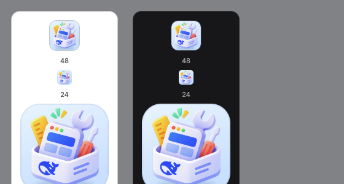

# Icon brief

The shipped plugin icon is the supplied 3D toolbox illustration, composited
onto a soft sky-blue rounded tile so it reads on both light and dark pages. This
page records how it was produced and how to replace it.

## Where the icon appears

- **Plugins** page: bundle list card and bundle detail header, inside a 48 px
  rounded, hairline-bordered tile.
- Settings → Built-in plugins inventory cards.
- It is rendered as ``, never inline SVG.

## Hard constraints

| Constraint | Value |
|---|---|
| Format | PNG, WebP, JPEG, or SVG, ≤ 256 KiB, inside the package |
| Canvas | Square; shipped as `256×256` PNG (renders at 48 px, over-sampled for crisp small sizes) |
| Theme | One file for both themes; all colors baked in, no `currentColor`/CSS variables/external references |
| Surface | Must not rely on a transparent background: the composited tile supplies contrast on light and dark pages |
| Content | Illustration centered with ~10% margin; no text; the toolbox silhouette must stay readable at 24 px |
| Look | 3D clay/isometric illustration: soft pastel purples and blues, warm yellow and coral accents, a browser-window card, hand tools, burst marks, and the blue whale mark on the toolbox |

## How the shipped icon was produced

Source: a `1254×1254` transparent PNG containing the toolbox illustration.

1. **Trim transparency** — the illustration's alpha bounding box was `930×1075`
   (the tools and burst marks make it taller than wide).
2. **Scale** to `228 px` tall, keep aspect, center on a `256×256` canvas.
3. **Background tile** — rounded rectangle, radius `56`, gradient
   `#EAF6FF → #C9E4FF` (top to bottom), plus a `3 px` inner hairline at
   `rgba(8,52,110,0.08)`.
4. **Ground shadow** — a blurred ellipse (`rx 82`, `ry 11`) at the tile bottom,
   `rgba(8,56,120,0.18)`, Gaussian blur `7`, drawn behind the illustration.
5. Export `256×256` PNG (about 76 KB, under the 256 KiB cap).

The shipped file is `icon.png` at the repository root; the package manifest points
`icon` and the `./icon` export at it.

## Replacing it

Keep the same pipeline so the new artwork sits correctly in the 48 px tile:

- Start from a transparent square illustration, ideally at least `512×512`.
- Trim alpha, fit the subject to about `89%` of the canvas height, center it.
- Keep one fixed background composed into the file (a soft light-blue or
  lavender gradient works with this illustration family); do not ship a
  transparent-only icon.
- Export a `256×256` PNG (or SVG) under `256 KiB`, replace `icon.png`, and bump
  the package version if the change ships to others.

### Prompt for an alternative illustration

> Design a square 3D clay-style app illustration for "DSH Power Suite", a
> developer tool plugin. Show an open white toolbox with soft lavender shading
> and a blue whale mark on its front, holding a browser-window card (white with
> blue content blocks and red/yellow/green dots), a lavender wrench, a coral
> screwdriver, and a yellow notepad card; add small green/yellow burst marks
> above. Pastel palette, soft studio lighting, transparent background, no text,
> centered composition with margins. It will be composited onto a soft sky-blue
> rounded tile and shown at 48 px, so keep silhouettes bold and details large.

## Verify before shipping

1. Replace the PNG, then reload the Plugins page.
2. Check the 48 px card and header tile on both light and dark page themes.
3. Check a 24 px rendering: the box, tools, and burst marks must not collapse
   into a blur.
