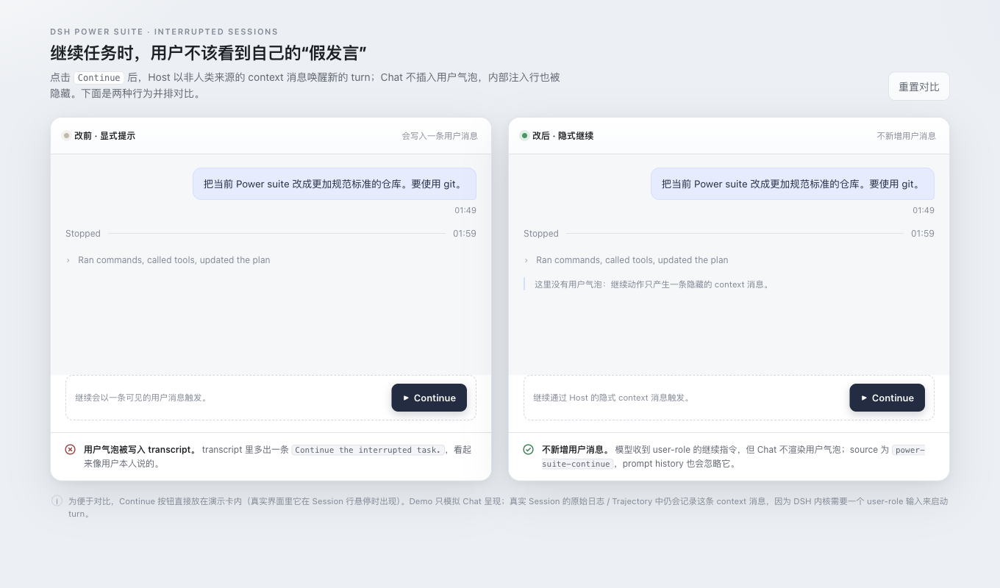

# Interrupted sessions

Tasks that did not finish — cut off by a Host restart/crash, or stopped by a
provider/model/network error, a quota/timeout, or an output-token ceiling — are
marked in the sidebar and can be continued without hunting for the right
message.

## What the user sees

- An **amber warning mark** sits left of the Session title, in the row's status
  cell, and stays visible by default.
- **Hovering** the row reveals a **Continue** action at the trailing edge. The
  same hover paints an opaque mask over the row's title and time, so the action
  never collides with the text underneath; the mark and the action sit above the
  mask. Both use theme tokens, so they follow light and dark mode.
- Opening that Session turns the composer's send control into a **play triangle**
  (`play-fill`). Pressing it with an empty draft continues the unfinished task;
  typing a draft first sends that draft normally instead.
- Continuing is **implicit**: it does not add a user bubble to the transcript.
  The browser asks the Host to start the next turn with a non-human context
  source; the plugin hides the native context/trigger row correlated with that
  request, and clears the mark while the new turn starts.

## When a Session counts as interrupted

The Host folds the Session's last turn and marks it when the turn did not
finish:

- the last `turn/end` reason is `interrupted` (crash recovery closes a tail turn
  with that reason),
- the last `turn/end` reason is `aborted` with the `disposed` cancellation cause
  (a graceful Host shutdown, such as a restart, closes the live turn that way)
  or the `legacy` cause (an imported record with no recoverable cause),
- the last `turn/end` reason is `error` — **any** provider/model/network error,
  including quota/usage limits, request timeouts, transport failures, rate
  limits and malformed responses,
- the last `turn/end` reason is `max-tokens` (a step hit its output ceiling), or
- the last turn is still open and its Agent is **not** running (a raw crash tail
  before recovery).

A running Session is never marked. Deliberate endings are not marked: a
completed turn, a user/parent/hook cancellation (`aborted` with those causes), a
`blocked` turn (a pre-step hook rejected it), a `forked` synthetic boundary, or
a Session with no turns.
Only the **last** turn matters: continuing the task starts a new turn, so the
previous stop stops counting immediately. Continue is a retry, not a guarantee:
if the underlying cause persists (still no credentials, still over the context
limit, still rate-limited) the new turn can fail again with the same mark.

## How it is wired

Host:

- `GET /api/power-suite.interrupted?sessionId=<id>` — returns
  `{ sessionId, interrupted, running, turn, reason, open }` for one Session.
  It reads the Session log through `ctx.sessionQuery.readSession()` on the first
  ask and caches the answer per Session; `session/event` `turn/start` and
  `turn/end` events keep the cache current and an event epoch prevents a slow
  read from caching an older snapshot over a newer event. `&refresh=1` recomputes.
- `POST /api/power-suite.continue` — admits one implicit continuation after
  checking JSON content type, the Session's current interruption state, and a
  per-Session in-flight lock; duplicate requests get `409`.
- Registered in [`src/features/interrupted-sessions/host.js`](../src/features/interrupted-sessions/host.js);
  the pure fold lives in [`turns.js`](../src/features/interrupted-sessions/turns.js).

Browser:

- `sidebar.session.row.leading` — the default-visible warning mark for idle rows.
- A row decorator covers rows whose native status still says running: it inserts
  the warning into the native leading span and hides the stale spinner.
- `sidebar.workspaces.session.row.action` — the hover-only Continue pill.
- `conversation.input.overlay` — a renderless seat for the open Conversation
  that marks the shell, swaps the submit glyph, and starts the Host continuation
  route; it no longer submits a draft prompt.
- Interruption reads are shared in one small client store, fetched two at a time
  and cached per Session. Every visible Session row is discovered independently
  of its leading slot. The state is re-read when the Conversation opens, on
  window focus or page visibility, on `connection/reset`/`online`, and every
  20 seconds; a forced refresh keeps the current ready value visible instead of
  downgrading it to loading.

## Icons

The mark and the play glyph are inlined paths from
[Remix Icon](https://remixicon.com) (`error-warning-fill`, `play-fill`; Apache-2.0).
The plugin does not depend on the icon package or network at runtime.

## Limits

- **One-time log reads.** The first look at each listed Session reads its log on
  the Host; after that the cache answers, and live turn boundaries keep it
  fresh. After a Host restart the first sidebar pass pays that cost once per
  listed Session.
- **Blank and archived rows** are not marked.
- **Draft safety.** The composer only auto-continues when the draft is empty; it
  never overwrites something the user typed.
- **Raw log.** The implicit continuation is still a durable `user/message` with
  source kind `power-suite-continue`; it is hidden from Chat via the native
  context/trigger rendering, but Trajectory/raw exports can show it.
- **Trigger correlation.** A turn-trigger card is hidden when its recorded time
  falls inside a recent continuation window for this browser. This is a UI
  compatibility shim until Chat exposes the source kind on the trigger row.

## Automatic refresh after a Host restart

Interruption state is Host-owned but the browser caches one record per Session.
After a DSH restart the browser may keep its old page, so a stale record used to
survive until that row was clicked.

- A row whose native status still says **running** (the shell shows a green
  spinner and does not render the custom leading slot) is decorated directly:
  the decoration inserts the amber warning into the native leading span and
  hides the stale spinner, so the interrupted mark is visible immediately after
  a reconnect instead of only after opening the Session.
- The browser listens for the client Connection's `connection/reset` event,
  which fires whenever a new Host generation is established, and immediately
  repulls every known/watched Session. Window focus, `visibilitychange`,
  `online`, and a 20 s poll refresh the same set.
- A pending badge therefore appears on its own after the Web page reconnects;
  clicking a Session is no longer required.
- The Host caches a Session's own fold, but derived parent values are invalidated
  on every `session/event`, so a child finishing or starting a turn is reflected
  on the next refresh.

## Delegated subagent work

A parent Session can finish its own `turn/end` while delegated subagent
Sessions are still running. If the Host restarts in that state, the parent log
looks `completed` even though the delegated work was cut off.

The route folds known child Sessions (`header.parentSession`) too:

- a child that is **still running** is live work, not an interruption;
- a child whose turn started during the parent's latest turn, or whose last
  event is newer than the parent's latest `turn/end`, belongs to that work;
- a child that was interrupted (or has an open crash tail) while belonging to
  the parent's latest turn marks the parent as interrupted;
- the badge tooltip distinguishes a delegated-subagent interruption, and
  Continue resumes the parent Session (the subagent is not a visible Session).

Nested delegations are followed recursively; a subagent Session is never shown
as its own row in the sidebar.

## Implicit continuation

A self-contained interactive demo is at
[demo/implicit-continue.html](demo/implicit-continue.html): click **Continue**
in both panels to compare the old visible prompt with the implicit path.

Clicking **Continue** no longer writes a human-looking prompt into the
transcript. The browser calls `POST /api/power-suite.continue`; the Host uses
the Session controller's prompt command with an explicit message source
(`power-suite-continue`, form `notice`), so:

- the transcript shows no user bubble for the continuation;
- prompt history ignores it (only `source.kind: "user"` messages are recalled);
- the native context/trigger row is hidden by the plugin, so the continuation
  appears implicit; the model still receives a user-role instruction and starts
  a new turn. The route is rejected when the Session is running or not
  interrupted, and a per-Session in-flight lock rejects duplicate Continue
  clicks.

If the Host composition does not expose the Session controller, the route
returns `continue-unavailable` and the badge stays; the browser repulls the
interruption state instead of pretending success.
