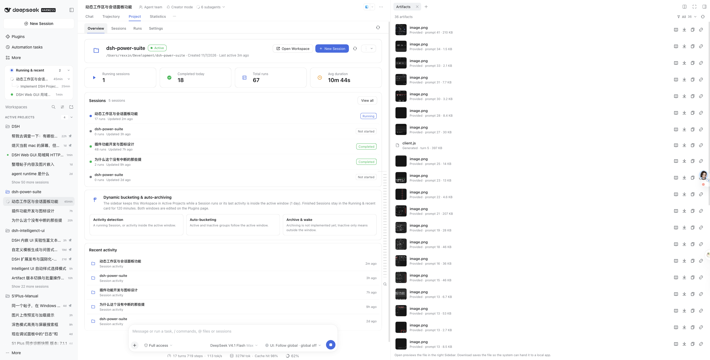
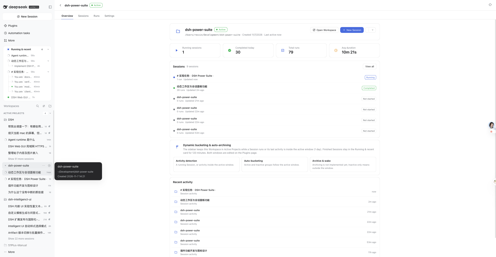
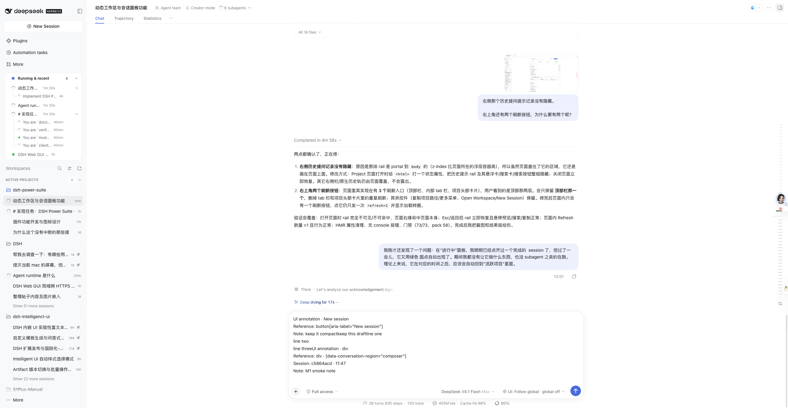
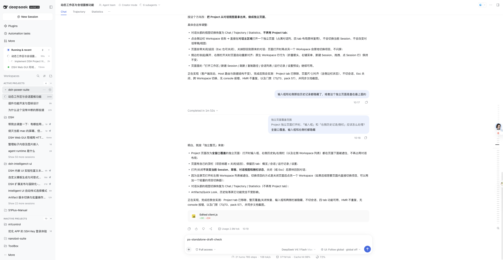
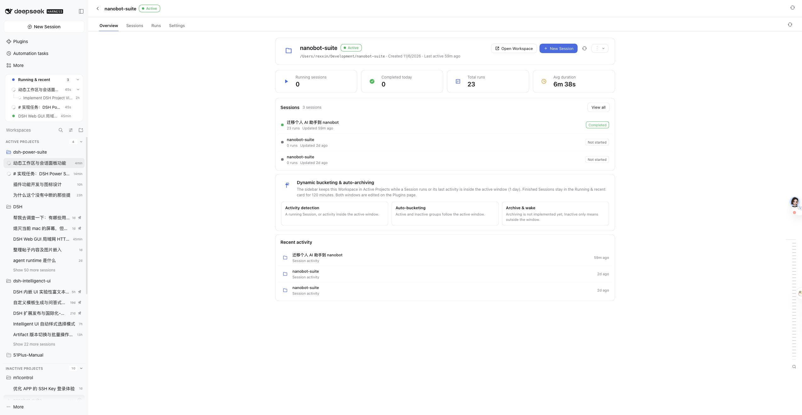

# Project view

A DSH Power Suite feature: a **standalone Project page** for a sidebar
Workspace — the design mock's 项目详情 / 运行记录. It is not a conversation view
tab: clicking a Workspace's title/folder area in the sidebar opens a page that
fills the **content area right of the left Workspaces sidebar**, and closing it
returns to the conversation exactly as it was.

- **Opening**: a click on a sidebar Workspace title dispatches the window
  CustomEvent `power-suite:open-project` with `{ workspaceId }`; an invisible
  `shell.overlay` seat (`power-suite.project-page`) renders one page instance.
- **Page surface**: `position: fixed; top: 0` with a measured inline
  `left`/`width`/`height`: it starts at the left Workspaces sidebar's right edge
  and ends at the viewport's right edge, full height. A token-background carrier
  with its own top bar above the unchanged four tabs:
  **Overview / Sessions / Runs / Settings**.
- **Top bar**: a back/close chevron, the project title, the **Active /
  Inactive** badge, and the page's **single refresh control**. **Esc** closes an
  open page menu/dropdown first (its own handler stops propagation) and closes
  the page on the next press; the back control closes the page directly.
- **Closing** restores the conversation, current Session, composer draft,
  selected conversation view, and both sidebar states; opening and closing never
  navigate.

The page is read-only for project facts and Session logs. Its one write path is
the Workspace's default agent preset, which reuses the existing workspace-presets
routes.

## Opening, covering, and closing



Clicking a Workspace row's **title/folder area** in the sidebar opens that
Workspace's project page. The click target is the title text: the leading icon
doubles as the native fold chevron on hover, so it still folds/expands the
Workspace group.

While the page is open it **covers the composer and input box, the right
sidebar, and the conversation history rails by design**, and it **hides the
body-portaled prompt-history rail** (pin, hover preview card, search card,
divider and magnifier). The seat marks the document root with
`data-power-suite-project-page="true"`; CSS hides
`[data-psp-rail]`, `[data-psp-preview-card]`, `[data-psp-search-card]`,
`[data-psp-rail-divider]`, and `[data-psp-search-toggle]` while it is set.
Closing, Esc, the back control, or unmounting removes the marker and restores the
rail immediately; its hover preview, search, and copy keep working afterwards.




 The **left Workspaces
sidebar stays visible and interactive**: the page's geometry follows the
sidebar's docked box, so clicking another Workspace in it switches the page in
place, and folding/expanding the sidebar re-measures the page. There is no
user-facing "hide the sidebar" control in the shell today; if the sidebar is
absent or zero-width, the page fills the viewport. Closing returns to the
conversation with the current Session, draft, selected view, and sidebar states
untouched:



- **Native sidebar behavior is preserved**: the row context menu and New Session
  button keep their own behavior, **Session rows** still open their own Session,
  **drags** (past a small slop threshold or a `dragstart`) and **modified or
  non-primary clicks** (⌘/Ctrl/⇧/Alt, secondary buttons) are ignored, and the
  Workspace service is resolved lazily through `ctx.get('workspaces')`, so the
  plugin still loads without a Workspace UI. A touch/no-hover tap on the
  title/folder area is intentionally the page entry; only the small native
  chevron folds the Workspace.
- **Page state survives Workspace switches.** The tab, filters, searches, and
  expanded rows stay as they are when another Workspace is clicked from the
  still-visible sidebar: the component instance stays mounted and only its data
  hook follows the new Workspace id. This is intended UX, not stale content —
  the previous Workspace's snapshot is discarded and its request aborted.
- **Annotation mode hands off to the page.** Opening the Project page dispatches
  `power-suite:ui-annotation-exit`, so UI-element annotation deactivates and its
  launcher is hidden while the page is open; annotation is **not usable** on the
  page. The page's Esc ladder closes the page first (menu → page), after which
  the launcher returns with annotation still off.


- **One handler, HMR-safe**: a single document-level capture click handler
  dispatches the open event, and the seat keeps exactly one
  `power-suite:open-project` listener; cleanup removes both and cancels pending
  work, so remounts cannot stack handlers (live listener inspection showed one
  capture handler and one event listener before and after a reload).
- **The left sidebar is the workspace switcher.** Clicking another Workspace in
  the visible sidebar updates the same page instance in place (the event handler
  swaps the target Workspace; its data hook aborts the old request), with no
  close/reopen and no stale content. There is no separate in-page workspace
  picker.
- **Navigation leaves the page**: **Open Workspace**, **New Session**, and
  clicking a Session in the Overview preview or the Sessions list close the page
  first, then navigate so the user lands on the Session/Workspace just opened.
  Refresh, Copy project path, the Settings preset editor, and Runs turn/job
  expansion stay inside the page; switching Workspace happens through the
  still-visible sidebar without closing.

### Page geometry

The page is measured, not hard-coded: its `left` is the left Workspaces sidebar's
docked-box right edge, its `width` is the viewport width minus that left edge,
and its `height` is the viewport height. Measured examples: expanded sidebar
280 px → page left 280 / width 2268; collapsed rail 56 px → left 56 / width 2492;
sidebar absent → left 0 / width 2548; a 1600×900 window with the expanded sidebar
→ left 280 / width 1320 / height 900. Geometry is re-measured through one
rAF-coalesced callback driven by ResizeObservers on the sidebar slot, its docked
box, and their container, a scoped MutationObserver for a replaced sidebar
subtree, a window `resize` listener, and a light 500 ms settle interval; all of
it is cleaned up when the page closes. The page is no longer modal
(`aria-modal` is not set), since the sidebar remains usable.

## Overview


- **Project header**: workspace folder icon, title (or **Untitled project**), an
  **Active / Inactive** badge, the workspace path, `Created …` and
  `Last active …`, plus **Open Workspace**, **New Session**, and a more-actions
  menu with **Refresh** and **Copy project path**. Refresh is also available from
  the page's single top-bar control; the header card itself has no refresh
  button (the old tab-bar/header refresh buttons were removed).
  Active means a Session of the Workspace is running, or its last activity is
  inside the Active-project window.
- **Stat cards**: **Running sessions**, **Completed today**, **Total runs**, and
  **Avg duration**. Completed today counts turns ending with `completed` at or
  after local midnight; Avg duration is the mean duration of completed turns that
  carry timing (an em dash when none is measurable). Each card carries a hint,
  and when the measurement cap bites the cards are annotated
  `Measured from the newest N sessions`.
- **Sessions preview**: up to six Sessions with a status dot and chip, run count,
  relative last update, and click-to-open (which closes the page first);
  **View all** switches to the Sessions tab.
- **Dynamic bucketing & auto-archiving** explains the honest current behavior:
  the sidebar keeps the Workspace in Active Projects while a Session runs or its
  last activity is inside the active window, and finished Sessions stay in the
  **Running & recent** card for the configured minutes. It states explicitly
  that archiving is not implemented — Inactive only means outside the window.
- **Recent activity**: one row per recent Session — a turn that ended with its
  real status, or later Session activity — newest first, capped at eight rows.

## Sessions

- Status chips **All / Running / Completed / Interrupted** with counts, and a
  title search field.
- Rows show the title (or **Untitled session**), status chip, run count,
  relative update time, and a **Subagent** marker for delegated Sessions; click a
  row to close the page and open that Session.
- Archived Sessions are not listed (the Host excludes them from the snapshot),
  and Sessions not accounted to this Workspace never appear.

## Runs

Turns become **runs**, newest first, across the measured Sessions. Each row
carries the Session title, `Turn N`, status, a relative start time (the exact
timestamp is in its tooltip), the duration, tool-call count, and job count.

- Status vocabulary: **Running** (open turn with a live Agent), **Completed**,
  **Interrupted** (crash/restart cutoff), **Stopped** (human/plugin cancellation,
  blocked, token ceiling, fork seed, or an unknown close reason), **Failed**
  (structured error).
- Filters: status chips with counts, a Session dropdown, an **Include jobs**
  toggle, and free-text search over Session title, turn number, and job labels;
  an empty-filtered state appears when nothing matches.
- **Expandable turns** reveal the nested job rows folded under that turn: job
  kind, a truncated label, status, duration, and detail (for example
  `exit code: 0`). Per-run job rows are capped at 24 while the row's job count
  keeps the full total, so the expansion can say `Showing X of Y jobs`.
- A running turn shows a **live elapsed** value that keeps counting while the
  page is open.
- **Show more** pages the list by 60 rows; when the snapshot is capped the
  header notes `The newest N of M measured runs are shown.`

## Settings

- **Default agent preset**: a select-style trigger and menu with **Follow global
  default** plus the available presets (for example Standard, PTC, Minimal,
  Cordis), the current choice checked. Selecting one writes through the same
  Host-backed workspace-presets routes as the Workspace context menu and shows a
  brief **Saved** acknowledgement.
- **Grouping windows**: read-only text describing the active-project window and
  the finished-Session window, with a pointer to edit them on the Plugins page.
- **Workspace path** with **Copy project path** and **Open Workspace** (the
  latter closes the page and navigates).
- If any measured Session log could not be read, a warnings banner reports how
  many were skipped; each `warnings[]` entry carries a bounded error identity
  (error name and a truncated message) so fold/programming failures are
  diagnosable rather than flattened into a generic line.

## Data loading

The page fetches one Workspace snapshot by id:

- `GET /api/power-suite.project?workspaceId=<id>` on mount, then every 15 s while
  open; a window `focus` event also refreshes it. The page's single top-bar
  refresh control re-fetches with `refresh=1` (one request per click, bypassing
  the Host's cache with the busy spin).
- A workspace switch cancels the previous request (`AbortController`), so a slow
  response for the old Workspace can never overwrite the new page.
- Loading, error (with retry), and empty states are handled; a `404
  workspace-not-found` renders the **Workspace not found** empty state. Host
  warnings and measurement-cap notes carry into the page.

## Host route and payload

One authenticated exact route, behind the same browser cookie and Host/Origin
fence as the rest of the GUI:

- `GET /api/power-suite.project?workspaceId=<id>` (or `?sessionId=<id>` for
  other consumers) — returns one Workspace snapshot. The page always asks by
  Workspace id. Empty or whitespace-only parameters count as absent; no
  parameter at all → `400 bad-request`; an unknown Workspace → `404
  workspace-not-found`; `refresh=1` bypasses the cache. Every response is
  `cache-control: no-store`.
- The route lists the Workspace's accounted Sessions, keeps the newest 20 for
  measurement (running Sessions first, then live records, then by rank), reads
  their logs with concurrency 4, slices a fork's inherited event prefix, and
  excludes archived Sessions. Unreadable logs are skipped and reported in
  `warnings[]`.
- An in-memory snapshot cache holds a response for **25 s** (up to 30 Workspace
  snapshots per Host process), so the page's 15 s poll normally reuses the warm
  snapshot while still refreshing at most one poll behind; manual `refresh=1`
  bypasses it. The cache identity covers the Workspace id, `updatedAt`, member
  count, a hash of the relevant archived-member subset, and the requested
  `focusSessionId`, so archived-set or focus changes cannot serve a stale
  snapshot.

Payload:

```text
{
  workspaceId, focusSessionId,
  project:   { workspaceId, title, path, createdAt, updatedAt, state,
               runningSessions, sessionCount, lastActivityAt,
               activeWindowDays, recentSessionMinutes },
  stats:     { runningSessions, completedToday, totalRuns, averageDurationMs,
               measuredSessions, completedRuns, truncated },
  sessions:  [ { sessionId, title, running, interrupted, updatedAt,
                 lastActivityAt, createdAt, agentPreset, parentId, origin,
                 runCount } ],
  runs:      [ { id, sessionId, sessionTitle, turn, startedAt, endedAt,
                 durationMs, status, toolCalls, jobCount,
                 jobs: [ { kind, label, startedAt, finishedAt, durationMs,
                           status, detail } ] } ],
  recentActivity: [ { kind, at, sessionId, title, detail } ],
  warnings:  [ { sessionId, message } ],
  limits:    { sessions, runsPerSession, runs, jobsPerRun,
               totalRunsMeasured, runsTruncated },
  generatedAt
}
```

Folding rules (pure helpers in
[`fold.js`](../src/features/project-view/fold.js)): one run is one
`turn/start`..`turn/end` pair. A **closed** turn is classified by its recorded
`turn/end` reason first — a fork seed's synthetic closer that has no matching
`turn/start` (the start lives in the inherited prefix) is `forked` and reports
**stopped**, not interrupted. A turn with no end is `running` while its Agent is
live and `interrupted` otherwise. `turn/end` reasons map to completed,
interrupted (`disposed` shutdown), stopped, or failed as described above.

**Canonical measured-turn rule:** a turn counts as a run only when
`isMeasuredTurn(turn)` holds — a finite `startedAt`. The same predicate governs
`buildRuns` (no synthetic-boundary run row or count), each Session's `runCount`,
`limits.totalRunsMeasured`, and `computeStats` (`totalRuns`, completed,
`completedToday`, and the duration average). A Session with only a fork closer
therefore reports **0 runs**, and a mixed inherited+real Session counts only its
real turns; synthetic boundaries never inflate the overview stats. The raw
frames are still folded (status/feeds), only run measurement excludes them.
`job/registered`..`job/settled` pairs are associated with their turn by the exact
tool-call id (`callId`/`rootCallId`), then by time containment, then by the
nearest preceding turn. `completedToday` uses the local day boundary, and the
average covers completed turns with measurable timing.

## Relation to Dynamic Workspaces and settings

The Active/Inactive badge, the explainer text, and the read-only windows in
Settings all use the same Host settings document as Dynamic Workspaces
(`activeProjectDays`, `recentSessionMinutes`, edited on the Plugins page). This
page only reads them; changing them there updates the sidebar buckets, the card,
and this page's copy on their next snapshot.

## Install

This feature ships inside [DSH Power Suite](overview.md); install the suite:

```text
plugin_manager action=install_bundle target=/Users/rexxin/Development/dsh-power-suite
```

The Host half registers the route; the browser half registers the `shell.overlay`
page seat, the sidebar Workspace entry, and the locale dictionaries. Reload the
plugin / recompose the Host after upgrading its Host JavaScript to pick up new
routes (no DSH restart is needed).

Implementation: Host route and cache
[`src/features/project-view/host.js`](../src/features/project-view/host.js), pure
folds [`fold.js`](../src/features/project-view/fold.js), browser surface
[`client.js`](../src/client.js) under its `feature: project view` regions, tests
[`test/project-view.test.js`](../test/project-view.test.js).

## Limits

- **The page covers the content area, not the left sidebar.** It hides the
  composer/input, the right sidebar, and the conversation history rails by design,
  while the left Workspaces sidebar stays visible and interactive. There is no
  user-facing "hide the sidebar" shell control today; if the shell ever hides it,
  the page falls back to filling the viewport.
- **Switching Workspace happens through the sidebar.** Clicking another
  Workspace in the still-visible sidebar switches the page in place (one
  instance, no close/reopen); there is no separate in-page Workspace picker.
- **The page is Workspace-scoped.** It needs a Workspace id; a stale/unknown
  Workspace renders the **Workspace not found** empty state and asks the user to
  close and refresh the sidebar. Sessions are reached through the page's own
  lists, not by opening a Session first.
- **Sample-bounded statistics.** Stats and Runs are measured from at most the
  20 newest Sessions of the Workspace, not the whole project history. When the
  cap hits, `stats.truncated` is set and the Overview says
  `Measured from the newest N sessions`; run rows may be capped at 40 per
  Session and 200 total.
- **Ranking can miss old-but-recent Sessions.** Session selection prefers the
  projection cache's last-prompt hints; on a cold composition without those hints
  it falls back to creation order, so a Session that is old but recently active
  may fall outside the 20-session sample.
- **Job rows are capped per turn.** Each expanded turn shows at most 24 job rows
  while the row's count keeps the full total; the expansion states
  `Showing X of Y jobs`. Jobs are associated heuristically when the exact tool
  call cannot be matched.
- **First loads are slow on large logs.** A first or forced refresh took roughly
  1.7–4.6 s on a five-Session repository (a cold 30-Session Workspace took about
  12.5 s); the 25 s snapshot cache covers the 15 s poll, and manual refresh
  intentionally pays the cost again. Unreadable Session logs are skipped with a
  warning (carrying a bounded error identity) rather than failing the page.
- **No virtualization and no infinite background loading.** The list grows by
  **Show more** in batches of 60; a very long project keeps every rendered run in
  the DOM.
- **Archived Sessions are excluded, and this page cannot archive or unarchive.**
  Inactive is only a window classification; automatic archiving is not
  implemented anywhere in the suite.
- **Statuses are coarse.** A turn that closed without a recognized reason is
  reported as stopped, not as a success or failure.
- **Localization.** The page ships English and Chinese copy; the live GUI checks
  ran in English, so the Chinese strings are code-reviewed but not
  live-exercised.

See [verification.md](verification.md) for the recorded evidence.
