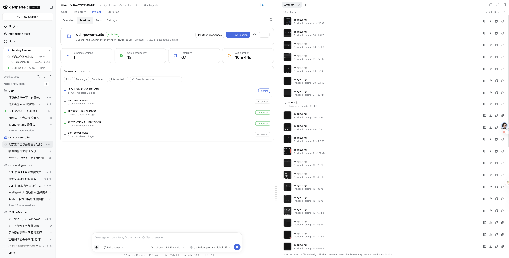
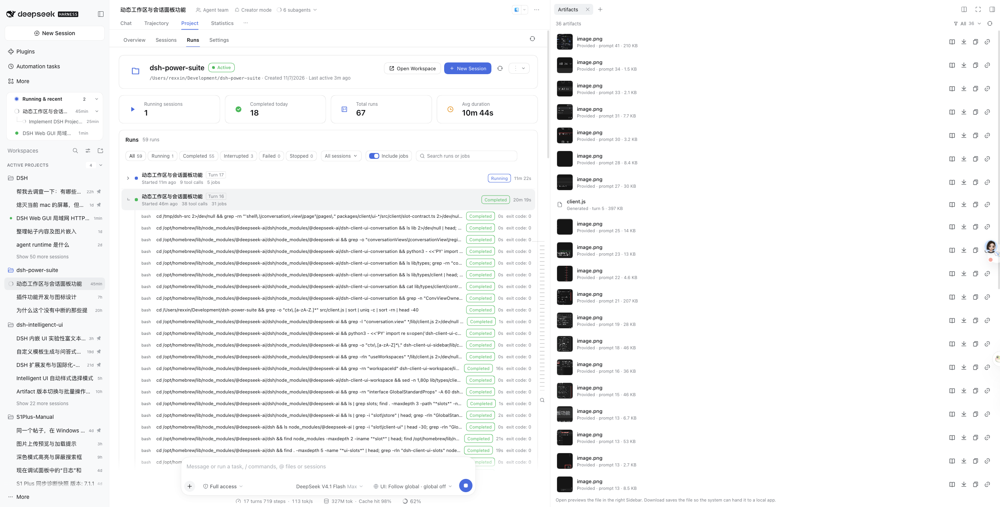
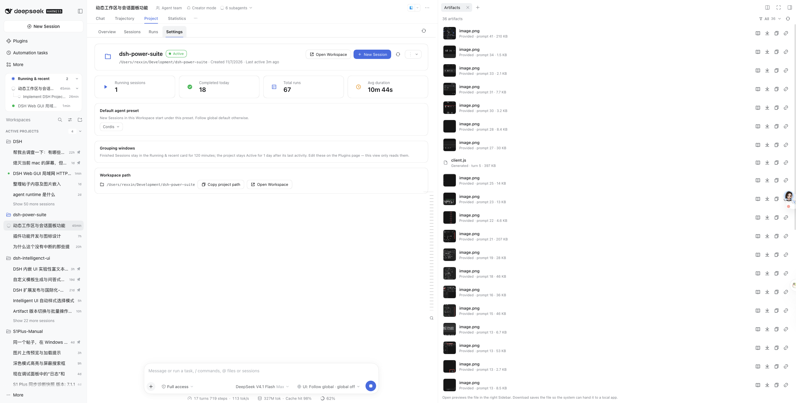

# Project view

A DSH Power Suite feature: a native conversation view tab **Project** that turns
the current Session's Workspace into a lightweight project dashboard — the design
mock's 项目详情 / 运行记录. It is a real DSH conversation view, registered through
the `conversation.view` slot (`power-suite-project`, order 20, label
`Project`/`项目`, locale namespace `powerSuiteProjectView`, `psv-` token CSS).
It appears in the conversation header's view switcher next to **Chat**,
**Trajectory**, and **Statistics**; selecting it replaces the conversation body,
and switching away unmounts it cleanly (no leftover roots or styles).

The view is read-only for project facts and Session logs. Its one write path is
the Workspace's default agent preset, which reuses the existing workspace-presets
routes.

## Overview


- **Project header**: workspace folder icon, title (or **Untitled project**), an
  **Active / Inactive** badge, the workspace path, `Created …` and
  `Last active …`, plus **Open Workspace**, **New Session**, a refresh control,
  and a more-actions menu with **Refresh** and **Copy project path**.
  Active means a Session of the Workspace is running, or its last activity is
  inside the Active-project window.
- **Stat cards**: **Running sessions**, **Completed today**, **Total runs**, and
  **Avg duration**. Completed today counts turns ending with `completed` at or
  after local midnight; Avg duration is the mean duration of completed turns that
  carry timing (an em dash when none is measurable). Each card carries a hint,
  and when the measurement cap bites the cards are annotated
  `Measured from the newest N sessions`.
- **Sessions preview**: up to six Sessions with a status dot and chip, run count,
  relative last update, and click-to-open; **View all** switches to the Sessions
  tab.
- **Dynamic bucketing & auto-archiving** explains the honest current behavior:
  the sidebar keeps the Workspace in Active Projects while a Session runs or its
  last activity is inside the active window, and finished Sessions stay in the
  **Running & recent** card for the configured minutes. It states explicitly
  that archiving is not implemented — Inactive only means outside the window.
- **Recent activity**: one row per recent Session — a turn that ended with its
  real status, or later Session activity — newest first, capped at eight rows.

## Sessions



- Status chips **All / Running / Completed / Interrupted** with counts, and a
  title search field.
- Rows show the title (or **Untitled session**), status chip, run count,
  relative update time, and a **Subagent** marker for delegated Sessions; click a
  row to open that Session.
- Archived Sessions are not listed (the Host excludes them from the snapshot),
  and templates/Sessions not accounted to this Workspace never appear.

## Runs



Turns become **runs**, newest first, across the measured Sessions. Each row
carries the Session title, `Turn N`, status, a relative start time (the exact
timestamp is in its tooltip), the duration, tool-call count, and job count.

- Status vocabulary: **Running** (open turn with a live Agent), **Completed**,
  **Interrupted** (crash/restart cutoff), **Stopped** (human/plugin cancellation,
  blocked, token ceiling, fork seed, or an unknown close reason), **Failed**
  (structured error).
- Filters: status chips with counts, a Session dropdown, a **Include jobs**
  toggle, and free-text search over Session title, turn number, and job labels;
  an empty-filtered state appears when nothing matches.
- **Expandable turns** reveal the nested job rows folded under that turn: job
  kind, a truncated label, status, duration, and detail (for example
  `exit code: 0`). Per-run job rows are capped at 24 while the row's job count
  keeps the full total, so the expansion can say `Showing X of Y jobs`.
- A running turn shows a **live elapsed** value that keeps counting while the
  view is open.
- **Show more** pages the list by 60 rows; when the snapshot is capped the
  header notes `The newest N of M measured runs are shown.`

## Settings



- **Default agent preset**: a select-style trigger and menu with **Follow global
  default** plus the available presets (for example Standard, PTC, Minimal,
  Cordis), the current choice checked. Selecting one writes through the same
  Host-backed workspace-presets routes as the Workspace context menu and shows a
  brief **Saved** acknowledgement.
- **Grouping windows**: read-only text describing the active-project window and
  the finished-Session window, with a pointer to edit them on the Plugins page.
- **Workspace path** with **Copy project path** and **Open Workspace**.
- If any measured Session log could not be read, a warnings banner reports how
  many were skipped.

## Host route and payload

One authenticated exact route, behind the same browser cookie and Host/Origin
fence as the rest of the GUI:

- `GET /api/power-suite.project?workspaceId=<id>` or
  `?sessionId=<id>` — returns one Workspace snapshot. Supplying `sessionId`
  resolves the Workspace by direct membership, then the Session's durable parent
  chain (for a subagent), then the canonical `cwd`; empty or whitespace-only
  parameters count as absent. No parameter at all → `400 bad-request`;
  an unknown Workspace or an unaccounted Session → `404 workspace-not-found`.
  `refresh=1` bypasses the cache. Every response is `cache-control: no-store`.
- The route lists the Workspace's accounted Sessions, keeps the newest 20 for
  measurement (running Sessions first, then live records, then by rank), reads
  their logs with concurrency 4, slices a fork's inherited event prefix, and
  excludes archived Sessions. Unreadable logs are skipped and reported in
  `warnings[]`.
- An in-memory snapshot cache keyed by Workspace id + `updatedAt` + member count
  holds a response for 10 s (up to 30 Workspace snapshots per Host process); the
  browser polls every 15 s while the view is open and manual refresh bypasses the
  cache.

Payload:

```text
{
  workspaceId, focusSessionId,
  project:   { workspaceId, title, path, createdAt, updatedAt, state,
               runningSessions, sessionCount, lastActivityAt,
               activeWindowDays, recentSessionMinutes },
  stats:     { runningSessions, completedToday, totalRuns, averageDurationMs,
               measuredSessions, completedRuns, truncated },
  sessions:  [ { sessionId, title, running, interrupted, updatedAt,
                 lastActivityAt, createdAt, agentPreset, parentId, origin,
                 runCount } ],
  runs:      [ { id, sessionId, sessionTitle, turn, startedAt, endedAt,
                 durationMs, status, toolCalls, jobCount,
                 jobs: [ { kind, label, startedAt, finishedAt, durationMs,
                           status, detail } ] } ],
  recentActivity: [ { kind, at, sessionId, title, detail } ],
  warnings:  [ { sessionId, message } ],
  limits:    { sessions, runsPerSession, runs, jobsPerRun,
               totalRunsMeasured, runsTruncated },
  generatedAt
}
```

Folding rules (pure helpers in
[`fold.js`](../src/features/project-view/fold.js)): one run is one
`turn/start`..`turn/end` pair; a turn with no end is `running` while its Agent is
live and `interrupted` otherwise. `turn/end` reasons map to completed,
interrupted (`disposed` shutdown), stopped, or failed as described above.
`job/registered`..`job/settled` pairs are associated with their turn by the exact
tool-call id (`callId`/`rootCallId`), then by time containment, then by the
nearest preceding turn. `completedToday` uses the local day boundary, and the
average covers completed turns with measurable timing.

## Relation to Dynamic Workspaces and settings

The Active/Inactive badge, the explainer text, and the read-only windows in
Settings all use the same Host settings document as Dynamic Workspaces
(`activeProjectDays`, `recentSessionMinutes`, edited on the Plugins page). This
view only reads them; changing them there updates the sidebar buckets, the
card, and this view's copy on their next snapshot.

## Install

This feature ships inside [DSH Power Suite](overview.md); install the suite:

```text
plugin_manager action=install_bundle target=/Users/rexxin/Development/dsh-power-suite
```

The Host half registers the route; the browser half registers the conversation
view. Restart the Host process after upgrading the package's Host JavaScript.

Implementation: Host route and cache
[`src/features/project-view/host.js`](../src/features/project-view/host.js), pure
folds [`fold.js`](../src/features/project-view/fold.js), browser surface
[`client.js`](../src/client.js) under its `feature: project view` regions, tests
[`test/project-view.test.js`](../test/project-view.test.js).

## Limits

- **Sample-bounded statistics.** Stats and Runs are measured from at most the
  20 newest Sessions of the Workspace, not the whole project history. When the
  cap hits, `stats.truncated` is set and the Overview says
  `Measured from the newest N sessions`; run rows may be capped at 40 per
  Session and 200 total.
- **Ranking can miss old-but-recent Sessions.** Session selection prefers the
  projection cache's last-prompt hints; on a cold composition without those hints
  it falls back to creation order, so a Session that is old but recently active
  may fall outside the 20-session sample.
- **Job rows are capped per turn.** Each expanded turn shows at most 24 job rows
  while the row's count keeps the full total; the expansion states
  `Showing X of Y jobs`. Jobs are associated heuristically when the exact tool
  call cannot be matched.
- **First loads are slow on large logs.** A first or forced refresh took roughly
  1.7–4.6 s on a five-Session repository; the 10 s snapshot cache absorbs the
  browser's 15 s poll, and manual refresh intentionally pays the cost again.
  Unreadable Session logs are skipped with a warning rather than failing the
  view.
- **No virtualization and no infinite background loading.** The list grows by
  **Show more** in batches of 60; a very long project keeps every rendered run in
  the DOM.
- **Archived Sessions are excluded, and this view cannot archive or unarchive.**
  Inactive is only a window classification; automatic archiving is not
  implemented anywhere in the suite.
- **Workspace membership is required.** A Session not accounted to a Workspace
  (including some subagent edge cases) shows **No project workspace** instead of
  a guessed project.
- **Statuses are coarse.** A turn that closed without a recognized reason is
  reported as stopped, not as a success or failure.
- **Localization.** The view ships English and Chinese copy; the live GUI checks
  ran in English, so the Chinese strings are code-reviewed but not
  live-exercised.

See [verification.md](verification.md) for the recorded evidence.
