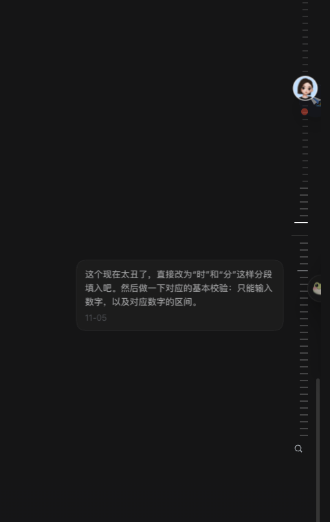
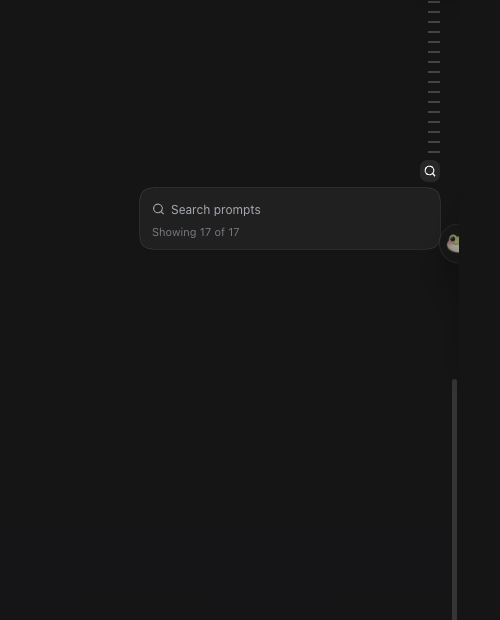

# Prompt history

A DSH Power Suite feature with two surfaces over the same Session history. The
configured modifier + **↑ / ↓** in the composer walks through the prompts you
already sent in this Session, shell-style. A vertical **history rail** at the
conversation's right edge lists the same prompts as tick marks, with a full-text
hover preview, an inline search, and click-to-copy. Both read the Session log, so
prompts from earlier pages of a long Session are included.

The keyboard shortcut defaults to ⌘ on macOS and Ctrl on Windows and Linux; the
[Settings](settings.md) section on the bundle's Plugins page changes it to
Option/Alt, Ctrl, or turns the shortcut off. A recalled or copied prompt is
ordinary draft text — edit it and send it again. Plain arrow keys keep their
original caret behavior.

## Use it

1. Click into the composer (any draft content works — the modifier states the
   intent).
2. **⌘↑** recalls the most recently sent prompt, then **⌘↑** again for older
   ones. At the oldest prompt, ⌘↑ stays there.
3. **⌘↓** walks toward newer prompts. One ⌘↓ past the newest restores the draft
   you had before browsing.
4. Plain ↑/↓ are untouched: they move the caret, also inside a recalled
   multi-line prompt. Editing or sending leaves browsing, so the chip-like
   history state never lingers.

The first ⌘↑ is consumed even if the history is still loading; the recall lands
as soon as it arrives. History refreshes when the Session changes and after a
send, so your own new prompt is recallable immediately.

## History rail

A fixed vertical rail sits at the right edge of the conversation, directly
**below** the native **Session history** turn rail and sharing its column. A
horizontal divider (a 32 x 1 px line, right-aligned on that column) separates
the native rail from the prompt marks. The composer dock slot only supplies the
Session-scoped hooks: the component renders nothing in the composer flow — no
horizontal card and no Conversation History bar — and portals its fixed rail and
cards to the page body. The rail is absent while the Session has no sent
prompts.

- **Marks**: the prompts are native-style tick marks — 20 x 2 px, radius 2,
  right-aligned on the native turn-rail column, resting at 60 % width
  (`scaleX(0.6)`) in the border colour. Hovering a mark grows it to 90 % and
  switches it to the tertiary label colour; keyboard focus keeps the native
  hairline treatment (a brand-coloured tick at full width with a 20 px ring on
  the right edge). The marks have a fixed pitch, newest at the top, oldest at
  the bottom. The rail has no visible scrollbar but still scrolls with the wheel
  or trackpad when there are more prompts than fit, and it caps its height at
  `min(available band, 420 px)` like the native turn rail: a long history
  scrolls its ticks inside that frame with 24 px fade masks at the top and
  bottom, while the search button stays pinned at the rail's foot. Each mark's
  accessible name carries the action and the prompt text (`Copy prompt #N: …`),
  so the visible tick never hides what the mark stands for.
- **Hover or keyboard focus**: a preview card opens to the **left** of the rail
  in the native preview style: at most 300 px wide, 10 x 12 px padding,
  `radius-lg`, background layer 1, the panel elevation, no border and no
  scrollbar. The prompt text is line-clamped to six lines (the full text stays
  in the mark's accessible name); the prompt's time is shown under it when the
  Host reports it. The card fades in over 120 ms, stays open while the pointer
  travels into it, and closes on scroll, resize, or shortly after leaving.
- **Click to copy**: clicking a mark (or pressing Enter on a focused one) puts
  the prompt into the composer draft and focuses the composer editor. The copy
  is **silent**: there is no confirmation chip, check icon, or animation, and
  nothing moves.
- **Search**: the magnifier is a 20 x 22 px button below the marks, aligned on
  the **visible resting tick column**: it overhangs the rail's right edge by
  4 px, so the SVG/button centre sits at `railRight - 6`, the centre of the
  20 px tick at `scaleX(0.6)`. It stays pinned when the search opens — the
  button does not move or hide. The card appears
  **directly below the button** (its right edge on the rail column, up to 300 px
  wide) when there is room above the composer; when the button sits close to the
  composer or the rail is long, the card instead opens **to the left of the
  magnifier** (right edge 8 px left of the button) and is clamped above the
  composer. In both cases it is the same native-style card with an input.
  Matching is a case-insensitive substring over the prompt text; the card
  reports **Showing {count} of {total}** and shows **No matching prompts** when
  nothing matches. There is no close (×) button: a blank pointer press outside
  the card dismisses it and clears the filter, and Escape does the same and
  returns focus to the magnifier.
- **Placement**: the rail measures the conversation's scroll surface, its
  composer seat, and the native turn rail's marks, then sits below the native
  rail when at least 90 px of room is available; otherwise it falls back to the
  vertical middle of the usable scrollport. Its bottom always stays above the
  composer. It re-measures in one animation frame on window resize, scroll,
  composer-height changes, sidebar-width changes, and the native rail
  appearing/loading, with a follow-up measurement after a short settle delay.

The rail with the search card open — with the button near the composer the card
flips to the magnifier's left (right edge 8 px from the button):

While UI-element annotation is active, the whole prompt-history rail family
(rail, search card, hover preview card, divider, and search toggle) is hidden so
the two right-edge surfaces cannot overlap; normal mode is unaffected.

The rail and the keyboard recall share one source, so both see the same
human-only prompts and the same 500-entry cap. The rail refetches per Session
and again when a turn finishes (the send that just completed appears then);
switching Sessions also clears the search and copied state. The Host fold
carries each prompt's event time, but it is served only after the plugin/Host
code is reloaded (a normal Host restart does that too); until then `at` is
absent, card times are hidden, and everything else keeps working.

## Multi-line prompts

A recalled multi-line prompt is one history entry: ⌘↑ / ⌘↓ jump to the previous
or next prompt directly, without stopping on internal lines. Move inside its
lines with plain arrows or the mouse; those keys do not change the history
position.

## What counts as a prompt

- Human prompts of the current Session, read from the Session log (not just
  the chat window the browser has loaded): ordinary prompts and prompts
  admitted mid-turn — including ones from earlier pages of a long Session.
- Prompts that begin with `/` (commands) are included, exactly as sent.
- Only text is recalled. A prompt that carried only image or file attachments
  has no entry; a prompt with both text and attachments recalls its text (the
  attachments are not re-added).
- Injected user-role context — instructions, runtime context, skill catalogs —
  never appears: it is logged with a different source kind.
- At most the 500 most recent prompts are served.
- Every entry also records the event's sequence number and, when the log has
  one, the event time. The rail shows that time in the hover card; the keyboard
  recall ignores it.

## Keys

- **Modifier + ↑ / ↓** switches history. The modifier is required; no plain key
  is taken over. It defaults to the platform primary modifier, and
  [Settings](settings.md) offers ⌘/Ctrl (platform primary), Option/Alt, Ctrl,
  Shift, or Off.
- **Plain ↑/↓, ←/→, Home/End** keep their original caret behavior, including
  inside a recalled multi-line prompt.
- **⇧, ⌥** with arrows keep their original selection or word/paragraph
  behavior; history is only the primary modifier with no other modifier.
- When a composer menu or listbox is open (the `/` and `@` trigger menus, the
  model or access menus), the history gesture stays out of the way.
- The composer in an ordinary chat is the only editor served; other inputs
  (rename dialogs, sidebar fields) keep native arrow behavior.

## Host route

The list comes from one authenticated exact route, behind the same browser
cookie and Host/Origin fence as the rest of the GUI:

- `GET /api/prompt-history.list?sessionId=<id>` →
  `{ sessionId, prompts: [{ seq, text, at }] }`, oldest first, capped at 500.

`seq` is the Session event sequence and `at` is that event's time in epoch
milliseconds, or `null` when the recorded event has no usable time. A Host built
before timestamps existed omits `at` entirely (it still sends `seq` and `text`):
the keyboard recall ignores it in every case, and the rail hides mark and card
times when no prompt has one.

The fold keeps only `user/message` events whose recorded source kind is
`user`, joins their text blocks, and skips blank results. Injected user-role
context is logged with a different source kind, so it never becomes a prompt.

## Limits

- **Current Session only.** History does not cross Sessions or Workspaces;
  there is no global shell history.
- **Send-time refresh.** A prompt sent from another device while this page sits
  idle appears after the next send or page reload; the rail refreshes on a
  Session switch and on a finished turn.
- **Replacement, not insertion.** Recalling or clicking a rail mark replaces the
  whole draft text and drops inline reference chips (`@file`, session
  references); pending attachments are untouched.
- **Text only.** Attachment-only prompts never enter the list.
- **Same 500-entry cap on both surfaces.** The rail and the keyboard recall see
  the same newest 500 prompts; search filters only what was served.
- **Timestamps need the matching Host.** Upgrading the package's browser code
  against a Host that still runs the old route keeps everything working without
  mark and card times; reload the Host plugin (or restart the Host) after
  upgrading so `at` is served.
