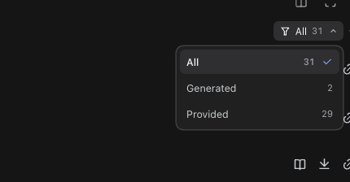
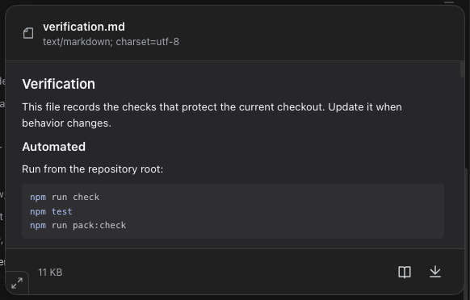

# Session artifacts

A DSH Power Suite feature: an **Artifacts** button in the native **Files** pane
header switches that pane's content to the current Session's artifact list — every
file the Session created or delivered **plus the images and files the user
attached to their own prompts** — with actions that work from whatever device is
viewing the pane. The list is no longer a standalone right-Sidebar page type or a
Start-guide card; the Files-header button is the single entry point.

## Opening it (Files pane toggle)

The right Sidebar's **Files** page header carries one extra tool button on its
actions row, right of the reload/auto-refresh controls (slot
`sidebar.right.tab.files.actions`, cell `power-suite.files-artifacts`, order
**40**, so it renders after the shipped open-in-app action). It is a native-style
28 x 28 px tool with the shell's radius, hover/active background and a 15 px open
tray glyph; its accessible name and title are **Artifacts** / **产物**, and it
shows `aria-pressed="true"` while the list is shown.

- Clicking it **cross-fades the pane content**: the Files navigator fades to 20 %
  and slides 14 px left behind the incoming view, while the artifacts view fades
  in from 14 px right over 180 ms (`cubic-bezier(.22,1,.36,1)`). Closing reverses
  it over 160 ms.
- The artifacts view is a React portal **inside that Files tab's
  `[data-files-content]`**, sized to the content box, so it replaces the Files
  content without changing the pane geometry (no layout jump) and the Files
  navigator stays mounted underneath.
- The view reuses the same panel (count, All/Generated/Provided filter, Refresh,
  rows, thumbnails, hover Quick Look, footer) with one addition: a leading
  **Back** button. Clicking the header button again, **Back**, or **Esc** returns
  to Files; the header button's pressed state and focus follow the view.
- `prefers-reduced-motion: reduce` swaps both directions instantly (no animation
  or transform); the pane is otherwise identical.
- The Files page root carries one marker attribute `data-psfa-active="true"`
  while the view is open (used only by the injected stylesheet for the navigator
  fade; removed on close/unmount). A second Session, a tab close, or plugin unload
  removes the view, its list request, listeners and marker. Collapsing the right
  Sidebar hides the whole dockkit surface without unmounting it, so reopening it
  restores the same Files/Artifacts view; closing the tab or switching Sessions is
  the teardown path.
- An artifact list left open in an **older build's standalone Artifacts tab** has
  no page type any more and is dropped by the shell's tab state on the next
  layout restore; the Files-header button replaces it.

## What it shows

The list merges two sources, newest event first.

### Generated and delivered files

An artifact is defined the same way the Host's own deliverables bookkeeping
defines it:

- a file produced by a successful `write`, `edit`, or mutating
  `str_replace_editor` call, and
- a file declared by a successful `present` call
  (`deliverables/presented`), including files created by shell commands.

Paths are deduplicated, the newest turn first. A file that was both written and
delivered appears once, carrying the delivery description. A recorded file that
no longer exists on disk is omitted from the panel: it cannot be opened or
downloaded, so showing it would only add noise. The list route still reports
those entries with `missing: true` for consumers that want the full history.

The list does not scan the workspace and does not guess: shell output that the
model never writes through a file tool or delivers with `present` is not an
artifact of this list.

### User-provided attachments

The Session log also records what the human attached to their prompts. The fold
reads those references and turns them into **Provided** rows:

- only `user/message` events whose recorded source kind is `user` count, so
  injected user-role context (instructions, runtime context, skill catalogs) and
  the `agent/inbox/spliced` duplicate of every human message are ignored;
- only `image` and `file` content blocks with an attachment id count; text and
  reference-chip blocks do not;
- a row carries the attachment id, a display name (stored name, else a
  media-type-based fallback, else `file`), the stored media type for images,
  recorded dimensions and byte size, and a 1-based **prompt ordinal** — the
  human message it arrived with;
- rows are de-duplicated by attachment id, with the **newest occurrence**
  winning, so re-pasting the same image moves it to the top instead of listing it
  twice;
- the Host adds the live size/existence of each stored object; a row whose bytes
  cannot be located is omitted from the panel like a missing generated file (the
  list route still reports it with `missing: true`);
- a Host composition without the durable attachment service simply omits
  Provided rows instead of showing broken ones.

Provided and generated rows are merged and sorted by event sequence, so the
list stays one newest-first timeline. The panel row meta reads
`Provided · prompt N · size` for provided rows and
`Generated`/`Delivered · turn N · size` for generated ones.

## Thumbnails

Every image artifact renders a **40 px rounded thumbnail** by default — provided
images through the attachment route, workspace images through the raw route.
Thumbnails load lazily (`loading="lazy"`, async decoding) and, if the image
cannot be decoded, fall back to the plain file icon. Non-image rows (and
provided generic files) show the file icon instead; every thumbnail action still
belongs to the row (Open/Download/Copy content/Copy link).

## Actions

Actions are per source. Generated/delivered rows keep the workspace-file actions;
provided attachments use the attachment route because their bytes live in the
attachment store, not in the workspace (so the native workspace preview cannot
claim them).

| Action | Generated / delivered rows | Provided attachment rows |
|---|---|---|
| **Open** | Opens the file in the right Sidebar's native document preview — the same workspace-files + document-preview pipeline the Files browser uses — through a `dsh-resource://file/session/<sessionId>/<path>` address. Images, PDFs, Office documents, Markdown, code, and HTML get the existing renderers. If no preview type claims the address, it falls back to the raw-file URL in a new tab. | Opens the attachment's inline URL in a **new browser tab**. It never uses the native workspace preview (the bytes are not workspace files). |
| **Download** | Raw URL with `Content-Disposition: attachment`; the browser saves the file and the operating system owns the open-with choice. | The attachment route with `disposition=attachment` and the stored file name; same browser save behavior. |
| **Copy content** | Text-like artifacts (text mime types, JSON/XML/YAML/JavaScript application types, and common markdown/text/code/config extensions) are fetched from the raw inline URL and their text is copied **verbatim**. Images use a three-step chain: in a secure context (HTTPS or localhost) with the async clipboard, the image is converted to PNG (`createImageBitmap` + canvas when needed) and written as an `image/png` clipboard item — a true picture; on an insecure origin a hidden `` is selected and the legacy `execCommand('copy')` runs inside the click gesture, so the clipboard receives HTML containing the image (rich editors paste the picture, while plain-text-only targets may get nothing or the alt text); only if that fails is the inline image URL copied as text. Other binaries get no Copy content button. | Same behavior through the verified attachment route's inline URL; text-like provided files are read whole and copied verbatim, provided images follow the same three-step chain. |
| **Copy link** | Copies the LAN URL of the file, built from the Host's bound listener address, so another device paired with this DSH can open it directly. | Copies the attachment's inline LAN URL, including its metadata parameters, so a paired device can fetch it. |

The actions render as icon buttons with their label as tooltip and accessible
name: an open book for Open, a download arrow for Download, a file-copy glyph for
**Copy content** (its label reads Copy image for images), and a chain for Copy
link; copied actions turn into a check in the success color for about 1.6 s.
Previews and thumbnails work over plain HTTP because they only point an ``
at the inline URL — the browser loads it like any page image. **Clipboard
writes** are what need a secure context; that is why Copy image has the HTML
fallback for insecure origins described above.
Copy content sits between Download and Copy link and is absent for binaries with
no meaningful text/picture clipboard representation. The icons are
inlined [Remix Icon](https://remixicon.com) paths (Apache-2.0). The panel header's
Refresh control is likewise an icon button (rotating while a reload is in
flight). The panel footer's "Open previews the file in the right Sidebar"
sentence describes generated/workspace rows; provided attachments open a tab
instead.

## Source filter

A custom dropdown in the panel header — immediately left of **Refresh** —
filters the list client-side. The trigger uses the Remix **`filter-line`**
funnel icon, the current option label, that option's count, and a caret that
rotates while the menu is open. Its hover and expanded states use theme tokens
and the trigger keeps a focus ring.



- the menu is themed, opens right-aligned under the trigger with a short
  fade/slide entry (disabled under reduced motion), and lists **All**,
  **Generated**, and **Provided** with their counts;
- the selected option carries a check (`role="menu"` with
  `role="menuitemradio"` + `aria-checked`); opening the menu moves focus to the
  selected option, an outside press or Escape closes it, and Escape returns
  focus to the trigger;
- selecting an option filters the visible rows without re-reading the Session
  log (no list-route request);
- the header count switches to `{shown} of {total} artifacts` while a filtered
  view is active, and a filter whose result set is empty shows
  **No artifacts in this filter**;
- a different Session resets the filter to All, so a filter cannot hide every
  new row.

Opening reuses DSH's own file preview instead of baking another renderer into
this feature: the right Sidebar owns rendering, reloads, open-in-app on the
Host, and file navigation. Download, Copy content, and Copy link stay custom
because the native preview cannot cover them: open-in-app launches on the **Host** machine, not the
viewing device, and another device reaches an artifact through the LAN URL. The
footer states that limit: opening a file with an application installed on the
*viewing* device cannot be triggered from a web page without a companion;
Download is the zero-install hand-off, and the browser's download bubble offers
Open directly.

## Hover preview (Quick Look)



Resting the pointer on an artifact row for about 420 ms opens a floating preview
card to the left of the panel, modeled on macOS Quick Look. Both generated and
**provided** rows participate, and the same card also works in the **native
Workspace files browser**: hovering a file row in the files page or beside a
docked preview shows it too, so the feature is an enhancement to the built-in
files surface rather than an artifacts-only one.

- **Markdown** renders with headings, paragraphs, lists, blockquotes, tables,
  links, inline code, and fenced code blocks instead of showing source text;
- **code** gets syntax highlighting for JavaScript/TypeScript, JSON, CSS/SCSS,
  HTML/XML, shell, Python, YAML, Go, Rust, Java, C/C++, Ruby, PHP, SQL, Kotlin,
  Swift, TOML, and INI (first 16 KiB; extension or fence chooses the language).
  Tokens distinguish comments, strings, keywords, booleans, types, functions,
  built-ins, variables, tags, attributes, properties, numbers, operators, and
  punctuation, all colored through theme tokens;
- images render inline, audio/video get native controls, PDFs render in a frame,
  and HTML renders in a script-blocked sandboxed frame;
- anything else shows “No preview available”;
- **provided attachments** preview too, through the verified attachment route:
  provided images render inline and provided audio/video get native controls;
  text-like provided files (text MIME types and JSON/XML/YAML/JavaScript/
  TypeScript/code/markdown extensions) are fetched read-only from the
  attachment route and clipped at **64 KiB** with a truncation note; other
  provided files (PDF/Office/archives, for example) show **No preview available**.
  The attachment route supplies the bytes, so a provided row's card **Open** and
  **Download** reuse the row's attachment-URL actions;
- the footer repeats the size and offers an icon-only **Open** button (the same
  book-open icon as the row action, opening through the row's native action)
  plus Download.

The card keeps itself open while the pointer is inside it, so long previews can
be read and scrolled: the card body is a scroll view and its own scrolling does
not dismiss it.

Hover handoff follows the safe-polygon pattern used by Floating UI's
`useHover`/Radix HoverCard: the source row, the card, and the rectangle between
them form a safe traversal area. Moving diagonally off the row towards the card
therefore does not dismiss it, and parking briefly between the two keeps it
open. While the card is open, any movement that **gets closer to the card**
(measured as distance to the card's nearest edge) cancels a pending close, so a
slow diagonal detour still counts as heading for the preview. Once the card has
been entered, leaving the card hides it after about **300 ms**; moving back onto
the row or into the card cancels that timer. Moving outside the traversal area
before reaching the card also closes it after a short fallback delay. Hovering
another row keeps the current preview visible until that row's 420 ms open delay
elapses and then swaps to it, so crossing rows does not blank the preview. The
delay is a **rest timer**: moving over the pending row restarts it, and leaving
that row cancels it even when the pointer is heading for the current card. This
prevents a row merely swept over while moving the mouse from replacing the
preview later.
Switching follows Material's motion patterns: the card itself never fades and
slides from the old row to the new one over 200 ms with the standard
`cubic-bezier(0.2, 0, 0, 1)` curve (shared-axis Y for a vertical list); the
content uses Material **fade through** with two stacked layers — the outgoing
layer fades out over 160 ms while the incoming layer fades in over 200 ms
(20 ms delay) with a ±6px shared-axis vertical offset matching the list's
direction of travel. The header title crossfades too. Reduced-motion
preferences skip these animations and swap instantly. A mouse press anywhere outside the card dismisses it
immediately (clicks inside the card or on its source row are exempt), so
clicking blank conversation space also closes the preview, as do Escape,
scrolling the underlying list, resizing, or reloading. The entrance animation
is opacity-only, so the card is hit-testable the moment it appears.

Drag the grip in the bottom-left corner to resize the card (the right edge stays
anchored while the width grows leftwards). The geometry is based on the Dex
extension popup panel: **570px** default width, **380px** minimum, **800px**
maximum, and a **360px** default height (280px minimum), always clamped to the
viewport. The card always receives an explicit height — the content layers are
absolutely positioned inside the body — so a first hover with no saved resize
shows its markup/image content immediately instead of collapsing to the header
and footer; a user-resized height still wins. Double-click the grip to forget the
stored size and return to the 570 x 360 default. The surface uses its visual
language too — 20px radius, panel shadow, 16/20px header padding, 32px icon
action buttons, and a 28px rounded resize grip — plus a 160ms entrance
animation whose visibility never depends on the animation finishing (a
throttled or canceled animation leaves the layer visible). The size is
remembered in `localStorage` and reused for later previews on both surfaces;
dragging pauses the auto-dismiss so the card cannot vanish mid-resize.

The card reads at most one bounded window per file and caches the result for the
page lifetime. It is a preview only: the row actions still own opening,
downloading, and copying the link.

## Routes

All routes are exact Fetch routes on Connection's authenticated API channel, so
they sit behind the same browser cookie and Host/Origin fence as the rest of the
GUI. Only the owner Peer reaches them.

- `GET /api/session-artifacts.list?sessionId=<id>` — folds the Session log and
  returns `{ sessionId, origin, workspaceRoot, artifacts }`, newest first.
  Generated rows carry `path`, `name`, `presented`, `generated`, `tool`, `turn`,
  `seq`, `mime`, `previewable`, `size`, and `missing`; provided rows carry
  `provided: true`, `attachmentId`, `name`, `mediaType` (images), `width`,
  `height`, `bytes`, `promptOrdinal`, `seq`, `mime`, `previewable`, `size`, and
  `missing`.
- `GET|HEAD /api/session-artifacts.raw?path=<absolute path>&disposition=inline|attachment&name=<filename>`
  — serves a workspace file's bytes, bounded to 64 MiB per response. It backs
  Download, Copy content, Copy link, and the Open fallback for generated rows;
  the native preview reads files through the workspace-files Remote instead.
- `GET|HEAD /api/session-artifacts.attachment?attachmentId=<id>&name=<filename>&mediaType=<mime>&bytes=<n>&width=<n>&height=<n>&disposition=inline|attachment`
  — serves one provided attachment's **verified** bytes. The query repeats the
  durable reference and its recorded metadata (never a host path); images go
  through the attachment store's verified image read and report the stored media
  type, while generic files stream through the verified file read with the type
  sniffed from the bytes when the name does not say it. It supports `HEAD`, sets
  an RFC 5987 `Content-Disposition` for non-ASCII names, and answers `400` for
  missing/invalid metadata, `404` for a reference or bytes that fail
  verification (a tampered width/size lands here), `413` above 64 MiB, `499`
  when the request aborts, and `503` when the Host composition has no attachment
  service.
- `GET /api/session-artifacts.preview?path=<absolute path>&name=<filename>`
  — one hover-card descriptor for a workspace file: `{ path, name, mime, size,
  previewable, kind }` plus `{ text, truncated }` for text kinds. Text reads are
  capped at 16 KiB.

Document and attachment responses are served with
`X-Content-Type-Options: nosniff` and a sandbox CSP, so artifact scripts run in
an opaque origin and cannot read the application's cookies, storage, or
same-origin APIs.

## Install

This feature ships inside [DSH Power Suite](overview.md); install the suite:

```text
plugin_manager action=install_bundle target=/absolute/path/to/dsh-power-suite
```

The Host half serves the list, raw, preview, and attachment routes; the browser
half registers the **Files-header Artifacts action** (and its animated in-pane
view), the thumbnails, and the source filter. Restart the Host process after
upgrading the package's JavaScript.

Implementation: Host entry [`src/features/session-artifacts/host.ts`](https://github.com/Zephinel/dsh-power-suite/blob/main/src/features/session-artifacts/host.ts),
pure fold [`artifact-index.ts`](https://github.com/Zephinel/dsh-power-suite/blob/main/src/features/session-artifacts/artifact-index.ts),
browser surface [`src/browser/artifacts/`](https://github.com/Zephinel/dsh-power-suite/tree/main/src/browser/artifacts) wired from [`src/client.js`](https://github.com/Zephinel/dsh-power-suite/blob/main/src/client.js),
unit tests [`test/session-artifacts.test.js`](https://github.com/Zephinel/dsh-power-suite/blob/main/test/session-artifacts.test.js)
and [`test/files-artifacts.test.js`](https://github.com/Zephinel/dsh-power-suite/blob/main/test/files-artifacts.test.js), live checks in
[`test/browser/sidebar.e2e.mjs`](https://github.com/Zephinel/dsh-power-suite/blob/main/test/browser/sidebar.e2e.mjs) (`files-*`).

## Limits

- **Single entry point.** The Files-header button replaces the old standalone
  Artifacts page type, its tab and its Start-guide card. The list is only
  reachable from a Session with a workspace (the Files page exists only then);
  the right Sidebar must be open on its Files tab.
- **Overlay, not a route.** The view is in-pane state owned by the Files-header
  action; it is not a URL, cannot be deep-linked, and does not survive a tab
  close or Session switch (it resets to Files). Collapsing the Sidebar hides it
  together with the pane and re-shows it on reopen.
- **Transition constants.** Enter 180 ms / exit 160 ms, 14 px slide; reduced
  motion is an instant swap. The Files navigator fades/translates only through one
  marker attribute and is restored on close.
- **Current Session only** — subagent Sessions and other Sessions are not
  listed. User-provided attachments are limited to this Session's human prompts.
- **Provided rows need the attachment service.** A Host composition without the
  durable attachment store omits them entirely; they are never shown as broken
  rows.
- **Only images get a list thumbnail.** Non-image provided files render the file
  icon in the list; Quick Look still previews provided images/media and
  text-like files, but provided PDF/Office/archive files show the unavailable
  state in the card (Open hands them to a browser tab).
- **Provided text preview is a fetch, not the workspace pipeline.** Text-like
  provided files are read read-only from the attachment route and clipped at
  64 KiB (no workspace path, relative links, or Workspace-files preview
  features), and Markdown with relative image links cannot resolve those images.
- **Card default height.** Without a saved resize the hover card opens at
  570 x 360 px (clamped to the viewport) so its content is visible immediately;
  a user-resized size still wins.
- **Dedupe keeps the newest occurrence.** One row per attachment id; re-pasting
  the same image moves that row to the top and updates its prompt ordinal, and
  the older occurrence is not listed again.
- **Thumbnails are lazy.** An image thumbnail is only fetched when its row
  scrolls near the viewport; a failed image falls back to the file icon.
- **Verified attachment bytes.** The attachment route re-reads the recorded
  media type/size/dimensions through the store; a tampered query is rejected
  (`404`/`400`) instead of serving bytes under a false identity.
- **Loaded from the Session log** — exact reads replay the whole log on each
  panel open. Very large Sessions fan out per open; the list reports what the
  log recorded, not a filesystem scan.
- **64 MiB per artifact** — larger files answer 413 rather than buffering.
- **Other devices need DSH pairing** — the copied LAN link opens on a device
  already authorised against this DSH listener; the deployment's pairing cookie
  is the access boundary, not the link.
- **One click to an external application is not available on a plain-HTTP LAN
  page** — mobile share sheets and the File System Access API need a secure
  context (HTTPS). Download covers the same need with two gestures.
