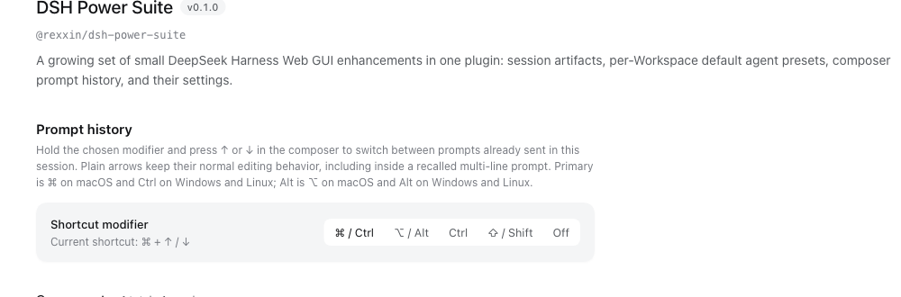

# Settings



The bundle carries its own configuration section on its **Plugins** page:

1. Sidebar **Plugins** → **Installed plugins** → **DSH Power Suite**.
2. The page shows the plugin header, then a **Prompt history** group with its
   shortcut setting, then the component rows and source facts.

The page replaces the auto-rendered README that previously filled the middle of
the page: the package no longer ships a root `README.md`, so there is no separate
"Details" block. Suite documentation lives in `docs/`.

## Prompt history shortcut

| Setting | Values | Default |
|---|---|---|
| Shortcut modifier | ⌘/Ctrl (primary), ⌥/Alt, Ctrl, ⇧/Shift, Off | platform primary |

- **⌘/Ctrl (primary)** uses Command on macOS and Control on Windows and Linux.
- **⌥/Alt** uses Option on macOS and Alt on Windows and Linux.
- **Ctrl** is Control on every platform; macOS may reserve some Control-arrow
  combinations for system shortcuts.
- **⇧/Shift** uses Shift alone. While it is active, Shift+↑/↓ drives history
  instead of extending the selection in the composer.
- **Off** keeps the feature installed but releases the shortcut, so the
  composer keeps its normal editing keys.

The stored value is the mode (`primary`, `alt`, `ctrl`, `shift`, `off`), not a
physical key, so every browser resolves `primary` on its own platform: Command
on macOS, Control on Windows and Linux. That keeps one shared setting correct
for a Mac and a Windows machine at the same time.

The row's hint always shows the resulting shortcut, for example
`Current shortcut: ⌘ + ↑ / ↓`. Changes take effect on the next keypress in any
open composer, without a reload, and apply to every browser connected to this
Host. See [prompt-history.md](prompt-history.md) for the history behavior
itself.

## Storage and route

Settings are Host-owned, so all browsers share one preference:

```text
$DSH_HOME/dsh-power-suite/settings.json
{
  "version": 1,
  "settings": { "promptHistoryModifier": "primary" }
}
```

- `GET /api/power-suite.settings` → `{ settings }`.
- `POST /api/power-suite.settings` with `{ "promptHistoryModifier": "alt" }` →
  the stored document.

Both routes sit on Connection's authenticated API channel, behind the same
cookie and Host/Origin fence as the rest of the GUI; only the owner Peer reaches
them. Writes serialize and land atomically. A missing, unreadable, or malformed
file reads as the defaults, so a broken preference cannot disable a feature.

## Limits

- **Shared preference.** There is no per-browser or per-device override; a
  change applies to every connected browser.
- **Stale tabs.** A page that was open before another device changed the setting
  picks the new value up on its next settings read (opening the Plugins page or
  reloading), not from live Host events.
- **Single field so far.** The document is versioned for adding more suite-wide
  preferences next to `promptHistoryModifier`.
