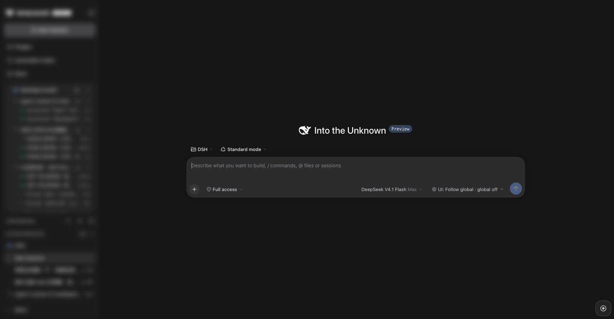
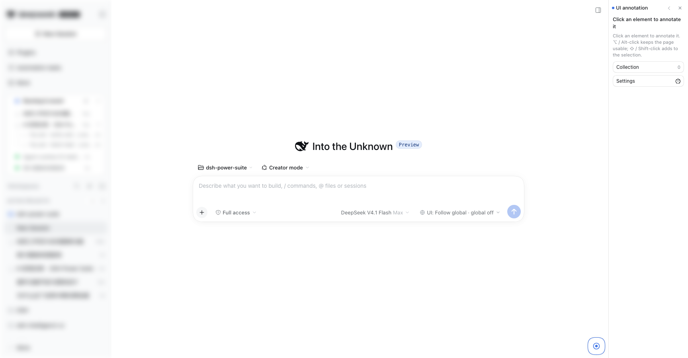

# UI element annotation

A DSH Power Suite feature: a floating launcher that turns DSH into a
point-and-click annotation surface. While the mode is on, the page makes room for
a narrow right rail, hovering the interface outlines the element under the
pointer, and clicking one opens a small note popover. Hover-triggered floating
cards, menus, and dialogs are selectable too: the whole floating surface is the
default target, and the Parent/Child control drills into its rows. A selected
element can be inserted into the current Session's composer as a plain-text
reference, alone or as one ordered batch for several elements. Every captured
reference carries a verified-unique locator, its stable ancestors, and the
Session/Workspace/route identity, and the collection survives a page reload
through browser-local storage. The mode only inserts text: it never edits the
page's content elements, never reads form values, and never sends the message.

## What it does

- **Launcher** — a round entry button that floats while the mode is off (draggable
  to any corner, position remembered) and **docks into the right rail while the
  mode is on**, so it never covers page content. Clicking it toggles the mode;
  dragging never toggles it.
- **Borderless surfaces** — every Power Suite floating surface is borderless:
  the launcher and its count badge, the annotation rail (docked or overlay), the
  requirement/batch popovers, the hover detail card, the note editor, the
  exit-confirmation dialog, and the feedback/undo toasts rely on their
  background and shadow alone; only inner controls keep their own borders. The
  launcher is a **perfect circle** (`corner-shape: round`, which opts out of the
  shell's superellipse corner shape) and its shadow is ring-free, so no hairline
  elevation ring can read as a border in either theme.
- **Mode layout** — the page shrinks by a responsive right rail; on narrow
  viewports the rail overlaps the right edge instead of squeezing the page, and
  can collapse to a narrow strip.
- **Selection** — hover highlights the candidate element, a click selects it for
  good, and the popover can step up or down the ancestor chain when the first
  candidate is too small or too large. A hit inside a floating surface selects
  the whole surface first and drills into its rows from there.
- **Multi-select** — the multi-select modifier toggles membership on click, or a
  modifier-held drag draws a box that selects everything inside it. When the
  selection settles the **batch popover** opens with ONE shared requirement, and
  the commit saves the whole selection as **one batch group** (not N records).
- **Pass-through** — holding the pass-through modifier gives the page its real
  native mouse behavior back, for the left and right buttons, without leaving the
  mode.
- **Requirement popover** — element name, locator summary, live resolution
  status, an ancestor lever, the **requirement** field, **Copy locator**, and the
  commit surface: **Mark requirement** / **Update requirement** (primary),
  **Quick reference**, and **Delete annotation**. Committing a requirement closes
  the popover and clears the selection automatically; floating surfaces are
  marked as transient in the popover. Delete annotation appears only when the
  element is **already marked** (then the primary action reads **Update
  requirement**); the trash lives in the **Requirement caption row** at the row's
  right end, above the textarea, so the footer keeps exactly the two primary
  buttons on one row. An unmarked selection has nothing to delete yet, so it
  shows **Mark requirement** only (no trash), and the popover's close X discards
  the selection.
- **Composer reference chip** — Quick reference (from the popover, the detail
  card, or a rail row) inserts one native inline reference chip into the current
  composer; the batch footer inserts **one group chip** (`UI annotations × N`).
  Chips are atomic, carry their clipboard text, and serialize to the documented
  quick-reference/batch text at send time. When the chip services are unavailable
  the plugin falls back to the Phase 1 plain text with an explanatory toast.
- **Annotation sidebar (collection view)** — the redesigned management surface:
  header `Annotations` + total badge + subtitle, filter chips `All / Singles /
  Groups` with live counts, a scrollable unified list of single rows and group
  cards, and a two-action footer. Every row/card/child exposes always-visible
  edit + delete controls (never hover-only); groups show their shared requirement,
  item count, collapse/expand and child rows. Batch include/insert tools live in
  the list toolbar; the footer primary is **Add annotation** and the danger action
  switches between **Clear selection** and **Clear collection** (undoable).
- **Page marks** — every current-Session annotation whose target still resolves
  stays visible on the page as a pointer-transparent overlay mask with a numbered
  badge (`#3` plus a one-line requirement excerpt). Missing, ambiguous, and
  other-Session records are deliberately not drawn.
- **Hover detail card** — resting the pointer on a mark opens a floating card
  beside it after about 120 ms: full requirement, locator, live position box,
  Session + Workspace, status, transient marker, and the actions Quick reference,
  Edit requirement (rainbow textarea with Save/Cancel), Go to element, Copy
  locator, and Delete. The pointer may move into the card, focus is never stolen,
  Esc closes it first, and it never covers the rail.
- **Delete undo** — deleting an annotation from the popover, the detail card, or
  a rail row (and **Clear**) immediately shows a 5 s undo toast with `role=status`
  instead of a confirmation dialog; a newer deletion replaces the previous undo
  slot.
- **Collection** — an ordered list held in the rail with per-entry notes, copy
  locator, delete and re-locate actions, and a batch insert that produces one
  structured request for the model. It is persisted in the browser and restored
  after a reload (up to 100 annotations; the 101st commit is refused visibly).
- **Input focus treatment** — annotation text fields and selects use the plugin's
  shared rainbow focus ring instead of a solid blue outline (see
  [focus treatment](#focus-treatment)).
- **Insertion** — references go into the current composer through the shell's own
  insertion API, preserving the existing draft and caret, one undo step, and
  never sending the message.

## Turning the mode on

The launcher is a round button with an annotation glyph. While the mode is
**off** it floats bottom-right by default; while the mode is **on** the same
control is **docked inside the right rail** (rail header, next to the
collapse/exit buttons) so it never covers the page. Click it to toggle the mode;
its accessible name states the action and its pressed state follows the mode.



- **Exactly one launcher control exists at a time** (`[data-psa-launcher]`): the
  floating round button while idle, the docked rail button while active. The
  docked copy keeps the same glyph, the collection count badge, `aria-pressed`
  and the "Exit annotation mode" name; clicking it exits the mode.
- **Drag** the floating launcher to move it. A drag never toggles the mode and is
  only possible while idle (the docked control never starts a drag); the
  position is clamped inside the viewport with an 8 px margin.
- The floating position is stored in the browser, so a page reload puts the
  button back where it was. **A mode cycle preserves it too**: activating docks
  the control, and exiting restores the floating launcher at the remembered
  position (or the default bottom-right corner when nothing was dragged). The
  mode itself starts off on every page load.
- While the mode is off, the page has no capture listeners and no injected
  layout: only the launcher stays. One window resize handler remains installed
  for the plugin's lifetime by design, so the floating launcher stays clamped
  inside the viewport even in idle (resizes do not move the remembered position
  while the mode is active).
- A count badge appears on the launcher (floating or docked) when the collection
  has entries, so the mode's state is visible either way.

## Mode layout

With the mode on, the page makes room for a **constant narrow right tool rail** in
a strip freed from the right edge instead of covering the conversation.



- The active-mode rail (managed annotation list) uses the
  wide `clamp(320px, 24vw, 420px)` — ≈415 px at a 1728 px viewport — so rows and
  group cards stay readable; the frame padding follows and the canvas shrinks by
  the rail width. There is no compact intermediate view any more; only the
  collapsed 48 px strip and the narrow-viewport overlay (320 px floor) are
  smaller. Collapsing/collapse-Esc/exit still restore the exact page layout.
- The **launcher docks into the rail header** (26 px round button next to the
  collapse/exit controls, same glyph and count badge) whenever the mode is
  active, in both the page-shrunk and the narrow-viewport overlay layouts; it is
  never rendered over the page content while active. Exiting returns it to the
  remembered floating position.
- Live geometry (E2E scenario 1): at 1728×900 the docked control is 26×26 inside
  the rail (`x=1528…1728`); at 800×700 the rail switches to overlay layout and the
  docked control stays inside the rail bounds; after exit the floating launcher
  returns to the exact remembered position (e.g. `(618, 298)` after a drag).
- The layout shrinks by setting the shell frame's `padding-right` to the rail
  width. The frame's content box shrinks: the left sidebar keeps its width while
  the conversation column and the native right sidebar give up the rail width,
  so the rail occupies the **rightmost strip, right of the native right column**
  (the padding moves the page content left; the rail itself is `position: fixed;
  right: 0`). The shell frame (`.pI_x6G_frame`) is `position: relative` and takes
  the `padding-right`; its direct child `.pI_x6G_overlayLayer` is
  `position: absolute; inset: 0`, so by CSS containing-block rules it fills the
  frame's **padding box** and **does span the rail strip** — only the native
  content inside the content box is pushed left, while the rail is a separate
  `position: fixed` element painted above the overlay layer. This is a padding
  change, not a CSS transform: the page stays crisp and its own scrolling and hit
  testing keep working.
- The padding change is animated with a 180 ms ease transition, disabled under
  `prefers-reduced-motion`.
- **Narrow viewports** switch to an overlay layout: when the space left after the
  two native sidebars and the rail would fall below 560 px, the page is not
  squeezed, the rail floats over the right edge with slight elevation, and it can
  be collapsed to a 48 px strip. Annotation features stay available in both
  layouts; they never silently disappear.
- The rail header carries the feature title, a status dot, the collapse toggle,
  and the exit control. Its content area scrolls internally. The footer holds the
  actions that belong to the current view.
- Three views swap in place: **status**, **collection**, and **settings**. Opening
  or closing collection/settings only changes the rail's inner content — never the
  frame width, padding, or page layout. There is no wide drawer over the canvas.
- While annotation mode is active, the whole prompt-history rail family from
  this same plugin ([prompt-history.md](prompt-history.md)) is hidden — the rail,
  its search card, hover preview card, divider, and search toggle — so the two
  right-edge surfaces cannot overlap. Normal (annotation-off) mode is
  unaffected.
- **Exit** the mode with the rail's exit control, the launcher, or Esc. The
  original layout comes back exactly: the frame's previous inline `padding-right`
  and rail-width property are restored, or removed when the plugin added them;
  the frame marker is cleared after the short transition; and the rail DOM is
  removed.

### Rail default list

With the mode on, the rail body **is the managed annotation list** — there is no
intermediate status screen and no full-width "Collection" / "Settings" entry
rows:

- header `Annotations` + total badge + a compact one-line subtitle and, when
  elements are selected, a `N elements selected` hint; a **Remix
  information-line icon** (transient modifier-settings popover), collapse and exit
  controls sit in the top rail header (no launcher control is docked there: the
  launcher hides while active);
- the filter chips, list toolbar, singles/group cards and the two-action footer
  are visible immediately (empty state when nothing is annotated yet);
- the info (i) icon opens the transient modifier-settings popover; Esc or an
  outside click closes it (the mode stays on), and Esc from the list leaves the
  mode after the usual edit/selection rungs. The launcher/collapse/exit controls
  stay available in that header.

### Launcher hide/show

The launcher is a single floating control: clicking it starts annotation mode and
the launcher **fades/scales out in place** (~180 ms); it does not fly anywhere and
there is **no docked copy in the rail header**. It reappears with the reverse
fade/scale animation at its remembered floating position only after the mode is
**fully exited** (header X, footer Cancel Annotation, or the final Esc step).
Idle drag/clamp/persistence are unchanged; `prefers-reduced-motion: reduce` makes
both transitions instant. While active the hidden launcher is `aria-hidden`, not
focusable and pointer-transparent, and exactly one `[data-psa-launcher]` element
exists at rest.

## Selecting elements

Hovering the page in mode draws an outline around the element a click would
select. The first click selects that element, keeps a persistent highlight, and
opens the note popover.

- **Leaf-first target (DevTools-inspect-like)** — the hover/click target is the
  **deepest eligible element under the pointer**, not a pre-filtered semantic
  control. Spans, inline SVGs and `<path>` shapes, icons, titles, subtitles,
  timestamps, counters, rows and buttons are all individually selectable when
  they are real visible boxes. The mode walks up the ancestor chain only when the
  target itself is ineligible: our own `[data-psa-own]` UI, `html`/`body`/
  `script`/`style` and other structural tags, and zero-size or hidden elements are
  skipped. A click inside the composer's **editable internals** resolves to the
  composer region, never to the typed text; normal text-input values are never
  read. If nothing in the chain is eligible, no target is selected.
- **Floating surfaces** — a hit inside a floating surface is scoped to that
  surface: leaf-first resolution still happens inside it, but selection never
  crosses the surface root to the page elements behind it. The whole card, menu,
  or dialog is selected by hovering/clicking its background or padding, or by
  pressing **Parent** from an inner leaf. See
  [floating surfaces](#floating-surfaces) for the exact rule and limits.
- **Hover hot path** — the pointer chain collects **elements only** (up to 16
  ancestors). Element descriptors are built lazily only for the chosen element
  and at most **2 context ancestors**, so a hover performs **0 `textContent`
  reads** and a bounded amount of work. This was established by an **ad hoc
  vm/fake-DOM probe** (not the committed E2E harness, which has no such
  instrumentation) and by the unit seam asserting the chain builder never calls
  the descriptor builder; treat it as a manual measurement. The v2 capture does
  not change this: the verified-unique-selector query runs at capture time, not
  on pointermove.
- **Stationary-pointer recompute** — a hovered floating card that appears or
  expands while the pointer stands still has no `pointermove` to follow. The mode
  observes the body's DOM mutations while active and re-resolves the hover target
  after a 60 ms debounce, so the outline follows the DOM instead of staying on
  the old target. This is covered by a live E2E check that inserts a fixed
  z-index layer under a stationary pointer and requires the outline to follow.
- **Ancestor adjustment** — the popover's up/down control walks the **full
  hovered ancestor chain**, clamped at both ends, and re-derives the reference at
  each level: **Parent** moves one element up (leaf → row → card/menu → page
  container), **Child** moves back down toward the deepest hovered element. This
  is for choosing the right granularity: an icon instead of its button, a title
  instead of the row, or the whole card instead of one row.
- **Selection highlight** follows the page on scroll and resize. It is
  recomputed in one animation frame, and no animation loop runs while nothing is
  selected.
- **Esc** steps out one layer at a time:
  1. an active note edit ends and keeps the popover and its text;
  2. the current selection clears and its popover closes;
  3. the mode turns off and the original layout returns.

  When the modifier-settings popover is open, Esc closes it first (mode stays on)
  before any mode exit; an expanded note editor or an in-progress marquee also
  closes on Esc.
- **Interaction isolation** — while the mode is active and not passed through,
  the pointer events that could drive the page are consumed in the capture phase:
  `pointerdown`, `mousedown`, `pointerup`, `mouseup`, `click`, `auxclick`,
  `dblclick`, `contextmenu`, and `dragstart`. A native control under the pointer
  therefore cannot react; for example, clicking **New session** selects the button
  and does not create a Session. Wheel/touch scrolling, typing, IME composition,
  and browser keyboard shortcuts are untouched, and the page stays readable.
  The current Session's **composer region is the one exception**: its pointer
  events stay native (and it never resolves as an annotation target, with its
  hover outline suppressed), because every insertion lands there — without that
  exemption an inserted reference chip could be neither edited nor sent.
- **Page content is never modified** by selection, annotation, or insertion. The
  feature reads layout and labels and inserts text; it does not edit the page's
  content elements, files, or Session logs. Its own UI, the prompt-rail style,
  and the temporary frame padding change are cleaned up on exit.

### Floating surfaces

Hover-triggered cards and menus are body-level portals; they are ordinary DOM and
are annotatable. The mode resolves the pick leaf-first from the pointer's own
chain, so **every inner item is hoverable/selectable first** (title, subtitle,
time, counters, inline icons, rows…), while the whole card stays reachable
through its background/padding and through the popover's Parent control.

- **Surface detection uses computed style, not class names.** From the hit
  element the mode walks up to the first box whose computed `position` is
  `fixed` or `absolute` and whose computed `z-index` is at least **10**, then
  keeps extending upward while the ancestors are themselves floating boxes. That
  outermost box is the **surface root**. Hashed DSH class names are never
  consulted, so a DSH rebuild cannot silently disable the behavior; SVG boxes,
  zero-size boxes, and the plugin's own UI are excluded.
- **Pinned while editing.** When the current selection comes from a detected
  floating surface, the mode pins that surface open while the annotation popover
  is active: capture-phase suppression of `mouseout`/`mouseleave`/`pointerout`/
  `pointerleave` events scoped to the surface's subtree and ancestor wrappers
  stops hover-triggered menus (the subagent dropdown, hover cards) from closing
  when the pointer moves into the requirement textarea. Closing the popover /
  clearing the selection releases the pin, emits a natural leave, and the surface
  closes; while pinned the target keeps its Resolved status and the captured
  locator text does not change. The transient-surface hint says the surface is
  kept open while editing and may disappear afterwards (the locator is kept).
- **Leaf-first hover/click.** A pointer hit inside the surface resolves to the
  deepest eligible element under the pointer (span/title/subtitle/time/counter/
  SVG path/icon/row/button all count), walking up only when that element is
  own-UI, structural, or zero-size. For example a subagent-dropdown row's title,
  subtitle, elapsed time, token count and chevron icon are each previewed and
  selectable individually; clicking one opens its own popover/locator. The same
  `.psa-hover` / `.psa-selection` rules are used, so the outline style is
  identical to an ordinary element's (live E2E asserts this). A hit on the
  surface background or padding stays on the whole surface.
- **The whole surface stays selectable.** Hover/click the background or padding
  to get the surface root, or press **Parent** from an inner leaf. **Child** steps
  back down the full ancestor chain toward the deepest hovered element. A surface
  record is marked `surface: "floating"` and `ephemeral: true`, and the popover
  says the element can disappear when its card closes.
- **Measured live (scenario 10).** On a native session-row hover card, a leaf
  hovers at 212×16 px inside the 244×92 px card. On the deterministic
  dropdown-like panel, the leaves hover at distinct rects — title 174×16,
  subtitle 174×13, time 43×13, token 53×13, chevron icon 4×8 — inside the
  340×170 px panel; clicking the subtitle selects exactly that leaf; Parent walks
  leaf → column → row → whole panel (3 steps) and Child walks back; card/panel
  padding keeps the whole-surface outline.
- **Paint layer.** While the mode is active the shell overlay's inline
  `z-index` is raised to **150** (above native hover cards at 100, below native
  modals at 1000 and menus at 1100) and restored exactly on exit — value and
  priority included. The rail stays inside `[data-shell-overlay]`; nothing is
  portalled. The raise is asserted live: the overlay's computed z-index must be
  greater than the hover card's.
- **Our own hover card** — the Dynamic Workspaces feature's running/recent hover
  card gets a stable `data-psd-hovercard` attribute and, while annotation mode is
  active, the annotation stylesheet makes it pointer-interactive at `z-index:
  120`. Pinning its lifetime to the mode (instead of the anchor row's 140 ms
  close) belongs to that feature; only when that behavior is present can the card
  itself be hovered and annotated. This document does not claim that behavior
  here.

If a pinned surface still disappears (scroll, page navigation, a menu that closes
from a non-pointer code path), the status may honestly become ambiguous/missing/
changed, but the **displayed locator stays the captured one** — only the status
line changes; a look-alike element never rewrites the summary.

Limits of leaf-first picking: only real DOM elements can be selected — bare text
nodes resolve to their parent element, and CSS `::before`/`::after` decorations
are not elements, so the owning element is selected instead (for example a chevron
drawn with a pseudo-element is annotated as its row/owner). Elements with
`pointer-events: none` (many native tooltips, disabled overlays) never receive the
pointer, so the nearest eligible ancestor is selected; the same fallback applies
to zero-size or `display: contents` wrappers. An inline SVG `<path>` is selectable
but its locator is structural/tag-based and its resolution status can honestly be
*ambiguous* or *changed* — the popover shows that status instead of pretending to
be unique. Native modals and context menus stack above the annotation layer
(z-index 1000/1100); close them before annotating, as before.
Cross-origin iframes, Shadow DOM internals, and canvas pixels remain
unselectable.

### Native right-Sidebar document preview

The native right Sidebar's document preview (workspace files opened from the Files
page; image, text and Markdown previews) is part of the annotatable page. When
annotation mode is active and a right-Sidebar pane is visible, the rail **docks
immediately to the left of that pane** (its `right` offset is the pane's visible
width) instead of painting over it, so preview content stays pointer-reachable:
hover outlines, click selection, the requirement popover and marks work over the
preview image/line, and an annotating click does not start the preview's native
image panning. The dock offset is removed when the pane closes or the mode exits,
and the preview remains usable afterwards. A near-fullscreen preview pane leaves no
room to dock, so the rail stays at the viewport edge and may cover the preview's
right side; resize the Sidebar or leave fullscreen to annotate it.

### Multi-select and marquee

The multi-select modifier (Shift by default) switches clicks from "select one" to
"toggle membership". A click with the modifier adds or removes that element
without opening the note popover while more than one remains selected; when the
toggle leaves exactly one element, that element becomes the single selection and
its popover may open. With more than one selected, the rail's status view shows the count with
**Save as group** and **Clear selection**, and about 0.8 s after the last
selection change the **batch popover** opens beside the newest selected element.
Like the single-element popover it is **draggable by its header** (8 px viewport
margin, clamped with its measured size, so a popover anchored near a window edge
can always be moved fully on-screen with its buttons visible).
It lists the selected elements, keeps updating its count while the selection
grows, and contains ONE requirement textarea for the whole batch (the draft is
preserved while more elements are added). Its primary action **Save as group**
creates ONE group entry; Esc / the close X / **Clear selection** dismiss the
selection. There is no per-item requirement writing in the batch flow.

A drag with the modifier held starts a **marquee** once it moves about 4 px: a
selection rectangle is drawn over the page, the pointer events under it stay
blocked, and on release the intersecting candidates are added, de-duplicated by
element identity, with nested duplicates collapsed. The marquee is bounded to
the **24 most specific** intersecting candidates (not every intersecting
element). A plain drag without the modifier does not start a marquee; it stays a
click/selection interaction, and wheel scrolling keeps working normally.

### Batch groups

A batch is a first-class **group** with one shared requirement:

- Saving a multi-selection stores **one group entry** — `{ kind: "group", id,
  requirement, items: [record…], session, createdAt, updatedAt }` — where every
  item keeps its own locator, bounds, status, Session/Workspace and route
  metadata. The group belongs to the Session the selection was captured in;
  groups from another Session are visible in the collection but excluded from
  batch insert exactly like other-session singles (same skip semantics).
- The collection view renders a group as a card with its shared requirement and
  item count; it expands to one child row per element (locator + live status +
  preview + remove). Editing the group's requirement is one shared edit; deleting
  the group deletes it with all children as one undo step; child removal is also
  undoable through the same slot.
- Insertion produces **ONE group chip** (`UI annotations × N`, N = total child
  elements). Its send-time serialization is one request: the batch header, then
  the group block — the shared `Requirement:` line followed by the numbered
  element references (`Element:` + `Reference:` + honest status line per item).
  Group items do not carry per-item `Note:` lines. Singles in the same batch keep
  their normal single-item block with the Note line.
- The **100-element cap** counts singles + group items together; saving a group
  that would exceed it is refused with the visible limit message instead of a
  partial commit.
- **Numbering** — a batch group takes ONE ordinal: every page-mark badge of its
  items shows the same `#N`, the collection card shows that single number (child
  rows may use subordinate labels like `#7.1/#7.2` but their page badge stays
  `#7`), and the next single/group continues from `#N+1`.
- Page marks, chips, detail cards and status resolution flatten group items with
  the group's shared requirement as their display note, so each child is still
  individually hoverable/relocatable while its requirement is the group's.

### Sidebar (collection view)

The collection view is the redesigned management surface for singles and groups
(phase 2). It uses only shell tokens and the existing rail/frame mechanics.

- **Header** — `Annotations` title, a total badge counting every element (single
  records + group items across scopes), a one-line subtitle, and the existing
  rail controls (docked launcher, collapse, exit) at the right.
- **Filters** — three client-side filter chips `All`, `Singles`, `Groups` with
  live current-Session counts; the active chip reports `aria-pressed="true"`.
  Filtering never mutates data and the header badge keeps the global total.
- **List** — one scrollable unified list:
  - **Single row** — type badge `Single`, element title (click = preview/scroll +
    flash + detail card), live status dot, requirement description (inline
    rainbow textarea), metadata line with Session/Workspace + updated time, a
    `Selector …` line and `Page … · Area …` line, batch include checkbox, and
    always-visible actions: insert reference chip, copy locator, edit, move
    up/down, delete.
  - **Group card** — badge `Group · N items`, auto title/description from the
    shared requirement (first line = title), collapse chevron with
    `aria-expanded`, requirement editor, metadata/selector/page lines, include
    checkbox and always-visible insert/edit/move/delete actions; expanded shows
    one child row per element with status dot, selector, updated time and
    always-visible edit (preview) + delete controls.
- **Toolbar** — select-all-current / deselect-all, one-chip batch insert, and
  delete-selected stay available above the list (they are the batch operations
  inherited from phases 1–2, kept out of the two-action footer).
- **Footer** — two **equal-width (50/50)** actions: primary **Add annotation**
  saves the current page selection (one group for a multi-selection, one single
  record otherwise); with no page selection but a non-empty collection it becomes
  **Insert all into composer** and inserts the collection as one group chip; with
  nothing at all it returns to the page. The danger action is **Cancel
  Annotation** (`取消标注`), which asks for confirmation when records exist and
  otherwise exits directly.
- **Exit confirmation / clear-on-exit** — clicking the header X, **Cancel
  Annotation**, or the final Esc step while records exist opens a secondary
  `alertdialog`: "Exit annotation mode and clear N annotations? These will not be
  kept for the next session." with **Cancel** (mode and data untouched) and
  **Clear & exit** (clears every single + group, page marks, selection and
  popovers, flushes the persisted v3 document as empty, and exits; the launcher
  fades back in). No records → exit directly. Esc still ends note edits and
  clears selections before this final step.
- **States** — populated (only singles / singles + groups / multiple groups),
  group collapsed/expanded, empty collection, filter-empty, hover,
  focus-visible; every action is a real button (keyboard tabbable, ≥24 px hit
  target, visible focus ring) and no action depends on hover.
- **Accessibility** — filters are pressed-state buttons, groups expose
  `aria-expanded`, rows/cards are semantic lists (`role="list"`), icons carry
  localized `aria-label`/`title`, and the footer/labels are localized EN/ZH.
- **Width** — the sidebar widens to `clamp(320px, 24vw, 420px)` while the
  collection view is open (frame padding follows; compact rail returns on close);
  narrow viewports use the overlay rail at the 320 px floor. Screenshots:
  `docs/assets/annotation-collection.png` (light) and the phase-2 evidence set.

### Pass-through

Hold the pass-through modifier (Alt/Option by default) to give the page its real
native mouse semantics back for as long as it is held:

- the pointer no longer selects or highlights, and the cursor returns to normal;
- a left click performs the element's real native action;
- a right click opens the browser's or the page's native context menu;
- the plugin never synthesizes a click or a menu — the original events simply
  reach the page.

Releasing the modifier returns to annotation behavior. Pass-through state is
reset on window blur, so a modifier held during a focus change cannot leave the
page in the wrong mode.

## The requirement popover

Clicking a single selected element opens a compact popover near it. It is
draggable by its header, clamped inside the viewport with an 8 px margin, and kept
left of the rail when there is room. It is 320 px wide. On window resize a
**pinned** (dragged) popover keeps its dragged offset and is re-clamped just
enough to stay on-screen; an unpinned popover is re-clamped against the anchored
element.


It shows:

- the element **name** and a short **locator summary**: the tag, its accessible
  name, and the **verified-unique selector** when capture could construct one,
  otherwise the most reliable ordered candidate. Duplicate-label controls such as
  **New session** therefore show an anchored selector like
  `div[data-slot="sidebar"] > div:nth-of-type(1) > button:nth-of-type(1)` and
  resolve uniquely instead of reporting Matches several; when no candidate is
  unique the summary falls back honestly and the status says so;
- the live **resolution status**, shown as Resolved, Matches several, No longer
  resolves, or Content changed (see [statuses](#re-resolution-statuses));
- a **Copy locator** control that copies the verified-unique selector (or the
  best ordered candidate) to the clipboard and reports **Locator copied** or
  **Could not copy the locator**;
- a transient-surface notice for floating cards (`surface: "floating"`,
  `ephemeral: true`), so a target that will disappear with its card is not
  presented as a permanent one;
- the ancestor **Parent element** / **Child element** controls;
- the **Requested change** field (a compact textarea, about three rows) with its
  placeholder, saved as you type. The note is normalized with
  `normalizeUserNote`: CRLF/CR becomes LF, NUL/C0 control characters other than
  tab and newline are removed, and internal spaces and line breaks are preserved
  — it is **not redacted and not truncated**. Both serializers insert it
  verbatim, so a multi-line note is inserted as multi-line content (and can
  exceed the single-line label layout); page-derived text still goes through the
  sanitizer below;
- the **Requested change** field uses the shared plugin rainbow focus ring (see
  [focus treatment](#focus-treatment)) instead of a solid outline;
- **Quick reference** — commits the requirement first when the element is not
  yet in the collection, then inserts this one annotation into the current
  Session's composer at the caret, preserving the existing draft and caret
  position, one undo step, and never sending the message. It inserts a native
  inline reference chip; when the composer chip services are unavailable it falls
  back to the plain-text block and says so with
  **Reference chips unavailable here; inserted as plain text**;
- **Mark requirement** / **Update requirement** — the primary action. It adds or
  updates the record and then auto-dismisses the popover and clears the
  selection, keeping the page marks visible; it does not touch the composer;
- **Delete annotation** — the danger X for an element that is already in the
  collection. It sits in the Requirement caption row above the textarea
  (right-aligned, same line as the caption; the footer stays two buttons on one
  row), deletes immediately (no confirmation), and shows the undo toast. The
  caption row sits 8 px above the textarea (the earlier gap was 4 px), and the
  rainbow ring still hugs the textarea border box exactly.

With no Session composer mounted (for example on the Start page), insert actions
are unavailable: the collection view shows **Open a session before inserting a
reference** under its rows and hides the generic other-session skip line, and a
single insertion attempt reports the same message. The launcher, rail, selection,
and collection still work there.

Adding an element shows **Added to the collection**. Re-adding the same element
from the popover keeps the original position in the list and shows **Updated the
existing collection entry**: a non-empty note replaces the stored one, while an
empty note preserves the note already saved for that entry. It never creates a
duplicate.

## Page marks and the hover detail card

While the mode is on, a current-Session annotation whose target still resolves is
outlined on the page by a `.psa-mark` overlay mask with a `.psa-mark-badge`
carrying its `#index` and a one-line requirement excerpt (18 characters, then an
ellipsis; an empty requirement shows the empty placeholder). Marks are drawn only
for records of the current Session in the **resolved** or **changed** state: a
missing or ambiguous target, and every other-Session record, is not drawn at all,
so a mark can never point at the wrong element. A changed target gets a
warning-toned badge. Marks live inside the annotation layer with
`pointer-events: none` and `aria-hidden`, never write an attribute or class onto
the page's own elements, and follow the existing scroll/resize/DOM-mutation
geometry frames. Under `prefers-reduced-motion` they are static.

Resting the pointer on a mark for about 120 ms opens the **hover detail card**
(`[data-psa-detail]`, `role="dialog"`): element name + status, the full
requirement (`white-space: pre-wrap`, internally scrollable), the locator
(`uniqueSelector || describeLocator`), the live `x, y · width×height` position,
the Session short label with its timestamp, the Workspace label, the transient
surface marker for floating records, and the action row Quick reference / Edit
requirement / Go to element / Copy locator / Delete. The card is anchored beside
the mark, flips to the left or above when there is no room, and clamps inside the
viewport so it never covers the rail. The pointer may move into the card (the
element-union-card is the keep-open area) and it closes about 120 ms after the
pointer leaves; exactly one card is open at a time; opening the popover or
pressing Esc closes it, and the page press that starts a new selection dismisses
it first. It is opened by hover only and never steals focus; Edit requirement /
Add requirement explicitly focus the rainbow-wrapped textarea, where Save bumps
`updatedAt` and both Save and Cancel return to the read view. The popover and the
detail card are mutually exclusive.

## The collection

The collection view replaces the rail's status content in place — same narrow
width, internal scroll, no wide drawer. Rows are ordered and numbered, and each
row shows the element name, the locator summary, and its per-entry note; a row
whose origin Session is the current Session also shows its resolution status,
while an other-session row shows the **Other session** badge instead. When the
collection is empty the view shows **No annotated elements** with the hint
**Select an element, write a note, then add it to the collection.**


- **Scope counts** — the header states `{current} current · {other} other` for the
  whole collection, so it is obvious what a batch insert will touch.
- **Selection / include** — every row has a native include checkbox. Only
  current-Session rows can be included; an other-Session row is dashed, disabled,
  and explained with **From another session; batch insert skips it**. **Select
  current session** includes every current row, **Clear selection** deselects all.
- **Order and moves** — entries stay in insertion order. The inline ↑/↓ controls
  move one row, keep the persisted `order` contiguous, and the footer states that
  the insertion order is the batch order. Re-adding an element updates it in
  place.
- **Notes** — edit a row's requirement inline (rainbow focus ring); a long note
  gets an expand control that opens a temporary 300 px floating editor beside the
  rail. Both paths dispatch the same update action as the detail card, so
  `updatedAt` is bumped and the persisted document is refreshed through the
  debounced write. The inline editor grows with its content up to 72 px and
  scrolls beyond it.
- **Per-row actions** — **Insert reference** (one native chip for that row),
  element name → **preview** (scroll + 600 ms flash + detail card; other-Session
  rows refuse with the existing message), **Copy locator**, **Move up/down**,
  **expand editor**, and **Delete X**. Deleting a row shows the 5 s undo toast.
- **Delete selected** deletes every included current-Session annotation as one
  undo step: a `multi` undo payload restores each record at its original index,
  and the newest deletion replaces the previous undo slot.
- **Batch insert (N)** inserts the included current-Session records as **one**
  native group chip (`UI annotations × N`, D2; per-item chips are not produced).
  The button is disabled with a visible reason when nothing is selectable (empty
  collection, no current Session, or only other-Session rows). The selected count
  is shown in the footer and the button label.
- **Clear** empties the list in one click with no confirmation dialog and enters
  the same 5 s undo slot.
- **Cap** — the collection and its persisted document hold at most **100 elements**
  (single records plus every group item)
  annotations. Adding the 101st record is refused before it is committed, with a
  visible message (**The collection is full (100 annotations)…**); the collection
  view also states the cap once it is reached. Nothing is silently dropped and no
  record is evicted.
- **Re-locate** scrolls a still-resolving element into view, flashes its
  highlight for about 600 ms, and reports **Moved to the element**. If the
  element no longer resolves, the action reports **The element cannot be located
  ({status})** instead of failing silently. Other-session entries refuse the
  action with **This annotation belongs to another session** because their DOM
  belongs to a different placement of the page.
- The collection view's header area shows the total count, so the rail's status
  view and launcher badge agree with the list.

### Session scope and persistence

The collection belongs to the browser profile, not to one Session. It survives
Session switches and page reloads, and every entry records the identity it was
created in.

- Entries whose origin Session is the current Session are **current-scope** rows.
- Entries from another Session carry an **Other session** badge in the
  collection and are **excluded from batch insert**: they are never selected, so
  they cannot enter a chip ref. The collection reports `{count} from other
  sessions will be skipped`; the plain-text fallback also states the skip count in
  its batch header, while the normal group chip only references the selected
  current-Session records.
- Switching back to the origin Session makes those entries current again.
  Nothing is deleted on a switch.
- Records are validated and persisted in **browser-local `localStorage`** under
  `power-suite.ui-annotation.annotations` as a versioned document
  `{ "version": 3, "updatedAt": <epoch ms>, "records": [ …singles… ],
  "groups": [ …batch groups… ] }`. Writes are debounced by 250 ms after any
  collection change, and flushed when the mode is deactivated, when the plugin is
  disposed, and when the tab becomes hidden. On load, invalid JSON, malformed
  records/groups, unknown document versions, duplicate ids, and items beyond the
  100-element cap are dropped; v1/v2 documents migrate their `records` to singles
  in place, so older annotations keep working.
  Restored records re-resolve their statuses live, so a target that is gone reads
  Missing while a still-present target reads Resolved.
- Each record also carries the Session id, the full `cwd` plus its basename as
  `workspaceLabel`, the route `location.pathname`, and the capture viewport, so a
  restored annotation still says which Session and Workspace it belongs to. The
  route never includes a query string or fragment, so a token can never be
  persisted.
- Persistence is **local to this browser profile**: there is no Host write, no
  Session-log entry, and no cross-device sync. Notes, locators, `cwd`, and the
  route stay on the machine. Clearing browser site data removes them; the
  collection's **Clear** action also empties the persisted document.

### De-duplication

Entries are identified by a stable locator key derived from the element's most
reliable selector, so selecting the same element twice is an update, not a second
row. A stable DSH attribute such as `data-row-key="session:<uuid>"` keeps its
identity, and a locator that only has an accessible label includes structural
context in its key so two same-label controls stay distinct. De-duplication is
scoped by Session: the same locator reached from two different Sessions produces
two entries, because it belongs to two different placements of the request.

### Re-resolution statuses

Every reference is re-resolved against the live document when it is shown and
inserted, so a stale annotation is visible before it is used:

| Status | Meaning | Marker line |
|---|---|---|
| Resolved | Exactly one element matches the candidates and its text is unchanged. | none |
| Ambiguous | More than one element matches the candidates. | `Status: target matches more than one element (locator only)` / `状态：目标匹配到多个元素（仅保留定位信息）` |
| Missing | No element matches any candidate any more. | `Status: target no longer resolves (locator only)` / `状态：目标已无法定位（仅保留定位信息）`; for a floating-surface record the honest variant is `Status: transient surface no longer present (locator only)` / `状态：瞬态浮层已不存在（仅保留定位信息）` |
| Changed | The element still matches but its text is different from the annotation. | `Status: target content changed` / `状态：目标内容已变化` |

Both insertion paths mark a non-resolved target: a single reference adds the
line after its `Note` line (making it five lines instead of four), and a batch
item adds it indented under that item's `Note` line. Only the reference text and
the recorded locator are inserted; the plugin never
modifies the page to fix a stale reference. Re-locate works only for a resolved
element and explains why when it cannot.

### Multi-strategy anchors (CSS → text quote → text position → XPath)

Text-bearing leaf records capture extra fallback anchors at annotation time
(backward-compatible optional locator fields; the v3 document and old records stay
valid):

- `xpath` — absolute XPath, with an `//*[@id="…"]` short-circuit for a stable id;
- `textQuote` — normalized (whitespace-collapsed, trimmed, bounded) `exact` text
  plus `prefix`/`suffix` context;
- `textPosition` — nearest container selector plus `start`/`end` offsets into the
  container's normalized text;
- `jsPath` — a DevTools-style `document.querySelector(...)` (or
  `document.evaluate(...)`) expression.

Resolution order on every re-resolve is **CSS candidates → XPath → text quote →
text position**; the first unique match wins and the UI shows a small
`via` hint (`· XPath`, `· text anchor`, `· text position`) beside the status. Only
a unique text quotation resolves — multiple matches report **Matches several**;
absent or changed text reports **No longer resolves** / **Content changed**
honestly. The popover/detail status keeps the captured locator text unchanged;
only the status line and `via` hint update.

**Copy actions** — besides Copy locator, the popover exposes **Copy XPath** and
**Copy JS path** (clipboard + toast, EN/ZH). The values come from the captured
anchors (or are generated from the live node when absent); with no usable anchor
or node the action shows an honest unavailable toast.

### Descendant anchors, confidence and identity limits

- **Descendant text anchors:** a non-leaf target (row/card/button with child text)
  captures its first text leaf descendant's rendered quote/position plus
  `anchorTarget:'descendant'`, the leaf tag and the ancestor tag chain (metadata;
  the climb matches the target tag + stable attribute signature) of the target.
  Resolution order stays CSS → descendant text-quote (position.start hint) →
  descendant text-position → XPath last, with a CSS `changed` hit upgraded by a
  resolving descendant quote: a text hit is climbed to the closest ancestor matching the recorded tag + signature, and
  only a unique climb reports **Resolved**; several plausible ancestors report
  **Matches several** and none continues honestly. Leaf/self anchors keep the old
  behaviour.
- **Captured scope is authoritative (A3/T42):** for descendant text anchors, if
  the recorded `textPosition.container` still resolves, resolution searches that
  container only: exactly one valid climbed target → Resolved (an out-of-scope
  duplicate can never downgrade it to Matches several); multiple distinct in-scope
  targets → Matches several (real decoy inside the captured scope); zero in-scope
  target → the bounded document fallback runs (honest re-anchor when content moved
  out of the container). Body/document fallback therefore only fills an empty
  scope result and never overrides an in-scope resolution. In-scope ambiguity is
  **terminal**: multiple distinct targets inside the authoritative captured scope
  report Matches several and later text-position/XPath fallbacks cannot override
  it (self-anchor text resolution keeps the older weak-ambiguity chain).
- **Confidence wording:** the four statuses are unchanged, but when the weak-identity
  structural gate produces `changed` the UI shows **Unverifiable · weak identity**
  (`无法验证 · 弱身份`, `data-psa-confidence="weak"`) in popover, detail card and
  rail row instead of “Content changed”.
- **Identity limits:** elements without a stable identity (icon-only, no
  `data-testid`/`data-*`, no accessible name, or a stale verified selector) cannot
  be re-verified: reference behavior (Hypothesis `maybeAssertQuote` / re-anchoring)
  is **Missing** rather than promoting a same-tag look-alike. Structural CSS/XPath
  hits additionally need captured-ancestor corroboration and, when a text quote
  exists, the quote must assert on the candidate. Weak identity with a resolvable
  quote and a still-present surface may honestly report Content changed
  (“Unverifiable · weak identity”). Transient/floating records whose captured
  surface is gone are **Missing**, never Changed/Resolved. Host apps should give
  annotatable elements stable `data-testid`/`data-*` or real accessible names.
- **Scan/cache probe:** fallback resolution counts resolver invocations and cache misses
  (exposed as `data-psa-fallback-scans` / the `debugFallbackScanProbe` test hook);
  repeated status reads on an unchanged DOM add 0 scans/resolutions, while a host
  mutation re-resolves once and then reuses the cache. Own overlay re-renders do
  not invalidate page-resolution caches.

### Reference-conformance limitations

- **Surface-gone contract:** for transient/floating records, the captured surface
  presence is the single authority — if the captured surface is gone, every outcome
  (CSS and text/anchor) resolves as **Missing**; no mark is drawn on a look-alike (copy uses saved anchors when the target is not live; a live look-alike copy path remains a documented follow-up).
  (The runtime resolver is deliberately conservative: because surface-presence
  detection is heuristic, a transient record's Changed is also reported Missing;
  the pure helper models the still-present Changed branch for future refinement.)
- **Apache word-boundary capture:** quote context expands in fixed 4-character
  steps (≤60/60, total ≤200) and drops non-unique quotes; Apache-style word-boundary
  alignment/minimum-length capture is not implemented (bounded deviation).
- **TextPosition semantics:** stored `textPosition` offsets are rendered-text
  UTF-16 offsets into a container selector, not W3C code-point offsets against a
  scope — self-consistent but not interoperable with the reference TextPosition.
- **Scope E2E shape:** the S12 scope-authority fixture seeds a record shape (a
  section-level container) that real capture does not produce (capture stores the
  leaf's immediate parent); a capture-shaped scope E2E is not yet present.
- **Identity-key fallback:** when no verified unique selector exists, the record
  identity key may fall back to an unverified data/id candidate (the reference
  verifies uniqueness at generation); duplicate unverified identities can therefore
  collapse in rare cases.

### Anchor hardening (P1/P2)

- **Capture disambiguation:** quote context is occurrence-aware — the target text run
  is located, prefix/suffix expand symmetrically (≤60 chars each, ≤200 total) until
  the quote is unique in its scope; if it cannot be made unique the quote is
  **dropped** (CSS/XPath remain) rather than storing a misleading anchor.
- **Rendered text:** capture and matching share one rendered-text pipeline
  (block boundaries and `<br>` → a single space) with a rendered→raw offset map;
  quote exact/prefix/suffix and text-position offsets all use it (input values are
  still never read).
- **Fail-closed identity (review MAJOR-1):** structural fallbacks (XPath and
  text-position) only return **Resolved** when the record carries a real identity
  signal — non-empty captured text (not the constant empty-FNV digest), a real
  accessible name that is not the tag/role fallback, or a verified unique stable
  locator that is marked unique-verified (the gate checks the stored
  `uniqueVerified` flag and a non-empty selector; it does not re-prove that the
  selector currently points at the same element). Icon-only/tag-only records
  degrade honestly to **Content changed** and are never marked/copied through a
  weak structural hit. This is one gate at the fallback boundary
  (`annotationHasStrongIdentity` → `annotationStructuralFallbackStatus`), not
  scattered checks.
- **Capture scope/context:** quote context expands from the target occurrence
  (≤60 prefix/suffix, total ≤200) and climbs to a wider scope when the same text
  repeats outside the immediate parent; the sanitizer persists exactly what capture
  verified (same constants). If the target occurrence cannot be located explicitly
  and the text is duplicated, the quote is dropped (never first-match guessed).
- **Bounded work:** fallback element scans are capped (400 elements / 32
  candidates) and both fallback status and node caches are bounded per DOM
  revision (cleared past 400 entries); repeated geometry frames reuse the cache.
- **Rendered whitespace:** whitespace-only text nodes and skipped form-control
  boundaries are preserved as separators, so `"Hello" + " " + "world"` renders as
  `Hello world` (with offset mapping), matching visible text.
- **Copy live-vs-saved:** Copy actions use a live node first and say so; when only
  a saved anchor exists the toast explicitly says “saved … (target not live)”;
  full XPath is only produced from a live node (otherwise an honest unavailable
  toast). Copy XPath/JS path live in popover, detail card and rail row.

- **Order and validation:** fallback order is now CSS → text quote (captured
  position.start as hint) → text position → XPath **last**. Fallback hits pass
  tag + text digest + accessible-name checks where those signals are meaningful;
  weak/empty-identity records instead use the structural identity gate (no
  same-tag promotion), and a `maybeAssertQuote`-style check applies to structural
  CSS hits when a text quote exists. XPath/text-position hits also need viewport
  proximity. Text-position resolves only when its container slice is unique;
  weak-strategy ambiguity continues the chain.
- **Scoring:** exact quote matches are scored 0.7·quote + 0.15·prefix +
  0.15·suffix (normalized over present components); bounded approximate matching
  (bounded Levenshtein) is capped below the Resolved threshold so an edited text
  lands in **Content changed** (0.5–0.85), exact/unique context in **Resolved**
  (≥0.85), unrelated text continues down the chain; tied best matches report
  **Matches several**.
- **Performance:** fallback outcomes and fallback-resolved nodes are cached per
  `(record id, DOM revision)`; the cache clears on DOM mutation/deactivate, so
  geometry frames do not rescan the document, and quote search is scoped to the
  captured container first with a bounded per-element document fallback.
- **Deferred:** descendant anchors for non-leaf targets (`textAnchorTarget:
  'descendant'`) are explicitly deferred — mapping a descendant hit back to the
  recorded ancestor is not structurally sound in the current pick model.
- **Copy parity (P2):** Copy locator / Copy XPath / Copy JS path are available in
  the popover, the detail card and the rail row (plus **Copy full XPath** in the
  detail card). Copy uses a **live node first** (fresh optimized/full XPath or JS
  path), then the saved anchor (with a distinct “target not live” toast); full
  XPath requires a live node and reports honestly when there is none — it is never
  fabricated. Optimized XPath may short-circuit through a stable id; full XPath is
  the absolute nth path. Shadow-root internals are **out of contract** (a shadow
  leaf resolves to its host for annotation; copy paths stop at the host).

**Two-phase candidate resolution (P0)** — resolution collects per-candidate hit
sets before deciding: the first candidate with exactly **one** hit wins (highest
tier first), so a non-unique high-tier candidate such as
`[aria-label="New session"]` no longer short-circuits to **Matches several** when
a lower-tier candidate (structural path / ancestor anchor) identifies one
element. **Matches several** is reported only when every viable CSS candidate is
genuinely non-unique and the weak fallbacks (XPath/text position) are ambiguous
too; ambiguity from a weak strategy does not terminate the text-quote fallback
chain. Non-unique candidates are never used as identity: the record identity key
is the verified unique selector when available (so duplicate-label controls stay
distinct records), falling back to the legacy stable-candidate hierarchy.

**Generated-class filter (P0)** — CSS-module/hashed class tokens are rejected
before they can become candidates (`_card_bgejw_9`, `_portal_bgejw_96`,
`YDXeBa_sessionRow`, `hHd-Xa_brand`, `wSkVaW_body`, `psd-hoverPath`); the filter
uses word-like segment requirements and generated-token heuristics (mixed-case +
digit + underscore/hyphen hash segments), while authored classes
(`annotation-row`, `is-active`, `card`, BEM tokens) are kept.

**Selector stability scoring** — candidates are ordered by explicit tiers:
stable `data-*` attributes / ids / aria attributes (tier 4) > semantic role and
non-aria labels (3) > stable classes (2) > positional `tag`/`nth-of-type` paths
(1/0), with the existing reliability as the within-tier score. Verified-unique
CSS selectors still win the copy-locator string, and all candidates keep their
unique verification.

Change detection compares an 8-hex lowercase digest of the whitespace-collapsed
sanitized text (derived data only; the raw page text is not stored, and the
digest is empty for live input surfaces) and the captured accessible name with
the live element, so a content or label change is reported as **Content changed**
even when the captured text itself was empty or truncated.

**Why some targets are red and others green.** Green **Resolved** means the
captured locator still matches exactly one element whose text/name is unchanged.
Red **Missing** / **No longer resolves** means the captured element is not in the
DOM any more (or, for a floating record, its transient surface is gone); that is
a truthful report, not an error: the chat flow streams and virtualizes, so a
leaf inside a message can be unmounted or replaced after it was annotated. The
capture now anchors chat leaves to the **real DSH chat-flow wrappers**
(`data-chat-node-key`, `data-chat-anchor-key`, `data-chat-group-key`,
`data-chat-turn`, `data-chat-flow-key`), which the shell actually renders around
chat nodes — instead of a positional `nth-of-type` path through the
`data-conversation-region="chat"` list. So a leaf inside a re-rendered assistant
answer resolves (green) as long as its chat node/turn still exists; sibling
inserts, streaming re-renders of other messages and list virtualization around
that node no longer break it. The user's two red picks were an `li` inside
assistant Markdown that the chat flow re-rendered, while the green picks were
controls anchored on sidebar/data-slot attributes — hence the mixed colors. A
chat node that is genuinely unmounted (virtualized away or deleted) still
reports missing, exactly as it should. Only genuinely
replaced/removed targets stay red/amber, and the resolver never fakes
**Resolved**. Annotations captured before this locator fix keep their old
positional locator and can still show red — re-annotate them; there is no
automatic remap because silently pointing an old annotation at a same-looking
element would be dishonest.

## Insertion format

Every insertion path targets the current Session's composer through the shell's
own semantic insertion API, using the active UI language. The normal shape is a
**native inline reference chip**: one chip for a single annotation, one group chip
for a batch. The plain-text blocks documented in this section are (a) the chip's
model serialization at send time and (b) the D9 fallback used when the composer
chip services are unavailable. Insertion places the chip at the captured caret,
preserves the rest of the draft, is one undo step, focuses the composer
afterwards, and is never sent automatically.


### Composer reference chips (single and batch)

- **Single chip** — source `ui-annotation`, ref = the record id, label = the
  element label, clipboard text `@<label>`. It is atomic: Backspace removes the
  whole chip once. Clicking it opens that record's hover detail card (the record
  must still be drawn on the current page; otherwise the editor leaves the
  gesture unchanged).
- **Batch group chip** — ONE chip with label `UI annotations × N` and ref
  `batch:<id>|<id>…` over the included current-Session records in collection
  order. D2 explicitly rejects per-item chips. Clicking it opens the collection
  view.
- **Chip × removal** — hovering (or keyboard-focusing) a single or group
  annotation chip shows our own small × affordance over its top-right corner.
  Clicking it removes exactly that chip from the draft through the composer's
  Lexical editor (the same node mutation Backspace performs): the other chips
  stay real chips, surrounding text and the caret are preserved, the edit is one
  undo step, and nothing is sent. The shell's chip DOM is never mutated, and the
  × does not trigger the chip's openReference click; Backspace still removes a
  selected chip atomically.
- **Hover preview** — resting the pointer on a single or grouped annotation chip
  opens a read-only custom tooltip anchored to the chip (native hover-card
  recipe, `role="tooltip"`, pointer-transparent, no focus steal) with the
  requirement text, locator, captured position box, Session + Workspace, and the
  live resolution status; the group chip shows the count and the first records
  instead. It hides on pointer leave, Esc, and an ancestor/window scroll (Esc is
  consumed by the tooltip first, so it never also clears the selection or leaves
  the mode), and an unrelated inner scroll container does not flicker it away.
  Detection uses the shell's own chip markup:
  `[data-composer-chip="ui-annotation"]` plus a local-store label match, so
  native chips are ignored and the shell is untouched. Click behavior is
  unchanged (single → detail card, group → collection view).
- **`@` source** — while typing an `@` reference in the composer, this source
  contributes current-Session records only, capped at 20. It renders **no custom
  group header** (`showGroupTitle: false`): the shell's slash-menu dictionary has
  no annotation title and locale registration cannot take over another owner's
  namespace, so a header would show the raw source name. Instead every row
  self-identifies in the mixed list: the label is
  `UI annotation · <element name>` (`UI 标注 · <element name>` in Chinese) and the
  requirement excerpt is the description. When there are no candidates the rows
  are absent rather than an empty group.
- **Send-time serialization** — the shell calls the source codec when the draft
  is submitted; nothing is sent by the annotation feature itself. A single chip
  serializes exactly like the quick-reference block below; the batch chip
  serializes exactly like the ordered batch request below, where a batch group
  contributes its shared `Requirement:` header followed by its numbered element
  references and a single item keeps its Note line. A single chip whose
  record no longer exists fails serialization (the shell blocks the send and the
  chip renders its failure treatment) instead of silently downgrading; a batch
  chip skips deleted members and adds an explicit
  `({count} annotation(s) no longer exist and were skipped)` line, and if every
  member is gone it emits the explicit `(no annotations remain for this
  reference)` line rather than an empty prompt.
- **Fallback (D9)** — when there is no composer, no current Session, the
  insertion span changed, or the chip services are not installed, the same action
  inserts the plain-text block instead and reports **Reference chips unavailable
  here; inserted as plain text**. A missing inserted-session notification still
  reports **Open a session before inserting a reference**.
- **Accessibility** — the chip is part of the shell's native editor (focusable
  draft, standard Backspace/undo semantics); the rail checkboxes are native
  `<input type="checkbox">` controls with labels, and the row actions, footer
  buttons and preview button are native buttons with localized `aria-label`s.

### Quick reference (single element) — chip serialization

This is the send-time model text of a single chip (and the plain-text fallback
shape), exactly as the previous Phase 1 contract.

English:

```text
UI annotation · <name>
Reference: <locator summary>
Session: <session short> · <HH:MM>
Note: <note or "—">
```

`<locator summary>` prefers the verified-unique selector when capture could build
one, for example `button "New session" · div[data-slot="sidebar"] >
div:nth-of-type(1) > button:nth-of-type(1)`, and otherwise falls back to the most
reliable ordered candidate. `<name>` is the accessible name when one exists,
otherwise the sanitized text summary.

Chinese:

```text
UI 标注 · <name>
定位：<locator summary>
会话：<session short> · <HH:MM>
备注：<note or "—">
```

`<session short>` is the session-identifying part of the Session id: the
`session-` prefix is dropped and the first 8 alphanumerics are used, so
`session-c5864acd…` becomes `c5864acd`. `<HH:MM>` is the local 24-hour time when
the reference was captured. An empty note is written as an em dash so the line
always has a value. The block ends with a trailing newline. The feedback message
confirms: **Inserted into the current session composer (not sent)**; a failed
insertion reports **Could not insert into the composer**.

A single reference to a stale target gains a fifth line, for example:

```text
UI annotation · Old toolbar
Reference: div "Toolbar" · [data-testid="toolbar"]
Session: c5864acd · 09:12
Note: Align the actions to the right edge
Status: target no longer resolves (locator only)
```

A vanished floating-surface target says so explicitly instead of pretending it
moved: `Status: transient surface no longer present (locator only)` /
`状态：瞬态浮层已不存在（仅保留定位信息）`.

### Batch request (collection) — group-chip serialization

The group chip's model text is one numbered, ordered request. Items follow
collection order; only included current-Session entries are part of the chip, so
other-Session records never appear (the plain-text fallback keeps the explicit
skip line with the count). A deleted batch member adds the explicit removed-count
line. A non-resolved entry keeps its block and adds an explicit status line.

English, with a skipped cross-session entry and one stale target:

```text
Please adjust the UI elements below. Each item lists its reference and the requested change.
(1 annotation(s) from other sessions skipped)

1. New session
   Reference: button "New session" · div[data-slot="sidebar"] > div:nth-of-type(1) > button:nth-of-type(1)
   Note: Make this button sticky in the header

2. Artifacts
   Reference: button "Artifacts" · [role="tab"]
   Note: —

3. Old toolbar
   Reference: div "Toolbar" · [data-testid="toolbar"]
   Note: Align the actions to the right edge
   Status: target no longer resolves (locator only)
```

Chinese uses the same structure with the localized title, field labels, skip
line, and status line:

```text
请调整以下 UI 元素，每项都附有定位和修改说明。
（已跳过 1 条来自其他会话的标注）

1. 新建会话
   定位：button "新建会话" · [aria-label="新建会话"]
   备注：把这个按钮固定在标题栏

2. 会话产物
   定位：button "会话产物" · [role="tab"]
   备注：—

3. 旧工具栏
   定位：div "工具栏" · [data-testid="toolbar"]
   备注：把操作对齐到右侧
   状态：目标已无法定位（仅保留定位信息）
```

The block ends with a trailing newline. The same feedback message confirms the
insertion, and the composer keeps focus so the human can edit before sending.

## Settings

The rail header has a small **info (i) icon** (Remix information-line) that opens
a transient, **borderless** modifier-settings popover anchored to it (no settings
view, gear page, or rail navigation step). The popover uses the plugin hovercard
style — background `var(--dsw-hovercard-bg,#2C2C2E)`, no border, 14px radius,
`--dsw-shadow-lv3`, white 12px text — and holds the two interaction modifier rows.
Each row is a **custom segmented control** (radiogroup with four always-visible
segments): there is no dropdown, listbox, native `<select>` or OS menu anywhere.

Both modifiers apply immediately, and the key handlers always read the current
values. The control is a `role=radiogroup` with `aria-labelledby` the row label;
each segment is a `<button role=radio aria-checked>` inside `.psa-rainbow-field`
(rainbow focus ring preserved), with linked labels for the group; visible segment
text shows the key symbol + short name (`⌥ Alt`, `⌃ Ctrl`, `⌘ Meta`, `⇧ Shift`)
while `aria-label` keeps the full modifier name. Roving tabindex keeps exactly one segment
tabbable (the checked one). The track has a subtle `rgba(255,255,255,.06)`
background with a 1px alpha border and 9px radius; the checked segment uses a
subtle primary accent tint (`color-mix(..., var(--dsw-alias-state-business-primary), 30%)
with white text), hover uses `rgba(255,255,255,.08)`, and focus uses the rainbow
ring instead of a solid outline; dark and light themes keep the hovercard popover
tokens. Keyboard: ArrowLeft/Right and ArrowUp/Down move the selection with
wrap-around, Home/End jump to the first/last segment, Enter/Space selects;
selection is persisted immediately (`power-suite.ui-annotation.settings`) and
conflicts move the other modifier with inline feedback. Esc closes the popover
(mode stays on); Tab leaves the group; clicking outside closes the popover; focus
is never trapped.

| Setting | Default | Choices | Purpose |
|---|---|---|---|
| Pass-through modifier | ⌥ / Alt (`alt`) | `⌥ / Alt`, `Ctrl`, `⌘ / Meta`, `⇧ / Shift` | Hold to hand mouse actions back to the page |
| Multi-select modifier | ⇧ / Shift (`shift`) | `⌥ / Alt`, `Ctrl`, `⌘ / Meta`, `⇧ / Shift` | Toggle selection on click, or drag a marquee |

The two modifiers must never be equal. Setting one to the other's current value
applies the new value and moves the other modifier to a different choice; the
popover's inline status line names the moved field and its new value, and an equal
pair is never stored. Missing or unreadable stored values fall back to the defaults.

Storage is browser-local and has four separate keys under the
`power-suite.ui-annotation.` prefix:

- `power-suite.ui-annotation.settings` — the JSON settings document, holding only
  the two modifier ids;
- `power-suite.ui-annotation.launcher` — the launcher position as JSON
  `{ "x": <number>, "y": <number> }`;
- `power-suite.ui-annotation.rail-collapsed` — the rail's collapsed flag
  (`true` or `false`);
- `power-suite.ui-annotation.annotations` — the versioned v2 annotation record
  document (locator, verified-unique selector, stable ancestors, Session/Workspace
  identity, route, viewport, and the user's note), capped at 100 records. It is
  the only key that holds page identity and user text; see
  [session scope and persistence](#session-scope-and-persistence).

The mode itself is not persisted: a page reload starts with the mode off while the
launcher and rail state come back.

These settings are **not** part of the suite's Plugins-page settings section and
are not stored in the Host. The Plugins page holds the Host-side preferences
(prompt-history modifier, Dynamic Workspaces retention windows — see
[settings.md](settings.md)); annotation settings are per browser profile and are
not synced to another browser or device.

### Focus treatment

Every annotation input — the popover request field, the collection row note, the
expanded note editor, and the two settings segmented controls — uses the plugin's shared
**rainbow focus ring** instead of a solid blue outline. The ring is painted by a
wrapper's `::after` mask ring (2 px band, `inset: -2px`, no layout shift), fades
in over 140 ms, spins once every 3.2 s while drifting hue over 14 s, and uses the
same conic-gradient stops and glow as the Dynamic Workspaces focus treatment, so
the whole plugin reads as one effect. The wrapped `textarea`/`input`/`select` is
rendered as a block inside the wrapper, so the wrapper's border box is exactly the
control's border box and the ring is symmetric on all four edges — no baseline
gap under the control and no exposed bottom border (measured live: wrapper rect ==
control rect). Under `prefers-reduced-motion` the ring is
static; under `forced-colors` the ring is replaced by a 2 px system `Highlight`
outline. Buttons keep their own focus rings — the rainbow ring is for inputs.

## Host boundaries

The feature is **browser-only**. It adds no Host route, no Host service, no
Session-log write, and no profile change; the browser half observes the live page
and inserts text through the composer that is already mounted.

- **Shadow DOM** — an element inside a shadow tree resolves to its shadow host.
  Shadow internals are neither inspected nor selectable, so a reference always
  points at a host the page exposes.
- **Cross-origin iframes** — not selectable. Their contents are outside this
  document; the iframe element itself is ordinary DOM and can be selected.
- **Native input values** — `<input>` values, `<textarea>` contents, and
  contenteditable contents are never read, copied, or serialized. An editable
  element is described by its role, tag, accessible name, and selector
  candidates, never by what is typed in it.
- **Sensitive attributes** — attribute names that look like
  `token`, `secret`, `password`, `passwd`, `authorization`, or `cookie` are
  dropped. Values are sanitized for known secret shapes: ASCII email addresses,
  `sk-…` keys, long unbroken base64/hex strings, case-insensitive `sk-` and
  `bearer ` prefixes, AWS access-key IDs, and JWT triples. The element's `id` is
  sanitized at the same boundary before it can become a selector candidate, so
  an `id` in one of those shapes is not used as a locator or identity key;
  unicode emails and arbitrary unknown secret shapes are not claimed to be
  recognized. Known DSH data attributes keep their namespaced and UUID values
  (for example `data-row-key="session:<uuid>"` and
  `data-conversation-session="session-<uuid>"`), because those are stable
  identities rather than opaque secrets. Text summaries are whitespace-collapsed,
  stripped of control and zero-width characters, redact the sanitizer's email,
  bearer, `sk-`, and long-token patterns, and truncate to 80 characters with an
  ellipsis.
- **Canvas-rendered content** — has no DOM target, so it has no DOM candidate and
  is not selectable. The feature never reads pixels.
- **Portals** — body-level DSH menus, popovers, and dialogs are ordinary DOM, so
  they are selectable like any other surface.
- **Native right sidebar and modals** — the rail lives in the strip the shrink
  layout frees, left of the native right column. A native modal or dialog surface
  stacked above the rail can cover it; close the native surface to continue.
- **Browser-extension DOM** — injected extension nodes are ordinary DOM and are
  selectable, but they are not DSH product UI; a reference to one points at that
  node only.

## Architecture

The feature is one region inside the plugin's single browser entry. It has no
Host counterpart: nothing is added to `src/index.ts`, `src/features/`, or the
package manifest.

- **One region, one installer** — `//#region feature: ui element annotation` in
  [`src/client.js`](https://github.com/Zephinel/dsh-power-suite/blob/main/src/client.js), installed by `installUiAnnotation(ctx)`
  from the entry's `apply()` inside `ctx.effect`. An install guard makes a
  reconnect/HMR install idempotent: one launcher, one set of listeners.
- **Two seats** — a `shell.overlay` seat (`AnnotationOverlay`) renders the
  launcher, rail, popover, and highlight layers; a renderless
  `conversation.input.overlay` seat (`AnnotationSessionSeat`) keeps the module's
  bridge (`sessionId`, `inputActions`, and the Session's `cwd` — the slot
  contract passes **no** `draft` prop, but the Session-scope seat does receive the
  `useSessions` standard hook, which is how the Workspace identity reaches a
  record) current for the Session on screen and notifies the controller. The
  composer itself remains the source of truth for the live draft/caret.
  Feature copy is registered under the `powerSuiteAnnotation` namespace and
  bound once with `ctx.locale.bind`, so both the overlay and the controller
  localize through the same binding.
- **UI stack** — React elements via `React.createElement` for the rail, launcher,
  popover, and highlight rectangles; an imperative controller for DOM listeners,
  hover geometry, marquee, layout changes, and insertion; a tiny observable store
  (`getSnapshot`/`subscribe`) connects them. No second state library.
- **Theme** — only shell `--dsw-alias-*` tokens, inline Remix Icon glyphs, no new
  packages, and one injected `<style data-power-suite-css="ui-annotation">` tag.
  Class names are `psa-*` and DOM attributes are `data-psa-*`; every feature UI
  node is inside a `data-psa-own` **ancestor** (the marker guarantees exclusion
  even though not every node carries the attribute literally).
- **Tooltip-like floating windows use the native session-row hover-card recipe** —
  the requirement popover (`.psa-popover`), the hover detail card
  (`.psa-detail-card`), and the expanded note editor (`.psa-note-editor`) are
  deliberately **not** panel cards. They copy the shell's own session-row hover
  preview card exactly: `background: var(--dsw-hovercard-bg, #2C2C2E)`,
  `box-shadow: var(--dsw-shadow-lv3)`, no border, no `backdrop-filter`, and a
  near-white content color. That hover-card background is a **fixed `#2C2C2E` in
  both themes** (the native card defines the custom property on itself and does
  not flip it for dark mode), so the annotation cards stay `#2C2C2E` in light and
  dark instead of following `--dsw-alias-tooltip-bg` (whose dark value is
  `#43454a`). Their inputs/buttons are tinted from the same near-white label color
  so they stay readable on that background. The rail, launcher, marks, and the
  undo toast keep the panel recipe. E2E scenario 12 discovers the real native
  hover-card stylesheet rule, measures its computed background/shadow, and asserts
  the computed background/shadow/border/backdrop of all three surfaces match it in
  both emulated themes (expected background `rgb(44, 44, 46)` in both).
- **Selector escaping** — candidate selectors use `globalThis.CSS` when
  available and a small fallback otherwise; the fallback escapes a leading digit
  as a hex escape (`#123abc` → `#\31 23abc`) rather than producing an invalid
  selector.
- **Paint layer (F1)** — activating the mode captures the shell overlay's own
  inline `z-index` value and priority, sets `z-index: 150 !important` plus a
  `data-psa-raised` marker, and restores the captured pair exactly on exit,
  deactivation rollback, or disposal. The overlay element itself is unchanged, so
  the rail stays inside the shell's own seat; only its stacking layer moves. This
  puts the annotation outlines above native hover cards (z-index 100) while
  native modals (1000) and menus (1100) stay above it.
- **Floating-surface picker (F2)** — `annotationSurfaceRoot(chain)` finds the
  outermost contiguous `fixed`/`absolute` + `z-index >= 10` ancestor using
  computed style only; the pick returns that root, and
  `annotationSurfaceLevels(root)` builds the bounded drill list (root plus
  candidates and ≥ 8×8 text rows, capped at 12). A surface pick is recorded with
  `surface: "floating"` / `ephemeral: true`. Ordinary page picks keep the v1
  candidate-then-solid-box order and ancestor Parent/Child behavior.
- **Mode state event (F4 side)** — activation and deactivation dispatch
  `power-suite:ui-annotation-state` on `document` (bubbling, `detail: { active }`);
  the Dynamic Workspaces feature owns the hover-card pin behavior that consumes it.
  The annotation stylesheet also declares
  `html[data-psa-active="true"] [data-psd-hovercard]{pointer-events:auto;z-index:120
  !important}` so that feature's card can be hovered while the mode is on.
- **ElementRef v2 (A2)** — each captured reference carries a verified-unique CSS
  selector (constructed from sanitized stable attributes or a stable ancestor plus
  `tag:nth-of-type` steps, then checked with `querySelectorAll`; `uniqueVerified`
  records the outcome), up to three sanitized stable ancestors, the surface kind,
  the ephemeral flag, Session id + `cwd`/`workspaceLabel`, `route`, `viewport`,
  and `updatedAt`/`included`/`lastStatus`. It deliberately carries **no**
  `outerHTML`, JS path, XPath, computed styles, or form values. The resolver tries
  the unique selector first, so a duplicate-label control resolves uniquely while
  genuine ambiguity is still reported.
- **Persistence (D1/D15)** — the controller loads
  `power-suite.ui-annotation.annotations` at construction through
  `parseAnnotationStore`, keeps the collection in the reducer as before, writes a
  debounced 250 ms `serializeAnnotationStore` document after every collection
  change, flushes on deactivate/dispose/visibilitychange-hidden, and drops
  invalid/duplicate/over-cap records on load. The 100-record cap is enforced in
  `collectionAdd` at the commit boundary, with an explicit refusal rather than an
  eviction.
- **Copy locator (D10)** — one controller action copies
  `uniqueSelector || best candidate` for a popover selection or a collection row
  and reports success/failure through the existing toast.
- **Focus treatment (B3)** — one `.psa-rainbow-field` wrapper recipe in
  `ANNOTATION_CSS`; the wrapper paints the shared ring, the control's solid focus
  outline is removed, and the same reduced-motion/forced-colors fallbacks apply.
- **Project page** — the standalone Project detail page was removed from the
  suite. The annotation region no longer listens for
  `power-suite:ui-annotation-exit` and no longer hides the launcher under a
  project-page marker; annotation mode and page navigation are now independent.
- **Layout** — the frame's `padding-right` plus a CSS transition, never a CSS
  transform. The exact layout mode is recomputed (debounced) on resize:
  `innerWidth - sidebarWidth - railWidth >= 560` shrinks, otherwise the rail
  overlays. The rail-collapsed flag and launcher position are persisted; the
  computed rail width is not.
- **Composer insertion** — `inputActions.captureInsertion()` captures
  `{ start, end, draftRev }`, then `inputActions.insertText(text, span)` inserts
  without replacing the draft, in one undo step, returning a boolean and never
  sending. This is the shell's semantic API, not a DOM setter or a synthetic
  `input` event. The composer is focused afterwards.
- **Explicit state machine** — one pure reducer with the phases
  `off | idle | inspect | selected | multi | collection`, a legacy `settings` view value
  (kept only for state compatibility; unreachable in the UI),
  and transient `passThrough`, `boxing`, `draggingLauncher`, and
  `draggingPopover` states. Every transition is an action
  (`activate`, `deactivate`, `hover`, `selectSingle`, `toggleMulti`, `setMulti`,
  `setNote`, `beginEdit`, `endEdit`, `openView`, the collection actions,
  `passThrough`, `box`, `feedback`, `session`, `exitOne`); deactivation from any
  phase is one code path that restores layout and state.
- **Two lifecycle boundaries** — exiting the mode removes the mode-scoped
  capture listeners and gesture listeners, restores the layout exactly, removes
  the rail, popover, and highlight DOM, and clears hover, selection, and box
  state. The plugin disposer additionally removes the always-on launcher resize
  handler, the injected style tag, the hidden prompt-rail rule, React roots,
  remaining rAF loops and timers, and all markers. Unloading therefore leaves
  the page as it found it.
- **Bridge tolerance** — a mount without a composer (Start page, no Session)
  leaves the launcher/rail and collection usable; only insert actions are
  disabled, with a notice to open a Session first.
- **Test seam** — at the end of the factory, when
  `globalThis.__POWER_SUITE_TEST_HOOKS__` exists (set only by the test harness
  and the E2E injector), the factory publishes its pure helpers under
  `__POWER_SUITE_TEST_HOOKS__.uiAnnotation` (**48 keys**, the Phase 1 generation;
  previous generations were 31/32/35): settings normalization and modifier
  conflict resolution, text/attribute sanitizers, selector candidates,
  `buildElementRef`, a deterministic text digest, a DOM node resolver, locator
  descriptions, the reducer, quick-reference and batch serializers,
  `batchScopeSplit`, `resolveRefStatus`, position clamps, rail width and layout
  mode, the collection list helpers, and the Phase 1 additions —
  `buildUniqueSelector`, `buildStableAncestors`, `annotationLocatorText`,
  `annotationWorkspaceLabel`, `annotationRoutePath`,
  `normalizeAnnotationViewport`, `normalizeAnnotationRecord`,
  `parseAnnotationStore`, `serializeAnnotationStore`, `annotationSurfaceRoot`,
  `annotationSurfaceLevels`, and the records storage key/limit constants.
  Production never defines the flag.

The visible DOM carries stable markers used by the E2E harness and by cleanup:
`html[data-psa-active]`, `[data-psa-frame]`, `[data-psa-rail]`,
`[data-psa-launcher]`, `[data-psa-layer]` with `[data-psa-hover]`,
`[data-psa-selection]`, `[data-psa-multi-outline]`, and `[data-psa-box]`,
`[data-psa-popover]`, the collection rows under `[data-psa-entry]` (including
`[data-psa-entry-note-editor]`, their `data-psa-status` values, and the
`data-psa-status="other"` state for other-session rows), the no-session notice
`[data-psa-no-session]`, the
multi-select action `[data-psa-add-multi]`, the settings controls
`[data-psa-setting-passthrough]` / `[data-psa-setting-multi]` with
`[data-psa-settings-feedback]`, and the feedback toast `[data-psa-feedback]`.
While the pass-through key is held,
`html[data-psa-passthrough="true"]` switches the cursor, and the re-locate action
sets `[data-psa-flash="true"]` on the target highlight for about 600 ms. The
`<style data-power-suite-css="ui-annotation">` tag is injected once while the
plugin is installed, and its mode-dependent rules act only while
`html[data-psa-active]` is set.

## Testing and verification

Pure logic is covered by Node's test runner (**214** cases); live behavior is
exercised by a pre-merge acceptance harness, but **not every interaction has a
single full-green live run** (see below and
[verification.md](verification.md)).

```bash
npm test            # node --test test/*.test.js
npm run check       # syntax + manifest + tests
```

The annotation model has its own suite,
[`test/ui-annotation.test.js`](../test/ui-annotation.test.js), materialized with
the shared harness [`test/helpers/client-module.mjs`](../test/helpers/client-module.mjs):
it loads the browser entry, provides DOM stubs, sets the test-seam flag, and
reads `uiAnnotation` back without a browser. The tests cover settings and the
modifier conflict, sanitization and attribute filtering (including sensitive
`id` values and the known DSH stable-attribute allowlist), selector candidate
order and identity stability (including same-label, different-path keys),
reference building for buttons/rows/regions/inputs (no values), the state machine
and Esc ladder (including ending an active note edit), collection de-duplication
and empty-re-add note preservation, immutability, session scoping and notes,
quick-reference and batch serialization (ordering, numbering, the empty-note and
status markers, the other-session skip line, and the ZH label conventions), the
resolution statuses (including digest-based change detection), the
launcher/popover clamps and rail-width thresholds, and the Phase 1 additions:
floating-surface root/level picking (including the DOM-free accessor path),
verified-unique selector construction and sanitized stable ancestors, v2
record normalization (v1 tolerance, invalid-record rejection, verbatim notes,
candidate bounding), the v2 store parse/serialize round trip (tolerant parsing,
duplicate removal, 100-record cap, deterministic output), honest unique-selector
resolution (one hit / several hits / zero-hit fallback), the copy-locator text
helper, the explicit collection cap, and the transient-surface status line.

The live acceptance harness is
[`test/browser/annotation.e2e.mjs`](../test/browser/annotation.e2e.mjs), a
dependency-free Node script that drives local Chrome over CDP. Run it from the
repository root against a running GUI:

```bash
node test/browser/annotation.e2e.mjs            # smoke + 13 scenarios + screenshots
node test/browser/annotation.e2e.mjs --smoke    # pipeline smoke only
node test/browser/annotation.e2e.mjs --scenario 10 --no-shots  # one scenario (1-16), no captures
```

It opens the real DSH UI with a fresh Chrome profile (`--user-data-dir`),
injects this checkout's `src/client.js` in place of the installed bundle for that
page, and runs the acceptance scenarios with real CDP mouse and keyboard input at
a 1728 x 900 viewport. The installed plugin, the user profile, and the launchd
service are never modified.

> **Pre-merge branch evidence.** All numbers in this section (seam 48/57/66/67/68,
> `npm test` 193/204/214/217/219, the scenario runs and screenshots) were recorded on
> the `feat/annotation-ux` branch, mostly **before the final merge**, against the
> live GUI at that time. They are branch-build evidence, not the merged-build
> verdict. The merged-build acceptance record — including verifier round 2 — is
> maintained by the Lead in [verification.md](verification.md) after the final
> merge; consult that file for the release record.

The Phase 1 build (`feat/annotation-ux`, `src/client.js` md5 `151e0380…`)
recorded these live results against the running GUI:

- `npm test`: **193/193** pass; `npm run check`: exit 0 (syntax, manifest, and
  pack dry-run).
- `--smoke`: **6/6**, 48-key seam, 0 page errors, 0 real network failures.
- `--scenario 10` and `--scenario 15`: PASS (floating surfaces, F3 stationary
  recompute, F4 annotation-side event/CSS, v2 records, reload persistence,
  100-record cap; rainbow focus ring and reduced motion).
- One self-contained sequence `node test/browser/annotation.e2e.mjs --from 6
  --no-shots` (smoke + scenarios 6, 7, 8, 9, 10, 15) passed **12 PASS / 1 SKIP /
  0 FAIL** in 143 s, 0 page errors, 0 real network failures. The SKIP row (`10b`)
  is the plugin-hovercard pin, which belongs to the Dynamic Workspaces branch;
  it is recorded explicitly rather than shown as a pass.
- A full `--no-shots` run was attempted twice on this build and both attempts
  stalled inside scenario 6 after scenarios 1-5 passed (the known late-run
  headless-renderer stall described below; the same scenario passes in the
  shorter `--from 6` sequence and standalone). **No single all-green full-suite
  run exists for this build**; the evidence above is the honest composite, and
  the harness retries/limitations are documented in
  [`test/browser/README.md`](../test/browser/README.md).

The Phase 2-A build (`feat/annotation-ux`, on top of the Phase 1 commit `1261846`)
recorded these live results against the running GUI:

- `npm test`: **204/204** pass; `npm run check`: exit 0 (18 modules, 10 test files,
  pack dry-run included).
- `--smoke`: **6/6**, 57-key seam (Phase 1 48 + the A3 Phase 2-A record-action,
  undo, mark-badge and detail-clamp helpers), 0 page errors, 0 real network
  failures.
- New scenarios **12** (`page marks + hover detail card + edit + delete/undo +
  other-Session exclusion + reduced motion`) and **14** (`reload restores
  records/marks; a removed target reads missing in the rail and is not drawn`)
  pass individually and in sequence.
- Self-contained regression sequence `node test/browser/annotation.e2e.mjs --from
  6 --no-shots` (smoke + scenarios 6, 7, 8, 9, 10, 12, 14, 15) recorded
  **14 PASS / 1 SKIP / 0 FAIL** in 173 s with 0 page errors and 0 real network
  failures; the SKIP row (`10b`) is still the cross-branch hovering-card pin.
  Scenario 10 additionally proves in that run that a real captured record now
  has `session.cwd` (absolute), `workspaceLabel` = cwd basename, matching
  `sessionId`, plausible `bounds`, the captured `viewport`, and a query-free
  route — the F-2 identity regression that Phase 1 persisted as nulls.
- Scenario 4 (`multi-select; collection add/update/note/remove`) and the
  S4→S5 sequence (multi add then ordered batch insert, draft preserved) pass on
  the reworked commit surface; scenario 10 and scenario 12 pass standalone too.
- Known evidence limits: one `--from 6` attempt on this build failed inside
  scenario 10 when the **native DSH hover preview card did not appear within 5 s**
  (the failing step is the pre-existing F2 hover-card probe, not an annotation
  assertion; a rerun of the same sequence was green). The screen-capture pass was
  not regenerated for Phase 2-A (those screenshots stayed outside the repository
  as working evidence). The **Phase 2-B build regenerated the committed
  `docs/assets/annotation-*.png` set** from the same CDP capture pass (privacy
  blur asserted before every capture, blank scratch Session only): idle, mode,
  selection (requirement popover), collection (new batch rail with include
  checkboxes/metadata), and inserted (native `UI annotations × N` group chip).

The Phase 2-B build (on top of the Phase 2-A commits) recorded these live results
against the running GUI:

- `npm test`: **214/214** pass (10 new T8/T9 cases); `npm run check`: exit 0.
- `--smoke`: **6/6**, 66-key seam (Phase 2-A 57 + multi-delete undo, rail
  scope/selection and chip-ref/candidate/serialization helpers), 0 page errors,
  0 real network failures.
- Scenario **13** (composer chips) PASS live: Quick reference inserted one native
  chip (occurrence 1, draft has no plain four-line block), chip click opened the
  record detail card, Backspace removed the chip atomically, batch inserted ONE
  `UI annotations × 2` group chip (no numbered blocks in the draft), the
  collection view stayed open, transcript stayed 0 and nothing was sent. The
  plain-text fallback row (`13f`) is recorded as an explicit **SKIP** on this
  branch: the live GUI always installs `conversation`/`inputTriggers`, so the
  fallback branch cannot be forced end-to-end without stubbing DSH services; the
  fallback text, toast and both serializers are unit-tested.
- Scenario **11** (F4 merged pin) is recorded as an explicit **SKIP** in this
  worktree because the merged F4 contract is not installed here. The scenario
  behaviorally probes the DW-rendered sidebar rows and skips only when no
  `[data-psd-hovercard]` marker can be produced (no DW hovercard at all, or a
  legacy card without the merged marker), quoting the probe's exact reason; after
  merge the same code runs the real pin + no-mode regression, and a present marker
  with a failing pin/select **fails** the row (retry once) instead of being masked
  as SKIP. The `10b` row uses the same behavior detector (M-4).
- Sequence `--from 4 --no-shots` (smoke + S4-S15): **13 PASS / 2 SKIP / 0 FAIL**
  in ~2 min, 0 page errors, 0 real network failures. S5 now asserts the ONE group
  chip (D2) instead of the old plain numbered blocks; S6's stale/cross-session
  honesty moved from the draft text (impossible anymore) to the rail status and
  the unit-tested serializers.
- Self-contained tail sequence `--from 10 --no-shots` (smoke + S10-S15): **11
  PASS / 3 SKIP / 0 FAIL** in 95 s, exit 0, 0 page errors, 0 real network
  failures (only attempt; an earlier run of the same sequence failed S12 with the
  whole annotation mode deactivated — mode/rail off, fresh Session — and the
  immediately following run was green, so it is recorded as the known live-GUI
  activation race rather than a product assertion).
- Screenshots: the committed `docs/assets/annotation-*.png` set was regenerated on
  this build (`--shots-only --assets`, exit 0, ~36 s) with the harness privacy
  guard asserted before every capture.

Post-merge follow-up (leaf-first precise picking, working-tree commit before the
Lead's merge):

- `npm test`: **219/219** pass (new unit cases for `annotationLeafPickIndex`:
  deepest span/svg/path leaf, ineligible own/zero fallthrough, surface-boundary
  restriction, nothing-eligible → -1, full-chain pickLevels wiring, composer
  exception); `npm run check` exit 0.
- `--smoke`: **6/6** with the **68-key** seam (67 + `annotationLeafPickIndex`),
  0 page errors.
- Scenario 10 (`--scenario 10 --no-shots`) **PASS**: native hover-card leaf
  `212×16` inside the `244×92` card; deterministic dropdown-like panel leaves are
  distinct — title `174×16`, subtitle `174×13`, time `43×13`, token `53×13`,
  chevron path `4×8` — inside the `340×170` panel; click leaf → leaf popover;
  Parent walks leaf → column → row → whole panel (3 steps), Child walks back;
  background/padding → whole surface; ordinary-page picking (leaf-first), F1/F3/
  F4, style consistency and the following scenarios unchanged.
- Sequence `--from 4 --no-shots`: **17 PASS / 3 SKIP / 0 FAIL**, 0 page errors
  (S4-S15 with the leaf-first picking change; the SKIPs are the known
  cross-branch/env rows 10b/11/13f).
- Close-up clips (`.tmp-work/leaf-after/`): `native-card-leaf-hover.png`,
  `native-card-whole-hover.png`, `dropdown-leaves-panel.png`,
  `dropdown-subtitle-leaf-hover.png`, `dropdown-parent-row-level.png`,
  `dropdown-panel-whole-hover.png`.

Historical round-1/round-2 acceptance evidence (pre-merge branches, 31/32/35-key
seams) remains recorded in [verification.md](verification.md) and the harness
README; it is not evidence for the Phase 1 build. The checked-in
`docs/assets/annotation-*.png` images were captured on that earlier round-2
build; Phase 1 evidence screenshots are kept outside the repository
(`.tmp-work/shots2/`), and regenerating the committed asset set belongs to the
Phase 2 UX pass along with the new detail card and marks.

- Prerequisites: Node 22 or newer (global WebSocket), Google Chrome (override the
  binary with `CHROME_BIN`), and the DSH UI served by
  `com.rexxin.dsh-web`. The token URL comes from `DSH_WEB_URL`; when it is unset
  or carries no token, the script resolves it with `~/.local/bin/dsh-web url
  --ip`. There is no npm install and no dependency to add.
- Other modes: `--shots-only` captures the screenshots without assertions,
  `--assets` writes them to `docs/assets/` (the default is a temporary
  directory), `--client <path>` injects an alternate client file, `--scenario N`
  or `--from N` runs a subset (scenario ids 1-15; this build's order is
  1-16, with 11/10b/13f recording explicit cross-branch/env SKIP rows in this
  worktree and running for real after the merge), `--no-shots` skips captures, `--headful` shows the
  browser, and `--keep-open` leaves Chrome running for inspection.
- Gate semantics: the exit code is `0` only when every check passes; `1` for any
  scenario failure, page error, real network/API failure, missing scenario row,
  feature-gate failure, or harness fatal error; `2` only for usage/argument errors
  (`--scenario 10`, `--from 10`, a missing value). A failed `Network.enable` is a
  gate failure (exit 1), not a usage error. `--smoke` is pipeline-only but still
  fails when the injected client cannot load, does not expose a documented seam
  generation (round-1 31 keys with `textDigest`; round-2 32 keys with
  `resolveNodeCandidate`; audit-fix 35 keys adding `normalizeUserNote`,
  `cssIdentifier` and `clampPopoverPositionToViewport`; Phase 1 48 keys adding the
  floating-surface picker, verified selector/ancestors, and v2 record store; Phase
  2-A 57 keys adding the record commit/remove/restore/move/include helpers, the
  single-slot undo, the mark-badge excerpt, and the detail-card clamp; Phase 2-B
  66 keys adding multi-delete undo, rail scope/selection helpers and the chip ref/
  candidates/serialization helpers; the inner-first surface pick adds
  `annotationSurfacePickLevel` for 67 keys; leaf-first picking adds
  `annotationLeafPickIndex` for 68 keys), or does not mount the
  annotation surface. `full` and `--shots-only` with a feature-absent client
  record a **FAIL** row and exit non-zero; every requested scenario must produce
  a result row.
- Blank Session and privacy preconditions: before any capture or interaction the
  harness requires all of these at once — a `[data-conversation-session]` root,
  `[data-conversation-region="composer"]`, a Lexical
  `[data-lexical-editor="true"]` inside it, the Chat view
  `[data-conversation-region="chat"]`, zero transcript messages, zero turns, an
  empty composer draft, and no draft attachments. Otherwise it creates a
  genuinely fresh blank Session through the native "New session in <workspace>"
  hover action and aborts explicitly if that is impossible; it never types into a
  non-blank Session. The non-blank-auto-restore branch is implemented but **was
  not triggered in this environment** (the restored draft was always blank), so
  there is no live evidence for it. Every capture is made with the privacy guard
  applied and asserted (blur on the native sidebar and conversation header, plus
  a blur/hide shield over the conversation content; the composer and annotation
  rail stay crisp), and it checks the 1728 x 900 frame, a right-anchored rail, the
  launcher clear of the rail footer, and the popover fully inside the viewport.
- Side effects: each run launches throwaway headless Chrome and creates or reuses
  blank Sessions in the live GUI through the native New Session control. Every
  Session the harness opens or creates is tracked once and printed with the
  reason it was touched — including the one reopened in scenario 7, the second
  blank Session created in scenario 6, and the Session used for the screenshots.
  No message is sent and no DSH setting is changed. The throwaway profile's three
  annotation `localStorage` keys (`settings`, `launcher`, `rail-collapsed`) are
  cleared before the captures so the screenshots show the default launcher
  position. Chrome and the temporary profile are removed even on failure.
- Mixed-scope coverage: scenario 6 asserts a collection holding one current and
  one other-session entry. The truly removed target must read `missing` and insert
  the explicit `Status: target no longer resolves` line; a row rebuilt by sidebar
  virtualization accepts `missing`, `ambiguous`, `changed`, or `resolved` (that
  tolerance applies to the rebuilt row only). Only the current entry is inserted;
  the skip line's extracted count must equal the other-scope entry count (EN
  `(N annotation(s) from other sessions skipped)` / ZH `另有 N 条…`); a leak check
  over every other-scope entry's name, note, and locator text (tokens of 6+
  characters) proves none of it reaches the composer; and re-locate is invoked on
  the other-scope row's own control, must show `This annotation belongs to
  another session` / `这条标注来自其他会话`, and must not scroll the canvas.
- Network predicate: a failure counts only when the request is same-origin
  http(s) (its origin equals the GUI URL origin) and either a
  `Network.responseReceived` for a `Document`/`Fetch`/`XHR` request has status
  ≥ 400, or any `/api/` or `/plugins` path fails to load; a non-canceled
  `Network.loadingFailed` on a same-origin `Fetch`/`XHR`/`Document`/`Script`/
  `Stylesheet` also counts. Third-party origins, `favicon.ico`,
  `chrome-extension:`/`data:`/`blob:` URLs, and same-origin static requests
  outside the DSH API/plugin routes are ignored and counted as network noise. A
  failed `Network.enable` is reported (`network domain: NOT ENABLED`), records a
  `FAIL gate-network` row, and fails the run.
- Output: a PASS/FAIL table for the scenarios plus collected page errors and
  network failures under that predicate; the script exits 0 only when the smoke
  checks and every scenario pass with 0 page errors and no real network failure.
  The smoke run takes about 5 seconds, `--shots-only` about 35 seconds, and the
  full 9-scenario run 8–10 minutes on the live GUI. Benign DSH-internal telemetry
  WebSocket 403s are printed but do not fail the run (they are neither page errors
  nor real network failures under the predicate). Known evidence limits are
  recorded in [`test/browser/README.md`](../test/browser/README.md) and
  [verification.md](verification.md): after roughly 7 minutes of continuous
  automation the headless renderer can stall real input before a scenario's
  product assertion completes (scenarios 8-9 pass in a short `--from 8` run on
  the same build; the cause is not proven), native context-menu visuals are not
  observable so the oracle is event-level, wheel scrolling is asserted on the
  nearest scrollable region, zero-area picker behavior is unit-tested only, and
  the run is single-device and single-language (ZH copy is unit-tested rather
  than exercised end to end). The final five screenshots come from one logged
  `--shots-only --assets` run whose log path is recorded in the harness README.

[`test/browser/README.md`](../test/browser/README.md) carries the same
prerequisites, options, side effects, and known evidence limits. See
[verification.md](verification.md) for the recorded acceptance results and
screenshot links.

## Install

This feature ships inside [DSH Power Suite](overview.md); install the suite:

```text
plugin_manager action=install_bundle target=/Users/rexxin/Development/dsh-power-suite
```

Because the feature is browser-only, no Host reload is required for it: reload
the Web page after upgrading the package's browser code. The feature adds no
route and no service, so a Host that predates this version still serves it.

Implementation: browser region [`src/client.js`](https://github.com/Zephinel/dsh-power-suite/blob/main/src/client.js) under its
`feature: ui element annotation` region; the modifier-settings helpers live in
`src/browser/ui-annotation/{settings,text,format,geometry,identity,records}.ts`,
the remaining pure model helpers stay in the same region with the shared test
seam, tests
[`test/ui-annotation.test.js`](../test/ui-annotation.test.js), browser
acceptance `test/browser/`.

## Limits

- **Text insertion only.** References are inserted as plain text; the feature
  never edits the page's content elements, any file, or a Session log. An
  annotation cannot change the UI itself.
- **Browser-local persistence.** The collection is persisted in this browser
  profile's `localStorage` (up to 100 records) and restored on reload. It is not
  written to the Host, a Session log, or another device; site-data clearing
  removes it. Records hold locators, `cwd`, `route` (pathname only), and the
  user's note, never page HTML, form values, URL query strings, or tokens.
- **Floating surfaces are transient.** A hover card, menu, or dialog can disappear
  when it closes, so its record is marked `ephemeral` and its inserted reference
  says the target is a transient surface rather than claiming it still exists.
  A `pointer-events: none` native tooltip cannot be hovered at all; annotate its
  anchor control. Native modals and context menus stack above the annotation
  layer, so close them first. The Dynamic Workspaces hover card only becomes
  fully annotatable once that feature's pin behavior ships; until then it still
  closes shortly after the pointer leaves its anchor row.
- **Browser-local settings.** The two modifiers apply to this browser profile and
  are not synced with the Host or another device.
- **Best-effort locators.** Generated, virtualized, or rebuilt DOM can leave a
  reference missing, ambiguous, or changed; the status is always shown and the
  inserted block says so instead of pretending the target exists. One known grey
  area: a control that is replaced in place by a different control carrying the
  same stable attribute (for example both states of a sidebar collapse toggle
  sharing `data-sidebar-toggle`) still resolves, because the locator identity is
  genuinely unchanged — the captured text helps only when it was recorded.
- **Untouchable surfaces.** Shadow internals, cross-origin iframes, and
  canvas-rendered content cannot be selected; a Shadow host, the iframe element,
  or the canvas element itself can be. Native input values are never part of a
  reference.
- **Covered rail.** A native modal or dialog stacked above the rail can cover it;
  close the native surface and the rail is usable again.
- **No Session, no insertion.** On the Start page without a composer, the
  insert paths report **Open a session before inserting a reference**; selection,
  the rail, and the collection still work.
- **Modifier conflicts are moved, not hidden.** Setting one modifier to the
  other's current key keeps the pair valid by moving the other modifier, and the
  popover status line says what changed; an equal pair is never stored.
- **Annotation mode is not accessible by keyboard alone.** The mode is entered
  and driven with the pointer (the launcher, hover, selection, and popover are
  mouse-oriented); keyboard users can use native keyboard shortcuts while it is
  active, but there is no full keyboard navigation path for annotating. This is
  an accepted accessibility limitation, not a hidden toggle.
- **Marquee selection is capped at 24 candidates.** A very large marquee adds
  the 24 most specific intersecting candidates, not every intersecting element.
- **No Project-page coupling.** The former standalone Project detail page was
  removed from the suite; annotation mode no longer exits on a project-page event
  and its launcher is no longer hidden by a project-page marker. Annotation mode
  and page navigation are independent.
- **Not a full keyboard-navigation path.** The mode is entered and driven with
  the pointer; native keyboard shortcuts keep working while active, but there is
  no keyboard route to annotate an element.
- **No client node-test harness for the pointer chain, flush, or 401/403
  retries.** The hover chain/descriptor laziness and the client sync rules live
  in the browser bundle; they are code-reviewed, the chain was measured by an
  **ad hoc vm/fake-DOM probe (not the committed E2E harness)**, and neither is
  covered end to end by `node:test`.
## Selecting elements

Hovering the page in mode draws an outline around the element a click would
select. The first click selects that element, keeps a persistent highlight, and
opens the note popover.

- **Leaf-first target (DevTools-inspect-like)** — the hover/click target is the
  **deepest eligible element under the pointer**, not a pre-filtered semantic
  control. Spans, inline SVGs and `<path>` shapes, icons, titles, subtitles,
  timestamps, counters, rows and buttons are all individually selectable when
  they are real visible boxes. The mode walks up the ancestor chain only when the
  target itself is ineligible: our own `[data-psa-own]` UI, `html`/`body`/
  `script`/`style` and other structural tags, and zero-size or hidden elements are
  skipped. A click inside the composer's **editable internals** resolves to the
  composer region, never to the typed text; normal text-input values are never
  read. If nothing in the chain is eligible, no target is selected.
- **Floating surfaces** — a hit inside a floating surface is scoped to that
  surface: leaf-first resolution still happens inside it, but selection never
  crosses the surface root to the page elements behind it. The whole card, menu,
  or dialog is selected by hovering/clicking its background or padding, or by
  pressing **Parent** from an inner leaf. See
  [floating surfaces](#floating-surfaces) for the exact rule and limits.
- **Hover hot path** — the pointer chain collects **elements only** (up to 16
  ancestors). Element descriptors are built lazily only for the chosen element
  and at most **2 context ancestors**, so a hover performs **0 `textContent`
  reads** and a bounded amount of work. This was established by an **ad hoc
  vm/fake-DOM probe** (not the committed E2E harness, which has no such
  instrumentation) and by the unit seam asserting the chain builder never calls
  the descriptor builder; treat it as a manual measurement. The v2 capture does
  not change this: the verified-unique-selector query runs at capture time, not
  on pointermove.
- **Stationary-pointer recompute** — a hovered floating card that appears or
  expands while the pointer stands still has no `pointermove` to follow. The mode
  observes the body's DOM mutations while active and re-resolves the hover target
  after a 60 ms debounce, so the outline follows the DOM instead of staying on
  the old target. This is covered by a live E2E check that inserts a fixed
  z-index layer under a stationary pointer and requires the outline to follow.
- **Ancestor adjustment** — the popover's up/down control walks the **full
  hovered ancestor chain**, clamped at both ends, and re-derives the reference at
  each level: **Parent** moves one element up (leaf → row → card/menu → page
  container), **Child** moves back down toward the deepest hovered element. This
  is for choosing the right granularity: an icon instead of its button, a title
  instead of the row, or the whole card instead of one row.
- **Selection highlight** follows the page on scroll and resize. It is
  recomputed in one animation frame, and no animation loop runs while nothing is
  selected.
- **Esc** steps out one layer at a time:
  1. an active note edit ends and keeps the popover and its text;
  2. the current selection clears and its popover closes;
  3. the mode turns off and the original layout returns.

  When the modifier-settings popover is open, Esc closes it first and the mode
  stays on; an expanded note editor or an in-progress marquee also closes on Esc.
- **Interaction isolation** — while the mode is active and not passed through,
  the pointer events that could drive the page are consumed in the capture phase:
  `pointerdown`, `mousedown`, `pointerup`, `mouseup`, `click`, `auxclick`,
  `dblclick`, `contextmenu`, and `dragstart`. A native control under the pointer
  therefore cannot react; for example, clicking **New session** selects the button
  and does not create a Session. Wheel/touch scrolling, typing, IME composition,
  and browser keyboard shortcuts are untouched, and the page stays readable.
  The current Session's **composer region is the one exception**: its pointer
  events stay native (and it never resolves as an annotation target, with its
  hover outline suppressed), because every insertion lands there — without that
  exemption an inserted reference chip could be neither edited nor sent.
- **Page content is never modified** by selection, annotation, or insertion. The
  feature reads layout and labels and inserts text; it does not edit the page's
  content elements, files, or Session logs. Its own UI, the prompt-rail style,
  and the temporary frame padding change are cleaned up on exit.

### Floating surfaces

Hover-triggered cards and menus are body-level portals; they are ordinary DOM and
are annotatable. The mode resolves the pick leaf-first from the pointer's own
chain, so **every inner item is hoverable/selectable first** (title, subtitle,
time, counters, inline icons, rows…), while the whole card stays reachable
through its background/padding and through the popover's Parent control.

- **Surface detection uses computed style, not class names.** From the hit
  element the mode walks up to the first box whose computed `position` is
  `fixed` or `absolute` and whose computed `z-index` is at least **10**, then
  keeps extending upward while the ancestors are themselves floating boxes. That
  outermost box is the **surface root**. Hashed DSH class names are never
  consulted, so a DSH rebuild cannot silently disable the behavior; SVG boxes,
  zero-size boxes, and the plugin's own UI are excluded.
- **Leaf-first hover/click.** A pointer hit inside the surface resolves to the
  deepest eligible element under the pointer (span/title/subtitle/time/counter/
  SVG path/icon/row/button all count), walking up only when that element is
  own-UI, structural, or zero-size. For example a subagent-dropdown row's title,
  subtitle, elapsed time, token count and chevron icon are each previewed and
  selectable individually; clicking one opens its own popover/locator. The same
  `.psa-hover` / `.psa-selection` rules are used, so the outline style is
  identical to an ordinary element's (live E2E asserts this). A hit on the
  surface background or padding stays on the whole surface.
- **The whole surface stays selectable.** Hover/click the background or padding
  to get the surface root, or press **Parent** from an inner leaf. **Child** steps
  back down the full ancestor chain toward the deepest hovered element. A surface
  record is marked `surface: "floating"` and `ephemeral: true`, and the popover
  says the element can disappear when its card closes.
- **Measured live (scenario 10).** On a native session-row hover card, a leaf
  hovers at 212×16 px inside the 244×92 px card. On the deterministic
  dropdown-like panel, the leaves hover at distinct rects — title 174×16,
  subtitle 174×13, time 43×13, token 53×13, chevron icon 4×8 — inside the
  340×170 px panel; clicking the subtitle selects exactly that leaf; Parent walks
  leaf → column → row → whole panel (3 steps) and Child walks back; card/panel
  padding keeps the whole-surface outline.
- **Paint layer.** While the mode is active the shell overlay's inline
  `z-index` is raised to **150** (above native hover cards at 100, below native
  modals at 1000 and menus at 1100) and restored exactly on exit — value and
  priority included. The rail stays inside `[data-shell-overlay]`; nothing is
  portalled. The raise is asserted live: the overlay's computed z-index must be
  greater than the hover card's.
- **Our own hover card** — the Dynamic Workspaces feature's running/recent hover
  card gets a stable `data-psd-hovercard` attribute and, while annotation mode is
  active, the annotation stylesheet makes it pointer-interactive at `z-index:
  120`. Pinning its lifetime to the mode (instead of the anchor row's 140 ms
  close) belongs to that feature; only when that behavior is present can the card
  itself be hovered and annotated. This document does not claim that behavior
  here.

Limits of leaf-first picking: only real DOM elements can be selected — bare text
nodes resolve to their parent element, and CSS `::before`/`::after` decorations
are not elements, so the owning element is selected instead (for example a chevron
drawn with a pseudo-element is annotated as its row/owner). Elements with
`pointer-events: none` (many native tooltips, disabled overlays) never receive the
pointer, so the nearest eligible ancestor is selected; the same fallback applies
to zero-size or `display: contents` wrappers. An inline SVG `<path>` is selectable
but its locator is structural/tag-based and its resolution status can honestly be
*ambiguous* or *changed* — the popover shows that status instead of pretending to
be unique. Native modals and context menus stack above the annotation layer
(z-index 1000/1100); close them before annotating, as before.
Cross-origin iframes, Shadow DOM internals, and canvas pixels remain
unselectable.

### Multi-select and marquee

The multi-select modifier (Shift by default) switches clicks from "select one" to
"toggle membership". A click with the modifier adds or removes that element
without opening the note popover while more than one remains selected; when the
toggle leaves exactly one element, that element becomes the single selection and
its popover may open. With more than one selected, the rail's status view shows the count with
**Save as group** and **Clear selection**, and about 0.8 s after the last
selection change the **batch popover** opens beside the newest selected element.
Like the single-element popover it is **draggable by its header** (8 px viewport
margin, clamped with its measured size, so a popover anchored near a window edge
can always be moved fully on-screen with its buttons visible).
It lists the selected elements, keeps updating its count while the selection
grows, and contains ONE requirement textarea for the whole batch (the draft is
preserved while more elements are added). Its primary action **Save as group**
creates ONE group entry; Esc / the close X / **Clear selection** dismiss the
selection. There is no per-item requirement writing in the batch flow.

A drag with the modifier held starts a **marquee** once it moves about 4 px: a
selection rectangle is drawn over the page, the pointer events under it stay
blocked, and on release the intersecting candidates are added, de-duplicated by
element identity, with nested duplicates collapsed. The marquee is bounded to
the **24 most specific** intersecting candidates (not every intersecting
element). A plain drag without the modifier does not start a marquee; it stays a
click/selection interaction, and wheel scrolling keeps working normally.

### Batch groups

A batch is a first-class **group** with one shared requirement:

- Saving a multi-selection stores **one group entry** — `{ kind: "group", id,
  requirement, items: [record…], session, createdAt, updatedAt }` — where every
  item keeps its own locator, bounds, status, Session/Workspace and route
  metadata. The group belongs to the Session the selection was captured in;
  groups from another Session are visible in the collection but excluded from
  batch insert exactly like other-session singles (same skip semantics).
- The collection view renders a group as a card with its shared requirement and
  item count; it expands to one child row per element (locator + live status +
  preview + remove). Editing the group's requirement is one shared edit; deleting
  the group deletes it with all children as one undo step; child removal is also
  undoable through the same slot.
- Insertion produces **ONE group chip** (`UI annotations × N`, N = total child
  elements). Its send-time serialization is one request: the batch header, then
  the group block — the shared `Requirement:` line followed by the numbered
  element references (`Element:` + `Reference:` + honest status line per item).
  Group items do not carry per-item `Note:` lines. Singles in the same batch keep
  their normal single-item block with the Note line.
- The **100-element cap** counts singles + group items together; saving a group
  that would exceed it is refused with the visible limit message instead of a
  partial commit.
- Page marks, chips, detail cards and status resolution flatten group items with
  the group's shared requirement as their display note, so each child is still
  individually hoverable/relocatable while its requirement is the group's.

### Sidebar (collection view)

The collection view is the redesigned management surface for singles and groups
(phase 2). It uses only shell tokens and the existing rail/frame mechanics.

- **Header** — `Annotations` title, a total badge counting every element (single
  records + group items across scopes), a one-line subtitle, and the existing
  rail controls (docked launcher, collapse, exit) at the right.
- **Filters** — three client-side filter chips `All`, `Singles`, `Groups` with
  live current-Session counts; the active chip reports `aria-pressed="true"`.
  Filtering never mutates data and the header badge keeps the global total.
- **List** — one scrollable unified list:
  - **Single row** — type badge `Single`, element title (click = preview/scroll +
    flash + detail card), live status dot, requirement description (inline
    rainbow textarea), metadata line with Session/Workspace + updated time, a
    `Selector …` line and `Page … · Area …` line, batch include checkbox, and
    always-visible actions: insert reference chip, copy locator, edit, move
    up/down, delete.
  - **Group card** — badge `Group · N items`, auto title/description from the
    shared requirement (first line = title), collapse chevron with
    `aria-expanded`, requirement editor, metadata/selector/page lines, include
    checkbox and always-visible insert/edit/move/delete actions; expanded shows
    one child row per element with status dot, selector, updated time and
    always-visible edit (preview) + delete controls.
- **Toolbar** — select-all-current / deselect-all, one-chip batch insert, and
  delete-selected stay available above the list (they are the batch operations
  inherited from phases 1–2, kept out of the two-action footer).
- **Footer** — primary **Add annotation** saves the current page selection (one
  group for a multi-selection, one single record otherwise) or returns to the
  page when nothing is selected; the danger action is **Clear selection** when a
  page selection exists and **Clear collection** otherwise (same 5 s undo slot).
- **States** — populated (only singles / singles + groups / multiple groups),
  group collapsed/expanded, empty collection, filter-empty, hover,
  focus-visible; every action is a real button (keyboard tabbable, ≥24 px hit
  target, visible focus ring) and no action depends on hover.
- **Accessibility** — filters are pressed-state buttons, groups expose
  `aria-expanded`, rows/cards are semantic lists (`role="list"`), icons carry
  localized `aria-label`/`title`, and the footer/labels are localized EN/ZH.
- **Width** — the sidebar widens to `clamp(320px, 24vw, 420px)` while the
  collection view is open (frame padding follows; compact rail returns on close);
  narrow viewports use the overlay rail at the 320 px floor. Screenshots:
  `docs/assets/annotation-collection.png` (light) and the phase-2 evidence set.

### Pass-through

Hold the pass-through modifier (Alt/Option by default) to give the page its real
native mouse semantics back for as long as it is held:

- the pointer no longer selects or highlights, and the cursor returns to normal;
- a left click performs the element's real native action;
- a right click opens the browser's or the page's native context menu;
- the plugin never synthesizes a click or a menu — the original events simply
  reach the page.

Releasing the modifier returns to annotation behavior. Pass-through state is
reset on window blur, so a modifier held during a focus change cannot leave the
page in the wrong mode.

## The requirement popover

Clicking a single selected element opens a compact popover near it. It is
draggable by its header, clamped inside the viewport with an 8 px margin, and kept
left of the rail when there is room. It is 320 px wide. On window resize a
**pinned** (dragged) popover keeps its dragged offset and is re-clamped just
enough to stay on-screen; an unpinned popover is re-clamped against the anchored
element.


It shows:

- the element **name** and a short **locator summary**: the tag, its accessible
  name, and the **verified-unique selector** when capture could construct one,
  otherwise the most reliable ordered candidate. Duplicate-label controls such as
  **New session** therefore show an anchored selector like
  `div[data-slot="sidebar"] > div:nth-of-type(1) > button:nth-of-type(1)` and
  resolve uniquely instead of reporting Matches several; when no candidate is
  unique the summary falls back honestly and the status says so;
- the live **resolution status**, shown as Resolved, Matches several, No longer
  resolves, or Content changed (see [statuses](#re-resolution-statuses));
- a **Copy locator** control that copies the verified-unique selector (or the
  best ordered candidate) to the clipboard and reports **Locator copied** or
  **Could not copy the locator**;
- a transient-surface notice for floating cards (`surface: "floating"`,
  `ephemeral: true`), so a target that will disappear with its card is not
  presented as a permanent one;
- the ancestor **Parent element** / **Child element** controls;
- the **Requested change** field (a compact textarea, about three rows) with its
  placeholder, saved as you type. The note is normalized with
  `normalizeUserNote`: CRLF/CR becomes LF, NUL/C0 control characters other than
  tab and newline are removed, and internal spaces and line breaks are preserved
  — it is **not redacted and not truncated**. Both serializers insert it
  verbatim, so a multi-line note is inserted as multi-line content (and can
  exceed the single-line label layout); page-derived text still goes through the
  sanitizer below;
- the **Requested change** field uses the shared plugin rainbow focus ring (see
  [focus treatment](#focus-treatment)) instead of a solid outline;
- **Quick reference** — commits the requirement first when the element is not
  yet in the collection, then inserts this one annotation into the current
  Session's composer at the caret, preserving the existing draft and caret
  position, one undo step, and never sending the message. It inserts a native
  inline reference chip; when the composer chip services are unavailable it falls
  back to the plain-text block and says so with
  **Reference chips unavailable here; inserted as plain text**;
- **Mark requirement** / **Update requirement** — the primary action. It adds or
  updates the record and then auto-dismisses the popover and clears the
  selection, keeping the page marks visible; it does not touch the composer;
- **Delete annotation** — the danger X for an element that is already in the
  collection. It sits in the Requirement caption row above the textarea
  (right-aligned, same line as the caption; the footer stays two buttons on one
  row), deletes immediately (no confirmation), and shows the undo toast. The
  caption row sits 8 px above the textarea (the earlier gap was 4 px), and the
  rainbow ring still hugs the textarea border box exactly.

With no Session composer mounted (for example on the Start page), insert actions
are unavailable: the collection view shows **Open a session before inserting a
reference** under its rows and hides the generic other-session skip line, and a
single insertion attempt reports the same message. The launcher, rail, selection,
and collection still work there.

Adding an element shows **Added to the collection**. Re-adding the same element
from the popover keeps the original position in the list and shows **Updated the
existing collection entry**: a non-empty note replaces the stored one, while an
empty note preserves the note already saved for that entry. It never creates a
duplicate.

## Page marks and the hover detail card

While the mode is on, a current-Session annotation whose target still resolves is
outlined on the page by a `.psa-mark` overlay mask with a `.psa-mark-badge`
carrying its `#index` and a one-line requirement excerpt (18 characters, then an
ellipsis; an empty requirement shows the empty placeholder). Marks are drawn only
for records of the current Session in the **resolved** or **changed** state: a
missing or ambiguous target, and every other-Session record, is not drawn at all,
so a mark can never point at the wrong element. A changed target gets a
warning-toned badge. Marks live inside the annotation layer with
`pointer-events: none` and `aria-hidden`, never write an attribute or class onto
the page's own elements, and follow the existing scroll/resize/DOM-mutation
geometry frames. Under `prefers-reduced-motion` they are static.

Resting the pointer on a mark for about 120 ms opens the **hover detail card**
(`[data-psa-detail]`, `role="dialog"`): element name + status, the full
requirement (`white-space: pre-wrap`, internally scrollable), the locator
(`uniqueSelector || describeLocator`), the live `x, y · width×height` position,
the Session short label with its timestamp, the Workspace label, the transient
surface marker for floating records, and the action row Quick reference / Edit
requirement / Go to element / Copy locator / Delete. The card is anchored beside
the mark, flips to the left or above when there is no room, and clamps inside the
viewport so it never covers the rail. The pointer may move into the card (the
element-union-card is the keep-open area) and it closes about 120 ms after the
pointer leaves; exactly one card is open at a time; opening the popover or
pressing Esc closes it, and the page press that starts a new selection dismisses
it first. It is opened by hover only and never steals focus; Edit requirement /
Add requirement explicitly focus the rainbow-wrapped textarea, where Save bumps
`updatedAt` and both Save and Cancel return to the read view. The popover and the
detail card are mutually exclusive.

## The collection

The collection view replaces the rail's status content in place — same narrow
width, internal scroll, no wide drawer. Rows are ordered and numbered, and each
row shows the element name, the locator summary, and its per-entry note; a row
whose origin Session is the current Session also shows its resolution status,
while an other-session row shows the **Other session** badge instead. When the
collection is empty the view shows **No annotated elements** with the hint
**Select an element, write a note, then add it to the collection.**


- **Scope counts** — the header states `{current} current · {other} other` for the
  whole collection, so it is obvious what a batch insert will touch.
- **Selection / include** — every row has a native include checkbox. Only
  current-Session rows can be included; an other-Session row is dashed, disabled,
  and explained with **From another session; batch insert skips it**. **Select
  current session** includes every current row, **Clear selection** deselects all.
- **Order and moves** — entries stay in insertion order. The inline ↑/↓ controls
  move one row, keep the persisted `order` contiguous, and the footer states that
  the insertion order is the batch order. Re-adding an element updates it in
  place.
- **Notes** — edit a row's requirement inline (rainbow focus ring); a long note
  gets an expand control that opens a temporary 300 px floating editor beside the
  rail. Both paths dispatch the same update action as the detail card, so
  `updatedAt` is bumped and the persisted document is refreshed through the
  debounced write. The inline editor grows with its content up to 72 px and
  scrolls beyond it.
- **Per-row actions** — **Insert reference** (one native chip for that row),
  element name → **preview** (scroll + 600 ms flash + detail card; other-Session
  rows refuse with the existing message), **Copy locator**, **Move up/down**,
  **expand editor**, and **Delete X**. Deleting a row shows the 5 s undo toast.
- **Delete selected** deletes every included current-Session annotation as one
  undo step: a `multi` undo payload restores each record at its original index,
  and the newest deletion replaces the previous undo slot.
- **Batch insert (N)** inserts the included current-Session records as **one**
  native group chip (`UI annotations × N`, D2; per-item chips are not produced).
  The button is disabled with a visible reason when nothing is selectable (empty
  collection, no current Session, or only other-Session rows). The selected count
  is shown in the footer and the button label.
- **Clear** empties the list in one click with no confirmation dialog and enters
  the same 5 s undo slot.
- **Cap** — the collection and its persisted document hold at most **100 elements**
  (single records plus every group item)
  annotations. Adding the 101st record is refused before it is committed, with a
  visible message (**The collection is full (100 annotations)…**); the collection
  view also states the cap once it is reached. Nothing is silently dropped and no
  record is evicted.
- **Re-locate** scrolls a still-resolving element into view, flashes its
  highlight for about 600 ms, and reports **Moved to the element**. If the
  element no longer resolves, the action reports **The element cannot be located
  ({status})** instead of failing silently. Other-session entries refuse the
  action with **This annotation belongs to another session** because their DOM
  belongs to a different placement of the page.
- The collection view's header area shows the total count, so the rail's status
  view and launcher badge agree with the list.

### Session scope and persistence

The collection belongs to the browser profile, not to one Session. It survives
Session switches and page reloads, and every entry records the identity it was
created in.

- Entries whose origin Session is the current Session are **current-scope** rows.
- Entries from another Session carry an **Other session** badge in the
  collection and are **excluded from batch insert**: they are never selected, so
  they cannot enter a chip ref. The collection reports `{count} from other
  sessions will be skipped`; the plain-text fallback also states the skip count in
  its batch header, while the normal group chip only references the selected
  current-Session records.
- Switching back to the origin Session makes those entries current again.
  Nothing is deleted on a switch.
- Records are validated and persisted in **browser-local `localStorage`** under
  `power-suite.ui-annotation.annotations` as a versioned document
  `{ "version": 3, "updatedAt": <epoch ms>, "records": [ …singles… ],
  "groups": [ …batch groups… ] }`. Writes are debounced by 250 ms after any
  collection change, and flushed when the mode is deactivated, when the plugin is
  disposed, and when the tab becomes hidden. On load, invalid JSON, malformed
  records/groups, unknown document versions, duplicate ids, and items beyond the
  100-element cap are dropped; v1/v2 documents migrate their `records` to singles
  in place, so older annotations keep working.
  Restored records re-resolve their statuses live, so a target that is gone reads
  Missing while a still-present target reads Resolved.
- Each record also carries the Session id, the full `cwd` plus its basename as
  `workspaceLabel`, the route `location.pathname`, and the capture viewport, so a
  restored annotation still says which Session and Workspace it belongs to. The
  route never includes a query string or fragment, so a token can never be
  persisted.
- Persistence is **local to this browser profile**: there is no Host write, no
  Session-log entry, and no cross-device sync. Notes, locators, `cwd`, and the
  route stay on the machine. Clearing browser site data removes them; the
  collection's **Clear** action also empties the persisted document.

### De-duplication

Entries are identified by a stable locator key derived from the element's most
reliable selector, so selecting the same element twice is an update, not a second
row. A stable DSH attribute such as `data-row-key="session:<uuid>"` keeps its
identity, and a locator that only has an accessible label includes structural
context in its key so two same-label controls stay distinct. De-duplication is
scoped by Session: the same locator reached from two different Sessions produces
two entries, because it belongs to two different placements of the request.

### Re-resolution statuses

Every reference is re-resolved against the live document when it is shown and
inserted, so a stale annotation is visible before it is used:

| Status | Meaning | Marker line |
|---|---|---|
| Resolved | Exactly one element matches the candidates and its text is unchanged. | none |
| Ambiguous | More than one element matches the candidates. | `Status: target matches more than one element (locator only)` / `状态：目标匹配到多个元素（仅保留定位信息）` |
| Missing | No element matches any candidate any more. | `Status: target no longer resolves (locator only)` / `状态：目标已无法定位（仅保留定位信息）`; for a floating-surface record the honest variant is `Status: transient surface no longer present (locator only)` / `状态：瞬态浮层已不存在（仅保留定位信息）` |
| Changed | The element still matches but its text is different from the annotation. | `Status: target content changed` / `状态：目标内容已变化` |

Both insertion paths mark a non-resolved target: a single reference adds the
line after its `Note` line (making it five lines instead of four), and a batch
item adds it indented under that item's `Note` line. Only the reference text and
the recorded locator are inserted; the plugin never
modifies the page to fix a stale reference. Re-locate works only for a resolved
element and explains why when it cannot.

Change detection compares an 8-hex lowercase digest of the whitespace-collapsed
sanitized text (derived data only; the raw page text is not stored, and the
digest is empty for live input surfaces) and the captured accessible name with
the live element, so a content or label change is reported as **Content changed**
even when the captured text itself was empty or truncated.

**Why some targets are red and others green.** Green **Resolved** means the
captured locator still matches exactly one element whose text/name is unchanged.
Red **Missing** / **No longer resolves** means the captured element is not in the
DOM any more (or, for a floating record, its transient surface is gone); that is
a truthful report, not an error: the chat flow streams and virtualizes, so a
leaf inside a message can be unmounted or replaced after it was annotated. The
capture now anchors chat leaves to the **real DSH chat-flow wrappers**
(`data-chat-node-key`, `data-chat-anchor-key`, `data-chat-group-key`,
`data-chat-turn`, `data-chat-flow-key`), which the shell actually renders around
chat nodes — instead of a positional `nth-of-type` path through the
`data-conversation-region="chat"` list. So a leaf inside a re-rendered assistant
answer resolves (green) as long as its chat node/turn still exists; sibling
inserts, streaming re-renders of other messages and list virtualization around
that node no longer break it. The user's two red picks were an `li` inside
assistant Markdown that the chat flow re-rendered, while the green picks were
controls anchored on sidebar/data-slot attributes — hence the mixed colors. A
chat node that is genuinely unmounted (virtualized away or deleted) still
reports missing, exactly as it should. Only genuinely
replaced/removed targets stay red/amber, and the resolver never fakes
**Resolved**. Annotations captured before this locator fix keep their old
positional locator and can still show red — re-annotate them; there is no
automatic remap because silently pointing an old annotation at a same-looking
element would be dishonest.

## Insertion format

Every insertion path targets the current Session's composer through the shell's
own semantic insertion API, using the active UI language. The normal shape is a
**native inline reference chip**: one chip for a single annotation, one group chip
for a batch. The plain-text blocks documented in this section are (a) the chip's
model serialization at send time and (b) the D9 fallback used when the composer
chip services are unavailable. Insertion places the chip at the captured caret,
preserves the rest of the draft, is one undo step, focuses the composer
afterwards, and is never sent automatically.


### Composer reference chips (single and batch)

- **Single chip** — source `ui-annotation`, ref = the record id, label = the
  element label, clipboard text `@<label>`. It is atomic: Backspace removes the
  whole chip once. Clicking it opens that record's hover detail card (the record
  must still be drawn on the current page; otherwise the editor leaves the
  gesture unchanged).
- **Batch group chip** — ONE chip with label `UI annotations × N` and ref
  `batch:<id>|<id>…` over the included current-Session records in collection
  order. D2 explicitly rejects per-item chips. Clicking it opens the collection
  view.
- **Chip × removal** — hovering (or keyboard-focusing) a single or group
  annotation chip shows our own small × affordance over its top-right corner.
  Clicking it removes exactly that chip from the draft through the composer's
  Lexical editor (the same node mutation Backspace performs): the other chips
  stay real chips, surrounding text and the caret are preserved, the edit is one
  undo step, and nothing is sent. The shell's chip DOM is never mutated, and the
  × does not trigger the chip's openReference click; Backspace still removes a
  selected chip atomically.
- **Hover preview** — resting the pointer on a single or grouped annotation chip
  opens a read-only custom tooltip anchored to the chip (native hover-card
  recipe, `role="tooltip"`, pointer-transparent, no focus steal) with the
  requirement text, locator, captured position box, Session + Workspace, and the
  live resolution status; the group chip shows the count and the first records
  instead. It hides on pointer leave, Esc, and an ancestor/window scroll (Esc is
  consumed by the tooltip first, so it never also clears the selection or leaves
  the mode), and an unrelated inner scroll container does not flicker it away.
  Detection uses the shell's own chip markup:
  `[data-composer-chip="ui-annotation"]` plus a local-store label match, so
  native chips are ignored and the shell is untouched. Click behavior is
  unchanged (single → detail card, group → collection view).
- **`@` source** — while typing an `@` reference in the composer, this source
  contributes current-Session records only, capped at 20. It renders **no custom
  group header** (`showGroupTitle: false`): the shell's slash-menu dictionary has
  no annotation title and locale registration cannot take over another owner's
  namespace, so a header would show the raw source name. Instead every row
  self-identifies in the mixed list: the label is
  `UI annotation · <element name>` (`UI 标注 · <element name>` in Chinese) and the
  requirement excerpt is the description. When there are no candidates the rows
  are absent rather than an empty group.
- **Send-time serialization** — the shell calls the source codec when the draft
  is submitted; nothing is sent by the annotation feature itself. A single chip
  serializes exactly like the quick-reference block below; the batch chip
  serializes exactly like the ordered batch request below, where a batch group
  contributes its shared `Requirement:` header followed by its numbered element
  references and a single item keeps its Note line. A single chip whose
  record no longer exists fails serialization (the shell blocks the send and the
  chip renders its failure treatment) instead of silently downgrading; a batch
  chip skips deleted members and adds an explicit
  `({count} annotation(s) no longer exist and were skipped)` line, and if every
  member is gone it emits the explicit `(no annotations remain for this
  reference)` line rather than an empty prompt.
- **Fallback (D9)** — when there is no composer, no current Session, the
  insertion span changed, or the chip services are not installed, the same action
  inserts the plain-text block instead and reports **Reference chips unavailable
  here; inserted as plain text**. A missing inserted-session notification still
  reports **Open a session before inserting a reference**.
- **Accessibility** — the chip is part of the shell's native editor (focusable
  draft, standard Backspace/undo semantics); the rail checkboxes are native
  `<input type="checkbox">` controls with labels, and the row actions, footer
  buttons and preview button are native buttons with localized `aria-label`s.

### Quick reference (single element) — chip serialization

This is the send-time model text of a single chip (and the plain-text fallback
shape), exactly as the previous Phase 1 contract.

English:

```text
UI annotation · <name>
Reference: <locator summary>
Session: <session short> · <HH:MM>
Note: <note or "—">
```

`<locator summary>` prefers the verified-unique selector when capture could build
one, for example `button "New session" · div[data-slot="sidebar"] >
div:nth-of-type(1) > button:nth-of-type(1)`, and otherwise falls back to the most
reliable ordered candidate. `<name>` is the accessible name when one exists,
otherwise the sanitized text summary.

Chinese:

```text
UI 标注 · <name>
定位：<locator summary>
会话：<session short> · <HH:MM>
备注：<note or "—">
```

`<session short>` is the session-identifying part of the Session id: the
`session-` prefix is dropped and the first 8 alphanumerics are used, so
`session-c5864acd…` becomes `c5864acd`. `<HH:MM>` is the local 24-hour time when
the reference was captured. An empty note is written as an em dash so the line
always has a value. The block ends with a trailing newline. The feedback message
confirms: **Inserted into the current session composer (not sent)**; a failed
insertion reports **Could not insert into the composer**.

A single reference to a stale target gains a fifth line, for example:

```text
UI annotation · Old toolbar
Reference: div "Toolbar" · [data-testid="toolbar"]
Session: c5864acd · 09:12
Note: Align the actions to the right edge
Status: target no longer resolves (locator only)
```

A vanished floating-surface target says so explicitly instead of pretending it
moved: `Status: transient surface no longer present (locator only)` /
`状态：瞬态浮层已不存在（仅保留定位信息）`.

### Batch request (collection) — group-chip serialization

The group chip's model text is one numbered, ordered request. Items follow
collection order; only included current-Session entries are part of the chip, so
other-Session records never appear (the plain-text fallback keeps the explicit
skip line with the count). A deleted batch member adds the explicit removed-count
line. A non-resolved entry keeps its block and adds an explicit status line.

English, with a skipped cross-session entry and one stale target:

```text
Please adjust the UI elements below. Each item lists its reference and the requested change.
(1 annotation(s) from other sessions skipped)

1. New session
   Reference: button "New session" · div[data-slot="sidebar"] > div:nth-of-type(1) > button:nth-of-type(1)
   Note: Make this button sticky in the header

2. Artifacts
   Reference: button "Artifacts" · [role="tab"]
   Note: —

3. Old toolbar
   Reference: div "Toolbar" · [data-testid="toolbar"]
   Note: Align the actions to the right edge
   Status: target no longer resolves (locator only)
```

Chinese uses the same structure with the localized title, field labels, skip
line, and status line:

```text
请调整以下 UI 元素，每项都附有定位和修改说明。
（已跳过 1 条来自其他会话的标注）

1. 新建会话
   定位：button "新建会话" · [aria-label="新建会话"]
   备注：把这个按钮固定在标题栏

2. 会话产物
   定位：button "会话产物" · [role="tab"]
   备注：—

3. 旧工具栏
   定位：div "工具栏" · [data-testid="toolbar"]
   备注：把操作对齐到右侧
   状态：目标已无法定位（仅保留定位信息）
```

The block ends with a trailing newline. The same feedback message confirms the
insertion, and the composer keeps focus so the human can edit before sending.

## Settings

The rail's **settings** view holds the two interaction modifiers. Both apply
immediately, and the key handlers always read the current values.

| Setting | Default | Choices | Purpose |
|---|---|---|---|
| Pass-through modifier | ⌥ / Alt (`alt`) | `⌥ / Alt`, `Ctrl`, `⌘ / Meta`, `⇧ / Shift` | Hold to hand mouse actions back to the page |
| Multi-select modifier | ⇧ / Shift (`shift`) | `⌥ / Alt`, `Ctrl`, `⌘ / Meta`, `⇧ / Shift` | Toggle selection on click, or drag a marquee |

The two modifiers must never be equal. Setting one to the other's current value
applies the new value and moves the other modifier to a different choice; the
popover status line names the moved field and its new value, and an equal pair is never
stored. Missing or unreadable stored values fall back to the defaults.

Storage is browser-local and has four separate keys under the
`power-suite.ui-annotation.` prefix:

- `power-suite.ui-annotation.settings` — the JSON settings document, holding only
  the two modifier ids;
- `power-suite.ui-annotation.launcher` — the launcher position as JSON
  `{ "x": <number>, "y": <number> }`;
- `power-suite.ui-annotation.rail-collapsed` — the rail's collapsed flag
  (`true` or `false`);
- `power-suite.ui-annotation.annotations` — the versioned v2 annotation record
  document (locator, verified-unique selector, stable ancestors, Session/Workspace
  identity, route, viewport, and the user's note), capped at 100 records. It is
  the only key that holds page identity and user text; see
  [session scope and persistence](#session-scope-and-persistence).

The mode itself is not persisted: a page reload starts with the mode off while the
launcher and rail state come back.

These settings are **not** part of the suite's Plugins-page settings section and
are not stored in the Host. The Plugins page holds the Host-side preferences
(prompt-history modifier, Dynamic Workspaces retention windows — see
[settings.md](settings.md)); annotation settings are per browser profile and are
not synced to another browser or device.

### Focus treatment

Every annotation input — the popover request field, the collection row note, the
expanded note editor, and the two settings selects — uses the plugin's shared
**rainbow focus ring** instead of a solid blue outline. The ring is painted by a
wrapper's `::after` mask ring (2 px band, `inset: -2px`, no layout shift), fades
in over 140 ms, spins once every 3.2 s while drifting hue over 14 s, and uses the
same conic-gradient stops and glow as the Dynamic Workspaces focus treatment, so
the whole plugin reads as one effect. The wrapped `textarea`/`input`/`select` is
rendered as a block inside the wrapper, so the wrapper's border box is exactly the
control's border box and the ring is symmetric on all four edges — no baseline
gap under the control and no exposed bottom border (measured live: wrapper rect ==
control rect). Under `prefers-reduced-motion` the ring is
static; under `forced-colors` the ring is replaced by a 2 px system `Highlight`
outline. Buttons keep their own focus rings — the rainbow ring is for inputs.

## Host boundaries

The feature is **browser-only**. It adds no Host route, no Host service, no
Session-log write, and no profile change; the browser half observes the live page
and inserts text through the composer that is already mounted.

- **Shadow DOM** — an element inside a shadow tree resolves to its shadow host.
  Shadow internals are neither inspected nor selectable, so a reference always
  points at a host the page exposes.
- **Cross-origin iframes** — not selectable. Their contents are outside this
  document; the iframe element itself is ordinary DOM and can be selected.
- **Native input values** — `<input>` values, `<textarea>` contents, and
  contenteditable contents are never read, copied, or serialized. An editable
  element is described by its role, tag, accessible name, and selector
  candidates, never by what is typed in it.
- **Sensitive attributes** — attribute names that look like
  `token`, `secret`, `password`, `passwd`, `authorization`, or `cookie` are
  dropped. Values are sanitized for known secret shapes: ASCII email addresses,
  `sk-…` keys, long unbroken base64/hex strings, case-insensitive `sk-` and
  `bearer ` prefixes, AWS access-key IDs, and JWT triples. The element's `id` is
  sanitized at the same boundary before it can become a selector candidate, so
  an `id` in one of those shapes is not used as a locator or identity key;
  unicode emails and arbitrary unknown secret shapes are not claimed to be
  recognized. Known DSH data attributes keep their namespaced and UUID values
  (for example `data-row-key="session:<uuid>"` and
  `data-conversation-session="session-<uuid>"`), because those are stable
  identities rather than opaque secrets. Text summaries are whitespace-collapsed,
  stripped of control and zero-width characters, redact the sanitizer's email,
  bearer, `sk-`, and long-token patterns, and truncate to 80 characters with an
  ellipsis.
- **Canvas-rendered content** — has no DOM target, so it has no DOM candidate and
  is not selectable. The feature never reads pixels.
- **Portals** — body-level DSH menus, popovers, and dialogs are ordinary DOM, so
  they are selectable like any other surface.
- **Native right sidebar and modals** — the rail lives in the strip the shrink
  layout frees, left of the native right column. A native modal or dialog surface
  stacked above the rail can cover it; close the native surface to continue.
- **Browser-extension DOM** — injected extension nodes are ordinary DOM and are
  selectable, but they are not DSH product UI; a reference to one points at that
  node only.

## Architecture

The feature is one region inside the plugin's single browser entry. It has no
Host counterpart: nothing is added to `src/index.ts`, `src/features/`, or the
package manifest.

- **One region, one installer** — `//#region feature: ui element annotation` in
  [`src/client.js`](https://github.com/Zephinel/dsh-power-suite/blob/main/src/client.js), installed by `installUiAnnotation(ctx)`
  from the entry's `apply()` inside `ctx.effect`. An install guard makes a
  reconnect/HMR install idempotent: one launcher, one set of listeners.
- **Two seats** — a `shell.overlay` seat (`AnnotationOverlay`) renders the
  launcher, rail, popover, and highlight layers; a renderless
  `conversation.input.overlay` seat (`AnnotationSessionSeat`) keeps the module's
  bridge (`sessionId`, `inputActions`, and the Session's `cwd` — the slot
  contract passes **no** `draft` prop, but the Session-scope seat does receive the
  `useSessions` standard hook, which is how the Workspace identity reaches a
  record) current for the Session on screen and notifies the controller. The
  composer itself remains the source of truth for the live draft/caret.
  Feature copy is registered under the `powerSuiteAnnotation` namespace and
  bound once with `ctx.locale.bind`, so both the overlay and the controller
  localize through the same binding.
- **UI stack** — React elements via `React.createElement` for the rail, launcher,
  popover, and highlight rectangles; an imperative controller for DOM listeners,
  hover geometry, marquee, layout changes, and insertion; a tiny observable store
  (`getSnapshot`/`subscribe`) connects them. No second state library.
- **Theme** — only shell `--dsw-alias-*` tokens, inline Remix Icon glyphs, no new
  packages, and one injected `<style data-power-suite-css="ui-annotation">` tag.
  Class names are `psa-*` and DOM attributes are `data-psa-*`; every feature UI
  node is inside a `data-psa-own` **ancestor** (the marker guarantees exclusion
  even though not every node carries the attribute literally).
- **Tooltip-like floating windows use the native session-row hover-card recipe** —
  the requirement popover (`.psa-popover`), the hover detail card
  (`.psa-detail-card`), and the expanded note editor (`.psa-note-editor`) are
  deliberately **not** panel cards. They copy the shell's own session-row hover
  preview card exactly: `background: var(--dsw-hovercard-bg, #2C2C2E)`,
  `box-shadow: var(--dsw-shadow-lv3)`, no border, no `backdrop-filter`, and a
  near-white content color. That hover-card background is a **fixed `#2C2C2E` in
  both themes** (the native card defines the custom property on itself and does
  not flip it for dark mode), so the annotation cards stay `#2C2C2E` in light and
  dark instead of following `--dsw-alias-tooltip-bg` (whose dark value is
  `#43454a`). Their inputs/buttons are tinted from the same near-white label color
  so they stay readable on that background. The rail, launcher, marks, and the
  undo toast keep the panel recipe. E2E scenario 12 discovers the real native
  hover-card stylesheet rule, measures its computed background/shadow, and asserts
  the computed background/shadow/border/backdrop of all three surfaces match it in
  both emulated themes (expected background `rgb(44, 44, 46)` in both).
- **Selector escaping** — candidate selectors use `globalThis.CSS` when
  available and a small fallback otherwise; the fallback escapes a leading digit
  as a hex escape (`#123abc` → `#\31 23abc`) rather than producing an invalid
  selector.
- **Paint layer (F1)** — activating the mode captures the shell overlay's own
  inline `z-index` value and priority, sets `z-index: 150 !important` plus a
  `data-psa-raised` marker, and restores the captured pair exactly on exit,
  deactivation rollback, or disposal. The overlay element itself is unchanged, so
  the rail stays inside the shell's own seat; only its stacking layer moves. This
  puts the annotation outlines above native hover cards (z-index 100) while
  native modals (1000) and menus (1100) stay above it.
- **Floating-surface picker (F2)** — `annotationSurfaceRoot(chain)` finds the
  outermost contiguous `fixed`/`absolute` + `z-index >= 10` ancestor using
  computed style only; the pick returns that root, and
  `annotationSurfaceLevels(root)` builds the bounded drill list (root plus
  candidates and ≥ 8×8 text rows, capped at 12). A surface pick is recorded with
  `surface: "floating"` / `ephemeral: true`. Ordinary page picks keep the v1
  candidate-then-solid-box order and ancestor Parent/Child behavior.
- **Mode state event (F4 side)** — activation and deactivation dispatch
  `power-suite:ui-annotation-state` on `document` (bubbling, `detail: { active }`);
  the Dynamic Workspaces feature owns the hover-card pin behavior that consumes it.
  The annotation stylesheet also declares
  `html[data-psa-active="true"] [data-psd-hovercard]{pointer-events:auto;z-index:120
  !important}` so that feature's card can be hovered while the mode is on.
- **ElementRef v2 (A2)** — each captured reference carries a verified-unique CSS
  selector (constructed from sanitized stable attributes or a stable ancestor plus
  `tag:nth-of-type` steps, then checked with `querySelectorAll`; `uniqueVerified`
  records the outcome), up to three sanitized stable ancestors, the surface kind,
  the ephemeral flag, Session id + `cwd`/`workspaceLabel`, `route`, `viewport`,
  and `updatedAt`/`included`/`lastStatus`. It deliberately carries **no**
  `outerHTML`, JS path, XPath, computed styles, or form values. The resolver tries
  the unique selector first, so a duplicate-label control resolves uniquely while
  genuine ambiguity is still reported.
- **Persistence (D1/D15)** — the controller loads
  `power-suite.ui-annotation.annotations` at construction through
  `parseAnnotationStore`, keeps the collection in the reducer as before, writes a
  debounced 250 ms `serializeAnnotationStore` document after every collection
  change, flushes on deactivate/dispose/visibilitychange-hidden, and drops
  invalid/duplicate/over-cap records on load. The 100-record cap is enforced in
  `collectionAdd` at the commit boundary, with an explicit refusal rather than an
  eviction.
- **Copy locator (D10)** — one controller action copies
  `uniqueSelector || best candidate` for a popover selection or a collection row
  and reports success/failure through the existing toast.
- **Focus treatment (B3)** — one `.psa-rainbow-field` wrapper recipe in
  `ANNOTATION_CSS`; the wrapper paints the shared ring, the control's solid focus
  outline is removed, and the same reduced-motion/forced-colors fallbacks apply.
- **Project page** — the standalone Project detail page was removed from the
  suite. The annotation region no longer listens for
  `power-suite:ui-annotation-exit` and no longer hides the launcher under a
  project-page marker; annotation mode and page navigation are now independent.
- **Layout** — the frame's `padding-right` plus a CSS transition, never a CSS
  transform. The exact layout mode is recomputed (debounced) on resize:
  `innerWidth - sidebarWidth - railWidth >= 560` shrinks, otherwise the rail
  overlays. The rail-collapsed flag and launcher position are persisted; the
  computed rail width is not.
- **Composer insertion** — `inputActions.captureInsertion()` captures
  `{ start, end, draftRev }`, then `inputActions.insertText(text, span)` inserts
  without replacing the draft, in one undo step, returning a boolean and never
  sending. This is the shell's semantic API, not a DOM setter or a synthetic
  `input` event. The composer is focused afterwards.
- **Explicit state machine** — one pure reducer with the phases
  `off | idle | inspect | selected | multi | collection`, a legacy `settings` view value
  (kept only for state compatibility; unreachable in the UI),
  and transient `passThrough`, `boxing`, `draggingLauncher`, and
  `draggingPopover` states. Every transition is an action
  (`activate`, `deactivate`, `hover`, `selectSingle`, `toggleMulti`, `setMulti`,
  `setNote`, `beginEdit`, `endEdit`, `openView`, the collection actions,
  `passThrough`, `box`, `feedback`, `session`, `exitOne`); deactivation from any
  phase is one code path that restores layout and state.
- **Two lifecycle boundaries** — exiting the mode removes the mode-scoped
  capture listeners and gesture listeners, restores the layout exactly, removes
  the rail, popover, and highlight DOM, and clears hover, selection, and box
  state. The plugin disposer additionally removes the always-on launcher resize
  handler, the injected style tag, the hidden prompt-rail rule, React roots,
  remaining rAF loops and timers, and all markers. Unloading therefore leaves
  the page as it found it.
- **Bridge tolerance** — a mount without a composer (Start page, no Session)
  leaves the launcher/rail and collection usable; only insert actions are
  disabled, with a notice to open a Session first.
- **Test seam** — at the end of the factory, when
  `globalThis.__POWER_SUITE_TEST_HOOKS__` exists (set only by the test harness
  and the E2E injector), the factory publishes its pure helpers under
  `__POWER_SUITE_TEST_HOOKS__.uiAnnotation` (**48 keys**, the Phase 1 generation;
  previous generations were 31/32/35): settings normalization and modifier
  conflict resolution, text/attribute sanitizers, selector candidates,
  `buildElementRef`, a deterministic text digest, a DOM node resolver, locator
  descriptions, the reducer, quick-reference and batch serializers,
  `batchScopeSplit`, `resolveRefStatus`, position clamps, rail width and layout
  mode, the collection list helpers, and the Phase 1 additions —
  `buildUniqueSelector`, `buildStableAncestors`, `annotationLocatorText`,
  `annotationWorkspaceLabel`, `annotationRoutePath`,
  `normalizeAnnotationViewport`, `normalizeAnnotationRecord`,
  `parseAnnotationStore`, `serializeAnnotationStore`, `annotationSurfaceRoot`,
  `annotationSurfaceLevels`, and the records storage key/limit constants.
  Production never defines the flag.

The visible DOM carries stable markers used by the E2E harness and by cleanup:
`html[data-psa-active]`, `[data-psa-frame]`, `[data-psa-rail]`,
`[data-psa-launcher]`, `[data-psa-layer]` with `[data-psa-hover]`,
`[data-psa-selection]`, `[data-psa-multi-outline]`, and `[data-psa-box]`,
`[data-psa-popover]`, the collection rows under `[data-psa-entry]` (including
`[data-psa-entry-note-editor]`, their `data-psa-status` values, and the
`data-psa-status="other"` state for other-session rows), the no-session notice
`[data-psa-no-session]`, the
multi-select action `[data-psa-add-multi]`, the settings controls
`[data-psa-setting-passthrough]` / `[data-psa-setting-multi]` with
`[data-psa-settings-feedback]`, and the feedback toast `[data-psa-feedback]`.
While the pass-through key is held,
`html[data-psa-passthrough="true"]` switches the cursor, and the re-locate action
sets `[data-psa-flash="true"]` on the target highlight for about 600 ms. The
`<style data-power-suite-css="ui-annotation">` tag is injected once while the
plugin is installed, and its mode-dependent rules act only while
`html[data-psa-active]` is set.

## Testing and verification

Pure logic is covered by Node's test runner (**214** cases); live behavior is
exercised by a pre-merge acceptance harness, but **not every interaction has a
single full-green live run** (see below and
[verification.md](verification.md)).

```bash
npm test            # node --test test/*.test.js
npm run check       # syntax + manifest + tests
```

The annotation model has its own suite,
[`test/ui-annotation.test.js`](../test/ui-annotation.test.js), materialized with
the shared harness [`test/helpers/client-module.mjs`](../test/helpers/client-module.mjs):
it loads the browser entry, provides DOM stubs, sets the test-seam flag, and
reads `uiAnnotation` back without a browser. The tests cover settings and the
modifier conflict, sanitization and attribute filtering (including sensitive
`id` values and the known DSH stable-attribute allowlist), selector candidate
order and identity stability (including same-label, different-path keys),
reference building for buttons/rows/regions/inputs (no values), the state machine
and Esc ladder (including ending an active note edit), collection de-duplication
and empty-re-add note preservation, immutability, session scoping and notes,
quick-reference and batch serialization (ordering, numbering, the empty-note and
status markers, the other-session skip line, and the ZH label conventions), the
resolution statuses (including digest-based change detection), the
launcher/popover clamps and rail-width thresholds, and the Phase 1 additions:
floating-surface root/level picking (including the DOM-free accessor path),
verified-unique selector construction and sanitized stable ancestors, v2
record normalization (v1 tolerance, invalid-record rejection, verbatim notes,
candidate bounding), the v2 store parse/serialize round trip (tolerant parsing,
duplicate removal, 100-record cap, deterministic output), honest unique-selector
resolution (one hit / several hits / zero-hit fallback), the copy-locator text
helper, the explicit collection cap, and the transient-surface status line.

The live acceptance harness is
[`test/browser/annotation.e2e.mjs`](../test/browser/annotation.e2e.mjs), a
dependency-free Node script that drives local Chrome over CDP. Run it from the
repository root against a running GUI:

```bash
node test/browser/annotation.e2e.mjs            # smoke + 13 scenarios + screenshots
node test/browser/annotation.e2e.mjs --smoke    # pipeline smoke only
node test/browser/annotation.e2e.mjs --scenario 10 --no-shots  # one scenario (1-16), no captures
```

It opens the real DSH UI with a fresh Chrome profile (`--user-data-dir`),
injects this checkout's `src/client.js` in place of the installed bundle for that
page, and runs the acceptance scenarios with real CDP mouse and keyboard input at
a 1728 x 900 viewport. The installed plugin, the user profile, and the launchd
service are never modified.

> **Pre-merge branch evidence.** All numbers in this section (seam 48/57/66/67/68,
> `npm test` 193/204/214/217/219, the scenario runs and screenshots) were recorded on
> the `feat/annotation-ux` branch, mostly **before the final merge**, against the
> live GUI at that time. They are branch-build evidence, not the merged-build
> verdict. The merged-build acceptance record — including verifier round 2 — is
> maintained by the Lead in [verification.md](verification.md) after the final
> merge; consult that file for the release record.

The Phase 1 build (`feat/annotation-ux`, `src/client.js` md5 `151e0380…`)
recorded these live results against the running GUI:

- `npm test`: **193/193** pass; `npm run check`: exit 0 (syntax, manifest, and
  pack dry-run).
- `--smoke`: **6/6**, 48-key seam, 0 page errors, 0 real network failures.
- `--scenario 10` and `--scenario 15`: PASS (floating surfaces, F3 stationary
  recompute, F4 annotation-side event/CSS, v2 records, reload persistence,
  100-record cap; rainbow focus ring and reduced motion).
- One self-contained sequence `node test/browser/annotation.e2e.mjs --from 6
  --no-shots` (smoke + scenarios 6, 7, 8, 9, 10, 15) passed **12 PASS / 1 SKIP /
  0 FAIL** in 143 s, 0 page errors, 0 real network failures. The SKIP row (`10b`)
  is the plugin-hovercard pin, which belongs to the Dynamic Workspaces branch;
  it is recorded explicitly rather than shown as a pass.
- A full `--no-shots` run was attempted twice on this build and both attempts
  stalled inside scenario 6 after scenarios 1-5 passed (the known late-run
  headless-renderer stall described below; the same scenario passes in the
  shorter `--from 6` sequence and standalone). **No single all-green full-suite
  run exists for this build**; the evidence above is the honest composite, and
  the harness retries/limitations are documented in
  [`test/browser/README.md`](../test/browser/README.md).

The Phase 2-A build (`feat/annotation-ux`, on top of the Phase 1 commit `1261846`)
recorded these live results against the running GUI:

- `npm test`: **204/204** pass; `npm run check`: exit 0 (18 modules, 10 test files,
  pack dry-run included).
- `--smoke`: **6/6**, 57-key seam (Phase 1 48 + the A3 Phase 2-A record-action,
  undo, mark-badge and detail-clamp helpers), 0 page errors, 0 real network
  failures.
- New scenarios **12** (`page marks + hover detail card + edit + delete/undo +
  other-Session exclusion + reduced motion`) and **14** (`reload restores
  records/marks; a removed target reads missing in the rail and is not drawn`)
  pass individually and in sequence.
- Self-contained regression sequence `node test/browser/annotation.e2e.mjs --from
  6 --no-shots` (smoke + scenarios 6, 7, 8, 9, 10, 12, 14, 15) recorded
  **14 PASS / 1 SKIP / 0 FAIL** in 173 s with 0 page errors and 0 real network
  failures; the SKIP row (`10b`) is still the cross-branch hovering-card pin.
  Scenario 10 additionally proves in that run that a real captured record now
  has `session.cwd` (absolute), `workspaceLabel` = cwd basename, matching
  `sessionId`, plausible `bounds`, the captured `viewport`, and a query-free
  route — the F-2 identity regression that Phase 1 persisted as nulls.
- Scenario 4 (`multi-select; collection add/update/note/remove`) and the
  S4→S5 sequence (multi add then ordered batch insert, draft preserved) pass on
  the reworked commit surface; scenario 10 and scenario 12 pass standalone too.
- Known evidence limits: one `--from 6` attempt on this build failed inside
  scenario 10 when the **native DSH hover preview card did not appear within 5 s**
  (the failing step is the pre-existing F2 hover-card probe, not an annotation
  assertion; a rerun of the same sequence was green). The screen-capture pass was
  not regenerated for Phase 2-A (those screenshots stayed outside the repository
  as working evidence). The **Phase 2-B build regenerated the committed
  `docs/assets/annotation-*.png` set** from the same CDP capture pass (privacy
  blur asserted before every capture, blank scratch Session only): idle, mode,
  selection (requirement popover), collection (new batch rail with include
  checkboxes/metadata), and inserted (native `UI annotations × N` group chip).

The Phase 2-B build (on top of the Phase 2-A commits) recorded these live results
against the running GUI:

- `npm test`: **214/214** pass (10 new T8/T9 cases); `npm run check`: exit 0.
- `--smoke`: **6/6**, 66-key seam (Phase 2-A 57 + multi-delete undo, rail
  scope/selection and chip-ref/candidate/serialization helpers), 0 page errors,
  0 real network failures.
- Scenario **13** (composer chips) PASS live: Quick reference inserted one native
  chip (occurrence 1, draft has no plain four-line block), chip click opened the
  record detail card, Backspace removed the chip atomically, batch inserted ONE
  `UI annotations × 2` group chip (no numbered blocks in the draft), the
  collection view stayed open, transcript stayed 0 and nothing was sent. The
  plain-text fallback row (`13f`) is recorded as an explicit **SKIP** on this
  branch: the live GUI always installs `conversation`/`inputTriggers`, so the
  fallback branch cannot be forced end-to-end without stubbing DSH services; the
  fallback text, toast and both serializers are unit-tested.
- Scenario **11** (F4 merged pin) is recorded as an explicit **SKIP** in this
  worktree because the merged F4 contract is not installed here. The scenario
  behaviorally probes the DW-rendered sidebar rows and skips only when no
  `[data-psd-hovercard]` marker can be produced (no DW hovercard at all, or a
  legacy card without the merged marker), quoting the probe's exact reason; after
  merge the same code runs the real pin + no-mode regression, and a present marker
  with a failing pin/select **fails** the row (retry once) instead of being masked
  as SKIP. The `10b` row uses the same behavior detector (M-4).
- Sequence `--from 4 --no-shots` (smoke + S4-S15): **13 PASS / 2 SKIP / 0 FAIL**
  in ~2 min, 0 page errors, 0 real network failures. S5 now asserts the ONE group
  chip (D2) instead of the old plain numbered blocks; S6's stale/cross-session
  honesty moved from the draft text (impossible anymore) to the rail status and
  the unit-tested serializers.
- Self-contained tail sequence `--from 10 --no-shots` (smoke + S10-S15): **11
  PASS / 3 SKIP / 0 FAIL** in 95 s, exit 0, 0 page errors, 0 real network
  failures (only attempt; an earlier run of the same sequence failed S12 with the
  whole annotation mode deactivated — mode/rail off, fresh Session — and the
  immediately following run was green, so it is recorded as the known live-GUI
  activation race rather than a product assertion).
- Screenshots: the committed `docs/assets/annotation-*.png` set was regenerated on
  this build (`--shots-only --assets`, exit 0, ~36 s) with the harness privacy
  guard asserted before every capture.

Post-merge follow-up (leaf-first precise picking, working-tree commit before the
Lead's merge):

- `npm test`: **219/219** pass (new unit cases for `annotationLeafPickIndex`:
  deepest span/svg/path leaf, ineligible own/zero fallthrough, surface-boundary
  restriction, nothing-eligible → -1, full-chain pickLevels wiring, composer
  exception); `npm run check` exit 0.
- `--smoke`: **6/6** with the **68-key** seam (67 + `annotationLeafPickIndex`),
  0 page errors.
- Scenario 10 (`--scenario 10 --no-shots`) **PASS**: native hover-card leaf
  `212×16` inside the `244×92` card; deterministic dropdown-like panel leaves are
  distinct — title `174×16`, subtitle `174×13`, time `43×13`, token `53×13`,
  chevron path `4×8` — inside the `340×170` panel; click leaf → leaf popover;
  Parent walks leaf → column → row → whole panel (3 steps), Child walks back;
  background/padding → whole surface; ordinary-page picking (leaf-first), F1/F3/
  F4, style consistency and the following scenarios unchanged.
- Sequence `--from 4 --no-shots`: **17 PASS / 3 SKIP / 0 FAIL**, 0 page errors
  (S4-S15 with the leaf-first picking change; the SKIPs are the known
  cross-branch/env rows 10b/11/13f).
- Close-up clips (`.tmp-work/leaf-after/`): `native-card-leaf-hover.png`,
  `native-card-whole-hover.png`, `dropdown-leaves-panel.png`,
  `dropdown-subtitle-leaf-hover.png`, `dropdown-parent-row-level.png`,
  `dropdown-panel-whole-hover.png`.

Historical round-1/round-2 acceptance evidence (pre-merge branches, 31/32/35-key
seams) remains recorded in [verification.md](verification.md) and the harness
README; it is not evidence for the Phase 1 build. The checked-in
`docs/assets/annotation-*.png` images were captured on that earlier round-2
build; Phase 1 evidence screenshots are kept outside the repository
(`.tmp-work/shots2/`), and regenerating the committed asset set belongs to the
Phase 2 UX pass along with the new detail card and marks.

- Prerequisites: Node 22 or newer (global WebSocket), Google Chrome (override the
  binary with `CHROME_BIN`), and the DSH UI served by
  `com.rexxin.dsh-web`. The token URL comes from `DSH_WEB_URL`; when it is unset
  or carries no token, the script resolves it with `~/.local/bin/dsh-web url
  --ip`. There is no npm install and no dependency to add.
- Other modes: `--shots-only` captures the screenshots without assertions,
  `--assets` writes them to `docs/assets/` (the default is a temporary
  directory), `--client <path>` injects an alternate client file, `--scenario N`
  or `--from N` runs a subset (scenario ids 1-15; this build's order is
  1-16, with 11/10b/13f recording explicit cross-branch/env SKIP rows in this
  worktree and running for real after the merge), `--no-shots` skips captures, `--headful` shows the
  browser, and `--keep-open` leaves Chrome running for inspection.
- Gate semantics: the exit code is `0` only when every check passes; `1` for any
  scenario failure, page error, real network/API failure, missing scenario row,
  feature-gate failure, or harness fatal error; `2` only for usage/argument errors
  (`--scenario 10`, `--from 10`, a missing value). A failed `Network.enable` is a
  gate failure (exit 1), not a usage error. `--smoke` is pipeline-only but still
  fails when the injected client cannot load, does not expose a documented seam
  generation (round-1 31 keys with `textDigest`; round-2 32 keys with
  `resolveNodeCandidate`; audit-fix 35 keys adding `normalizeUserNote`,
  `cssIdentifier` and `clampPopoverPositionToViewport`; Phase 1 48 keys adding the
  floating-surface picker, verified selector/ancestors, and v2 record store; Phase
  2-A 57 keys adding the record commit/remove/restore/move/include helpers, the
  single-slot undo, the mark-badge excerpt, and the detail-card clamp; Phase 2-B
  66 keys adding multi-delete undo, rail scope/selection helpers and the chip ref/
  candidates/serialization helpers; the inner-first surface pick adds
  `annotationSurfacePickLevel` for 67 keys; leaf-first picking adds
  `annotationLeafPickIndex` for 68 keys), or does not mount the
  annotation surface. `full` and `--shots-only` with a feature-absent client
  record a **FAIL** row and exit non-zero; every requested scenario must produce
  a result row.
- Blank Session and privacy preconditions: before any capture or interaction the
  harness requires all of these at once — a `[data-conversation-session]` root,
  `[data-conversation-region="composer"]`, a Lexical
  `[data-lexical-editor="true"]` inside it, the Chat view
  `[data-conversation-region="chat"]`, zero transcript messages, zero turns, an
  empty composer draft, and no draft attachments. Otherwise it creates a
  genuinely fresh blank Session through the native "New session in <workspace>"
  hover action and aborts explicitly if that is impossible; it never types into a
  non-blank Session. The non-blank-auto-restore branch is implemented but **was
  not triggered in this environment** (the restored draft was always blank), so
  there is no live evidence for it. Every capture is made with the privacy guard
  applied and asserted (blur on the native sidebar and conversation header, plus
  a blur/hide shield over the conversation content; the composer and annotation
  rail stay crisp), and it checks the 1728 x 900 frame, a right-anchored rail, the
  launcher clear of the rail footer, and the popover fully inside the viewport.
- Side effects: each run launches throwaway headless Chrome and creates or reuses
  blank Sessions in the live GUI through the native New Session control. Every
  Session the harness opens or creates is tracked once and printed with the
  reason it was touched — including the one reopened in scenario 7, the second
  blank Session created in scenario 6, and the Session used for the screenshots.
  No message is sent and no DSH setting is changed. The throwaway profile's three
  annotation `localStorage` keys (`settings`, `launcher`, `rail-collapsed`) are
  cleared before the captures so the screenshots show the default launcher
  position. Chrome and the temporary profile are removed even on failure.
- Mixed-scope coverage: scenario 6 asserts a collection holding one current and
  one other-session entry. The truly removed target must read `missing` and insert
  the explicit `Status: target no longer resolves` line; a row rebuilt by sidebar
  virtualization accepts `missing`, `ambiguous`, `changed`, or `resolved` (that
  tolerance applies to the rebuilt row only). Only the current entry is inserted;
  the skip line's extracted count must equal the other-scope entry count (EN
  `(N annotation(s) from other sessions skipped)` / ZH `另有 N 条…`); a leak check
  over every other-scope entry's name, note, and locator text (tokens of 6+
  characters) proves none of it reaches the composer; and re-locate is invoked on
  the other-scope row's own control, must show `This annotation belongs to
  another session` / `这条标注来自其他会话`, and must not scroll the canvas.
- Network predicate: a failure counts only when the request is same-origin
  http(s) (its origin equals the GUI URL origin) and either a
  `Network.responseReceived` for a `Document`/`Fetch`/`XHR` request has status
  ≥ 400, or any `/api/` or `/plugins` path fails to load; a non-canceled
  `Network.loadingFailed` on a same-origin `Fetch`/`XHR`/`Document`/`Script`/
  `Stylesheet` also counts. Third-party origins, `favicon.ico`,
  `chrome-extension:`/`data:`/`blob:` URLs, and same-origin static requests
  outside the DSH API/plugin routes are ignored and counted as network noise. A
  failed `Network.enable` is reported (`network domain: NOT ENABLED`), records a
  `FAIL gate-network` row, and fails the run.
- Output: a PASS/FAIL table for the scenarios plus collected page errors and
  network failures under that predicate; the script exits 0 only when the smoke
  checks and every scenario pass with 0 page errors and no real network failure.
  The smoke run takes about 5 seconds, `--shots-only` about 35 seconds, and the
  full 9-scenario run 8–10 minutes on the live GUI. Benign DSH-internal telemetry
  WebSocket 403s are printed but do not fail the run (they are neither page errors
  nor real network failures under the predicate). Known evidence limits are
  recorded in [`test/browser/README.md`](../test/browser/README.md) and
  [verification.md](verification.md): after roughly 7 minutes of continuous
  automation the headless renderer can stall real input before a scenario's
  product assertion completes (scenarios 8-9 pass in a short `--from 8` run on
  the same build; the cause is not proven), native context-menu visuals are not
  observable so the oracle is event-level, wheel scrolling is asserted on the
  nearest scrollable region, zero-area picker behavior is unit-tested only, and
  the run is single-device and single-language (ZH copy is unit-tested rather
  than exercised end to end). The final five screenshots come from one logged
  `--shots-only --assets` run whose log path is recorded in the harness README.

[`test/browser/README.md`](../test/browser/README.md) carries the same
prerequisites, options, side effects, and known evidence limits. See
[verification.md](verification.md) for the recorded acceptance results and
screenshot links.

## Install

This feature ships inside [DSH Power Suite](overview.md); install the suite:

```text
plugin_manager action=install_bundle target=/Users/rexxin/Development/dsh-power-suite
```

Because the feature is browser-only, no Host reload is required for it: reload
the Web page after upgrading the package's browser code. The feature adds no
route and no service, so a Host that predates this version still serves it.

Implementation: browser region [`src/client.js`](https://github.com/Zephinel/dsh-power-suite/blob/main/src/client.js) under its
`feature: ui element annotation` region; the modifier-settings helpers live in
`src/browser/ui-annotation/settings.ts`, the remaining pure model helpers stay in
the same region with the shared test seam, tests
[`test/ui-annotation.test.js`](../test/ui-annotation.test.js), browser
acceptance `test/browser/`.

## Limits

- **Text insertion only.** References are inserted as plain text; the feature
  never edits the page's content elements, any file, or a Session log. An
  annotation cannot change the UI itself.
- **Browser-local persistence.** The collection is persisted in this browser
  profile's `localStorage` (up to 100 records) and restored on reload. It is not
  written to the Host, a Session log, or another device; site-data clearing
  removes it. Records hold locators, `cwd`, `route` (pathname only), and the
  user's note, never page HTML, form values, URL query strings, or tokens.
- **Floating surfaces are transient.** A hover card, menu, or dialog can disappear
  when it closes, so its record is marked `ephemeral` and its inserted reference
  says the target is a transient surface rather than claiming it still exists.
  A `pointer-events: none` native tooltip cannot be hovered at all; annotate its
  anchor control. Native modals and context menus stack above the annotation
  layer, so close them first. The Dynamic Workspaces hover card only becomes
  fully annotatable once that feature's pin behavior ships; until then it still
  closes shortly after the pointer leaves its anchor row.
- **Browser-local settings.** The two modifiers apply to this browser profile and
  are not synced with the Host or another device.
- **Best-effort locators.** Generated, virtualized, or rebuilt DOM can leave a
  reference missing, ambiguous, or changed; the status is always shown and the
  inserted block says so instead of pretending the target exists. One known grey
  area: a control that is replaced in place by a different control carrying the
  same stable attribute (for example both states of a sidebar collapse toggle
  sharing `data-sidebar-toggle`) still resolves, because the locator identity is
  genuinely unchanged — the captured text helps only when it was recorded.
- **Untouchable surfaces.** Shadow internals, cross-origin iframes, and
  canvas-rendered content cannot be selected; a Shadow host, the iframe element,
  or the canvas element itself can be. Native input values are never part of a
  reference.
- **Covered rail.** A native modal or dialog stacked above the rail can cover it;
  close the native surface and the rail is usable again.
- **No Session, no insertion.** On the Start page without a composer, the
  insert paths report **Open a session before inserting a reference**; selection,
  the rail, and the collection still work.
- **Modifier conflicts are moved, not hidden.** Setting one modifier to the
  other's current key keeps the pair valid by moving the other modifier, and the
  popover status line says what changed; an equal pair is never stored.
- **Annotation mode is not accessible by keyboard alone.** The mode is entered
  and driven with the pointer (the launcher, hover, selection, and popover are
  mouse-oriented); keyboard users can use native keyboard shortcuts while it is
  active, but there is no full keyboard navigation path for annotating. This is
  an accepted accessibility limitation, not a hidden toggle.
- **Marquee selection is capped at 24 candidates.** A very large marquee adds
  the 24 most specific intersecting candidates, not every intersecting element.
- **No Project-page coupling.** The former standalone Project detail page was
  removed from the suite; annotation mode no longer exits on a project-page event
  and its launcher is no longer hidden by a project-page marker. Annotation mode
  and page navigation are independent.
- **Not a full keyboard-navigation path.** The mode is entered and driven with
  the pointer; native keyboard shortcuts keep working while active, but there is
  no keyboard route to annotate an element.
- **No client node-test harness for the pointer chain, flush, or 401/403
  retries.** The hover chain/descriptor laziness and the client sync rules live
  in the browser bundle; they are code-reviewed, the chain was measured by an
  **ad hoc vm/fake-DOM probe (not the committed E2E harness)**, and neither is
  covered end to end by `node:test`.
