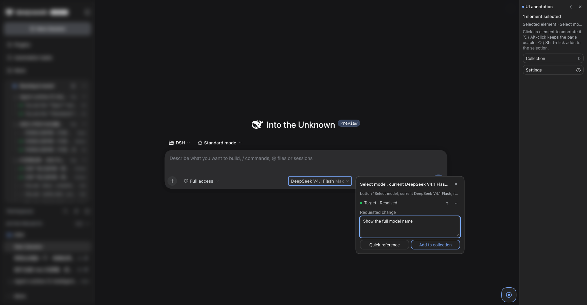
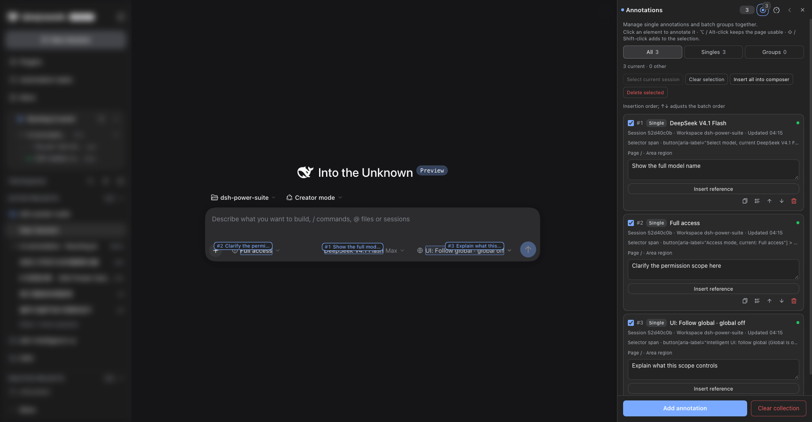
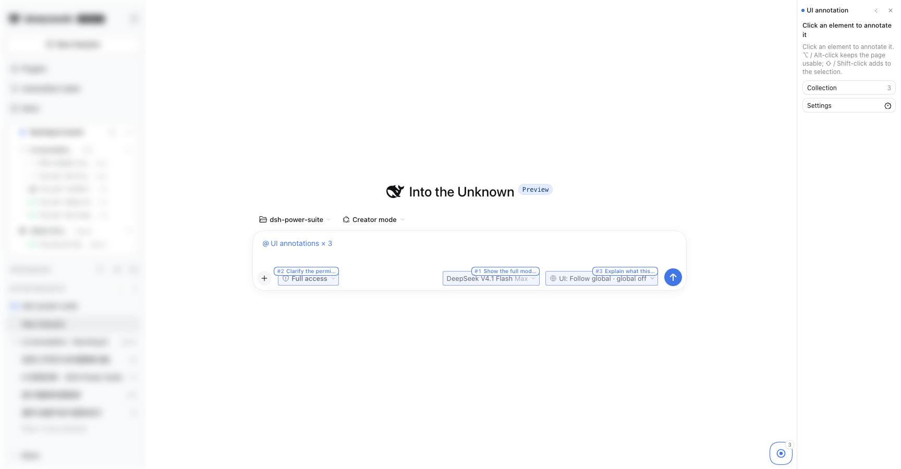

# UI element annotation

A DSH Power Suite feature: a floating launcher that turns the Web GUI into a
point-and-click annotation surface. While the mode is on, the page makes room for
a narrow right rail, hovering the interface outlines the element under the
pointer, and clicking one opens a small note popover. A selected element can be
inserted into the current Session's composer as a plain-text reference, alone or
as one ordered batch for several elements. The mode only inserts text: it never
edits the page's content elements, never reads form values, and never sends the
message.

## What it does

- **Launcher** — a round entry button, draggable to any corner, that toggles the
  mode. Dragging never toggles it, and its position is remembered.
- **Mode layout** — the page shrinks by a responsive right rail; on narrow
  viewports the rail overlaps the right edge instead of squeezing the page, and
  can collapse to a narrow strip.
- **Selection** — hover highlights the candidate element, a click selects it for
  good, and the popover can step up or down the ancestor chain when the first
  candidate is too small or too large.
- **Multi-select** — the multi-select modifier toggles membership on click, or a
  modifier-held drag draws a box that selects everything inside it.
- **Pass-through** — holding the pass-through modifier gives the page its real
  native mouse behavior back, for the left and right buttons, without leaving the
  mode.
- **Note popover** — element name, locator summary, live resolution status, an
  ancestor lever, a note field, and two paths: insert one reference into the
  composer, or add the element to the collection.
- **Collection** — an ordered list held in the rail with per-entry notes, delete
  and re-locate actions, and a batch insert that produces one structured request
  for the model.
- **Insertion** — references go into the current composer through the shell's own
  insertion API, preserving the existing draft and caret, one undo step, and
  never sending the message.

## Turning the mode on

The launcher is a round floating button with an annotation glyph, bottom-right by
default. Click it to toggle the mode on or off; its accessible name states the
action and its pressed state follows the mode.


- **Drag** the launcher to move it. A drag never toggles the mode, and the
  position is clamped inside the viewport with an 8 px margin on drag end, on
  window resize, and on mode change.
- The launcher position is stored in the browser, so a page reload puts the
  button back where it was. The mode itself starts off on every page load.
- While the rail is open, the launcher is moved just left of the rail's column
  so it cannot sit under the rail or its footer controls.
- While the mode is off, the page has no capture listeners and no injected
  layout: only the launcher stays. One window resize handler remains installed
  for the plugin's lifetime by design, so the launcher stays clamped inside the
  viewport even in idle.
- A count badge appears on the launcher when the collection has entries, so the
  mode's state is visible before opening it.

## Mode layout

With the mode on, the page makes room for a **constant narrow right tool rail** in
a strip freed from the right edge instead of covering the conversation.


- The rail width is `clamp(188px, 11.6vw, 236px)` — about 200 px at a 1728 px
  viewport — and it holds the rail content, not the page.
- The layout shrinks by setting the shell frame's `padding-right` to the rail
  width. The frame's content box shrinks: the left sidebar keeps its width while
  the conversation column and the native right sidebar give up the rail width,
  so the rail occupies the **rightmost strip, right of the native right column**
  (the padding moves the page content left; the rail itself is `position: fixed;
  right: 0`). The shell's `.pI_x6G_overlayLayer` is `position: absolute; inset: 0`
  inside the padded frame's **padding box**, so it does **not** span the rail
  strip; native content therefore does not paint under the fixed rail. This is a
  padding change, not a CSS transform: the page stays crisp and its own scrolling
  and hit testing keep working.
- The padding change is animated with a 180 ms ease transition, disabled under
  `prefers-reduced-motion`.
- **Narrow viewports** switch to an overlay layout: when the space left after the
  two native sidebars and the rail would fall below 560 px, the page is not
  squeezed, the rail floats over the right edge with slight elevation, and it can
  be collapsed to a 48 px strip. Annotation features stay available in both
  layouts; they never silently disappear.
- The rail header carries the feature title, a status dot, the collapse toggle,
  and the exit control. Its content area scrolls internally. The footer holds the
  actions that belong to the current view.
- Three views swap in place: **status**, **collection**, and **settings**. Opening
  or closing collection/settings only changes the rail's inner content — never the
  frame width, padding, or page layout. There is no wide drawer over the canvas.
- While annotation mode is active, the whole prompt-history rail family from
  this same plugin ([prompt-history.md](prompt-history.md)) is hidden — the rail,
  its search card, hover preview card, divider, and search toggle — so the two
  right-edge surfaces cannot overlap. Normal (annotation-off) mode is
  unaffected.
- **Exit** the mode with the rail's exit control, the launcher, or Esc. The
  original layout comes back exactly: the frame's previous inline `padding-right`
  and rail-width property are restored, or removed when the plugin added them;
  the frame marker is cleared after the short transition; and the rail DOM is
  removed.

### Rail status view

The rail's default **status** view reports what the mode would act on:

- while idle: `Click an element to annotate it`, a short hint that names the
  current pass-through and multi-select modifiers, and the **Collection** (with
  its count) and **Settings** entries;
- with one element selected: `1 element selected`, a secondary line naming the
  selected element, and the **Collection** and **Settings** entries — the note
  popover is open at the same time, and adding lives there;
- with several elements selected: `{count} elements selected`,
  **Add {count} to collection**, **Clear selection**, then the **Collection** and
  **Settings** entries.

Collection and settings replace the rail's body in place. Each view has a back
control to the status view, and Esc also returns to the status view from either
view.

## Selecting elements

Hovering the page in mode draws an outline around the element a click would
select. The first click selects that element, keeps a persistent highlight, and
opens the note popover.

- **Candidate choice** walks the pointer target's ancestor chain and prefers the
  nearest meaningful control or container — buttons, links, inputs, rows, menu
  items, regions, headings, list and table cells, and other semantic surfaces —
  over a bare text leaf or an anonymous wrapper. Our own UI nodes, the root
  elements, zero-size or hidden elements, and the composer's editable internals
  are skipped; a hit inside the composer resolves to the composer region, never
  to the typed text. When no semantic candidate matches, the nearest element with
  a real box is used.
- **Hover hot path** — the pointer chain collects **elements only** (up to 16
  ancestors). Element descriptors are built lazily only for the chosen element
  and at most **2 context ancestors**, so a hover performs **0 `textContent`
  reads** and a bounded amount of work; the E2E measurement records the bounded
  descriptor build rather than per-move descriptor construction.
- **Ancestor adjustment** — the popover's up/down control moves along the
  candidate's ancestor chain, clamped at both ends, and re-derives the reference
  at each level. This is for choosing the right granularity: an icon instead of
  its button, or a card instead of one row.
- **Selection highlight** follows the page on scroll and resize. It is
  recomputed in one animation frame, and no animation loop runs while nothing is
  selected.
- **Esc** steps out one layer at a time:
  1. an active note edit ends and keeps the popover and its text;
  2. the current selection clears and its popover closes;
  3. the mode turns off and the original layout returns.

  When the collection or settings view is open, Esc returns to the status view
  before the mode can be exited; an expanded note editor or an in-progress
  marquee also closes on Esc.
- **Interaction isolation** — while the mode is active and not passed through,
  the pointer events that could drive the page are consumed in the capture phase:
  `pointerdown`, `mousedown`, `pointerup`, `mouseup`, `click`, `auxclick`,
  `dblclick`, `contextmenu`, and `dragstart`. A native control under the pointer
  therefore cannot react; for example, clicking **New session** selects the button
  and does not create a Session. Wheel/touch scrolling, typing, IME composition,
  and browser keyboard shortcuts are untouched, and the page stays readable.
- **Page content is never modified** by selection, annotation, or insertion. The
  feature reads layout and labels and inserts text; it does not edit the page's
  content elements, files, or Session logs. Its own UI, the prompt-rail style,
  and the temporary frame padding change are cleaned up on exit.

### Multi-select and marquee

The multi-select modifier (Shift by default) switches clicks from "select one" to
"toggle membership". A click with the modifier adds or removes that element
without opening the note popover while more than one remains selected; when the
toggle leaves exactly one element, that element becomes the single selection and
its popover may open. With more than one selected, the rail's status view shows
the count with **Add {count} to collection** and **Clear selection**.

A drag with the modifier held starts a **marquee** once it moves about 4 px: a
selection rectangle is drawn over the page, the pointer events under it stay
blocked, and on release the intersecting candidates are added, de-duplicated by
element identity, with nested duplicates collapsed. The marquee is bounded to
the **24 most specific** intersecting candidates (not every intersecting
element). A plain drag without the modifier does not start a marquee; it stays a
click/selection interaction, and wheel scrolling keeps working normally.

### Pass-through

Hold the pass-through modifier (Alt/Option by default) to give the page its real
native mouse semantics back for as long as it is held:

- the pointer no longer selects or highlights, and the cursor returns to normal;
- a left click performs the element's real native action;
- a right click opens the browser's or the page's native context menu;
- the plugin never synthesizes a click or a menu — the original events simply
  reach the page.

Releasing the modifier returns to annotation behavior. Pass-through state is
reset on window blur, so a modifier held during a focus change cannot leave the
page in the wrong mode.

## The note popover

Clicking a single selected element opens a compact popover near it. It is
draggable by its header, clamped inside the viewport with an 8 px margin, and kept
left of the rail when there is room. It is 320 px wide. On window resize a
**pinned** (dragged) popover keeps its dragged offset and is re-clamped just
enough to stay on-screen; an unpinned popover is re-clamped against the anchored
element.



It shows:

- the element **name** and a short **locator summary** (the tag, its accessible
  name, and the most reliable selector candidate);
- the live **resolution status**, shown as Resolved, Matches several, No longer
  resolves, or Content changed (see [statuses](#re-resolution-statuses));
- the ancestor **Parent element** / **Child element** controls;
- the **Requested change** field (a compact textarea, about three rows) with its
  placeholder, saved as you type. The note is normalized with
  `normalizeUserNote`: CRLF/CR becomes LF, NUL/C0 control characters other than
  tab and newline are removed, and internal spaces and line breaks are preserved
  — it is **not redacted and not truncated**. Both serializers insert it
  verbatim, so a multi-line note is inserted as multi-line content (and can
  exceed the single-line label layout); page-derived text still goes through the
  sanitizer below;
- **Quick reference** — inserts this one annotation into the current Session's
  composer at the caret, preserving the existing draft and caret position, one
  undo step, and never sending the message;
- **Add to collection** / **Update collection** — the label and state follow
  whether the element is already in the collection. Adding does not touch the
  composer.

With no Session composer mounted (for example on the Start page), insert actions
are unavailable: the collection view shows **Open a session before inserting a
reference** under its rows and hides the generic other-session skip line, and a
single insertion attempt reports the same message. The launcher, rail, selection,
and collection still work there.

Adding an element shows **Added to the collection**. Re-adding the same element
from the popover keeps the original position in the list and shows **Updated the
existing collection entry**: a non-empty note replaces the stored one, while an
empty note preserves the note already saved for that entry. It never creates a
duplicate.

## The collection

The collection view replaces the rail's status content in place — same narrow
width, internal scroll, no wide drawer. Rows are ordered and numbered, and each
row shows the element name, the locator summary, and its per-entry note; a row
whose origin Session is the current Session also shows its resolution status,
while an other-session row shows the **Other session** badge instead. When the
collection is empty the view shows **No annotated elements** with the hint
**Select an element, write a note, then add it to the collection.**



- **Order** — entries stay in the order they were added. Re-adding an element
  updates it in place, so order reflects first selection.
- **Notes** — edit a row's note inline. A long note gets an expand control that
  opens a temporary 300 px floating editor beside the rail; it edits live and
  closes on its close control, on blur, or on Esc, and it never changes the canvas
  width. The inline note editor grows with its content up to 72 px and scrolls
  beyond it.
- **Remove** removes one entry and reports **Removed from the collection**;
  **Clear** empties the list in one click with no confirmation dialog and reports
  **Collection cleared**.
- **Re-locate** scrolls a still-resolving element into view, flashes its
  highlight for about 600 ms, and reports **Moved to the element**. If the
  element no longer resolves, the action reports **The element cannot be located
  ({status})** instead of failing silently. Other-session entries refuse the
  action with **This annotation belongs to another session** because their DOM
  belongs to a different placement of the page.
- **Insert all into composer** produces one ordered batch (see
  [insertion format](#batch-request-collection)). The control is disabled while
  the collection holds no entry for the current Session; the rail explains why
  with its scope notice or no-session notice instead of a click-time error.
- The collection view's header area shows the total count, so the rail's status
  view and launcher badge agree with the list.

### Session scope

The collection belongs to the browser page, not to one Session. It survives
Session switches, and every entry records the Session it was created in.

- Entries whose origin Session is the current Session are **current-scope** rows.
- Entries from another Session carry an **Other session** badge in the
  collection and are **excluded from batch insert**. The collection reports
  `{count} from other sessions will be skipped`, and the batch header states how
  many were skipped.
- Switching back to the origin Session makes those entries current again.
  Nothing is deleted on a switch.
- The collection is held in memory for the page lifetime. A page reload clears it;
  it is not written to the Host, a Session log, or storage. This is deliberate:
  annotations are a scratch list for the request being composed.

### De-duplication

Entries are identified by a stable locator key derived from the element's most
reliable selector, so selecting the same element twice is an update, not a second
row. A stable DSH attribute such as `data-row-key="session:<uuid>"` keeps its
identity, and a locator that only has an accessible label includes structural
context in its key so two same-label controls stay distinct. De-duplication is
scoped by Session: the same locator reached from two different Sessions produces
two entries, because it belongs to two different placements of the request.

### Re-resolution statuses

Every reference is re-resolved against the live document when it is shown and
inserted, so a stale annotation is visible before it is used:

| Status | Meaning | Marker line |
|---|---|---|
| Resolved | Exactly one element matches the candidates and its text is unchanged. | none |
| Ambiguous | More than one element matches the candidates. | `Status: target matches more than one element (locator only)` / `状态：目标匹配到多个元素（仅保留定位信息）` |
| Missing | No element matches any candidate any more. | `Status: target no longer resolves (locator only)` / `状态：目标已无法定位（仅保留定位信息）` |
| Changed | The element still matches but its text is different from the annotation. | `Status: target content changed` / `状态：目标内容已变化` |

Both insertion paths mark a non-resolved target: a single reference adds the
line after its `Note` line (making it five lines instead of four), and a batch
item adds it indented under that item's `Note` line. Only the reference text and
the recorded locator are inserted; the plugin never
modifies the page to fix a stale reference. Re-locate works only for a resolved
element and explains why when it cannot.

Change detection compares an 8-hex lowercase digest of the whitespace-collapsed
sanitized text (derived data only; the raw page text is not stored, and the
digest is empty for live input surfaces) and the captured accessible name with
the live element, so a content or label change is reported as **Content changed**
even when the captured text itself was empty or truncated.

## Insertion format

Both insertion paths write plain text into the current Session's composer,
through the shell's own semantic insertion API, using the active UI language.
Inserted text is placed at the caret (or the captured insertion point) and the
rest of the draft is preserved; the insertion is one undo step, focuses the
composer afterwards, and is never sent automatically.



### Quick reference (single element)

English:

```text
UI annotation · <name>
Reference: <locator summary>
Session: <session short> · <HH:MM>
Note: <note or "—">
```

Chinese:

```text
UI 标注 · <name>
定位：<locator summary>
会话：<session short> · <HH:MM>
备注：<note or "—">
```

`<session short>` is the session-identifying part of the Session id: the
`session-` prefix is dropped and the first 8 alphanumerics are used, so
`session-c5864acd…` becomes `c5864acd`. `<HH:MM>` is the local 24-hour time when
the reference was captured. An empty note is written as an em dash so the line
always has a value. The block ends with a trailing newline. The feedback message
confirms: **Inserted into the current session composer (not sent)**; a failed
insertion reports **Could not insert into the composer**.

A single reference to a stale target gains a fifth line, for example:

```text
UI annotation · Old toolbar
Reference: div "Toolbar" · [data-testid="toolbar"]
Session: c5864acd · 09:12
Note: Align the actions to the right edge
Status: target no longer resolves (locator only)
```

### Batch request (collection)

**Insert all into composer** in the collection view produces one numbered,
ordered request. Items follow collection order; current-scope entries are
included and other-scope entries are omitted with a skip line that states the
count. A non-resolved entry keeps its block and adds an explicit status line.

English, with a skipped cross-session entry and one stale target:

```text
Please adjust the UI elements below. Each item lists its reference and the requested change.
(1 annotation(s) from other sessions skipped)

1. New session
   Reference: button "New session" · [aria-label="New session"]
   Note: Make this button sticky in the header

2. Artifacts
   Reference: button "Artifacts" · [role="tab"]
   Note: —

3. Old toolbar
   Reference: div "Toolbar" · [data-testid="toolbar"]
   Note: Align the actions to the right edge
   Status: target no longer resolves (locator only)
```

Chinese uses the same structure with the localized title, field labels, skip
line, and status line:

```text
请调整以下 UI 元素，每项都附有定位和修改说明。
（已跳过 1 条来自其他会话的标注）

1. 新建会话
   定位：button "新建会话" · [aria-label="新建会话"]
   备注：把这个按钮固定在标题栏

2. 会话产物
   定位：button "会话产物" · [role="tab"]
   备注：—

3. 旧工具栏
   定位：div "工具栏" · [data-testid="toolbar"]
   备注：把操作对齐到右侧
   状态：目标已无法定位（仅保留定位信息）
```

The block ends with a trailing newline. The same feedback message confirms the
insertion, and the composer keeps focus so the human can edit before sending.

## Settings

The rail's **settings** view holds the two interaction modifiers. Both apply
immediately, and the key handlers always read the current values.

| Setting | Default | Choices | Purpose |
|---|---|---|---|
| Pass-through modifier | ⌥ / Alt (`alt`) | `⌥ / Alt`, `Ctrl`, `⌘ / Meta`, `⇧ / Shift` | Hold to hand mouse actions back to the page |
| Multi-select modifier | ⇧ / Shift (`shift`) | `⌥ / Alt`, `Ctrl`, `⌘ / Meta`, `⇧ / Shift` | Toggle selection on click, or drag a marquee |

The two modifiers must never be equal. Setting one to the other's current value
applies the new value and moves the other modifier to a different choice; the
settings view names the moved field and its new value, and an equal pair is never
stored. Missing or unreadable stored values fall back to the defaults.

Storage is browser-local and has three separate keys under the
`power-suite.ui-annotation.` prefix:

- `power-suite.ui-annotation.settings` — the JSON settings document, holding only
  the two modifier ids;
- `power-suite.ui-annotation.launcher` — the launcher position as JSON
  `{ "x": <number>, "y": <number> }`;
- `power-suite.ui-annotation.rail-collapsed` — the rail's collapsed flag
  (`true` or `false`).

The mode itself is not persisted: a page reload starts with the mode off while the
launcher and rail state come back.

These settings are **not** part of the suite's Plugins-page settings section and
are not stored in the Host. The Plugins page holds the Host-side preferences
(prompt-history modifier, Dynamic Workspaces retention windows — see
[settings.md](settings.md)); annotation settings are per browser profile and are
not synced to another browser or device.

## Host boundaries

The feature is **browser-only**. It adds no Host route, no Host service, no
Session-log write, and no profile change; the browser half observes the live page
and inserts text through the composer that is already mounted.

- **Shadow DOM** — an element inside a shadow tree resolves to its shadow host.
  Shadow internals are neither inspected nor selectable, so a reference always
  points at a host the page exposes.
- **Cross-origin iframes** — not selectable. Their contents are outside this
  document; the iframe element itself is ordinary DOM and can be selected.
- **Native input values** — `<input>` values, `<textarea>` contents, and
  contenteditable contents are never read, copied, or serialized. An editable
  element is described by its role, tag, accessible name, and selector
  candidates, never by what is typed in it.
- **Sensitive attributes** — attribute names that look like
  `token`, `secret`, `password`, `passwd`, `authorization`, or `cookie` are
  dropped. Values are sanitized for known secret shapes: ASCII email addresses,
  `sk-…` keys, long unbroken base64/hex strings, case-insensitive `sk-` and
  `bearer ` prefixes, AWS access-key IDs, and JWT triples. The element's `id` is
  sanitized at the same boundary before it can become a selector candidate, so
  an `id` in one of those shapes is not used as a locator or identity key;
  unicode emails and arbitrary unknown secret shapes are not claimed to be
  recognized. Known DSH data attributes keep their namespaced and UUID values
  (for example `data-row-key="session:<uuid>"` and
  `data-conversation-session="session-<uuid>"`), because those are stable
  identities rather than opaque secrets. Text summaries are whitespace-collapsed,
  stripped of control and zero-width characters, redact the sanitizer's email,
  bearer, `sk-`, and long-token patterns, and truncate to 80 characters with an
  ellipsis.
- **Canvas-rendered content** — has no DOM target, so it has no DOM candidate and
  is not selectable. The feature never reads pixels.
- **Portals** — body-level DSH menus, popovers, and dialogs are ordinary DOM, so
  they are selectable like any other surface.
- **Native right sidebar and modals** — the rail lives in the strip the shrink
  layout frees, left of the native right column. A native modal or dialog surface
  stacked above the rail can cover it; close the native surface to continue.
- **Browser-extension DOM** — injected extension nodes are ordinary DOM and are
  selectable, but they are not DSH product UI; a reference to one points at that
  node only.

## Architecture

The feature is one region inside the plugin's single browser entry. It has no
Host counterpart: nothing is added to `src/index.js`, `src/features/`, or the
package manifest.

- **One region, one installer** — `//#region feature: ui element annotation` in
  [`src/client.js`](../src/client.js), installed by `installUiAnnotation(ctx)`
  from the entry's `apply()` inside `ctx.effect`. An install guard makes a
  reconnect/HMR install idempotent: one launcher, one set of listeners.
- **Two seats** — a `shell.overlay` seat (`AnnotationOverlay`) renders the
  launcher, rail, popover, and highlight layers; a renderless
  `conversation.input.overlay` seat (`AnnotationSessionSeat`) keeps the module's
  bridge (`sessionId`, `inputActions` — the slot contract passes **no** `draft`
  prop) current for the Session on screen and notifies the controller. The
  composer itself remains the source of truth for the live draft/caret.
  Feature copy is registered under the `powerSuiteAnnotation` namespace and
  bound once with `ctx.locale.bind`, so both the overlay and the controller
  localize through the same binding.
- **UI stack** — React elements via `React.createElement` for the rail, launcher,
  popover, and highlight rectangles; an imperative controller for DOM listeners,
  hover geometry, marquee, layout changes, and insertion; a tiny observable store
  (`getSnapshot`/`subscribe`) connects them. No second state library.
- **Theme** — only shell `--dsw-alias-*` tokens, inline Remix Icon glyphs, no new
  packages, and one injected `<style data-power-suite-css="ui-annotation">` tag.
  Class names are `psa-*` and DOM attributes are `data-psa-*`; every feature UI
  node is inside a `data-psa-own` **ancestor** (the marker guarantees exclusion
  even though not every node carries the attribute literally).
- **Selector escaping** — candidate selectors use `globalThis.CSS` when
  available and a small fallback otherwise; the fallback escapes a leading digit
  as a hex escape (`#123abc` → `#\31 23abc`) rather than producing an invalid
  selector.
- **Coexistence with the Project page** — the Project page dispatches
  `power-suite:ui-annotation-exit` when it opens, so annotation deactivates; the
  launcher is hidden under `html[data-power-suite-project-page="true"]`, and the
  page's Esc ladder closes the page first (the launcher returns with annotation
  still off). Annotation is **not usable while the Project page is open**.
- **Layout** — the frame's `padding-right` plus a CSS transition, never a CSS
  transform. The exact layout mode is recomputed (debounced) on resize:
  `innerWidth - sidebarWidth - railWidth >= 560` shrinks, otherwise the rail
  overlays. The rail-collapsed flag and launcher position are persisted; the
  computed rail width is not.
- **Composer insertion** — `inputActions.captureInsertion()` captures
  `{ start, end, draftRev }`, then `inputActions.insertText(text, span)` inserts
  without replacing the draft, in one undo step, returning a boolean and never
  sending. This is the shell's semantic API, not a DOM setter or a synthetic
  `input` event. The composer is focused afterwards.
- **Explicit state machine** — one pure reducer with the phases
  `off | idle | inspect | selected | multi | collection`, a settings view flag,
  and transient `passThrough`, `boxing`, `draggingLauncher`, and
  `draggingPopover` states. Every transition is an action
  (`activate`, `deactivate`, `hover`, `selectSingle`, `toggleMulti`, `setMulti`,
  `setNote`, `beginEdit`, `endEdit`, `openView`, the collection actions,
  `passThrough`, `box`, `feedback`, `session`, `exitOne`); deactivation from any
  phase is one code path that restores layout and state.
- **Two lifecycle boundaries** — exiting the mode removes the mode-scoped
  capture listeners and gesture listeners, restores the layout exactly, removes
  the rail, popover, and highlight DOM, and clears hover, selection, and box
  state. The plugin disposer additionally removes the always-on launcher resize
  handler, the injected style tag, the hidden prompt-rail rule, React roots,
  remaining rAF loops and timers, and all markers. Unloading therefore leaves
  the page as it found it.
- **Bridge tolerance** — a mount without a composer (Start page, no Session)
  leaves the launcher/rail and collection usable; only insert actions are
  disabled, with a notice to open a Session first.
- **Test seam** — at the end of the factory, when
  `globalThis.__POWER_SUITE_TEST_HOOKS__` exists (set only by the test harness
  and the E2E injector), the factory publishes its pure helpers under
  `__POWER_SUITE_TEST_HOOKS__.uiAnnotation`: settings normalization and modifier
  conflict resolution, text/attribute sanitizers, selector candidates,
  `buildElementRef`, a deterministic text digest, a DOM node resolver, locator
  descriptions, the reducer, quick-reference and batch
  serializers, `batchScopeSplit`, `resolveRefStatus`, position clamps, rail width
  and layout mode, and the collection list helpers. Production never defines the
  flag.

The visible DOM carries stable markers used by the E2E harness and by cleanup:
`html[data-psa-active]`, `[data-psa-frame]`, `[data-psa-rail]`,
`[data-psa-launcher]`, `[data-psa-layer]` with `[data-psa-hover]`,
`[data-psa-selection]`, `[data-psa-multi-outline]`, and `[data-psa-box]`,
`[data-psa-popover]`, the collection rows under `[data-psa-entry]` (including
`[data-psa-entry-note-editor]`, their `data-psa-status` values, and the
`data-psa-status="other"` state for other-session rows), the no-session notice
`[data-psa-no-session]`, the
multi-select action `[data-psa-add-multi]`, the settings controls
`[data-psa-setting-passthrough]` / `[data-psa-setting-multi]` with
`[data-psa-settings-feedback]`, and the feedback toast `[data-psa-feedback]`.
While the pass-through key is held,
`html[data-psa-passthrough="true"]` switches the cursor, and the re-locate action
sets `[data-psa-flash="true"]` on the target highlight for about 600 ms. The
`<style data-power-suite-css="ui-annotation">` tag is injected once while the
plugin is installed, and its mode-dependent rules act only while
`html[data-psa-active]` is set.

## Testing and verification

Pure logic is covered by Node's test runner (**57** cases); live behavior is
exercised by a pre-merge acceptance harness, but **not every interaction has a
single full-green live run** (see below and
[verification.md](verification.md)).

```bash
npm test            # node --test test/*.test.js
npm run check       # syntax + manifest + tests
```

The annotation model has its own suite,
[`test/ui-annotation.test.js`](../test/ui-annotation.test.js), materialized with
the shared harness [`test/helpers/client-module.mjs`](../test/helpers/client-module.mjs):
it loads the browser entry, provides DOM stubs, sets the test-seam flag, and
reads `uiAnnotation` back without a browser. The tests cover settings and the
modifier conflict, sanitization and attribute filtering (including sensitive
`id` values and the known DSH stable-attribute allowlist), selector candidate
order and identity stability (including same-label, different-path keys),
reference building for buttons/rows/regions/inputs (no values), the state machine
and Esc ladder (including ending an active note edit), collection de-duplication
and empty-re-add note preservation, immutability, session scoping and notes,
quick-reference and batch serialization (ordering, numbering, the empty-note and
status markers, the other-session skip line, and the ZH label conventions), the
resolution statuses (including digest-based change detection), and the
launcher/popover clamps and rail-width thresholds.

The live acceptance harness is
[`test/browser/annotation.e2e.mjs`](../test/browser/annotation.e2e.mjs), a
dependency-free Node script that drives local Chrome over CDP. Run it from the
repository root against a running GUI:

```bash
node test/browser/annotation.e2e.mjs            # smoke + 9 scenarios + screenshots
node test/browser/annotation.e2e.mjs --smoke    # pipeline smoke only
node test/browser/annotation.e2e.mjs --scenario 4 --no-shots   # one scenario, no captures
```

It opens the real DSH Web GUI with a fresh Chrome profile (`--user-data-dir`),
injects this checkout's `src/client.js` in place of the installed bundle for that
page, and runs the acceptance scenarios with real CDP mouse and keyboard input at
a 1728 x 900 viewport. The installed plugin, the user profile, and the launchd
service are never modified. The recorded acceptance evidence is **pre-merge**
(final publication build `10dd3b72…` / branch commit `fd8ccc9`); the merged build
(`572b8fa1…`) was **not re-run** through the harness — after the merge only an
installed-page smoke checked the launcher and rail markers, and the round-3 audit
fixes (note normalization, lazy hover) are unit-tested rather than re-covered by
E2E. The evidence exists
as in-repo summaries plus `/tmp` logs that are external development artifacts,
not repository files.

- Prerequisites: Node 22 or newer (global WebSocket), Google Chrome (override the
  binary with `CHROME_BIN`), and the DSH Web GUI running as
  `com.rexxin.dsh-web`. The token URL comes from `DSH_WEB_URL`; when it is unset
  or carries no token, the script resolves it with `~/.local/bin/dsh-web url
  --ip`. There is no npm install and no dependency to add.
- Other modes: `--shots-only` captures the screenshots without assertions,
  `--assets` writes them to `docs/assets/` (the default is a temporary
  directory), `--client <path>` injects an alternate client file, `--scenario N`
  or `--from N` runs a subset, `--no-shots` skips captures, `--headful` shows the
  browser, and `--keep-open` leaves Chrome running for inspection.
- Gate semantics: the exit code is `0` only when every check passes; `1` for any
  scenario failure, page error, real network/API failure, missing scenario row,
  feature-gate failure, or harness fatal error; `2` only for usage/argument errors
  (`--scenario 10`, `--from 10`, a missing value). A failed `Network.enable` is a
  gate failure (exit 1), not a usage error. `--smoke` is pipeline-only but still
  fails when the injected client cannot load, does not expose a documented seam
  generation (round-1 31 keys with `textDigest`; the current generation is 32
  with `resolveNodeCandidate`), or does not mount the annotation surface. `full` and `--shots-only` with a feature-absent client
  record a **FAIL** row and exit non-zero; every requested scenario must produce
  a result row.
- Blank Session and privacy preconditions: before any capture or interaction the
  harness requires all of these at once — a `[data-conversation-session]` root,
  `[data-conversation-region="composer"]`, a Lexical
  `[data-lexical-editor="true"]` inside it, the Chat view
  `[data-conversation-region="chat"]`, zero transcript messages, zero turns, an
  empty composer draft, and no draft attachments. Otherwise it creates a
  genuinely fresh blank Session through the native "New session in <workspace>"
  hover action and aborts explicitly if that is impossible; it never types into a
  non-blank Session. The non-blank-auto-restore branch is implemented but **was
  not triggered in this environment** (the restored draft was always blank), so
  there is no live evidence for it. Every capture is made with the privacy guard
  applied and asserted (blur on the native sidebar and conversation header, plus
  a blur/hide shield over the conversation content; the composer and annotation
  rail stay crisp), and it checks the 1728 x 900 frame, a right-anchored rail, the
  launcher clear of the rail footer, and the popover fully inside the viewport.
- Side effects: each run launches throwaway headless Chrome and creates or reuses
  blank Sessions in the live GUI through the native New Session control. Every
  Session the harness opens or creates is tracked once and printed with the
  reason it was touched — including the one reopened in scenario 7, the second
  blank Session created in scenario 6, and the Session used for the screenshots.
  No message is sent and no DSH setting is changed. The throwaway profile's three
  annotation `localStorage` keys (`settings`, `launcher`, `rail-collapsed`) are
  cleared before the captures so the screenshots show the default launcher
  position. Chrome and the temporary profile are removed even on failure.
- Mixed-scope coverage: scenario 6 asserts a collection holding one current and
  one other-session entry. The truly removed target must read `missing` and insert
  the explicit `Status: target no longer resolves` line; a row rebuilt by sidebar
  virtualization accepts `missing`, `ambiguous`, `changed`, or `resolved` (that
  tolerance applies to the rebuilt row only). Only the current entry is inserted;
  the skip line's extracted count must equal the other-scope entry count (EN
  `(N annotation(s) from other sessions skipped)` / ZH `另有 N 条…`); a leak check
  over every other-scope entry's name, note, and locator text (tokens of 6+
  characters) proves none of it reaches the composer; and re-locate is invoked on
  the other-scope row's own control, must show `This annotation belongs to
  another session` / `这条标注来自其他会话`, and must not scroll the canvas.
- Network predicate: a failure counts only when the request is same-origin
  http(s) (its origin equals the GUI URL origin) and either a
  `Network.responseReceived` for a `Document`/`Fetch`/`XHR` request has status
  ≥ 400, or any `/api/` or `/plugins` path fails to load; a non-canceled
  `Network.loadingFailed` on a same-origin `Fetch`/`XHR`/`Document`/`Script`/
  `Stylesheet` also counts. Third-party origins, `favicon.ico`,
  `chrome-extension:`/`data:`/`blob:` URLs, and same-origin static requests
  outside the DSH API/plugin routes are ignored and counted as network noise. A
  failed `Network.enable` is reported (`network domain: NOT ENABLED`), records a
  `FAIL gate-network` row, and fails the run.
- Output: a PASS/FAIL table for the scenarios plus collected page errors and
  network failures under that predicate; the script exits 0 only when the smoke
  checks and every scenario pass with 0 page errors and no real network failure.
  The smoke run takes about 5 seconds, `--shots-only` about 35 seconds, and the
  full 9-scenario run 8–10 minutes on the live GUI. Benign DSH-internal telemetry
  WebSocket 403s are printed but do not fail the run (they are neither page errors
  nor real network failures under the predicate). Known evidence limits are
  recorded in [`test/browser/README.md`](../test/browser/README.md) and
  [verification.md](verification.md): after roughly 7 minutes of continuous
  automation the headless renderer can stall real input before a scenario's
  product assertion completes (scenarios 8-9 pass in a short `--from 8` run on
  the same build; the cause is not proven), native context-menu visuals are not
  observable so the oracle is event-level, wheel scrolling is asserted on the
  nearest scrollable region, zero-area picker behavior is unit-tested only, and
  the run is single-device and single-language (ZH copy is unit-tested rather
  than exercised end to end). The final five screenshots come from one logged
  `--shots-only --assets` run whose log path is recorded in the harness README.

[`test/browser/README.md`](../test/browser/README.md) carries the same
prerequisites, options, side effects, and known evidence limits. See
[verification.md](verification.md) for the recorded acceptance results and
screenshot links.

## Install

This feature ships inside [DSH Power Suite](overview.md); install the suite:

```text
plugin_manager action=install_bundle target=/Users/rexxin/Development/dsh-power-suite
```

Because the feature is browser-only, no Host reload is required for it: reload
the Web page after upgrading the package's browser code. The feature adds no
route and no service, so a Host that predates this version still serves it.

Implementation: browser region [`src/client.js`](../src/client.js) under its
`feature: ui element annotation` region, pure model helpers in the same region
and the shared test seam, tests
[`test/ui-annotation.test.js`](../test/ui-annotation.test.js), browser
acceptance `test/browser/`.

## Limits

- **Text insertion only.** References are inserted as plain text; the feature
  never edits the page's content elements, any file, or a Session log. An
  annotation cannot change the UI itself.
- **Page-lifetime collection.** The collection is in memory: a page reload
  clears it. Only the two modifier settings and the launcher position (and the
  rail's collapsed state) are remembered.
- **Browser-local settings.** The two modifiers apply to this browser profile and
  are not synced with the Host or another device.
- **Best-effort locators.** Generated, virtualized, or rebuilt DOM can leave a
  reference missing, ambiguous, or changed; the status is always shown and the
  inserted block says so instead of pretending the target exists. One known grey
  area: a control that is replaced in place by a different control carrying the
  same stable attribute (for example both states of a sidebar collapse toggle
  sharing `data-sidebar-toggle`) still resolves, because the locator identity is
  genuinely unchanged — the captured text helps only when it was recorded.
- **Untouchable surfaces.** Shadow internals, cross-origin iframes, and
  canvas-rendered content cannot be selected; a Shadow host, the iframe element,
  or the canvas element itself can be. Native input values are never part of a
  reference.
- **Covered rail.** A native modal or dialog stacked above the rail can cover it;
  close the native surface and the rail is usable again.
- **No Session, no insertion.** On the Start page without a composer, the
  insert paths report **Open a session before inserting a reference**; selection,
  the rail, and the collection still work.
- **Modifier conflicts are moved, not hidden.** Setting one modifier to the
  other's current key keeps the pair valid by moving the other modifier, and the
  settings view says what changed; an equal pair is never stored.
- **Annotation mode is not accessible by keyboard alone.** The mode is entered
  and driven with the pointer (the launcher, hover, selection, and popover are
  mouse-oriented); keyboard users can use native keyboard shortcuts while it is
  active, but there is no full keyboard navigation path for annotating. This is
  an accepted accessibility limitation, not a hidden toggle.
- **Marquee selection is capped at 24 candidates.** A very large marquee adds
  the 24 most specific intersecting candidates, not every intersecting element.
- **The Project page takes precedence.** Opening the Project page exits
  annotation mode and hides the launcher; the two surfaces coexist only by that
  exit (there is no mixed mode and no z-index negotiation beyond it).
- **Not a full keyboard-navigation path.** The mode is entered and driven with
  the pointer; native keyboard shortcuts keep working while active, but there is
  no keyboard route to annotate an element.
- **No client node-test harness for the pointer chain, flush, or 401/403
  retries.** The hover chain/descriptor laziness and the client sync rules live
  in the browser bundle; they are code-reviewed and (for the chain) covered by
  the E2E measurement, not by `node:test`.
